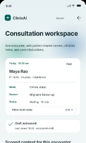
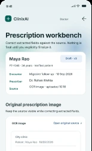
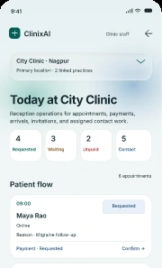
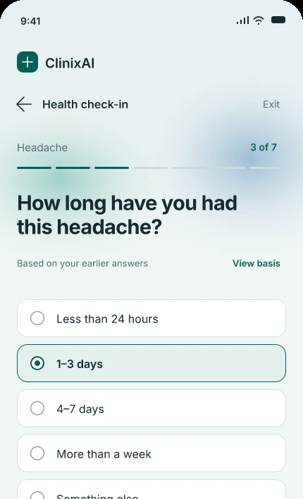
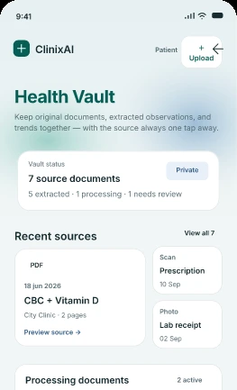
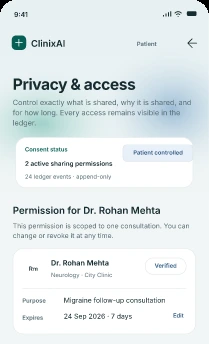
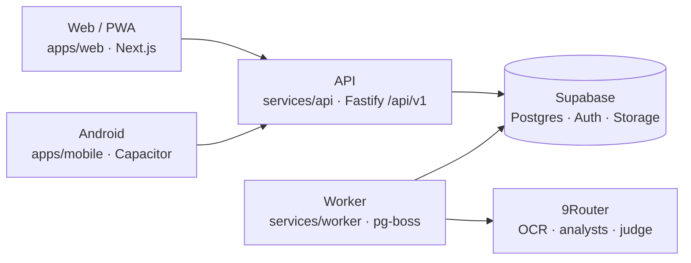

# CliniX AI

A privacy-first personal health record and clinical workflow prototype with three workspaces:

- **Patients** keep a health vault and timeline. They can run an AI check-in and choose exactly what each doctor may see.
- **Doctors** run consultations and issue immutable digital prescriptions. They review OCR and AI drafts before anything becomes a record.
- **Clinic staff** handle arrivals, intake, booking and follow-ups within their practice role.

It runs as a web app, an installable PWA and an Android app. Every AI, OCR and voice output is a draft until a doctor finalizes it.

## UI design previews

| Consultation | Prescription review | Staff dashboard |
| :---: | :---: | :---: |
| [](docs/previews/consultation.webp) | [](docs/previews/prescription-review.webp) | [](docs/previews/staff-dashboard.webp) |

| Health check-in | Health Vault | Privacy ledger |
| :---: | :---: | :---: |
| [](docs/previews/health-check-in.webp) | [](docs/previews/health-vault.webp) | [](docs/previews/privacy-ledger.webp) |



Run the app with your own Supabase project. The web app and API do not require a model gateway for basic workflows; OCR and AI jobs need a running worker and a configured gateway.

## Repository

| Path | Contents |
|---|---|
| `apps/web` | Next.js frontend for all three roles, plus the PWA |
| `apps/mobile` | Capacitor Android shell |
| `services/api` | Fastify API, Drizzle schema and migrations, seed, live gates |
| `services/worker` | OCR and AI analysis jobs |
| `packages/` | Shared Zod schemas and TypeScript config |
| `infra/` | Supabase Storage bucket setup |
| `docs/` | **Documentation: start at [docs/README.md](docs/README.md)** |

## Quick start

Use Node 24, npm 11 and a dedicated Supabase Cloud project with synthetic data only. Follow [local development](docs/operations/local-dev.md) to enable `vector`, create the private Storage bucket and fill in the environment files.

```bash
npm ci
npm run db:migrate
npm run dev:api     # terminal 1, port 4000
npm run dev:web     # terminal 2, port 3000
npm run seed        # terminal 3, after the API is healthy
```

Open `http://localhost:3000`. To try OCR or AI, configure the worker and run `npm run dev:worker` in a separate terminal.

## Checks

| Command | Runs |
|---|---|
| `npm run typecheck` | TypeScript in web, API and worker |
| `npm run lint` | ESLint (web) |
| `npm run test` | Vitest unit tests |
| `npm run test:browser` | Playwright on a mocked dev server |
| `npm run build` | Production web build + service worker |

PWA, live and gate checks are in [docs/operations/testing.md](docs/operations/testing.md).

## Documentation

| Doc | For |
|---|---|
| [docs/README.md](docs/README.md) | The reading map: what to read for each task |
| [docs/codebase-map.md](docs/codebase-map.md) | Where code lives and where to make changes |
| [docs/history.md](docs/history.md) | Decisions: what, why, when, where |
| [docs/status.md](docs/status.md) | What works, and what blocks release |
| [docs/operations/deployment.md](docs/operations/deployment.md) | Self-hosted deployment, Android builds and rollback |
| [CONTRIBUTING.md](CONTRIBUTING.md) | How to contribute |
| [SECURITY.md](SECURITY.md) | How to report vulnerabilities privately |

## Safety rails

- AI, OCR and voice output is **draft-first**. Only a doctor's explicit action finalizes it.
- Finalized prescriptions are **immutable**. A change creates a new version.
- `access_events` is **append-only**, so every sensitive read leaves a record.
- AI payloads carry **no direct identifiers**.
- Demo and seed data are **synthetic only**. Secrets live in gitignored `.env` files. Never commit them.
