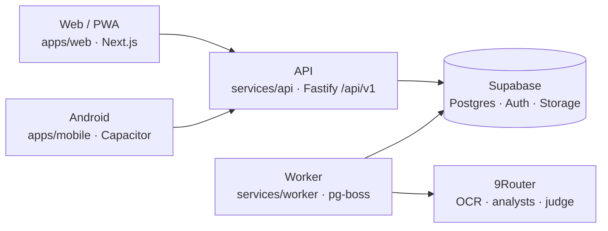

# CliniX AI

A privacy-first personal health record and clinical workflow prototype with three workspaces:

- **Patients** keep a health vault and timeline. They can run an AI check-in and choose exactly what each doctor may see.
- **Doctors** run consultations and issue immutable digital prescriptions. They review OCR and AI drafts before anything becomes a record.
- **Clinic staff** handle arrivals, intake, booking and follow-ups within their practice role.

It runs as a web app, an installable PWA and an Android app. Every AI, OCR and voice output is a draft until a doctor finalizes it.



The web app and API run on Vercel (`bom1`, Mumbai), next to Supabase. The worker runs on Dokploy.

## Repository

| Path | Contents |
|---|---|
| `apps/web` | Next.js frontend for all three roles, plus the PWA |
| `apps/mobile` | Capacitor Android shell |
| `services/api` | Fastify API, Drizzle schema and migrations, seed, live gates |
| `services/worker` | OCR and AI analysis jobs |
| `packages/` | Shared Zod schemas and TypeScript config |
| `infra/` | Dokploy compose, backup image, Storage bucket SQL |
| `docs/` | **Documentation: start at [docs/README.md](docs/README.md)** |

## Quick start

Needs Node 24, npm 11, a Supabase Cloud project and a 9Router endpoint.

```bash
npm ci
cp services/api/.env.example services/api/.env          # fill in the values
cp services/worker/.env.example services/worker/.env
cp apps/web/.env.example apps/web/.env.local
npm run db:migrate
npm run dev            # web :3000 · api :4000 · worker   (or ./run.sh → :12455)
npm run seed           # synthetic demo accounts (API must be running)
```

The full setup, variables and demo personas are in [docs/operations/local-dev.md](docs/operations/local-dev.md).

## Checks

| Command | Runs |
|---|---|
| `npm run typecheck` | TypeScript in web, API and worker |
| `npm run lint` | ESLint (web) |
| `npm run test` | Vitest unit tests |
| `npm run test:browser` | Playwright on a mocked dev server |
| `npm run build` | Production web build + service worker |

PWA, live and gate checks are in [docs/operations/testing.md](docs/operations/testing.md).

## Documentation

| Doc | For |
|---|---|
| [docs/README.md](docs/README.md) | The reading map: what to read for each task |
| [docs/codebase-map.md](docs/codebase-map.md) | Where code lives and where to make changes |
| [docs/history.md](docs/history.md) | Decisions: what, why, when, where |
| [docs/status.md](docs/status.md) | What works, and what blocks release |
| [docs/operations/deployment.md](docs/operations/deployment.md) | Vercel, Dokploy, Android releases, rollback |
| [CLAUDE.md](CLAUDE.md) | Rules for coding agents |

## Safety rails

- AI, OCR and voice output is **draft-first**. Only a doctor's explicit action finalizes it.
- Finalized prescriptions are **immutable**. A change creates a new version.
- `access_events` is **append-only**, so every sensitive read leaves a record.
- AI payloads carry **no direct identifiers**.
- Demo and seed data are **synthetic only**. Secrets live in gitignored `.env` files. Never commit them.
