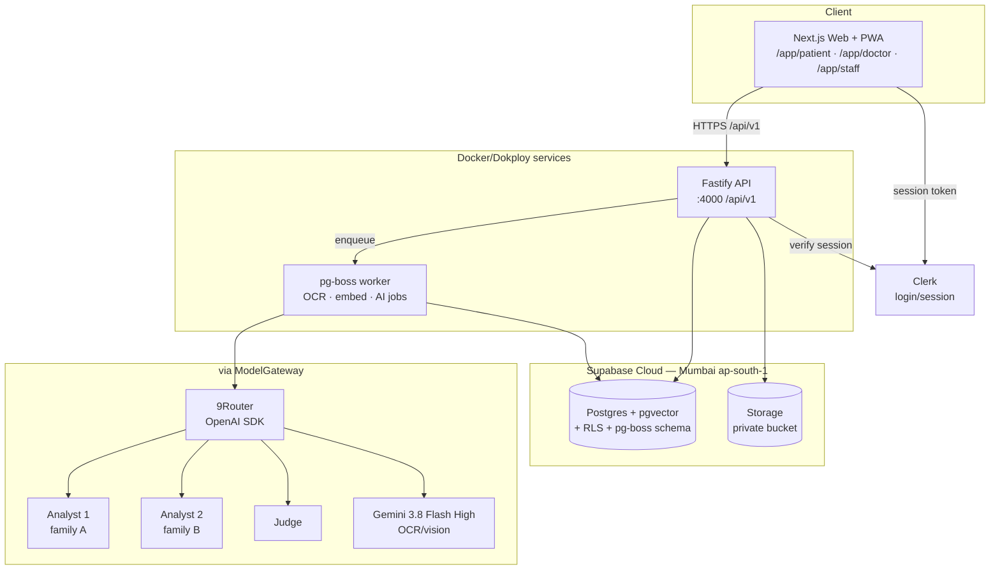

# CliniX AI — Master Build Plan (v2, agent-proof)

## Goal

| Property         | Value |
| ---------------- | ----- |
| Target           | Working web + installable-mobile-PWA prototype of all 30 screens in `SCREEN_CATALOG.md`, a real doctor↔patient clinical loop, multi-analyst AI check-in, Gemini 3.8 Flash High OCR, and a privacy/access-ledger story — jury-ready. |
| Scope            | Patient + Doctor + Clinic Staff workspaces; longitudinal PHR; AI-assisted (non-diagnostic) check-in; document OCR; consent + access ledger; PWA shell. |
| Non-goals        | Payment gateway (manual `payment_status` only), production India-hosted inference, ABDM/ABHA, video-consult provider, real clinical validation, handwriting-OCR accuracy claims. |
| Success criteria | All 30 screens render from Figma fidelity; Test Milestones A/B/C pass end-to-end; privacy ledger + factual-vs-AI separation demonstrable; app installs on a phone. |

## Assumptions (recheck at each phase gate)

1. 4 students, one semester, AI coding agent does the heavy lifting. Demo polish > production hardening.
2. Figma mockups exist and are **visually authoritative**; their file URL arrives from the user in chat (blocker, see Blockers).
3. **Supabase Cloud (official supabase.com) from Phase 0** — Mumbai region `ap-south-1`, one project for dev + demo. No local Docker Postgres.
4. **Clerk official cloud** — dev instance first; production keys only in Phase 8.
5. AI inference via 9Router (`ModelGateway` abstraction); deployed-mode provider is a later adapter swap, not a rewrite.
6. OCR = Gemini 3.8 Flash High (vision) via 9Router pinned route; TeleOCR secondary adapter (only if 9Router vision route fails).
7. Voice dictation (prescription Mode C) = **hypothetical stub** — schema + queue + UI shape, no live mic for demo.
8. Synthetic patient data only through any external AI/OCR path. No real PII, ever.
9. Node 24.21 + npm 11.19 confirmed on the dev machine; npm workspaces (npm 11.19 already present).

## Current-state inventory

| Area | Current state | Evidence / path |
| ---- | ------------- | --------------- |
| Specs | Complete: CONTEXT (50 §), ARCHITECTURE_SPEC, DATABASE_SCHEMA_SPEC (~40 tables), API_CONTRACT_SPEC (~50 endpoints), SCREEN_CATALOG (30 screens), DESIGN (tokens + anti-patterns) | repo root `.md` files |
| Code | None — greenfield | `ls` (only docs; `clinix-ui-prototype/` deleted, staged) |
| Secrets registry | `.sensitive_docs/README.md` (tracked) + `credentials.md` (gitignored, verified via `git check-ignore`) | `.sensitive_docs/` |
| `.gitignore` | Blocks `credentials.md`, `.env*`, `apps/web/.env.local`; allows `.env.example` | `.gitignore` (verified) |
| Plan history | v1 of this plan (superseded by this file) | same path |
| Node/npm | Node 24.21.0, npm 11.19.0; npm workspaces (npm 11.19) | `node -v` / `npm -v` |
| Figma | Account verified: plan `team::1607020207482189625`; **file URL not yet provided** | Figma MCP `whoami` |

## Locked technology decisions (do not relitigate mid-phase)

| Layer | Decision | Detail |
| --- | --- | --- |
| Architecture | **Option A** — two services | Next.js frontend + Fastify backend; **never collapse to Next API routes** |
| Frontend | Next.js (App Router) + TS | `apps/web`; role routes `/app/patient`, `/app/doctor`, `/app/staff` |
| UI | Tailwind v4 (`@theme` tokens) + shadcn/ui + TanStack Query + React Hook Form + Zod | `DESIGN.md` is law; anti-pattern list at `DESIGN.md` §7 |
| Backend | Fastify 5 (TS), Zod everywhere, `/api/v1` prefix | `services/api`; modular monolith, domain folders per `ARCHITECTURE_SPEC.md` §5 |
| ORM | Drizzle + drizzle-kit | migrations in `services/api/drizzle/` |
| DB | **Supabase Cloud Postgres, Mumbai (ap-south-1)** | enable `pgvector` + `pgcrypto` extensions in dashboard; RLS defense-in-depth only — **real authorization in Fastify** |
| Pooling | Use **session pooler** connection string (port 5432) | pg-boss needs session mode; transaction pooler breaks LISTEN/NOTIFY |
| Storage | Supabase Storage, private bucket `clinix-documents` | signed URLs only, never public |
| Auth | Clerk (login/session only) | roles live in Postgres `profiles`; Clerk webhook (or lazy sync) creates profile rows |
| Jobs | pg-boss on same Postgres | `services/worker`; no Redis |
| AI | `ModelGateway` abstraction → 9Router via OpenAI Node SDK | pinned routes; **Analyst 1 and Analyst 2 = different model families** |
| OCR | Gemini 3.8 Flash High via 9Router route `MODEL_ROUTE_OCR` | output always draft (`NEEDS_REVIEW`) |
| Mobile | PWA (manifest standalone, `#12352C` theme, bottom dock, 393px baseline) | not Flutter/Expo |
| Hosting | Dokploy VPS: `web` + `api` compose | Phase 8 only |

## Environment variables (the complete map)

Where every variable lives. Names are final — agent must not invent variants.

### `services/api/.env` (+ copy in `services/worker/.env`)

```text
NODE_ENV=development
PORT=4000
DATABASE_URL=             # Supabase session pooler URI, port 5432, postgres role
SUPABASE_URL=             # https://<project-ref>.supabase.co
SUPABASE_ANON_KEY=
SUPABASE_SERVICE_ROLE_KEY=
CLERK_SECRET_KEY=
CLERK_WEBHOOK_SIGNING_SECRET=   # optional if using lazy profile sync (see Phase 1)
NINEROUTER_BASE_URL=
NINEROUTER_API_KEY=
MODEL_ROUTE_ANALYST_1=     # family A, e.g. a Claude/GPT-class route
MODEL_ROUTE_ANALYST_2=     # family B, MUST differ from ANALYST_1
MODEL_ROUTE_JUDGE=         # strongest available route
MODEL_ROUTE_OCR=           # Gemini 3.8 Flash High vision route
```

### `apps/web/.env.local`

```text
NEXT_PUBLIC_API_BASE_URL=http://localhost:4000/api/v1
NEXT_PUBLIC_CLERK_PUBLISHABLE_KEY=
```

Rules: `.env.example` files carry names only, never values. Values are pasted by the human per `.sensitive_docs/README.md`. Agent never logs or prints env values.

## AI harness integration — how Claude Code plugs in

This is how the coding agent (Claude Code / any harness) is expected to operate across the build:

1. **Specs are the source of truth.** Before each phase, the agent re-reads the relevant spec sections (paths cited below). Conflicts between spec and code → spec wins; conflict between specs → ask the user.
2. **Plans before code.** Each phase starts by writing a detailed phase plan into `code-agent/c-plans/` (in-session), then implements against it.
3. **Figma MCP for screens.** When a screen is implemented, the agent calls `get_design_context` (with `skillNames: figma-design-to-code`) using the user-provided node URL, renders to the design screenshot, and verifies fidelity. Until the Figma URL exists, `DESIGN.md` + `SCREEN_CATALOG.md` §7 govern visuals.
4. **Clerk/Supabase are official cloud** — the agent never self-hosts auth or DB, never invents local substitutes. Missing credential at a gate = stop and ask.
5. **Safety rails the agent must enforce in generated code:** OCR/voice output always draft; `access_events` append-only; finalized prescriptions immutable (new version on change); AI never writes to clinical-fact tables; no direct identifiers in AI payloads; synthetic seed data only.
6. **Verification habit:** after each phase the agent runs the phase's gate commands and reports actual output, not assumptions.
7. **9Router usage note:** the harness may also use 9Router skills directly for auxiliary generation (images for synthetic personas, STT/TTS stubs) — separate from the app's own gateway calls.

## Architecture diagram



## Target monorepo layout (exact)

```text
ClinixAI/
├── apps/web/                    # Next.js App Router (all 30 screens)
│   └── src/app/(patient|doctor|staff)/...
├── services/api/                # Fastify modular monolith
│   └── src/{auth,patients,doctors,encounters,appointments,
│            prescriptions,medications,reports,labs,consent,
│            audit,ai,retrieval,notifications}/
│   └── drizzle/                 # drizzle-kit migrations
├── services/worker/             # pg-boss processors (OCR, embed, AI)
├── packages/schemas/            # shared Zod — THE contract (both sides import)
├── packages/config/             # shared tsconfig, eslint
├── packages/ui/                 # shared shadcn components
├── ai/
│   ├── prompts/                 # analyst_1.md, analyst_2.md, judge.md, ocr.md
│   ├── schemas/                  # analyst/judge/ocr Zod schemas
│   ├── orchestrator/             # three-model flow (API-side import)
│   └── evals/                    # per-subsystem accuracy harness
├── docs/                         # specs moved here (git mv) in Phase 0
├── infra/
│   ├── supabase/                 # SQL for extensions, RLS, storage bucket
│   └── dokploy/                  # compose for web+api
├── .sensitive_docs/              # credentials registry (README tracked)
├── code-agent/c-plans/           # this + per-phase plans
├── .env.example                  # names only
└── .gitignore
```

## Phase-by-phase detail

### Phase 0 — Foundation (no screens)

**Status (2026-10-01):** ✅ Complete — all steps done, gate green. `npm install` clean · `npm run typecheck` pass · `/health` → `db:"up"` · `/app/patient` renders with design tokens · pgvector + pgcrypto enabled.

**Setup steps (agent):**
1. npm 11.19 already installed — no setup step.
2. Scaffold npm workspaces per layout above. `apps/web` = Next.js (App Router, TS, Tailwind v4). `services/api` = Fastify 5 + Zod + Drizzle. `packages/schemas` = Zod package with one trivial shared schema to prove import wiring both directions.
3. `git mv` the six spec `.md` files into `docs/`.
4. **Human:** create Supabase project (Mumbai) → Settings → enable `pgvector`, `pgcrypto` extensions → copy session-pooler `DATABASE_URL` into `.sensitive_docs/credentials.md` + `services/api/.env`.
5. Agent: `drizzle-kit` init, empty migration, run against Supabase → confirms connectivity.
6. Tailwind v4 `@theme` tokens from `DESIGN.md` §2–3: canvas `#F7F2E9`, surface `#FFFDFC`, botanical `#12352C`, ink `#151919`, graphite `#3D4640`, sage `#AFB88A`, copper `#F5934F` (only accent), evidence `#A5C3FF`, review `#A65F11`, critical `#B42318`, hairline `#E6E0D6`; fonts Plus Jakarta Sans + JetBrains Mono; radius 14–22px; spacing 4/6/8/12/16/20/24/32/40; shadows per `DESIGN.md` §4.
7. `apps/web` route `/app/patient` stub shell (header + bottom dock placeholder), `min-height:100dvh`, 393px-friendly.
8. Root scripts: `dev` (concurrently web+api), `build`, `lint`, `typecheck`, `db:generate`, `db:migrate`.

**Gate (must actually run and report output):**
```text
npm install          → clean
npm run dev               → web :3000 + api :4000 both up
curl :4000/health      → {"ok":true,"db":"up"}
npm run typecheck         → pass
:3000/app/patient      → Alabaster bg, Botanical header, Copper CTA, correct fonts
SELECT extname...      → 'vector' present in Supabase
```

**Stop:** all green → commit `phase-0` branch, merge to master.

### Phase 1 — Auth & onboarding (Screens 1, 2, 2a, 2b, 2c, 5)

**Human:** create Clerk application → copy keys per `.sensitive_docs/README.md`.

**Agent:**
1. Clerk `<ClerkProvider>` in web; sign-in/up pages styled to `DESIGN.md` (Page 1, 2).
2. Fastify verifies Clerk session token (`@clerk/clerk-sdk-node` or `clerk-backend-api` verify + JWKS); `GET /api/v1/me` resolves profile from Postgres — **never trusts client-supplied role**.
3. Profile sync: preferred = Clerk webhook (`user.created` → insert `profiles`); fallback = lazy sync on first `/me` call when profile row missing (works without webhook secret — acceptable for prototype; note in code which path is active).
4. Tables (DB spec §4–5): `profiles`, `patients`, `patient_identity` (encrypted via app-layer AES-256-GCM, key from env `IDENTITY_ENCRYPTION_KEY` — add to env map), `doctors`.
5. Screens from Figma (or `SCREEN_CATALOG.md` §7 until URL arrives): 2a (record lookup stub, vault/private-mode choice), 2b (registration number, verification `PENDING`), 2c (invitation accept, role-badged), 5 (workspace switcher via profile menu).

**Gate:** sign up patient + doctor; onboard both; `/me` returns correct role per token; workspace switch persists; 18+ check enforced server-side.

### Phase 2 — Core dossiers (Screens 3, 4, 15, 16, 17, 22)

Tables (DB spec §8, §11): `patient_doctor_relationships`, `encounters`, `appointments` (+ indexes §41). Endpoints (API spec §5, §7, §14): `POST /doctor/patients`, `GET /doctors/{id}/availability`, appointment CRUD, `GET /patients/self/dashboard`, `GET /doctor/dashboard`. Screens per catalog §7: Pages 3, 4, 15 (calendar + availability), 16 (directory + unclaimed filter), 17 (clinical workspace, factual-record only — AI panel arrives Phase 5 as separate container), 22 (add clinic patient with duplicate check via `phone_hash`).

**Gate:** doctor creates unclaimed patient → patient appears in Page 16 + schedule on Page 15 → appointment booked → Page 17 shows dossier.

### Phase 3 — Clinical loop (Screens 10, 11, 14, 18, 19, 20) — **Test Milestone A**

Tables (DB spec §18–20): `prescription_drafts`, `prescription_draft_items`, `prescriptions`, `prescription_versions`, `prescription_items`, `medication_records`, `consultation_notes`, `payment_events`. Endpoints (API spec §15, §19, §23–27): booking confirm/complete, payment-status (manual), prescription draft → finalize (idempotency key; immutable version 1; no AI actor may finalize), amend, render (PDF via `@react-pdf/renderer`), patient view, medication history (CURRENT/PAST/UNKNOWN_STATUS).

Screens: 14 (booking + packet builder with scope summary), 11 (appointments), 18 (consultation workspace, autosave notes), 19 (draft queue — direct-entry drafts only at this phase), 20 (prescription workspace: structured med fields, finalize confirm, print/send), 10 (medication history with "historical ≠ authorization" language).

**Gate — Test Milestone A (must run as script):**
```text
doctor signup → creates unclaimed patient → appointment → encounter →
direct digital prescription → finalize (Version 1, immutable) →
patient claims record via invite → patient sees prescription →
access_events shows both accesses
```

### Phase 4 — Documents & OCR (Screen 9 + 19/20 updates) — **Test Milestone C**

**Human:** Supabase keys + 9Router `MODEL_ROUTE_OCR` (Gemini 3.8 Flash High) into env.

**Agent:**
1. Supabase Storage private bucket `clinix-documents` (SQL in `infra/supabase/`). Signed upload-URL flow per API spec §11: `upload-init` → browser PUT → `upload-complete` → `documents` row.
2. pg-boss worker (`services/worker`): job `document.extract` → fetch object via service-role → Gemini 3.8 Flash High vision call via `ModelGateway` → strict Zod (`ai/schemas/ocr.ts`) → route on `document_type`:
   - `LAB_REPORT` → `lab_reports` + `lab_observations` (value/unit/reference/confidence, link to source page)
   - `PRESCRIPTION` (doctor paper Rx) → `prescription_drafts` (source=OCR, status=NEEDS_REVIEW, field_confidence, risk_flags)
3. TeleOCR adapter: only implement if 9Router vision route proves unusable — flag to user first, don't silently swap.
4. Screen 9 (Health Vault): document shelf, upload states (UPLOADING→PROCESSING→NEEDS_REVIEW→COMPLETE), lab observations table, trend sparkline, source-preview drawer, confirm/correct path for low-confidence values.
5. Page 19 update: OCR drafts with confidence badges + priority ordering (safety ambiguity first). Page 20 update: side-by-side source image | extracted editable fields; approve requires explicit confirm.

**Gate — Test Milestone C:** upload printed synthetic Rx photo → worker OCR → draft in 19 → doctor corrects one field → finalizes → patient sees final Rx. Lab path: synthetic PDF → observations extracted → trend renders on Page 9.

### Phase 5 — AI check-in (Screens 6, 7, 8 + 17 update) — **Test Milestone B**

**Human:** 9Router keys + 3 pinned routes (A1, A2 different families, J strongest).

**Agent:**
1. Prompts in `ai/prompts/` (analyst_1.md, analyst_2.md, judge.md) — strict-JSON output contracts per `ARCHITECTURE_SPEC.md` §12.
2. Tables (DB spec §12, §28–29): `interaction_sessions/blocks/responses`, `ai_sessions`, `ai_evidence_bundles`, `ai_model_runs`, `ai_judgments`, `ai_historical_matches`, `semantic_chunks`.
3. Flow per API spec §9–10: `interaction/start` → safety pre-check → context builder (minimum-necessary Evidence Bundle, **no direct identifiers**, `contains_direct_identifiers=false`) → adaptive `InteractionBlock` (single/multi/numeric/date/scale + always free-text "Something else...") → responses → `ai-analysis` (202 + poll) → A1 ∥ A2 independent → Judge → deterministic post-check → composer → patient-safe output.
4. Safety engine `services/api/src/safety/`: rules in JSON (`emergency.json` small curated set, clearly documented as demo-scale per `ARCHITECTURE_SPEC.md` §13); red-flag → blocking interrupt state (Critical Red, single next action) per Page 6 spec.
5. Screens: 6 (adaptive check-in, progress, autosave, no chat-transcript UI), 7 (result + packet: similar episodes STRONGLY/PARTIALLY/INSUFFICIENTLY, prior-treatment-not-authorization language, uncertainty labels, book-with-packet), 8 (timeline with provenance chips: Patient-asserted / Doctor-authored / Source-derived / AI-derived; AI entries in distinct container), 17 update (AI Assistance panel visually separated from Patient Record; consent-locked sections shown as unavailable).

**Gate — Test Milestone B:** synthetic recurring-cough persona → check-in questions → analysis → evidence-based result → scoped consent → book regular doctor → doctor opens authorized workspace with split record.

### Phase 6 — Privacy (Screens 12, 13, 26)

Tables (DB spec §25–27): `consents`, `consent_scopes`, `access_events` (append-only — revoke UPDATE/DELETE from all app roles), `record_removal_requests`. Endpoints (API spec §16–18, §28–29): consent preview/create/revoke, doctor workspace (consent-filtered composition), doctor AI-assistance view, patient access ledger, removal request + resolve.

Fastify `authorizePatientResource` helper (API spec §36): every sensitive read → consent check → access-event write. Screens: 13 (ledger UI, scopes in plain language, revoke), 12 (care circle + directory + per-doctor sharing), 26 (removal requests: approve/partial/retain with rationale).

**Gate:** doctor view writes ledger entry visible on Page 13; revoke consent → doctor's Page 17 shows consent-locked sections as blocked (not silently omitted); every AI run logs `AI_PROCESS` event.

### Phase 7 — Staff & practice OS (Screens 21, 23, 24, 25, 27)

Tables (DB spec §7, §22–24): `practices`, `practice_members`, `followups`, `notifications`. Staff invitation flow (Page 2c closes the loop). Screens per catalog §7 with strict role bounds: 23 (staff dashboard, active-practice selector, role badge), 24 (intake: vitals with CLINIC_STAFF provenance, "Needs Doctor Review" phrasing for out-of-range, no diagnosis controls), 21 (follow-up worklist, due/overdue), 25 (memberships lifecycle), 27 (doctor profile, verified-field locking, fees, availability link).

**Gate:** assistant completes intake on 24 → vitals appear in doctor's Page 18 with staff provenance → Ready-for-Doctor state updates Pages 4/15; receptionist cannot reach Pages 17–20.

### Phase 8 — PWA + seed + rehearsal

1. PWA: `manifest.json` (standalone, `#12352C`, icons 192/512 maskable), Serwist service worker, install prompt handling, `viewport-fit=cover`, 44px-target audit.
2. Synthetic seed script (`services/api/src/seed/`): Persona A (respiratory: cough history, amoxicillin allergy, lab PDF, old Rx, regular doctor), Persona B (metabolic: HbA1c trend, metformin), Persona C (red-flag chest-pain scenario for safety interrupt demo).
3. Rehearsal: run Milestones A/B/C on a real phone through installed PWA; record screen for jury.
4. Deploy: Dokploy compose (`web`, `api`, env from Dokploy secrets), Supabase stays cloud. **Never deploy with dev keys holding real data.**

**Gate:** full A+B+C green on phone; fresh clone → `npm i && npm run dev` works off `.env.example` + credentials doc.

## Screen-to-phase checklist (30/30)

- [ ] 1, 2, 2a, 2b, 2c, 5 (Phase 1)
- [ ] 3, 4, 15, 16, 17, 22 (Phase 2)
- [ ] 10, 11, 14, 18, 19, 20 (Phase 3)
- [ ] 9 (Phase 4)
- [ ] 6, 7, 8 (Phase 5)
- [ ] 12, 13, 26 (Phase 6)
- [ ] 21, 23, 24, 25, 27 (Phase 7)
- [ ] PWA shell + install (Phase 8)

## Validation gates (repo-native once they exist)

| Check | Command | Expected |
| --- | --- | --- |
| Install | `npm install` | clean |
| Dev | `npm run dev` | web :3000, api :4000 |
| Health | `curl localhost:4000/health` | `{"ok":true,"db":"up"}` |
| Typecheck | `npm run typecheck` | pass |
| Lint | `npm run lint` | pass |
| Migrations | `npm run db:migrate` | applied to Supabase |
| E2E | Test A / B / C scripts | pass |
| Visual | Figma `get_design_context` vs screen | fidelity pass |
| Secrets | `git check-ignore .sensitive_docs/credentials.md` | ignored |

## Rollback / safety plan

- Each phase = one branch, merged only after its gate passes. `git revert` is always available.
- Drizzle migrations are forward-only; a bad migration is fixed by a new migration, never by editing an applied one.
- Supabase is shared — **never run destructive SQL (`DROP`, `TRUNCATE`) without explicit user approval.**
- No phase deletes spec files; Phase 0 `git mv` preserves history.

## Risks and mitigations

| Risk | Mitigation |
| --- | --- |
| Figma URL never arrives | Screens built from `DESIGN.md` + catalog; re-sync when link appears; flag drift |
| Missing credential mid-phase | Hard stop + ask user; no placeholder values (rule in `.sensitive_docs/README.md`) |
| 9Router route drift/limits | pinned routes; one cached canned run per demo scenario; report provider failures honestly |
| Handwriting OCR fails in front of jury | demo printed synthetic Rxs only; all OCR = draft anyway |
| Supabase project = single point of failure | periodic `pg_dump` to local during Phases 5–8; document restore |
| Agent drifts into Next-API-routes | architectural invariant in root `CLAUDE.md` (Phase 0); code review at each gate |
| Voice stub accidentally made live | Mode C routes return 501 unless `ENABLE_VOICE_CAPTURE=true`; documented as hypothetical |
| Scope creep past 30 screens | plan scope frozen; new ideas → `code-agent/c-plans/backlog.md`, not code |

## Deliverables

- Monorepo (web + api + worker + shared packages) on master, phase-tagged commits
- 30 screens Figma-faithful; PWA installable
- Test Milestones A/B/C passing + rehearsal recording
- `docs/` specs preserved; `.sensitive_docs/` credential registry maintained
- Per-phase detail plans in `code-agent/c-plans/`

## Execution handoff

1. Start with Phase 0 only. Do not scaffold Phase 1+ files "while at it."
2. Each phase: write detail plan in-session → implement → run gate commands → report real output → merge.
3. Update TODO statuses (pending/in_progress/completed/blocked) as phases complete.
4. Stop and ask when: a credential is missing, Figma and specs disagree, a destructive DB action seems needed, or a spec assumption proves false.
5. Never: commit secrets, edit applied migrations, finalize OCR/voice/AI output without doctor action, put direct identifiers into AI payloads, or use real patient data.
