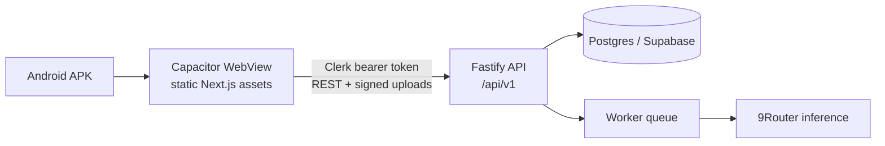

# CliniX AI Capacitor Android Compatibility Audit

**Audit date:** 2026-10-25  
**Decision:** **3. Requires significant refactoring** before `output: "export"` can produce an APK-ready web bundle.  
**Scope:** Read-only audit of the repository and ignored environment-variable names/configuration. Only this audit document was created; application source, dependency manifests, configuration, and backend services were not changed.

## Executive finding

The frontend/backend split is a good fit for a Capacitor shell: most application screens are client-rendered, fetch their data from the existing Fastify REST API, and do not require Next.js to host mutations or inference. The UI, Tailwind styling, API contracts, and Fastify business logic can remain in place.

The current frontend is **not exportable as-is**. Two isolated builds with `output: "export"` reproduced independent blockers: (1) Next found Clerk Server Actions registered by the root `ClerkProvider`; (2) the full export then stopped at a private-ID dynamic route with no `generateStaticParams()`. The root page also reads request-time Clerk auth, `proxy.ts` depends on request-time execution, and the sign-in routes are optional catch-alls. Those require a client-side/static routing design for the APK.



The intended target can retain Fastify and 9Router. The main frontend work is removing Next-server-only auth/routing assumptions from the exported build and resolving arbitrary record IDs without build-time route enumeration.

## Repository and application architecture

### Versions and build setup

| Area | Evidence-based finding |
|---|---|
| Frontend framework | Next.js **16.3.8** installed; `apps/web/package.json:14` declares `^16.3.8`. |
| React | React and React DOM **19.3.0** installed; `apps/web/package.json:15-16` declares `^19.3.0`. |
| Router | **App Router** under `apps/web/src/app/`; no `pages/` directory or Pages Router APIs. Pages use `.tsx`, so the current frontend source is TypeScript/React rather than JavaScript-only. |
| Auth SDK | `@clerk/nextjs` 7.9.9 installed; declared at `apps/web/package.json:11`. |
| Backend | Fastify **5.12.5** declared by `services/api/package.json`; TypeScript service in `services/api/src/`. |
| Worker / AI | Separate TypeScript worker in `services/worker/src/`; `gateway.ts` reads the 9Router base URL, API key, and model-route names from server environment variables. |
| Workspace | npm workspaces at root (`apps/*`, `services/*`, `packages/*`); root scripts coordinate web/API/worker type checks and the web build. |
| Current Next config | `apps/web/next.config.ts:3-5` only configures `transpilePackages: ["@clinix/schemas"]`; it does not enable static export. |
| Capacitor/Android | No Capacitor dependency, `capacitor.config.*`, Android project, or Android build script was found. |

### Route inventory

The complete page inventory found under `apps/web/src/app/` is:

- `/`, `/after-sign-in`, `/settings`
- `/sign-in/[[...sign-in]]`, `/sign-up/[[...sign-up]]`
- `/onboarding/claim`, `/onboarding/doctor`, `/onboarding/patient`, `/onboarding/role`, `/onboarding/staff`
- `/app/patient`, `/app/patient/appointments`, `/app/patient/book`, `/app/patient/checkin`, `/app/patient/checkin/result/[sessionId]`, `/app/patient/medications`, `/app/patient/timeline`, `/app/patient/vault`
- `/app/doctor`, `/app/doctor/consultation/[appointmentId]`, `/app/doctor/drafts`, `/app/doctor/patients`, `/app/doctor/patients/new`, `/app/doctor/patients/[patientId]`, `/app/doctor/prescription-drafts/new`, `/app/doctor/prescription-drafts/[draftId]`, `/app/doctor/prescriptions/[prescriptionId]`, `/app/doctor/schedule`
- `/app/staff`

Shared frontend components are in `apps/web/src/components/` (`auth-shell`, `clinix-brand`, `confidence-badge`, `medicine-editor`, `skeleton`, `status-badge`, `workspace-shell`). `apps/web/src/lib/api.ts` owns client API calls and hooks; `ui-demo-data.ts` contains static display data. The visual shell and most screen workflows are already componentized and can be retained.

`docs/ARCHITECTURE_SPEC.md` describes some intended/planned stack pieces (including TanStack Query and shadcn/ui), but the current web app does not declare or use those packages. The implementation uses its own `useApiData()` hook and checked-in components; this audit is based on that implementation, not the aspirational architecture document.

### Data, auth, and service boundaries

- Screens use Clerk client hooks to acquire a session token, then call `fetchApi()` / `fetchApiBlob()` from `apps/web/src/lib/api.ts:9-49`. Requests go directly from the browser to Fastify with `Authorization: Bearer …`.
- `useMe()` calls Fastify `GET /me` and routes users based on a backend-resolved role (`apps/web/src/lib/api.ts:52-82`). Role and domain IDs are derived from Postgres in `services/api/src/auth/context.ts:44-76`; the API verifies Clerk tokens in `services/api/src/auth/clerk.ts:14-19`.
- Fastify mounts domain endpoints under `/api/v1` (`services/api/src/index.ts:46-69`), starts on `0.0.0.0:4000` by default (`:71-79`), and already handles appointments, patients, documents, prescriptions, interactions, and AI sessions. The worker owns the 9Router API key and model routes. No frontend inference keys or Next.js API routes were found.
- Mutations, signed document-upload URLs, and clinical authorization are already backend-owned. The API applies bearer-token and role checks; the client is not the authorization boundary. This means the Fastify service can remain the application backend for the APK.
- The web environment template contains `NEXT_PUBLIC_API_BASE_URL`, Clerk publishable key, and redirect paths (`apps/web/.env.example:1-6`). Backend secrets are named in `services/api/.env.example:1-15`, not the checked-in example for the web app.

## Compatibility findings

Severity meanings: **Blocker** prevents a working static export or core route behavior; **Major** requires a migration or device validation before the APK is dependable; **Minor** is compatible in principle but needs native/device hardening; **Compatible** has no identified export blocker.

| Severity | Evidence (path and line) | Finding and compatibility | Smallest safe recommendation | Area / regression risk |
|---|---|---|---|---|
| **Blocker** | `apps/web/src/app/layout.tsx:3,27-42` | The root imports `ClerkProvider` from `@clerk/nextjs`. A root-only isolated export build failed with `Server Actions are not supported with static export`. Its generated `server-reference-manifest.json` listed Clerk `invalidateCacheAction` and `deleteKeylessAction` from `@clerk/nextjs/dist/esm/app-router/…`, attached to `/` and `/_not-found`. There are no app-authored `"use server"` directives; this is an SDK integration dependency. | Use a browser-only Clerk React integration for the exported target, or another supported client auth flow. Preserve the current bearer-token contract with Fastify, and keep the server secret solely in the backend environment. Confirm the export manifest contains no Server Actions. | Frontend. **High auth regression risk** until sign-in, sign-up, token retrieval, MFA/recovery, sign-out, and session refresh are verified. No Fastify business changes are inherently needed. |
| **Blocker** | `apps/web/src/app/page.tsx:1-9` | `/` calls Clerk server `auth()` and then uses Next `redirect()` according to the incoming request session. A static asset has no request-time Next server. This route cannot perform that session lookup or redirect at runtime. | Render a static landing/loading shell and make the redirect after client auth is ready; reuse the existing `/after-sign-in` + `GET /me` role resolver. | Frontend. Risk: first-load timing and signed-out/signed-in routing can regress; test refresh and cold launches. |
| **Blocker** | `apps/web/src/app/app/doctor/consultation/[appointmentId]/page.tsx:41-47`; `apps/web/src/app/app/doctor/patients/[patientId]/page.tsx:48-60`; `apps/web/src/app/app/doctor/prescription-drafts/[draftId]/page.tsx:27-33`; `apps/web/src/app/app/doctor/prescriptions/[prescriptionId]/page.tsx:32-38`; `apps/web/src/app/app/patient/checkin/result/[sessionId]/page.tsx:10-30` | These client pages read private record IDs through `useParams()` and fetch data only after login. No `generateStaticParams()` exists. The isolated full export compiled and type-checked, then failed at `/app/doctor/consultation/[appointmentId]`: missing `generateStaticParams()`. Enumerating patient/appointment/draft/session IDs at build time is not safe or practical. | Put the private ID in a query parameter on a statically known route (or create a fixed static client shell for each resource screen and read its ID from the query). Update in-app links while preserving the screens and API calls. | Frontend. **Medium-to-high workflow risk**: update all links, refresh behavior, and any future deep links. This is the one unavoidable URL-shape change for arbitrary private IDs in the APK. |
| **Major** | `apps/web/src/app/sign-in/[[...sign-in]]/page.tsx:35-63`; `apps/web/src/app/sign-up/[[...sign-up]]/page.tsx:33-61` | Optional catch-all routes intentionally admit Clerk subpaths such as verification or recovery steps. These dynamic routes have no static parameter list and cannot provide arbitrary runtime path handling from static assets. | Keep `/sign-in` and `/sign-up` as static entry pages and use a Clerk client routing mode supported by the installed SDK (for example, hash-based internal steps if supported), or use a hosted/browser auth flow with an Android return link. | Frontend / possibly Android deep-link config. **High auth regression risk** if multi-step auth or callback paths are omitted. |
| **Major** | `apps/web/src/proxy.ts:1-17,19-24` | Clerk `clerkMiddleware()` protects non-public requests and redirects unauthenticated requests. Next Proxy is request-time server logic and is not part of static export behavior. The source comment explicitly says Fastify `GET /me` is the real authorization. | Keep this proxy for the normal Next.js web deployment if desired, but provide an equivalent client-side navigation guard for the APK. Continue to require and authorize the token on every Fastify API request. | Frontend. UI may briefly render or show a loading state before client auth resolves; patient data must remain API-protected. No weakening of backend guards. |
| **Major** | `apps/web/src/lib/api.ts:7-16`; `apps/web/.env.example:1`; local ignored `apps/web/.env.local:1` | The API base is compiled from `NEXT_PUBLIC_API_BASE_URL`, with a `localhost:4000` fallback only when the variable is nullish. The committed template leaves it blank (an empty string does **not** trigger `??` fallback). The local ignored file currently supplies an HTTP loopback endpoint on port 4000. In an APK, loopback means the device/emulator, not the Kubuntu host, and Android cleartext HTTP is disabled by default in Capacitor’s documented config. | Set an explicit absolute backend URL for each build. For the Android emulator use its host bridge address (`10.0.2.2:4000`); for a physical device use the Kubuntu machine’s reachable LAN address. Keep HTTP exceptions debug-only; use HTTPS for deployed builds. Treat the endpoint as build-time config, not a secret. | Frontend config and Android debug network policy; possibly Fastify host/firewall. **High connectivity risk** if the local value ships unchanged. |
| **Major** | `services/api/src/index.ts:26-27`; `apps/web/src/lib/api.ts:9-16,41-46`; `apps/web/src/app/app/patient/vault/page.tsx:130-153,233-239` | Fastify currently reflects any request origin with `origin: true`; the client makes bearer-authenticated JSON requests and directly `PUT`s document bytes to a Supabase signed URL. The Fastify CORS setting is broad and likely accommodates a Capacitor WebView origin, but the Supabase Storage bucket CORS configuration is not in this repository, so file upload from the APK is unverified. | At release, allowlist the production web origin and the Capacitor local origin at Fastify. Check Supabase Storage CORS for the WebView origin and required `PUT`/content-type headers. Keep object access signed and short-lived. | Fastify + Supabase deployment config. **Medium risk** to Vault uploads; backend auth/authorization must remain unchanged. |
| **Major** | `apps/web/src/app/app/doctor/prescriptions/[prescriptionId]/page.tsx:90-104` | PDF rendering calls the authenticated API, creates a `Blob` URL, and opens it with `window.open(url, "_blank")`. This works as a browser workflow but popup/blob handling and saving/printing in Android WebView have not been validated. | Test on a physical device and emulator. If the WebView does not display/save it, retain the Fastify PDF response and add an in-app preview or a narrow Capacitor file/share integration. | Frontend / Android. **Medium risk** to the doctor print workflow. Do not add a file plugin unless device testing requires it. |
| **Minor** | `apps/web/src/app/app/patient/vault/page.tsx:95,130-161,233-239`; frontend-wide search | The vault uses the standard file picker (`PNG`, `JPG`, `PDF`) and an authenticated upload-init/complete flow. No direct `navigator.mediaDevices`, camera/microphone plugin, `localStorage`, or `sessionStorage` usage was found in app source. File selection and fetch are WebView-compatible in principle; file-picker behavior and storage CORS still need Android testing. | Test photo/document selection, cancellation, large files, signed upload, and return from the picker. No camera or microphone permission is currently required by the checked-in UI. | Frontend / device QA; Fastify/Storage only if CORS needs adjustment. **Low-to-medium risk** to attachments. |
| **Minor** | `apps/web/package.json:10-19`; `apps/web/src/components/workspace-shell.tsx:1-6,68`; no Capacitor config/project found | No Capacitor App/back-button or keyboard integration is present. Standard React navigation and form inputs are present, but Android back behavior, keyboard resizing, focus, and scrolling are device behaviors absent from a static build. | Add the Capacitor App back-button handler after confirming the desired behavior (history back when possible; exit at app root). Check keyboard and focused-input visibility on representative Android devices. | Android/frontend. **Low risk** to data integrity; medium UX risk if ignored. |
| **Major security hygiene** | Local ignored `apps/web/.env.local:3`; `services/api/.env.example:8-11`; `apps/web/.env.example:1-6` | The local web environment has a nonempty `CLERK_SECRET_KEY` entry in addition to the public Clerk publishable key. Its value was not read into output or recorded here. `CLERK_SECRET_KEY` is a server credential and must not be supplied to or embedded in APK assets. The audit did not produce a successful export artifact, so it makes no claim that this key currently appears in a bundle. | Remove the secret from the web build environment; keep it in `services/api/.env` only. Before signing, scan the generated `out/` and APK contents for the secret and other backend keys. Public publishable keys and API base URLs are expected client configuration. | Frontend build environment + API deployment. **High security risk** if a server secret were shipped; no secret value is included in this report. |
| **Compatible** | `apps/web/src/app/app/staff/page.tsx:1-26`; `apps/web/src/app/onboarding/staff/page.tsx:1-77`; `apps/web/src/app/layout.tsx:17-46`; `apps/web/src/app/globals.css` | Server Components are not automatically incompatible: these pages/layout provide static shell, metadata, and component composition. Next.js renders static-compatible Server Components during `next build`; only request-dependent server APIs or other unsupported features are blockers. `next/font/google` is build-time font optimization, not a runtime Next server dependency. | Keep these components and styling. Ensure the build environment can retrieve/cache Google Fonts, or later self-host fonts if offline builds are required. | Frontend. Low risk; no migration beyond build environment. |
| **Compatible / absent in source** | `apps/web/src/app/` and `apps/web/next.config.ts:1-6`; source search | No app-authored Server Actions, `getServerSideProps`, `getStaticProps`, `cookies()`, `headers()`, `draftMode()`, `connection()`, `dynamic = "force-dynamic"`, ISR/revalidation, `app/api/**/route.*`, `pages/api/**`, Next image optimization, or Next-config rewrites/redirects were found. Most pages are client components that fetch data from Fastify. The `redirect()` exception is the request-dependent root page noted above. | No general rewrite of data fetching is indicated. Keep runtime clinical data behind authenticated Fastify endpoints. | None for static export. |

### Environment details observed without exposing values

- `apps/web/.env.local:1` is present and sets `NEXT_PUBLIC_API_BASE_URL` to an HTTP loopback address on port 4000. The exact address/path was not copied into this report.
- `apps/web/.env.local:3` has a nonempty `CLERK_SECRET_KEY`; its value was not inspected or recorded.
- The root and app example files contain variable names only. `NEXT_PUBLIC_API_BASE_URL=` is blank in the example, which should be changed to an explicit build-time value for Android builds or documented as intentionally unset.
- API and worker environment files hold Clerk, Supabase, database, encryption, and 9Router keys. Keep these server-side. The frontend source only reads the `NEXT_PUBLIC_*` settings for API/auth UI configuration.

## Validation performed

1. `npm run typecheck` — **passed** for web, API, and worker.
2. Static export build in a temporary copy with `output: "export"` added only to that copy — compilation and TypeScript passed; export stopped at `/app/doctor/consultation/[appointmentId]` because it has no `generateStaticParams()`.
3. A second temporary export build restricted to `/` — failed with `Server Actions are not supported with static export`. The generated manifest identified two Clerk-owned actions imported through the root `ClerkProvider`.
4. No test suite was run. No application source/config/dependency file was modified by these checks. The temporary test copies were removed. The pre-existing worktree modifications (`apps/web/next-env.d.ts`, `.claude/`, and `docs/architecture/`) were left untouched.

The failure is not a generic SSR diagnosis: the full export first reported a specific ungenerated dynamic route, while the targeted root build independently exposed a Clerk dependency’s Server Actions. The remaining request-time `auth()` and Proxy limitations are corroborated by their code and Next’s static-export feature constraints.

## Migration plan, in implementation order

| Order | Change | Scope / owner | Estimate | Regression risk |
|---:|---|---|---:|---|
| 1 | Split auth integration at the provider/component boundary so the exported app uses browser-side Clerk without Next Server Actions. Keep token minting in the client and bearer verification/role resolution in Fastify. Remove `CLERK_SECRET_KEY` from the web build environment. | `apps/web/src/app/layout.tsx`, sign-in/up pages, auth imports; frontend + environment | **L: 4–6 days** | High; exercise password sign-in/up, confirmation, recovery/MFA if enabled, sign-out, token refresh, and redirects. |
| 2 | Replace `/` request-time `auth()`/`redirect()` with a client auth gate that routes through existing `/after-sign-in` and `GET /me`. Retain `proxy.ts` only for server-rendered web deployments; client guard is for APK navigation, while Fastify remains authoritative. | `apps/web/src/app/page.tsx`, client navigation/auth boundary; frontend | **S: 0.5–1 day** | Medium; cold launch and unauthenticated refresh. |
| 3 | Convert the five private-ID route segments to statically known client routes that read IDs from query parameters. Update the existing links and preserve each page’s form/data behavior. Keep the optional auth catch-all paths out of runtime URL routing with a supported client flow. | Five doctor/patient pages, all links to them, sign-in/up route strategy; frontend | **M: 2–4 days** | Medium-high; internal link coverage, refresh, Android back, and future deep links. |
| 4 | Add an opt-in export build mode, e.g. environment-controlled `output: "export"`, without changing the default Next server build. Set `NEXT_PUBLIC_API_BASE_URL` explicitly for each APK build. | `apps/web/next.config.ts`, root scripts/env docs; frontend/build | **S: 0.5–1 day** | Low once export passes; avoid accidentally exporting the normal web deployment. |
| 5 | Add Capacitor config and Android platform with `webDir` pointing to `apps/web/out`. Keep all current screen code and Next web deployment scripts. Add the Android hardware-back handler and only add file/PDF plugins if device tests demonstrate the need. | Root Capacitor config, Android project, minimal native adapter; frontend/Android | **M: 2–3 days** | Medium; build/signing and WebView behavior. |
| 6 | Configure API CORS allowlists, confirm signed-upload CORS at Supabase, define debug-only local HTTP access, and require HTTPS for production. Verify no backend secret is present in static assets or APK. | Fastify deployment + Supabase configuration + release process | **S–M: 1–2 days** | High security importance; preserve bearer-token validation and patient/doctor authorization unchanged. |
| 7 | Validate APK workflows on emulator and physical devices with test accounts and synthetic records: auth, deep links/refresh, all record pages, upload, PDF print/share, keyboard/back button, API outage, and token expiry. | QA/Android + frontend/API | **M: 2–4 days** | Necessary release gate for a clinical app. |

**Estimated implementation effort:** roughly **12–21 engineering days**, including auth and device validation. This range assumes the existing API and auth configuration are usable; external Clerk callback setup, Android signing, and deployment/network access can add time. No clinical business logic needs to move from Fastify to Next.js or be rewritten in another UI framework.

### Data flow after migration

```text
Android app launch
  -> bundled static assets render the existing React screens
  -> browser-side Clerk session provides a short-lived bearer token
  -> Fastify validates token and derives role/record access from Postgres
  -> API returns data or a short-lived signed upload/download URL
  -> worker runs AI/OCR through server-side 9Router credentials
```

## Recommended Capacitor configuration

The current Capacitor v8 config schema uses a local `webDir` containing the built `index.html`. With a root-level `capacitor.config.ts`, the expected shape is:

```ts
import type { CapacitorConfig } from "@capacitor/cli";

const config: CapacitorConfig = {
  appId: "com.clinixai.app",
  appName: "CliniX AI",
  webDir: "apps/web/out",
  server: {
    hostname: "localhost",
    androidScheme: "https",
    cleartext: false,
  },
};

export default config;
```

Do not set `server.url` for production; the APK should load bundled files. Keep `cleartext: false` in release builds. For local HTTP testing, use a debug-only network configuration or an HTTPS dev endpoint; never enable broad cleartext/mixed-content behavior in a production APK. Capacitor documents `localhost` and the Android `https` scheme as defaults, and warns that cleartext is disabled by default on Android API 28+.

## Kubuntu build commands (after approval and implementation)

Capacitor v8 documents Node.js 22+, Android Studio, and an Android SDK as prerequisites; Android Studio supplies the appropriate JDK. Install an SDK platform and emulator/device target through Android Studio’s SDK Manager.

```bash
# Add Capacitor to the npm workspace (versions aligned to current v8 docs)
npm install @capacitor/core@^8 @capacitor/android@^8
npm install --save-dev @capacitor/cli@^8

# After the export mode and capacitor.config.ts exist
npx cap add android

# Build a local-network APK for the Android emulator.
# 10.0.2.2 is the emulator's host-machine loopback bridge; use the host's LAN IP for a phone.
NEXT_PUBLIC_API_BASE_URL=http://10.0.2.2:4000/api/v1 \
  npm run build --workspace @clinix/web
npx cap sync android

# Debug APK
cd android
./gradlew assembleDebug
# android/app/build/outputs/apk/debug/app-debug.apk
```

For a physical device, replace the emulator address with a Kubuntu LAN address reachable from the device, ensure Fastify is listening on the network interface (`HOST=0.0.0.0` is already the default), and allow the port through the host firewall. If using HTTP, enable it only in the debug Android build; production must use HTTPS. For release, configure Android signing in the native project, then build a signed release APK/AAB through Android Studio or Gradle. No signing configuration currently exists in the repository.

## Known limitations and release risks

- Static assets do not provide Next request-time rendering, Proxy execution, redirects/rewrites, Server Actions, ISR, or server API endpoints. The current screens do not otherwise depend on these features once auth/root routing are moved client-side.
- Next static export cannot pre-generate a never-known private record ID. The query-parameter route strategy preserves screen UX and API calls, but URL templates change for the five record pages; enumerate this in any future deep-link contract.
- Android auth, email verification/recovery, external auth callbacks, cookies/storage behavior, and token refresh need WebView testing. Keep backend token verification and role-based resource authorization as the security boundary.
- Document upload depends on remote Supabase CORS for the actual Capacitor origin. The repository does not define that bucket policy.
- PDF Blob popup/save behavior, hardware back, keyboard resizing, and interrupted file-picker restoration are not validated by type checking or static build.
- `NEXT_PUBLIC_API_BASE_URL` is a public build-time value, not a runtime switch. A different API target requires a separate build unless a later non-secret runtime configuration mechanism is designed.
- The local ignored web environment contains a Clerk secret setting. Do not copy its value into any report, static file, APK, or client-side `NEXT_PUBLIC_*` variable. The export attempts failed before producing an APK, so the final artifact still needs an explicit secret scan.

## Research references and limits

The Exa-backed OmniRoute searches failed with `fetch failed`. I then fetched official docs directly by URL and checked the installed Next 16.3.8 package’s bundled documentation for version-specific constraints. The current online docs identify their versions where relevant.

- [Next.js static exports](https://nextjs.org/docs/app/guides/static-exports) — static Server Components, client fetching, and unsupported runtime features.
- [Next.js dynamic route segments](https://nextjs.org/docs/app/api-reference/file-conventions/dynamic-routes) — path params and catch-all routing.
- [Capacitor configuration](https://capacitorjs.com/docs/config) — `webDir`, local host/scheme, cleartext settings.
- [Capacitor Android setup](https://capacitorjs.com/docs/android) — Android platform and command-line workflow.
- [Capacitor environment setup](https://capacitorjs.com/docs/getting-started/environment-setup) — Node.js, Android Studio, and Android SDK prerequisites.
- [Capacitor App API](https://capacitorjs.com/docs/apis/app) — Android hardware back-button handling.
- [Android Emulator networking](https://developer.android.com/studio/run/emulator-networking) — emulator network access to the host machine.
