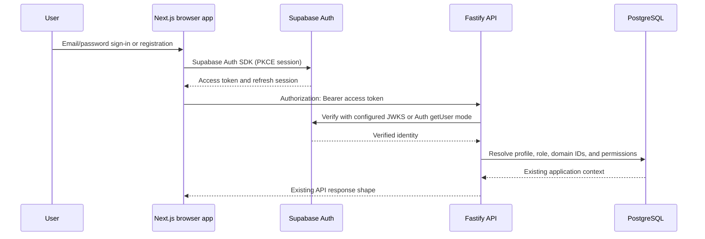

# Supabase Auth Migration

## Status

The migration is implemented on `feat/supabase-auth-migration`. After the project
was resumed, the deployed schema, foreign keys, grants, policies, and signing keys
were inspected. Drizzle migrations `0006` and `0007` have been applied. Fingerprints
verified that every pre-existing row across 33 application tables and both stored
objects survived the cutover unchanged. Private identity/configuration backups are
under the ignored `.sensitive_docs/auth-migration-backups/` directory.

The local API and web app are configured for this project. The live auth gate
passed 38 checks; the appointment and prescription/claim gates passed. Final email
delivery confirmation, document/AI processing, and the final build checks are being
completed. Document processing currently fails because the pre-existing worker
9Router key is rejected (`401`); its `Relay` and `Level_2` routes are also absent.

## Previous and new architecture

Previously, the Next.js root provided Clerk session state, auth pages used Clerk
widgets, and browser requests sent Clerk bearer tokens to Fastify. Fastify verified
the token and resolved application roles from `profiles.clerk_user_id`.

The replacement keeps the same browser-to-Fastify path. Supabase Auth establishes
identity; Fastify remains authoritative for application profiles, clinical data,
and authorization.



The browser uses the official `@supabase/supabase-js` client with PKCE,
SDK-managed persistence, automatic refresh, and one auth-state subscription. The
callback is a fixed static route. The app exchanges the one-use PKCE code itself
because URL detection is disabled to keep callback handling explicit.

```mermaid
flowchart LR
    A[Email confirmation or recovery link] --> B[/auth/callback]
    B --> C{Code and browser verifier available?}
    C -- yes --> D[exchangeCodeForSession]
    D --> E{Recovery?}
    E -- yes --> F[/reset-password]
    E -- no --> G[/after-sign-in]
    C -- no --> H[Restart or resend from this browser]
```

Email confirmation and recovery use the browser that initiated the PKCE flow. An
email opened on another browser without the verifier shows a restart/resend path.
Native Android deep-link return to a WebView is not implemented.

## Identity and database changes

Migration `services/api/drizzle/0006_curious_wallow.sql`:

- Renames `profiles.clerk_user_id` to nullable unique `legacy_auth_subject`, keeping
  the existing values for rollback only.
- Adds nullable unique UUID `profiles.supabase_user_id`.
- Does not add a cascading foreign key to `auth.users`.
- Does not delete or rewrite profile, patient, doctor, appointment, prescription,
  document, AI, audit, claim, or Storage records.

Migration `services/api/drizzle/0007_browser_access_lockdown.sql` revokes browser
table privileges from `PUBLIC`, `anon`, and `authenticated`, including default
grants for future application migrations run as `postgres`. All 33 deployed tables
already had RLS enabled with no policies. The API's `postgres` role and server-only
`service_role` access are retained. Storage policies and bucket configuration are
unchanged. The platform's `rls_auto_enable` event-trigger function is retained.

The Fastify API associates a profile only after verifying the Supabase token. A new
account is keyed by the verified Supabase UUID; it is never matched by email or the
legacy subject. Patient and doctor onboarding create the profile and domain row in
one transaction and are idempotent. The profile is locked until the transaction
commits, serializing onboarding/claims for the same identity. Patient claim
onboarding creates its profile
mapping and links the claimed internal patient ID in one transaction; failed or
raced claims roll back the profile insertion. Ownership is checked again after a
concurrent profile creation finishes. Role conflicts return `409`.

Existing profiles retain their internal IDs and old clinical relationships, but
their `supabase_user_id` remains null until a separate, explicitly approved linking
process is designed. This implementation does not link old profiles. New accounts
start with empty workspaces unless the user explicitly completes the existing
claim-code workflow.

## Fastify token verification and authorization

The API requires `SUPABASE_JWT_VERIFICATION_MODE` to be explicitly configured:

- `asymmetric` uses `jose` with the project's remote JWKS, an exact issuer,
  `authenticated` audience, a configured asymmetric algorithm allowlist, and
  required expiration, issued-at, and UUID subject checks, plus not-before
  validation when that claim is present. The JWKS
  resolver supports rotation and separates key-fetch/configuration outages from
  invalid credentials.
- `auth_server` calls Supabase Auth `getUser(accessToken)` for projects using legacy
  symmetric signing. After Supabase validates the token, the API also checks issuer,
  audience, expiry, issued-at, not-before, and identity consistency. No signing
  secret is copied to the API or browser.

There is no automatic fallback between verification modes. Missing configuration
or verification-service outages fail closed with `503 AUTH_UNAVAILABLE`; malformed,
invalid, or expired tokens produce `401 UNAUTHORIZED`. A valid session without a
profile still receives `403 ONBOARDING_REQUIRED`. Existing role and resource checks
continue to read PostgreSQL; Supabase user metadata is used only as an optional
display name. The API response envelopes and `/me` fields remain unchanged.

Doctor self-onboarding continues to create a `PENDING` verification row and grants
doctor workspace access immediately under the agreed demo policy. Staff and admin
roles are not publicly selectable. Staff onboarding remains an invitation preview;
clinic membership is not implemented.

## Modified files

- Web auth: `apps/web/src/lib/auth.tsx`, `apps/web/src/lib/supabase.ts`, root layout,
  static sign-in/sign-up/forgot/reset/callback pages, route guards, settings and
  account menu, and `apps/web/src/lib/api.ts`.
- API auth: `services/api/src/auth/supabase.ts`, `bearer.ts`, `context.ts`, the
  patient/doctor/claim onboarding routes, and the profile schema.
- Tests/tooling: web Vitest and Playwright configuration/tests, API Vitest tests,
  ESLint configuration, package scripts, lockfile, and API gate scripts.
- Documentation: architecture, API, database, context, and this migration guide.
- Database migration: `services/api/drizzle/0006_curious_wallow.sql` and its Drizzle
  snapshot/journal entries, plus `0007_browser_access_lockdown.sql`.

The separate Fastify API, PostgreSQL infrastructure, signed Storage workflow,
worker, and 9Router integration remain in place. Historical migration snapshots and
archived planning documents may still mention the previous provider; they are not
runtime dependencies.

## Environment configuration

Frontend (`apps/web/.env.local` and deployment build settings):

```text
NEXT_PUBLIC_API_BASE_URL=
NEXT_PUBLIC_SUPABASE_URL=
NEXT_PUBLIC_SUPABASE_PUBLISHABLE_KEY=
NEXT_PUBLIC_AUTH_REDIRECT_BASE_URL=
```

Set the API base to the Fastify `/api/v1` origin. Production API and auth redirect
URLs must use HTTPS. `NEXT_PUBLIC_AUTH_REDIRECT_BASE_URL` must point to the deployed
web origin whose static `/auth/callback` route is allowlisted in Supabase.

Backend (`services/api/.env`):

```text
SUPABASE_URL=
SUPABASE_PUBLISHABLE_KEY=
SUPABASE_ANON_KEY=
SUPABASE_JWT_VERIFICATION_MODE=
SUPABASE_JWT_ISSUER=
SUPABASE_JWT_ALLOWED_ALGORITHMS=
```

Set the verification mode and issuer/algorithms only after inspecting the live
project's signing configuration. `SUPABASE_PUBLISHABLE_KEY` (or legacy anon key) is
used for the Auth server verification mode; the service-role key remains server
only for existing Storage/worker duties and API-gate account setup. Never place it
in `NEXT_PUBLIC_*` configuration or generated browser artifacts.

Synthetic API gate setup additionally uses `SUPABASE_GATE_DOCTOR_EMAIL`,
`SUPABASE_GATE_PATIENT_EMAIL`, and `SUPABASE_GATE_PASSWORD`. Admin API-gate setup
uses the existing server-only service-role key; those scripts retain synthetic
accounts and records rather than deleting/resetting the database.

For Android, `localhost` addresses the device itself. The Android emulator can use
`10.0.2.2` to reach the development host. A physical device needs a reachable host
LAN address or HTTPS deployment; this has not been device-validated.

## Session lifecycle and screen behavior

- Session state restores through Supabase Auth and persists/refreshed through the
  SDK. Auth events are subscribed once and unsubscribed on provider cleanup.
- Sign-up supports email/password and confirmation resend. Confirmation-enabled
  accounts do not navigate to onboarding until a session exists.
- Password reset uses a generic success message. Recovery state stays on the reset
  flow and is redirected away from workspace routes until the password is changed.
- Callback errors, missing PKCE verifier, expired links, and reused links show a
  safe restart path without exposing provider internals.
- `/me` remains the source of application role resolution. Patients, doctors, and
  staff route only to their database-resolved workspace; unsupported roles display
  an access-denied screen.
- Account changes abort tracked API calls, discard stale hook state, remount the
  protected screen tree, and revoke generated prescription Blob URLs.
- The central API client attaches bearer tokens, retries only safe GETs once after
  a `401` refresh, and does not replay clinical mutations or signed uploads.

## Provider feature inventory

The live Clerk Frontend API environment and Backend API user inventory were read
without changing Clerk accounts. There were 10 test accounts, all with phone
numbers, zero MFA enrolments, and no linked social accounts.

| Capability | Previous live Clerk settings | Replacement |
| --- | --- | --- |
| Email/password | Enabled | Supabase email/password |
| Email verification | Email code | PKCE email confirmation link |
| Email-code passwordless sign-in | Enabled | Not implemented; sign-in uses password |
| Phone/SMS sign-in, verification, and recovery | Enabled; phone attribute required | Not implemented; needs an SMS provider and additional flows |
| SMS second factor | Enabled, zero enrolled accounts | Not implemented |
| Authenticator app / passkey | Disabled | Not introduced |
| Social sign-in | No enabled providers | Existing social buttons remain disabled |
| Name | Optional first/last name | Optional signup display name; clinical profile fields remain separate |
| Account menu | Clerk account management | Account information, settings, password recovery, sign-out |
| Self-account deletion / organization creation | Enabled in provider settings | Not implemented in the custom menu; clinic membership remains out of scope |

Phone authentication, passwordless sign-in, MFA, and provider-managed account
editing/deletion are explicit unavailable equivalents. The agreed target flows
use email/password. Application roles never come from these editable attributes.

## Manual Supabase Dashboard checks

Completed for the current development project:

1. Current signing key is ECC P-256 / ES256, confirmed in the Dashboard and JWKS.
   The API uses the exact project issuer and an ES256-only allowlist. The previous
   HS256 key was not revoked or distributed.
2. Email/password sign-up is enabled and email confirmation is required.
3. Site URL is `http://localhost:3000`; exact confirmation and recovery callback
   URLs are allowlisted for `localhost:3000` and `127.0.0.1:3000`.
4. Browser table grants were revoked and direct Data API reads were denied for
   all 33 application tables with both anonymous and authenticated credentials.
5. The clinical Storage bucket is private; signed upload/read tests passed.
6. Synthetic confirmed patient/doctor accounts were created for the live gates.

For a deployed web origin, configure its HTTPS API/redirect environment and exact
callback allowlist. Email templates/SMTP delivery and the live inbox flows are
still being validated; no SMTP secret is placed in browser configuration.

## Validation evidence and limitations

Validation performed in the local environment:

- Root typecheck: passed directly for web, API, and worker after regenerating the
  current development route types. The existing `next-env.d.ts` change is preserved.
- API typecheck: passed.
- Unit tests: passed (18 web tests and 38 API tests before the final display-name
  fallback test), including session restoration
  failure, safe-read refresh, mutation/forbidden non-retry, and cancellation during
  refresh.
- Fastify auth unit tests: passed for valid, malformed, forged, expired, wrong
  issuer/audience, missing subject/expiry/issued-at, disallowed algorithm, legacy
  Auth verification, JWKS rotation/outage, role conflicts, concurrent profile
  creation, missing bearer tokens, and patient ownership denial.
- Playwright browser tests: passed (12 tests), using the real browser SDK with
  controlled Auth/Fastify HTTP boundaries for confirmation, recovery, refresh
  restoration, expiration, backend outage, and account switching during a request.
- Live Supabase auth gate: 38 checks passed, including real ES256 sessions,
  concurrent patient/doctor onboarding, concurrent claims, metadata role rejection,
  ended/unrelated doctor relationships, private document ownership, Storage,
  session refresh/sign-out, and direct Data API denial.
- `gate-tmp.mjs` and `gate-phase3.mjs`: passed against the live project, covering
  appointments, claims, prescriptions, amendments, PDFs, and access audit records.
- `gate-phase4.mjs`: blocked at OCR because 9Router rejects the existing worker
  key with `401 Invalid API key`; no extraction draft was produced. Two pinned
  worker aliases are also missing. Worker/provider implementation is unchanged.
- `npm run lint`: passed with six warnings in existing clinical-screen code; no
  lint errors.
- Normal Next.js production build: passed and generated the static auth routes.
  The server-reference manifest has zero Server Action entries. A separate
  isolated `output: export` build compiled and typechecked auth successfully, then
  stopped at the existing dynamic private-record route that lacks
  `generateStaticParams()`; it was not given fake IDs.
- Browser bundle scan: zero matches for the four configured privileged values.
- Visual inspection: sign-in layout checked at desktop and 390×844 mobile sizes;
  no baseline screenshots were captured before implementation, so there is no
  pixel-diff comparison.
- Both Drizzle migrations were applied and existing-record fingerprints matched.
  The integration gates append only synthetic records; they do not delete accounts,
  clinical rows, or objects.
- Full static export is still expected to stop at the five unrelated private-ID
  routes: `/app/doctor/consultation/[appointmentId]`,
  `/app/doctor/patients/[patientId]`,
  `/app/doctor/prescription-drafts/[draftId]`,
  `/app/doctor/prescriptions/[prescriptionId]`, and
  `/app/patient/checkin/result/[sessionId]`. Their dynamic path/data-loading design
  is unchanged; no fake build-time IDs were added.
- Android deep-link return from the external email browser to the WebView, APK
  packaging, emulator, and physical-device behavior remain unverified.

## Rollback

1. Restore the prior application/API release and its previous server-side provider
   configuration. Existing provider accounts were not deleted.
2. Back up the current database, including new Supabase identity mappings and all
   post-cutover clinical rows.
3. Restore the legacy column name while keeping new Supabase associations intact:

   ```sql
   ALTER TABLE profiles DROP CONSTRAINT profiles_legacy_auth_subject_unique;
   ALTER TABLE profiles RENAME COLUMN legacy_auth_subject TO clerk_user_id;
   ALTER TABLE profiles ADD CONSTRAINT profiles_clerk_user_id_unique UNIQUE (clerk_user_id);
   ```

   Leave `supabase_user_id` in place during rollback so no new identity mappings
   are lost. Do not delete newly created auth users or clinical records.
4. Reconcile any Supabase-only accounts separately before attempting another
   cutover. Never reset the database to force rollback.
5. Keep the browser-grant lockdown when rolling back: the prior Fastify release
   also uses the server database role. Do not restore broad browser privileges.
   Preserve Drizzle history and use a new forward migration for a later cutover;
   do not replay `0006` over the retained Supabase UUID column.
