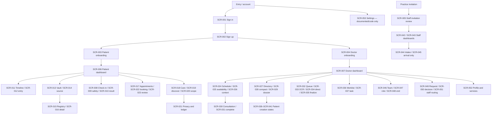

# Information architecture

[Audit index](README.md) · [Interactions](02-interaction-map.md) · [Traceability](04-design-code-traceability.md)

## Evidence and counting

The connected document is `ClinixAI v2` (27 pages, no active file path, clean/zero undo history at discovery). All 52 application screen/state frames are 393 px wide. No desktop screen variant was found. `Page 0 Home` contains reference frames 3, 39 and 40; frame 3 contains navigation prose and Mermaid source, 39 is an empty black frame, and 40 is a rendered workflow diagram. These are not application screens. No Page 5 frame exists; Settings is documented and implemented separately as SCR-053 below. Frame count differs from the catalog's 30 numbered base screens because this audit counts visible substates individually.

Explicit design roles: Patient, Doctor, Receptionist, Clinical Assistant/Nurse, Practice Owner. Admin is mentioned in repository specifications, with screens deferred; no Admin design or frontend route is discovered. Staff navigation is explicitly unresolved in design nodes 4686 and 4854. Parent relations below are information-architecture inferences unless frame copy or Page 0 states otherwise; they are not prototype connections.

## Screen registry and inspected structure

### SCR-001 — CliniX / Patient / Sign in Page 1

- Exact page: `Page 1 `; frame: `163`; 393 × 852 px.
- Role/context: Public / returning account holder (patient naming in frame); parent/flow: entry/contextual. Purpose: Sign in Page 1.
- Structure: Absolute-positioned header, content, fields/actions and navigation; inspect individual node references in the interaction map.
- Implementation candidate: `/sign-in/[[...sign-in]]` in [source](../../apps/web/src/app/sign-in/[[...sign-in]]/page.tsx). This is an actual route association, not a newly invented intended route.
- Layout metadata: absolute-positioned screen; clipping enabled; fixed 393px frame width. Desktop behavior is not encoded by a separate discovered frame.
- Observed state/variant cues: 9:41; ▮▮▮ ⌁ ▰. Native component/variant metadata and prototype state transitions are not exposed.
- Finding: Clerk widget controls depend on provider configuration; added auth tabs; three social buttons explicitly disabled.
- Evidence capture: [rendered frame 163](evidence/design-163.png). 11 inventoried controls/events; review [interaction inventory](02-interaction-map.md#scr-001).
- Coverage: full nested tree + rendered appearance inspected; interaction references are listed under this screen in [02-interaction-map.md](02-interaction-map.md#scr-001). Prototype destination UNKNOWN unless separately evidenced; responsive behavior and keyboard operation unverified.

### SCR-002 — CliniX / Patient / Sign up Page 2

- Exact page: `Page 2`; frame: `199`; 393 × 1205 px.
- Role/context: Public; primary Patient or Doctor selected during signup; parent/flow: entry/contextual. Purpose: Sign up Page 2.
- Structure: Status Bar (`200`); Back (`203`); Brand (`205`); Sign up form (`213`); Primary / Sign Up (`286`); Social / Facebook (`291`); Social / Google (`293`); Social / Apple (`295`); Footer (`297`)
- Implementation candidate: `/sign-up/[[...sign-up]]` in [source](../../apps/web/src/app/sign-up/[[...sign-up]]/page.tsx). This is an actual route association, not a newly invented intended route.
- Layout metadata: absolute-positioned screen; clipping enabled; fixed 393px frame width. Desktop behavior is not encoded by a separate discovered frame.
- Observed state/variant cues: 9:41; ▮▮▮   )))   ▰. Native component/variant metadata and prototype state transitions are not exposed.
- Finding: Clerk signup then separate role/onboarding routes; design puts name, DOB, mobile, role and passwords together.
- Evidence capture: [rendered frame 199](evidence/design-199.png). 15 inventoried controls/events; review [interaction inventory](02-interaction-map.md#scr-002).
- Coverage: full nested tree + rendered appearance inspected; interaction references are listed under this screen in [02-interaction-map.md](02-interaction-map.md#scr-002). Prototype destination UNKNOWN unless separately evidenced; responsive behavior and keyboard operation unverified.

### SCR-003 — Page2a / ClinixAI / Patient Onboarding

- Exact page: `Page 2`; frame: `300`; 393 × 852 px.
- Role/context: Patient completing setup; parent/flow: SCR-002. Purpose: Patient Onboarding.
- Structure: Brand (`304`); Onboarding / Progress (`308`); Intro (`313`); Patient Record / Outer Tray (`316`); Field / Blood Group (`326`); Field / Known Allergies (`332`); Field / Current Medicines (`337`); Optional Note (`342`); Action / Continue (`345`)
- Implementation candidate: `/onboarding/patient` in [source](../../apps/web/src/app/onboarding/patient/page.tsx). This is an actual route association, not a newly invented intended route.
- Layout metadata: absolute-positioned screen; clipping enabled; fixed 393px frame width. Desktop behavior is not encoded by a separate discovered frame.
- Observed state/variant cues: 9:41; ▮▮▮ ︶ ▰; PATIENT ONBOARDING; 1 OF 3. Native component/variant metadata and prototype state transitions are not exposed.
- Finding: Identity and privacy-mode form replaces optional blood group, allergies, current medicines and skip.
- Evidence capture: [rendered frame 300](evidence/design-300.png). 12 inventoried controls/events; review [interaction inventory](02-interaction-map.md#scr-003).
- Coverage: full nested tree + rendered appearance inspected; interaction references are listed under this screen in [02-interaction-map.md](02-interaction-map.md#scr-003). Prototype destination UNKNOWN unless separately evidenced; responsive behavior and keyboard operation unverified.

### SCR-004 — Page2b / ClinixAI / Doctor Onboarding

- Exact page: `Page 2`; frame: `350`; 393 × 852 px.
- Role/context: Doctor applicant completing professional setup; parent/flow: SCR-002. Purpose: Doctor Onboarding.
- Structure: Brand (`354`); Onboarding / Progress (`358`); Intro (`363`); Doctor Profile / Outer Tray (`366`); Field / Specialty (`376`); Field / Registration Number (`382`); Field / Primary Workplace (`387`); Optional Note (`392`); Action / Continue (`395`)
- Implementation candidate: `/onboarding/doctor` in [source](../../apps/web/src/app/onboarding/doctor/page.tsx). This is an actual route association, not a newly invented intended route.
- Layout metadata: absolute-positioned screen; clipping enabled; fixed 393px frame width. Desktop behavior is not encoded by a separate discovered frame.
- Observed state/variant cues: 9:41; ▮▮▮ ︶ ▰; DOCTOR ONBOARDING; 1 OF 3. Native component/variant metadata and prototype state transitions are not exposed.
- Finding: Registration form persists PENDING profile; no primary workplace or skip; displayed verification policy is not enforced by doctor guard.
- Evidence capture: [rendered frame 350](evidence/design-350.png). 8 inventoried controls/events; review [interaction inventory](02-interaction-map.md#scr-004).
- Coverage: full nested tree + rendered appearance inspected; interaction references are listed under this screen in [02-interaction-map.md](02-interaction-map.md#scr-004). Prototype destination UNKNOWN unless separately evidenced; responsive behavior and keyboard operation unverified.

### SCR-005 — Page2c / ClinixAI / Clinic Staff Invitation & Onboarding

- Exact page: `Page 2`; frame: `400`; 393 × 1480 px.
- Role/context: Invited clinic staff; pictured invitation is Receptionist; parent/flow: SCR-046. Purpose: Clinic Staff Invitation & Onboarding.
- Structure: Header / Logo (`403`); Header / Invite-only (`406`); Invite-only / Boundary (`411`); Verification / Email (`416`); Verification / Mobile (`423`); Verification / Note (`430`); Invite / Outer Tray (`434`); Permissions / Card (`447`); Acceptance / Terms (`466`); Action / Accept Membership (`471`)
- Implementation candidate: `/onboarding/staff` in [source](../../apps/web/src/app/onboarding/staff/page.tsx). This is an actual route association, not a newly invented intended route.
- Layout metadata: absolute-positioned screen; clipping enabled; fixed 393px frame width. Desktop behavior is not encoded by a separate discovered frame.
- Observed state/variant cues: 9:41; ▮▮▮ ︶ ▰; VERIFIED; RECEPTIONIST; ✓. Native component/variant metadata and prototype state transitions are not exposed.
- Finding: Invitation preview only; accept disabled; account verification, acceptance terms and decline absent.
- Evidence capture: [rendered frame 400](evidence/design-400.png). 4 inventoried controls/events; review [interaction inventory](02-interaction-map.md#scr-005).
- Coverage: full nested tree + rendered appearance inspected; interaction references are listed under this screen in [02-interaction-map.md](02-interaction-map.md#scr-005). Prototype destination UNKNOWN unless separately evidenced; responsive behavior and keyboard operation unverified.

### SCR-006 — Page 3 / ClinixAI / Patient Dashboard

- Exact page: `Page 3 [Patient]`; frame: `478`; 393 × 1018 px.
- Role/context: patient; parent/flow: entry/contextual. Purpose: Patient Dashboard.
- Structure: Status Bar (`479`); Header (`482`); Greeting (`492`); Care Horizon Section (`495`); Today Section (`516`); Care Plan Section (`538`); Quick Links Section (`549`); Navigation / Floating Island (`580`)
- Implementation candidate: `/app/patient` in [source](../../apps/web/src/app/app/patient/page.tsx). This is an actual route association, not a newly invented intended route.
- Layout metadata: vertical; clipping enabled; fixed 393px frame width. Gap 18px; padding [16, 24, 16, 24]. Desktop behavior is not encoded by a separate discovered frame.
- Observed state/variant cues: 9:41; ▮▮▮ ︶ ▰; +; Check-in; How are you today?; ✓; Share & consent; Control access. Native component/variant metadata and prototype state transitions are not exposed.
- Finding: Care plan is a labeled demo; no Share & consent quick action; Care nav goes to medications; Today lacks medication row.
- Evidence capture: [rendered frame 478](evidence/design-478.png). 19 inventoried controls/events; review [interaction inventory](02-interaction-map.md#scr-006).
- Coverage: full nested tree + rendered appearance inspected; interaction references are listed under this screen in [02-interaction-map.md](02-interaction-map.md#scr-006). Prototype destination UNKNOWN unless separately evidenced; responsive behavior and keyboard operation unverified.

### SCR-007 — Page 4 / ClinixAI / Doctor Dashboard

- Exact page: `Page 4 [Doctor]`; frame: `594`; 393 × 1840 px.
- Role/context: doctor; parent/flow: entry/contextual. Purpose: Doctor Dashboard.
- Structure: Top Bar (`595`); Header (`598`); Greeting (`608`); Attention Section (`612`); Schedule Section (`623`); Drafts Section (`686`); Followups Section (`718`); Patients Section (`738`); Bottom Spacer (`751`); Doctor Navigation (`752`)
- Implementation candidate: `/app/doctor` in [source](../../apps/web/src/app/app/doctor/page.tsx). This is an actual route association, not a newly invented intended route.
- Layout metadata: vertical; clipping enabled; fixed 393px frame width. Gap 0px; padding [0, 0, 0, 0]. Desktop behavior is not encoded by a separate discovered frame.
- Observed state/variant cues: 9:41; ▮▮▮ ︶ ▰; WAITING · 12 MIN; URGENT REVIEW; DELAYED · 18 MIN; INCOMPLETE; OVERDUE; DUE TOMORROW. Native component/variant metadata and prototype state transitions are not exposed.
- Finding: Schedule rows lack context links; queue reduced to aggregate link; follow-ups are counts without task access.
- Evidence capture: [rendered frame 594](evidence/design-594.png). 22 inventoried controls/events; review [interaction inventory](02-interaction-map.md#scr-007).
- Coverage: full nested tree + rendered appearance inspected; interaction references are listed under this screen in [02-interaction-map.md](02-interaction-map.md#scr-007). Prototype destination UNKNOWN unless separately evidenced; responsive behavior and keyboard operation unverified.

### SCR-008 — Page 6 / ClinixAI / AI Health Check-in

- Exact page: `Page 6 [Patient]`; frame: `766`; 393 × 980 px.
- Role/context: patient; parent/flow: SCR-006. Purpose: AI Health Check-in.
- Structure: Brand / Logo Tile (`770`); AI Assistance / Chip (`774`); Adaptive Context / Outer Tray (`787`); Adaptive Context / Inner Surface (`788`); Answer / Less than 24 hours (`793`); Answer / 1-3 days (`796`); Answer / 4-7 days (`799`); Answer / More than a week (`802`); Answer / Something else (`805`); Action / Back (`809`); Action / Continue (`811`)
- Implementation candidate: `/app/patient/checkin` in [source](../../apps/web/src/app/app/patient/checkin/page.tsx). This is an actual route association, not a newly invented intended route.
- Layout metadata: absolute-positioned screen; clipping enabled; fixed 393px frame width. Desktop behavior is not encoded by a separate discovered frame.
- Observed state/variant cues: 9:41; ▮▮▮ ︶ ▰; STEP 3 OF 7. Native component/variant metadata and prototype state transitions are not exposed.
- Finding: Back decrements step counter without restoring previous question; only single option/free text supported.
- Evidence capture: [rendered frame 766](evidence/design-766.png). 13 inventoried controls/events; review [interaction inventory](02-interaction-map.md#scr-008).
- Coverage: full nested tree + rendered appearance inspected; interaction references are listed under this screen in [02-interaction-map.md](02-interaction-map.md#scr-008). Prototype destination UNKNOWN unless separately evidenced; responsive behavior and keyboard operation unverified.

### SCR-009 — Page 6a / ClinixAI / Red-flag Safety Interrupt

- Exact page: `Page 6 [Patient]`; frame: `815`; 393 × 852 px.
- Role/context: patient; parent/flow: SCR-008. Purpose: Red-flag Safety Interrupt.
- Structure: Brand / Logo Tile (`818`); Safety / Chip (`821`); Safety / Alert Icon (`823`); Safety Evidence / Outer Tray (`827`); Safety Evidence / Inner Surface (`828`); Action / Emergency Help (`833`); Action / Emergency Department (`837`); Safety / Support Note (`839`)
- Implementation candidate: `/app/patient/checkin` in [source](../../apps/web/src/app/app/patient/checkin/page.tsx). This is an actual route association, not a newly invented intended route.
- Layout metadata: absolute-positioned screen; clipping enabled; fixed 393px frame width. Desktop behavior is not encoded by a separate discovered frame.
- Observed state/variant cues: 9:41; ▮▮▮ ︶ ▰. Native component/variant metadata and prototype state transitions are not exposed.
- Finding: Emergency call/map links exist; review dismisses interrupt in memory; server safety-state behavior requires runtime verification.
- Evidence capture: [rendered frame 815](evidence/design-815.png). 3 inventoried controls/events; review [interaction inventory](02-interaction-map.md#scr-009).
- Coverage: full nested tree + rendered appearance inspected; interaction references are listed under this screen in [02-interaction-map.md](02-interaction-map.md#scr-009). Prototype destination UNKNOWN unless separately evidenced; responsive behavior and keyboard operation unverified.

### SCR-010 — Page 7 / ClinixAI / Check-in Result

- Exact page: `Page 7 [Patient]`; frame: `843`; 393 × 1993 px.
- Role/context: patient; parent/flow: SCR-008. Purpose: Check-in Result.
- Structure: Header (`844`); Result / Chip (`855`); Intro (`857`); Outcome Section (`860`); Self Care Section (`868`); Past Section (`886`); Labs Section (`897`); Missing Section (`912`); Packet Section (`927`); Actions (`935`)
- Implementation candidate: `/app/patient/checkin/result/[sessionId]` in [source](../../apps/web/src/app/app/patient/checkin/result/[sessionId]/page.tsx). This is an actual route association, not a newly invented intended route.
- Layout metadata: vertical; clipping enabled; fixed 393px frame width. Gap 24px; padding [18, 24, 32, 24]. Desktop behavior is not encoded by a separate discovered frame.
- Observed state/variant cues: 9:41; ▮▮▮ ︶ ▰; LOW RISK. Native component/variant metadata and prototype state transitions are not exposed.
- Finding: Save is local only; share/download buttons have no handler; scope/basis are text; labs and reassuring copy are hardcoded.
- Evidence capture: [rendered frame 843](evidence/design-843.png). 15 inventoried controls/events; review [interaction inventory](02-interaction-map.md#scr-010).
- Coverage: full nested tree + rendered appearance inspected; interaction references are listed under this screen in [02-interaction-map.md](02-interaction-map.md#scr-010). Prototype destination UNKNOWN unless separately evidenced; responsive behavior and keyboard operation unverified.

### SCR-011 — Page 8 / ClinixAI / Health Timeline

- Exact page: `Page 8 [Patient]`; frame: `951`; 393 × 1680 px.
- Role/context: patient; parent/flow: SCR-006. Purpose: Health Timeline.
- Structure: Brand / Logo (`955`); Filter / All (`964`); Filter / Doctor Visits (`966`); Filter / AI Check-ins (`968`); Filter / Lab Reports (`970`); Filter / Prescriptions (`972`); Timeline / Headache check-in (`978`); Timeline / Follow-up with Dr. Mehta (`988`); Timeline / Prescription updated (`998`); Timeline / Bloodwork imported (`1009`); Timeline / Similar headache episode (`1019`); Timeline / Headache episode (`1030`); Timeline / Routine consultation (`1040`); Provenance / Legend (`1048`); Bottom Navigation (`1050`)
- Implementation candidate: `/app/patient/timeline` in [source](../../apps/web/src/app/app/patient/timeline/page.tsx). This is an actual route association, not a newly invented intended route.
- Layout metadata: absolute-positioned screen; clipping enabled; fixed 393px frame width. Desktop behavior is not encoded by a separate discovered frame.
- Observed state/variant cues: 9:41; ▮▮▮ ︶ ▰; FILTER RECORDS; All; Doctor Visits; AI Check-ins; Lab Reports; Prescriptions; AI CHECK-IN; Headache check-in; Low-risk pattern · self-care guidance saved to your record.; View details & sources →; ›. Native component/variant metadata and prototype state transitions are not exposed.
- Finding: Filter API wired; every details/source affordance is a span with no href or handler.
- Evidence capture: [rendered frame 951](evidence/design-951.png). 21 inventoried controls/events; review [interaction inventory](02-interaction-map.md#scr-011).
- Coverage: full nested tree + rendered appearance inspected; interaction references are listed under this screen in [02-interaction-map.md](02-interaction-map.md#scr-011). Prototype destination UNKNOWN unless separately evidenced; responsive behavior and keyboard operation unverified.

### SCR-012 — Page 8a / ClinixAI / Timeline Entry Detail

- Exact page: `Page 8 [Patient]`; frame: `1060`; 393 × 980 px.
- Role/context: patient; parent/flow: SCR-011. Purpose: Timeline Entry Detail.
- Structure: Header (`1061`); Content (`1072`)
- Implementation candidate: UNKNOWN — no matching UI found. This is an actual route association, not a newly invented intended route.
- Layout metadata: vertical; clipping enabled; fixed 393px frame width. Gap 0px; padding [0, 0, 0, 0]. Desktop behavior is not encoded by a separate discovered frame.
- Observed state/variant cues: 9:41; ▮▮▮ ︶ ▰; Check-in result. Native component/variant metadata and prototype state transitions are not exposed.
- Finding: No timeline-detail rendering, handler or route found.
- Evidence capture: [rendered frame 1060](evidence/design-1060.png). 6 inventoried controls/events; review [interaction inventory](02-interaction-map.md#scr-012).
- Coverage: full nested tree + rendered appearance inspected; interaction references are listed under this screen in [02-interaction-map.md](02-interaction-map.md#scr-012). Prototype destination UNKNOWN unless separately evidenced; responsive behavior and keyboard operation unverified.

### SCR-013 — Page 9 / ClinixAI / Health Vault & Document Hub

- Exact page: `Page 9 [Patient]`; frame: `1130`; 393 × 1860 px.
- Role/context: patient; parent/flow: SCR-006. Purpose: Health Vault & Document Hub.
- Structure: Brand / Logo (`1134`); Action / Upload (`1137`); Vault Summary / Outer Tray (`1142`); Vault Summary / Inner Surface (`1143`); Document / Selected (`1152`); Document / Scan (`1159`); Document / Photo (`1163`); Upload Queue / Card (`1168`); Observations / Table (`1183`); Trend / Card (`1209`); Source Integrity / Note (`1236`); Bottom Navigation (`1239`)
- Implementation candidate: `/app/patient/vault` in [source](../../apps/web/src/app/app/patient/vault/page.tsx). This is an actual route association, not a newly invented intended route.
- Layout metadata: absolute-positioned screen; clipping enabled; fixed 393px frame width. Desktop behavior is not encoded by a separate discovered frame.
- Observed state/variant cues: 9:41; ▮▮▮ ︶ ▰; PRIVATE; Extracting text · 68%; OCR complete · 2 fields need review; REVIEW; TEST; RESULT; REFERENCE; Within range; Below range; Below reference. Native component/variant metadata and prototype state transitions are not exposed.
- Finding: Upload and lab correction APIs wired; shelf layout differs; document polling does not refresh reports after OCR completes.
- Evidence capture: [rendered frame 1130](evidence/design-1130.png). 25 inventoried controls/events; review [interaction inventory](02-interaction-map.md#scr-013).
- Coverage: full nested tree + rendered appearance inspected; interaction references are listed under this screen in [02-interaction-map.md](02-interaction-map.md#scr-013). Prototype destination UNKNOWN unless separately evidenced; responsive behavior and keyboard operation unverified.

### SCR-014 — Page 9a / ClinixAI / Source Preview Drawer

- Exact page: `Page 9 [Patient]`; frame: `1249`; 393 × 980 px.
- Role/context: patient; parent/flow: SCR-013. Purpose: Source Preview Drawer.
- Structure: Brand / Logo (`1253`); Context / Selected Document (`1258`); Source Preview / Drawer (`1263`)
- Implementation candidate: `/app/patient/vault` in [source](../../apps/web/src/app/app/patient/vault/page.tsx). This is an actual route association, not a newly invented intended route.
- Layout metadata: absolute-positioned screen; clipping enabled; fixed 393px frame width. Desktop behavior is not encoded by a separate discovered frame.
- Observed state/variant cues: 9:41; ▮▮▮ ︶ ▰; ORIGINAL SOURCE. Native component/variant metadata and prototype state transitions are not exposed.
- Finding: Drawer exists for images/external PDF link; no inline paginated PDF, extraction deep link or download control.
- Evidence capture: [rendered frame 1249](evidence/design-1249.png). 7 inventoried controls/events; review [interaction inventory](02-interaction-map.md#scr-014).
- Coverage: full nested tree + rendered appearance inspected; interaction references are listed under this screen in [02-interaction-map.md](02-interaction-map.md#scr-014). Prototype destination UNKNOWN unless separately evidenced; responsive behavior and keyboard operation unverified.

### SCR-015 — Page 10 / ClinixAI / Medication History

- Exact page: `Page 10 [Patient]`; frame: `1310`; 393 × 2238 px.
- Role/context: patient; parent/flow: SCR-013. Purpose: Medication History.
- Structure: Header (`1311`); Registry Summary / Outer Tray (`1324`); Registry Summary / Inner (`1325`); Filters Section (`1332`); Active Section (`1343`); Past Section (`1411`); Provenance / Note (`1479`); Bottom Navigation (`1482`)
- Implementation candidate: `/app/patient/medications` in [source](../../apps/web/src/app/app/patient/medications/page.tsx). This is an actual route association, not a newly invented intended route.
- Layout metadata: vertical; clipping enabled; fixed 393px frame width. Gap 24px; padding [18, 24, 24, 24]. Desktop behavior is not encoded by a separate discovered frame.
- Observed state/variant cues: 9:41; ▮▮▮ ︶ ▰; FILTER; All; Active; Completed; Discontinued; ACTIVE; COMPLETED; DISCONTINUED. Native component/variant metadata and prototype state transitions are not exposed.
- Finding: Registry and local filters exist; no discontinued filter; source/encounter links absent.
- Evidence capture: [rendered frame 1310](evidence/design-1310.png). 14 inventoried controls/events; review [interaction inventory](02-interaction-map.md#scr-015).
- Coverage: full nested tree + rendered appearance inspected; interaction references are listed under this screen in [02-interaction-map.md](02-interaction-map.md#scr-015). Prototype destination UNKNOWN unless separately evidenced; responsive behavior and keyboard operation unverified.

### SCR-016 — Page 10a / ClinixAI / Medication Detail

- Exact page: `Page 10 [Patient]`; frame: `1495`; 393 × 1280 px.
- Role/context: patient; parent/flow: SCR-015. Purpose: Medication Detail.
- Structure: Brand / Logo (`1499`); Type / Chip (`1503`); Medication / Status (`1507`); Medication / Provenance (`1509`); Medication Details (`1511`); Adverse Reaction (`1530`); Provenance Card (`1535`); Source / Original prescription (`1540`); Source / Encounter chapter (`1545`); Action / Open Prescription (`1550`)
- Implementation candidate: `/app/patient/medications` in [source](../../apps/web/src/app/app/patient/medications/page.tsx). This is an actual route association, not a newly invented intended route.
- Layout metadata: absolute-positioned screen; clipping enabled; fixed 393px frame width. Desktop behavior is not encoded by a separate discovered frame.
- Observed state/variant cues: 9:41; ▮▮▮ ︶ ▰; ACTIVE. Native component/variant metadata and prototype state transitions are not exposed.
- Finding: Detail sheet exists but lacks original prescription, encounter navigation and complete provenance/duration.
- Evidence capture: [rendered frame 1495](evidence/design-1495.png). 5 inventoried controls/events; review [interaction inventory](02-interaction-map.md#scr-016).
- Coverage: full nested tree + rendered appearance inspected; interaction references are listed under this screen in [02-interaction-map.md](02-interaction-map.md#scr-016). Prototype destination UNKNOWN unless separately evidenced; responsive behavior and keyboard operation unverified.

### SCR-017 — Page 11 / ClinixAI / Patient Appointments

- Exact page: `Page 11 [Patient]`; frame: `1555`; 393 × 2310 px.
- Role/context: patient; parent/flow: SCR-006. Purpose: Patient Appointments.
- Structure: Brand / Logo (`1559`); Action / Book (`1562`); Tabs (`1567`); Payment Policy Note (`1574`); Appointment / Dr. Rohan Mehta (`1578`); Appointment / Dr. Neha Kapoor (`1600`); Appointment / Dr. Mira Joshi (`1628`); Appointment / Dr. Arjun Sen (`1650`); Payment Legend (`1679`); Appointments Note (`1689`); Bottom Navigation (`1692`)
- Implementation candidate: `/app/patient/appointments` in [source](../../apps/web/src/app/app/patient/appointments/page.tsx). This is an actual route association, not a newly invented intended route.
- Layout metadata: absolute-positioned screen; clipping enabled; fixed 393px frame width. Desktop behavior is not encoded by a separate discovered frame.
- Observed state/variant cues: 9:41; ▮▮▮ ︶ ▰; Upcoming  ·  4; Past  ·  8; Cancelled  ·  2; PAID; CONFIRMED; REQUESTED; AWAITING; WAIVED; UNPAID. Native component/variant metadata and prototype state transitions are not exposed.
- Finding: Tabs and REQUESTED cancellation wired; confirmed cancellation, reschedule, join and directions absent.
- Evidence capture: [rendered frame 1555](evidence/design-1555.png). 25 inventoried controls/events; review [interaction inventory](02-interaction-map.md#scr-017).
- Coverage: full nested tree + rendered appearance inspected; interaction references are listed under this screen in [02-interaction-map.md](02-interaction-map.md#scr-017). Prototype destination UNKNOWN unless separately evidenced; responsive behavior and keyboard operation unverified.

### SCR-018 — Page 12 / ClinixAI / Care Circle & Directory

- Exact page: `Page 12 [Patient]`; frame: `1703`; 393 × 2031 px.
- Role/context: patient; parent/flow: SCR-006. Purpose: Care Circle & Directory.
- Structure: Status Bar (`1704`); Header (`1707`); Eyebrow (`1714`); Hero (`1716`); Tabs (`1719`); Care Circle Summary (`1724`); Primary Section (`1733`); Specialists Section (`1762`); Sharing Note (`1814`); Bottom Navigation (`1818`)
- Implementation candidate: UNKNOWN — no matching UI found. This is an actual route association, not a newly invented intended route.
- Layout metadata: vertical; clipping enabled; fixed 393px frame width. Gap 24px; padding [18, 24, 24, 24]. Desktop behavior is not encoded by a separate discovered frame.
- Observed state/variant cues: Default pictured state; field/button selections and uncertainties are individually recorded in 02. Native component/variant metadata and prototype state transitions are not exposed.
- Finding: Care Circle has backend relationship list/upsert, but no frontend screen; medication route occupies Care nav.
- Evidence capture: [rendered frame 1703](evidence/design-1703.png). 19 inventoried controls/events; review [interaction inventory](02-interaction-map.md#scr-018).
- Coverage: full nested tree + rendered appearance inspected; interaction references are listed under this screen in [02-interaction-map.md](02-interaction-map.md#scr-018). Prototype destination UNKNOWN unless separately evidenced; responsive behavior and keyboard operation unverified.

### SCR-019 — Page 12a / ClinixAI / Discover Doctors

- Exact page: `Page 12 [Patient]`; frame: `1832`; 393 × 1866 px.
- Role/context: patient; parent/flow: SCR-018. Purpose: Discover Doctors.
- Structure: Status Bar (`1833`); Header (`1836`); Eyebrow (`1843`); Hero (`1845`); Tabs (`1848`); Search (`1853`); Filters Section (`1856`); Verified Doctors Section (`1867`); Privacy Note (`1926`); Bottom Navigation (`1930`)
- Implementation candidate: UNKNOWN — no matching UI found. This is an actual route association, not a newly invented intended route.
- Layout metadata: vertical; clipping enabled; fixed 393px frame width. Gap 24px; padding [18, 24, 24, 24]. Desktop behavior is not encoded by a separate discovered frame.
- Observed state/variant cues: Filter. Native component/variant metadata and prototype state transitions are not exposed.
- Finding: Doctor list is used only in booking select; full discovery/search/filter/profile screen absent.
- Evidence capture: [rendered frame 1832](evidence/design-1832.png). 22 inventoried controls/events; review [interaction inventory](02-interaction-map.md#scr-019).
- Coverage: full nested tree + rendered appearance inspected; interaction references are listed under this screen in [02-interaction-map.md](02-interaction-map.md#scr-019). Prototype destination UNKNOWN unless separately evidenced; responsive behavior and keyboard operation unverified.

### SCR-020 — Page 12b / ClinixAI / Consent Scope Picker

- Exact page: `Page 12 [Patient]`; frame: `1944`; 393 × 1482 px.
- Role/context: patient; parent/flow: SCR-018. Purpose: Consent Scope Picker.
- Structure: Status Bar (`1945`); Header (`1948`); Eyebrow (`1957`); Hero (`1959`); Recipient Card (`1962`); Purpose Section (`1972`); Share Scope Section (`1977`); Access Expiry Section (`2003`); Review Banner (`2014`); Action / Confirm (`2018`)
- Implementation candidate: UNKNOWN — no matching UI found. This is an actual route association, not a newly invented intended route.
- Layout metadata: vertical; clipping enabled; fixed 393px frame width. Gap 24px; padding [18, 24, 24, 24]. Desktop behavior is not encoded by a separate discovered frame.
- Observed state/variant cues: Consent · Record Sharing; Check-in result + selected context. Native component/variant metadata and prototype state transitions are not exposed.
- Finding: No recipient/purpose/expiry consent picker or matching registered endpoint.
- Evidence capture: [rendered frame 1944](evidence/design-1944.png). 10 inventoried controls/events; review [interaction inventory](02-interaction-map.md#scr-020).
- Coverage: full nested tree + rendered appearance inspected; interaction references are listed under this screen in [02-interaction-map.md](02-interaction-map.md#scr-020). Prototype destination UNKNOWN unless separately evidenced; responsive behavior and keyboard operation unverified.

### SCR-021 — Page 13 / ClinixAI / Privacy & Access Ledger

- Exact page: `Page 13 [Patient]`; frame: `2021`; 393 × 2290 px.
- Role/context: patient; parent/flow: SCR-006. Purpose: Privacy & Access Ledger.
- Structure: Brand / Logo (`2025`); Privacy Summary / Outer Tray (`2031`); Privacy Summary / Inner (`2032`); Sharing / Recipient Purpose Expiry (`2041`); Permissions Matrix (`2056`); Sharing / Update Action (`2079`); Ledger / Immutable Note (`2085`); Ledger Filter / All (`2088`); Ledger Filter / Clinical (`2090`); Ledger Filter / Admin (`2092`); Ledger Filter / AI (`2094`); Ledger Event / Doctor Access (`2096`); Ledger Event / AI Audit (`2108`); Ledger Event / Admin Access (`2120`); Bottom Navigation (`2132`)
- Implementation candidate: UNKNOWN — no matching UI found. This is an actual route association, not a newly invented intended route.
- Layout metadata: absolute-positioned screen; clipping enabled; fixed 393px frame width. Desktop behavior is not encoded by a separate discovered frame.
- Observed state/variant cues: 9:41; ▮▮▮ ︶ ▰; PATIENT CONTROLLED; ON  ✓; OFF; ✓; IMMUTABLE · READ ONLY · APPEND-ONLY; All · 24; Clinical; Admin; AI audit. Native component/variant metadata and prototype state transitions are not exposed.
- Finding: No privacy ledger, scope editor, revoke or patient removal-request UI; audit writes exist separately.
- Evidence capture: [rendered frame 2021](evidence/design-2021.png). 19 inventoried controls/events; review [interaction inventory](02-interaction-map.md#scr-021).
- Coverage: full nested tree + rendered appearance inspected; interaction references are listed under this screen in [02-interaction-map.md](02-interaction-map.md#scr-021). Prototype destination UNKNOWN unless separately evidenced; responsive behavior and keyboard operation unverified.

### SCR-022 — Page 14 / ClinixAI / Consultation Booking & Packet Builder

- Exact page: `Page 14 [Patient]`; frame: `2143`; 393 × 2180 px.
- Role/context: patient; parent/flow: SCR-017. Purpose: Consultation Booking & Packet Builder.
- Structure: Brand / Logo (`2147`); Booking / Chip (`2151`); Doctor / Outer Tray (`2155`); Mode / Online (`2166`); Mode / Clinic (`2170`); Mode / Note (`2174`); Date / FRI (`2179`); Date / SAT (`2182`); Date / MON (`2185`); Date / TUE (`2188`); Slot / 10:30 AM (`2192`); Slot / 11:00 AM (`2194`); Slot / 4:30 PM (`2196`); Slot / 5:00 PM (`2198`); Reason / Card (`2201`); Packet / Outer Tray (`2208`); Consent / Card (`2235`); Privacy / Note (`2247`); Action / Review Booking (`2250`)
- Implementation candidate: `/app/patient/book` in [source](../../apps/web/src/app/app/patient/book/page.tsx). This is an actual route association, not a newly invented intended route.
- Layout metadata: absolute-positioned screen; clipping enabled; fixed 393px frame width. Desktop behavior is not encoded by a separate discovered frame.
- Observed state/variant cues: 9:41; ▮▮▮ ︶ ▰; ✓; Recent AI check-in; 17 Sep · headache result + selected answers; SHARING RECEIPT; What this booking will share. Native component/variant metadata and prototype state transitions are not exposed.
- Finding: All bookings hardcode IN_PERSON; packet state is not submitted; incoming packetId/encounterId query is ignored.
- Evidence capture: [rendered frame 2143](evidence/design-2143.png). 23 inventoried controls/events; review [interaction inventory](02-interaction-map.md#scr-022).
- Coverage: full nested tree + rendered appearance inspected; interaction references are listed under this screen in [02-interaction-map.md](02-interaction-map.md#scr-022). Prototype destination UNKNOWN unless separately evidenced; responsive behavior and keyboard operation unverified.

### SCR-023 — Page 14a / ClinixAI / Review Consultation Booking

- Exact page: `Page 14 [Patient]`; frame: `2255`; 393 × 1240 px.
- Role/context: patient; parent/flow: SCR-022. Purpose: Review Consultation Booking.
- Structure: Brand / Logo (`2259`); Review / Chip (`2263`); Visit / Summary (`2267`); Packet / Outer (`2279`); Sharing / Card (`2297`); Confirmation / Note (`2308`); Action / Confirm (`2311`)
- Implementation candidate: `/app/patient/book` in [source](../../apps/web/src/app/app/patient/book/page.tsx). This is an actual route association, not a newly invented intended route.
- Layout metadata: absolute-positioned screen; clipping enabled; fixed 393px frame width. Desktop behavior is not encoded by a separate discovered frame.
- Observed state/variant cues: 9:41; ▮▮▮ ︶ ▰; ✓. Native component/variant metadata and prototype state transitions are not exposed.
- Finding: Review shares a count/preview with end-of-encounter expiry; POST omits packet and consent; designed 7-day receipt not implemented.
- Evidence capture: [rendered frame 2255](evidence/design-2255.png). 6 inventoried controls/events; review [interaction inventory](02-interaction-map.md#scr-023).
- Coverage: full nested tree + rendered appearance inspected; interaction references are listed under this screen in [02-interaction-map.md](02-interaction-map.md#scr-023). Prototype destination UNKNOWN unless separately evidenced; responsive behavior and keyboard operation unverified.

### SCR-024 — Page 15 / ClinixAI / Doctor Schedule

- Exact page: `Page 15 [Doctor]`; frame: `2317`; 393 × 1980 px.
- Role/context: doctor; parent/flow: SCR-007. Purpose: Doctor Schedule.
- Structure: Header / Logo (`2320`); Header / Profile (`2323`); Tabs (`2328`); View Toggle (`2332`); Date / WED (`2337`); Date / THU (`2340`); Date / FRI (`2343`); Date / SAT (`2346`); Date / SUN (`2349`); Appointment / Maya Rao (`2356`); Appointment / Arjun Patel (`2370`); Appointment / Neha Kapoor (`2384`); Appointment / Vikram Shah (`2398`); Attention / Waiting (`2411`); Attention / Review (`2414`); Attention / Incomplete (`2417`); Later / List (`2422`); Schedule / Note (`2440`); Doctor Navigation (`2443`)
- Implementation candidate: `/app/doctor/schedule` in [source](../../apps/web/src/app/app/doctor/schedule/page.tsx). This is an actual route association, not a newly invented intended route.
- Layout metadata: absolute-positioned screen; clipping enabled; fixed 393px frame width. Desktop behavior is not encoded by a separate discovered frame.
- Observed state/variant cues: 9:41; ▮▮▮ ︶ ▰; Schedule; Availability. Native component/variant metadata and prototype state transitions are not exposed.
- Finding: Status-filtered list replaces day/week calendar; payments wired; context screen skipped in favor of direct consultation.
- Evidence capture: [rendered frame 2317](evidence/design-2317.png). 28 inventoried controls/events; review [interaction inventory](02-interaction-map.md#scr-024).
- Coverage: full nested tree + rendered appearance inspected; interaction references are listed under this screen in [02-interaction-map.md](02-interaction-map.md#scr-024). Prototype destination UNKNOWN unless separately evidenced; responsive behavior and keyboard operation unverified.

### SCR-025 — Page 15a / ClinixAI / Doctor Availability

- Exact page: `Page 15 [Doctor]`; frame: `2453`; 393 × 1700 px.
- Role/context: doctor; parent/flow: SCR-024. Purpose: Doctor Availability.
- Structure: Header / Logo (`2456`); Header / Profile (`2459`); Tabs (`2464`); Working Hours (`2469`); Field / Default visit duration (`2495`); Field / Breaks (`2500`); Field / Clinic assignment (`2505`); Online Availability (`2511`); Blocked Dates (`2518`); One-off Changes (`2526`); Save Availability (`2534`); Doctor Navigation (`2538`)
- Implementation candidate: `/app/doctor/schedule` in [source](../../apps/web/src/app/app/doctor/schedule/page.tsx). This is an actual route association, not a newly invented intended route.
- Layout metadata: absolute-positioned screen; clipping enabled; fixed 393px frame width. Desktop behavior is not encoded by a separate discovered frame.
- Observed state/variant cues: 9:41; ▮▮▮ ︶ ▰; Schedule; Availability; ON; AVAILABLE. Native component/variant metadata and prototype state transitions are not exposed.
- Finding: Weekly editor saves template/duration; never loads saved template; breaks, clinics, blocked dates and overrides absent.
- Evidence capture: [rendered frame 2453](evidence/design-2453.png). 25 inventoried controls/events; review [interaction inventory](02-interaction-map.md#scr-025).
- Coverage: full nested tree + rendered appearance inspected; interaction references are listed under this screen in [02-interaction-map.md](02-interaction-map.md#scr-025). Prototype destination UNKNOWN unless separately evidenced; responsive behavior and keyboard operation unverified.

### SCR-026 — Page 15b / ClinixAI / Appointment Consultation Context

- Exact page: `Page 15 [Doctor]`; frame: `2548`; 393 × 1240 px.
- Role/context: doctor; parent/flow: SCR-024. Purpose: Appointment Consultation Context.
- Structure: Logo (`2552`); Context Chip (`2556`); Waiting (`2560`); Appointment Details (`2562`); Packet (`2573`); Snapshot (`2588`); Consultation Note (`2598`); Start Consultation (`2601`); Open Patient Record (`2605`)
- Implementation candidate: UNKNOWN — no matching UI found. This is an actual route association, not a newly invented intended route.
- Layout metadata: absolute-positioned screen; clipping enabled; fixed 393px frame width. Desktop behavior is not encoded by a separate discovered frame.
- Observed state/variant cues: 9:41; ▮▮▮ ︶ ▰; CONSULTATION. Native component/variant metadata and prototype state transitions are not exposed.
- Finding: No appointment-context review surface; Consult jumps straight to consultation route.
- Evidence capture: [rendered frame 2548](evidence/design-2548.png). 7 inventoried controls/events; review [interaction inventory](02-interaction-map.md#scr-026).
- Coverage: full nested tree + rendered appearance inspected; interaction references are listed under this screen in [02-interaction-map.md](02-interaction-map.md#scr-026). Prototype destination UNKNOWN unless separately evidenced; responsive behavior and keyboard operation unverified.

### SCR-027 — Page 16 / ClinixAI / Patient Directory

- Exact page: `Page 16 [Doctor]`; frame: `2609`; 393 × 2060 px.
- Role/context: doctor; parent/flow: SCR-007. Purpose: Patient Directory.
- Structure: Logo (`2612`); Role (`2615`); Access notice (`2620`); Search (`2623`); Add Patient (`2626`); Filter Recent (`2629`); Filter Upcoming (`2631`); Filter Follow-ups (`2633`); Filter Unclaimed (`2635`); Summary (`2637`); Patient Maya Rao (`2644`); Patient Arjun Patel (`2659`); Patient Nisha Kapoor (`2674`); Patient Vikram Shah (`2689`); Create unclaimed (`2704`); Role note (`2709`); Bottom Navigation (`2712`)
- Implementation candidate: `/app/doctor/patients` in [source](../../apps/web/src/app/app/doctor/patients/page.tsx). This is an actual route association, not a newly invented intended route.
- Layout metadata: absolute-positioned screen; clipping enabled; fixed 393px frame width. Desktop behavior is not encoded by a separate discovered frame.
- Observed state/variant cues: FILTER; Recent; Upcoming; Follow-ups; Unclaimed. Native component/variant metadata and prototype state transitions are not exposed.
- Finding: Search/unclaimed and dossier links wired; Recent has no handler; upcoming absent; follow-up filter disabled.
- Evidence capture: [rendered frame 2609](evidence/design-2609.png). 15 inventoried controls/events; review [interaction inventory](02-interaction-map.md#scr-027).
- Coverage: full nested tree + rendered appearance inspected; interaction references are listed under this screen in [02-interaction-map.md](02-interaction-map.md#scr-027). Prototype destination UNKNOWN unless separately evidenced; responsive behavior and keyboard operation unverified.

### SCR-028 — Page 16a / ClinixAI / Patient Clinical Workspace

- Exact page: `Page 16 [Doctor]`; frame: `2722`; 393 × 1450 px.
- Role/context: doctor; parent/flow: SCR-027. Purpose: Patient Clinical Workspace.
- Structure: Logo (`2725`); Patient Header (`2731`); Safety Banner (`2742`); Consultation Context (`2746`); Recent Record (`2759`); Medication Snapshot (`2774`); Role Access Note (`2780`); Start Consultation (`2783`); Open Patient Record (`2785`)
- Implementation candidate: UNKNOWN — no matching UI found. This is an actual route association, not a newly invented intended route.
- Layout metadata: absolute-positioned screen; clipping enabled; fixed 393px frame width. Desktop behavior is not encoded by a separate discovered frame.
- Observed state/variant cues: ESTABLISHED; ONLINE. Native component/variant metadata and prototype state transitions are not exposed.
- Finding: No compact pre-dossier workspace; directory goes directly to full dossier SCR-029.
- Evidence capture: [rendered frame 2722](evidence/design-2722.png). 7 inventoried controls/events; review [interaction inventory](02-interaction-map.md#scr-028).
- Coverage: full nested tree + rendered appearance inspected; interaction references are listed under this screen in [02-interaction-map.md](02-interaction-map.md#scr-028). Prototype destination UNKNOWN unless separately evidenced; responsive behavior and keyboard operation unverified.

### SCR-029 — Page 17 / ClinixAI / Patient Clinical Workspace

- Exact page: `Page 17 [Doctor]`; frame: `2789`; 393 × 2936 px.
- Role/context: doctor; parent/flow: SCR-027. Purpose: Patient Clinical Workspace.
- Structure: Header / Logo (`2792`); Header / Role (`2795`); Fixed Patient Header / Identity + Safety (`2798`); Record Navigation (`2817`); Patient Record / Boundary (`2826`); Overview / Current Concern (`2832`); Overview / Meds (`2839`); Overview / Appointment (`2843`); Overview / Recent Activity (`2848`); Timeline / Card (`2859`); Reports / Labs Card (`2885`); Medication / Registry (`2913`); Consent Locked / Section (`2930`); AI Assistance / Boundary (`2938`); AI Assistance / Panel (`2941`); Action / Begin Consultation (`2956`); Action / Create Prescription (`2958`); Action / Upload Record (`2960`); Action / Schedule Follow-up (`2962`)
- Implementation candidate: `/app/doctor/patients/[patientId]` in [source](../../apps/web/src/app/app/doctor/patients/[patientId]/page.tsx). This is an actual route association, not a newly invented intended route.
- Layout metadata: absolute-positioned screen; clipping enabled; fixed 393px frame width. Desktop behavior is not encoded by a separate discovered frame.
- Observed state/variant cues: 9:41; ▮▮▮ ︶ ▰; CONSENT ACTIVE; Overview; Timeline; Reports; Meds; SOURCE LINKED; ACTIVE; CONSENT-LOCKED RECORDS; Some record groups are unavailable; CONFIDENCE; Moderate · verify before clinical use. Native component/variant metadata and prototype state transitions are not exposed.
- Finding: Hardcoded Penicillin fallback, conditions, medicines, labs, dates, doctor and CONSENT ACTIVE; tabs change highlight only; several actions inert.
- Evidence capture: [rendered frame 2789](evidence/design-2789.png). 12 inventoried controls/events; review [interaction inventory](02-interaction-map.md#scr-029).
- Coverage: full nested tree + rendered appearance inspected; interaction references are listed under this screen in [02-interaction-map.md](02-interaction-map.md#scr-029). Prototype destination UNKNOWN unless separately evidenced; responsive behavior and keyboard operation unverified.

### SCR-030 — Page 18 / ClinixAI / Consultation Workspace

- Exact page: `Page 18 [Doctor]`; frame: `2966`; 393 × 2930 px.
- Role/context: doctor; parent/flow: SCR-026. Purpose: Consultation Workspace.
- Structure: Header / Logo (`2969`); Header / Role (`2972`); Appointment Header (`2977`); Autosave / Ribbon (`2993`); Patient Record / Shared Packet (`3000`); AI Assistance / Boundary (`3026`); AI Assistance / Panel (`3028`); Note / Complaint (`3044`); Note / Observations (`3047`); Note / Assessment (`3050`); Note / Plan (`3053`); Actions / Workbench (`3057`); Encounter Status (`3074`); Completion / Card (`3077`); Doctor Navigation (`3089`)
- Implementation candidate: `/app/doctor/consultation/[appointmentId]` in [source](../../apps/web/src/app/app/doctor/consultation/[appointmentId]/page.tsx). This is an actual route association, not a newly invented intended route.
- Layout metadata: absolute-positioned screen; clipping enabled; fixed 393px frame width. Desktop behavior is not encoded by a separate discovered frame.
- Observed state/variant cues: 9:41; ▮▮▮ ︶ ▰; STATUS; Waiting · 12 min; ACTIVE SHARE; ASSISTIVE ONLY; DRAFT AUTOSAVE ON; Changes save continuously until the consultation is completed.; IN PROGRESS. Native component/variant metadata and prototype state transitions are not exposed.
- Finding: Note autosave/payment/Rx actions wired; scoped packet, AI encounter panel, video, report and follow-up actions absent; amendment cannot edit fields.
- Evidence capture: [rendered frame 2966](evidence/design-2966.png). 18 inventoried controls/events; review [interaction inventory](02-interaction-map.md#scr-030).
- Coverage: full nested tree + rendered appearance inspected; interaction references are listed under this screen in [02-interaction-map.md](02-interaction-map.md#scr-030). Prototype destination UNKNOWN unless separately evidenced; responsive behavior and keyboard operation unverified.

### SCR-031 — Page 18a / ClinixAI / Complete Consultation Confirmation

- Exact page: `Page 18 [Doctor]`; frame: `3103`; 393 × 1180 px.
- Role/context: doctor; parent/flow: SCR-030. Purpose: Complete Consultation Confirmation.
- Structure: Header / Logo (`3106`); Review / Chip (`3110`); Review / Encounter Summary (`3114`); Review / Completion Checks (`3126`); Review / Amendment Rule (`3143`); Review / Warning (`3147`); Review / Confirm Button (`3150`); Review / Back Button (`3154`)
- Implementation candidate: `/app/doctor/consultation/[appointmentId]` in [source](../../apps/web/src/app/app/doctor/consultation/[appointmentId]/page.tsx). This is an actual route association, not a newly invented intended route.
- Layout metadata: absolute-positioned screen; clipping enabled; fixed 393px frame width. Desktop behavior is not encoded by a separate discovered frame.
- Observed state/variant cues: 9:41; ▮▮▮ ︶ ▰; ONLINE; BEFORE COMPLETING; ✓; Clinical note; Complaint, observations, assessment, and plan reviewed; Shared sources; Patient-shared packet and selected source records reviewed; Follow-up action; Follow-up intentionally scheduled or omitted. Native component/variant metadata and prototype state transitions are not exposed.
- Finding: Completion modal exists but designed review checklist/summary missing; complete does not await latest note save.
- Evidence capture: [rendered frame 3103](evidence/design-3103.png). 3 inventoried controls/events; review [interaction inventory](02-interaction-map.md#scr-031).
- Coverage: full nested tree + rendered appearance inspected; interaction references are listed under this screen in [02-interaction-map.md](02-interaction-map.md#scr-031). Prototype destination UNKNOWN unless separately evidenced; responsive behavior and keyboard operation unverified.

### SCR-032 — Page 19 / ClinixAI / Prescription Draft Queue

- Exact page: `Page 19 [Doctor]`; frame: `3158`; 393 × 3045 px.
- Role/context: doctor; parent/flow: SCR-007. Purpose: Prescription Draft Queue.
- Structure: Top Bar (`3159`); Eyebrow (`3167`); Heading Block (`3169`); Metrics (`3172`); Priority / Rule (`3182`); Filter Section (`3188`); Queue / Header (`3201`); Draft / Maya Rao (`3204`); Draft / Nisha Kapoor (`3235`); Draft / Arjun Patel (`3267`); Draft / Vikram Shah (`3295`); Draft / Processing / Sara Iyer (`3323`); Draft / Extraction Failed / Unassigned (`3338`); Safety / Draft Rule (`3359`); Bottom Navigation (`3363`)
- Implementation candidate: `/app/doctor/drafts` in [source](../../apps/web/src/app/app/doctor/drafts/page.tsx). This is an actual route association, not a newly invented intended route.
- Layout metadata: vertical; clipping enabled; fixed 393px frame width. Gap 18px; padding [18, 20, 24, 20]. Desktop behavior is not encoded by a separate discovered frame.
- Observed state/variant cues: 9:41; FILTER BY SOURCE; All · 8; OCR · 4; Voice · 2; Manual · 1; Failed · 1; NEEDS REVIEW; CONFIDENCE; 81%; AMBIGUITIES; 2; 84%; READY FOR REVIEW; 93%; 0; N/A; PROCESSING; EXTRACTION FAILED. Native component/variant metadata and prototype state transitions are not exposed.
- Finding: Status instead of source filters; no reassign/source action; equal-risk sort is newest first, contrary to oldest-first design.
- Evidence capture: [rendered frame 3158](evidence/design-3158.png). 30 inventoried controls/events; review [interaction inventory](02-interaction-map.md#scr-032).
- Coverage: full nested tree + rendered appearance inspected; interaction references are listed under this screen in [02-interaction-map.md](02-interaction-map.md#scr-032). Prototype destination UNKNOWN unless separately evidenced; responsive behavior and keyboard operation unverified.

### SCR-033 — Page 20 / ClinixAI / Prescription Workspace / OCR Review

- Exact page: `Page 20 [Doctor]`; frame: `3377`; 393 × 3140 px.
- Role/context: doctor; parent/flow: SCR-032. Purpose: Prescription Workspace / OCR Review.
- Structure: Header / Logo (`3380`); Header / Role (`3383`); Context / Patient + Encounter (`3388`); Source / OCR Preview (`3403`); Medication / Naproxen (`3423`); Medication / Second medication (`3443`); Medication / Add (`3463`); Safety / Panel (`3467`); Preview / Summary (`3483`); Version / Card (`3490`); Actions / Save Draft (`3501`); Actions / Preview (`3503`); Actions / Finalize (`3505`); Finalization / Rule (`3508`); Doctor Navigation (`3513`)
- Implementation candidate: `/app/doctor/prescription-drafts/[draftId]` in [source](../../apps/web/src/app/app/doctor/prescription-drafts/[draftId]/page.tsx). This is an actual route association, not a newly invented intended route.
- Layout metadata: absolute-positioned screen; clipping not exposed/disabled; fixed 393px frame width. Desktop behavior is not encoded by a separate discovered frame.
- Observed state/variant cues: 9:41; ▮▮▮ ︶ ▰; DRAFT · V3; Rx 2   “... 5? mg” — handwriting unclear; OCR CONFIDENCE 86%; EXTRACTED; AMBIGUOUS; AMBIGUITY; Second medicine name / dose cannot be reliably read.; REVIEW; FINALIZATION RULE. Native component/variant metadata and prototype state transitions are not exposed.
- Finding: OCR source + editor exists; safety context, field confidence, preview and ambiguity review missing; finalize does not save edited local items.
- Evidence capture: [rendered frame 3377](evidence/design-3377.png). 23 inventoried controls/events; review [interaction inventory](02-interaction-map.md#scr-033).
- Coverage: full nested tree + rendered appearance inspected; interaction references are listed under this screen in [02-interaction-map.md](02-interaction-map.md#scr-033). Prototype destination UNKNOWN unless separately evidenced; responsive behavior and keyboard operation unverified.

### SCR-034 — Page 20a / ClinixAI / Prescription Workspace / Direct

- Exact page: `Page 20 [Doctor]`; frame: `3524`; 393 × 1760 px.
- Role/context: doctor; parent/flow: SCR-030. Purpose: Prescription Workspace / Direct.
- Structure: Header / Logo (`3527`); Header / Role (`3530`); Direct / Context (`3535`); Direct / Blank Medication (`3546`); Direct / Add Medicine (`3568`); Direct / Safety (`3571`); Direct / Save (`3578`); Direct / Preview (`3580`); Direct / Finalize (`3582`); Direct / Version Rule (`3584`)
- Implementation candidate: `/app/doctor/prescription-drafts/new` in [source](../../apps/web/src/app/app/doctor/prescription-drafts/new/page.tsx). This is an actual route association, not a newly invented intended route.
- Layout metadata: absolute-positioned screen; clipping not exposed/disabled; fixed 393px frame width. Desktop behavior is not encoded by a separate discovered frame.
- Observed state/variant cues: 9:41; ▮▮▮ ︶ ▰; NEW DRAFT; VERSIONED FINALIZATION. Native component/variant metadata and prototype state transitions are not exposed.
- Finding: Structured editor saves direct draft then routes to review; no safety context, direct preview or finalize on initial form.
- Evidence capture: [rendered frame 3524](evidence/design-3524.png). 15 inventoried controls/events; review [interaction inventory](02-interaction-map.md#scr-034).
- Coverage: full nested tree + rendered appearance inspected; interaction references are listed under this screen in [02-interaction-map.md](02-interaction-map.md#scr-034). Prototype destination UNKNOWN unless separately evidenced; responsive behavior and keyboard operation unverified.

### SCR-035 — Page 20b / ClinixAI / Prescription Finalization Confirmation

- Exact page: `Page 20 [Doctor]`; frame: `3590`; 393 × 1260 px.
- Role/context: doctor; parent/flow: SCR-033. Purpose: Prescription Finalization Confirmation.
- Structure: Confirm / Logo (`3593`); Confirm / Badge (`3597`); Confirm / Summary (`3601`); Confirm / Checks (`3616`); Confirm / Lock Rule (`3634`); Confirm / Finalize (`3639`); Confirm / Return (`3641`)
- Implementation candidate: `/app/doctor/prescription-drafts/[draftId]` in [source](../../apps/web/src/app/app/doctor/prescription-drafts/[draftId]/page.tsx). This is an actual route association, not a newly invented intended route.
- Layout metadata: absolute-positioned screen; clipping not exposed/disabled; fixed 393px frame width. Desktop behavior is not encoded by a separate discovered frame.
- Observed state/variant cues: ▮▮▮ ︶ ▰; FINAL REVIEW; BEFORE FINALIZING; ✓; FINALIZED RECORD. Native component/variant metadata and prototype state transitions are not exposed.
- Finding: Finalization modal exists but no source/safety/preview checklist; counts local items while endpoint finalizes stored items.
- Evidence capture: [rendered frame 3590](evidence/design-3590.png). 3 inventoried controls/events; review [interaction inventory](02-interaction-map.md#scr-035).
- Coverage: full nested tree + rendered appearance inspected; interaction references are listed under this screen in [02-interaction-map.md](02-interaction-map.md#scr-035). Prototype destination UNKNOWN unless separately evidenced; responsive behavior and keyboard operation unverified.

### SCR-036 — Page 21 / ClinixAI / Follow-up Worklist

- Exact page: `Page 21 [Doctor]`; frame: `3645`; 393 × 3277 px.
- Role/context: doctor; parent/flow: SCR-007. Purpose: Follow-up Worklist.
- Structure: status-bar (`3646`); app-header (`3655`); hero-intro (`3662`); metrics-row (`3666`); filters-section (`3676`); info-banner-container (`3709`); section-today (`3717`); section-overdue (`3841`); section-upcoming (`3905`); section-completed (`4017`); section-cancelled (`4072`); audit-banner-container (`4126`); bottom-dock (`4131`)
- Implementation candidate: UNKNOWN — no matching UI found. This is an actual route association, not a newly invented intended route.
- Layout metadata: vertical; clipping enabled; fixed 393px frame width. Gap 0px; padding [0, 0, 100, 0]. Desktop behavior is not encoded by a separate discovered frame.
- Observed state/variant cues: FILTER WORKLIST; Contact Status; Appointment Status; Check symptom resolution and medication tolerance.; Source · Medication tolerance check; Check lipid panels and adjust statin dosage accordingly.; All changes remain attributable in the patient Access Ledger.. Native component/variant metadata and prototype state transitions are not exposed.
- Finding: No follow-up worklist UI or registered follow-up routes; dashboard counts only.
- Evidence capture: [rendered frame 3645](evidence/design-3645.png). 23 inventoried controls/events; review [interaction inventory](02-interaction-map.md#scr-036).
- Coverage: full nested tree + rendered appearance inspected; interaction references are listed under this screen in [02-interaction-map.md](02-interaction-map.md#scr-036). Prototype destination UNKNOWN unless separately evidenced; responsive behavior and keyboard operation unverified.

### SCR-037 — Page 21a / ClinixAI / Follow-up Task Detail

- Exact page: `Page 21 [Doctor]`; frame: `4149`; 393 × 1654 px.
- Role/context: doctor; parent/flow: SCR-036. Purpose: Follow-up Task Detail.
- Structure: status-bar (`4150`); app-header (`4159`); patient-header (`4165`); body-stack (`4172`); bottom-dock (`4274`)
- Implementation candidate: UNKNOWN — no matching UI found. This is an actual route association, not a newly invented intended route.
- Layout metadata: vertical; clipping enabled; fixed 393px frame width. Gap 0px; padding [0, 0, 120, 0]. Desktop behavior is not encoded by a separate discovered frame.
- Observed state/variant cues: Appointment Status; Assignment & Contact Status; Contact Status. Native component/variant metadata and prototype state transitions are not exposed.
- Finding: No task detail, contact, assignment, scheduling or outcome UI.
- Evidence capture: [rendered frame 4149](evidence/design-4149.png). 17 inventoried controls/events; review [interaction inventory](02-interaction-map.md#scr-037).
- Coverage: full nested tree + rendered appearance inspected; interaction references are listed under this screen in [02-interaction-map.md](02-interaction-map.md#scr-037). Prototype destination UNKNOWN unless separately evidenced; responsive behavior and keyboard operation unverified.

### SCR-038 — Page 22 / ClinixAI / Add Clinic Patient

- Exact page: `Page 22 [Doctor]`; frame: `4293`; 393 × 1860 px.
- Role/context: doctor; parent/flow: SCR-027. Purpose: Add Clinic Patient.
- Structure: Header / Logo (`4296`); Header / Role (`4299`); Professional Record Warning (`4306`); Field / Full Name (`4310`); Field / Mobile (`4313`); Field / DOB (`4317`); Field / Sex (`4320`); Sex Selector (`4323`); Duplicate Check (`4329`); Field / Relationship (`4337`); Field / Clinic (`4340`); Field / Assigned Doctor (`4343`); Claim Invitation (`4347`); Creation Gate (`4354`); Action / Review (`4357`); Primary Navigation (`4360`)
- Implementation candidate: `/app/doctor/patients/new` in [source](../../apps/web/src/app/app/doctor/patients/new/page.tsx). This is an actual route association, not a newly invented intended route.
- Layout metadata: absolute-positioned screen; clipping enabled; fixed 393px frame width. Desktop behavior is not encoded by a separate discovered frame.
- Observed state/variant cues: 9:41; ▮▮▮ ︶ ▰; Not checked yet. Native component/variant metadata and prototype state transitions are not exposed.
- Finding: Identity form and review exist; duplicate check happens at create instead of pre-review; no clinic/doctor assignment or SMS switch.
- Evidence capture: [rendered frame 4293](evidence/design-4293.png). 20 inventoried controls/events; review [interaction inventory](02-interaction-map.md#scr-038).
- Coverage: full nested tree + rendered appearance inspected; interaction references are listed under this screen in [02-interaction-map.md](02-interaction-map.md#scr-038). Prototype destination UNKNOWN unless separately evidenced; responsive behavior and keyboard operation unverified.

### SCR-039 — Page 22a / ClinixAI / Duplicate Resolution

- Exact page: `Page 22 [Doctor]`; frame: `4372`; 393 × 1520 px.
- Role/context: doctor; parent/flow: SCR-038. Purpose: Duplicate Resolution.
- Structure: Header / Logo (`4375`); Header / Role (`4378`); Search Identity Summary (`4385`); Match / Claimed Patient (`4392`); Match / Unclaimed Record (`4403`); Duplicate Policy (`4414`); Resolution Status (`4417`); Resolution / Continue (`4422`); Primary Navigation (`4425`)
- Implementation candidate: `/app/doctor/patients/new` in [source](../../apps/web/src/app/app/doctor/patients/new/page.tsx). This is an actual route association, not a newly invented intended route.
- Layout metadata: absolute-positioned screen; clipping enabled; fixed 393px frame width. Desktop behavior is not encoded by a separate discovered frame.
- Observed state/variant cues: 9:41; ▮▮▮ ︶ ▰. Native component/variant metadata and prototype state transitions are not exposed.
- Finding: Conflict candidates only after 409; no not-same resolution, per-candidate gate or name+DOB matching.
- Evidence capture: [rendered frame 4372](evidence/design-4372.png). 13 inventoried controls/events; review [interaction inventory](02-interaction-map.md#scr-039).
- Coverage: full nested tree + rendered appearance inspected; interaction references are listed under this screen in [02-interaction-map.md](02-interaction-map.md#scr-039). Prototype destination UNKNOWN unless separately evidenced; responsive behavior and keyboard operation unverified.

### SCR-040 — Page 22b / ClinixAI / Confirm Clinic Patient

- Exact page: `Page 22 [Doctor]`; frame: `4437`; 393 × 1590 px.
- Role/context: doctor; parent/flow: SCR-038. Purpose: Confirm Clinic Patient.
- Structure: Header / Logo (`4440`); Header / Role (`4443`); Review / Chip (`4447`); Confirmation / Identity (`4451`); Confirmation / Duplicate Check (`4460`); Confirmation / Clinic Relationship (`4466`); Confirmation / Invitation (`4474`); Confirmation / Record Boundary (`4480`); Confirmation / Create (`4483`); Confirmation / Back (`4485`); Primary Navigation (`4488`)
- Implementation candidate: `/app/doctor/patients/new` in [source](../../apps/web/src/app/app/doctor/patients/new/page.tsx). This is an actual route association, not a newly invented intended route.
- Layout metadata: absolute-positioned screen; clipping enabled; fixed 393px frame width. Desktop behavior is not encoded by a separate discovered frame.
- Observed state/variant cues: 9:41; ▮▮▮ ︶ ▰. Native component/variant metadata and prototype state transitions are not exposed.
- Finding: Basic review/create exists; duplicate-cleared receipt, clinic assignment and invitation summary absent.
- Evidence capture: [rendered frame 4437](evidence/design-4437.png). 10 inventoried controls/events; review [interaction inventory](02-interaction-map.md#scr-040).
- Coverage: full nested tree + rendered appearance inspected; interaction references are listed under this screen in [02-interaction-map.md](02-interaction-map.md#scr-040). Prototype destination UNKNOWN unless separately evidenced; responsive behavior and keyboard operation unverified.

### SCR-041 — Page 22c / ClinixAI / Patient Created → Workspace

- Exact page: `Page 22 [Doctor]`; frame: `4500`; 393 × 1040 px.
- Role/context: doctor; parent/flow: SCR-040. Purpose: Patient Created → Workspace.
- Structure: Header / Logo (`4503`); Header / Role (`4506`); Success / Chip (`4510`); Success / Summary (`4514`); Redirect / Page 17 (`4526`); Redirect / Open (`4530`); Success / Audit (`4533`)
- Implementation candidate: UNKNOWN — no matching UI found. This is an actual route association, not a newly invented intended route.
- Layout metadata: absolute-positioned screen; clipping enabled; fixed 393px frame width. Desktop behavior is not encoded by a separate discovered frame.
- Observed state/variant cues: 9:41; ▮▮▮ ︶ ▰. Native component/variant metadata and prototype state transitions are not exposed.
- Finding: Creation navigates immediately to dossier; no success/invitation-queued state.
- Evidence capture: [rendered frame 4500](evidence/design-4500.png). 3 inventoried controls/events; review [interaction inventory](02-interaction-map.md#scr-041).
- Coverage: full nested tree + rendered appearance inspected; interaction references are listed under this screen in [02-interaction-map.md](02-interaction-map.md#scr-041). Prototype destination UNKNOWN unless separately evidenced; responsive behavior and keyboard operation unverified.

### SCR-042 — Page 23 / ClinixAI / Clinic Staff Dashboard / Receptionist

- Exact page: `Page 23 [Clinic_Staff]`; frame: `4536`; 393 × 2563 px.
- Role/context: staff; parent/flow: entry/contextual. Purpose: Clinic Staff Dashboard / Receptionist.
- Structure: Header / Logo (`4539`); Header / Role (`4542`); Practice / Selector (`4545`); Metric / Requested (`4552`); Metric / Waiting (`4555`); Metric / Unpaid (`4558`); Metric / Contact (`4561`); Schedule / Maya Rao (`4567`); Schedule / Arjun Patel (`4577`); Schedule / Nisha Kapoor (`4587`); Schedule / Vikram Shah (`4597`); Schedule / Sara Iyer (`4607`); Schedule / Mohan Verma (`4617`); Alert / 2 unpaid appointments (`4628`); Alert / 3 claim invitations awaiting (`4632`); Alert / 4 patients require contact (`4636`); Follow-up / Maya Rao (`4641`); Follow-up / Arjun Patel (`4650`); Quick action / Add Patient (`4660`); Quick action / Book Appointment (`4664`); Quick action / Mark Arrival (`4668`); Quick action / Update Payment (`4672`); Quick action / Contact Patient (`4676`); Role Boundary (`4680`); Navigation Decision Note (`4684`)
- Implementation candidate: `/app/staff` in [source](../../apps/web/src/app/app/staff/page.tsx). This is an actual route association, not a newly invented intended route.
- Layout metadata: absolute-positioned screen; clipping enabled; fixed 393px frame width. Desktop behavior is not encoded by a separate discovered frame.
- Observed state/variant cues: 9:41; ▮▮▮ ︶ ▰; REQUESTED; CONFIRMED; ARRIVED; WAITING · 12M; DELAYED · 18M; COMPLETED; UNREACHED; REACHED. Native component/variant metadata and prototype state transitions are not exposed.
- Finding: Generic membership stub; no receptionist dashboard/actions/data; nav labels all self-link.
- Evidence capture: [rendered frame 4536](evidence/design-4536.png). 23 inventoried controls/events; review [interaction inventory](02-interaction-map.md#scr-042).
- Coverage: full nested tree + rendered appearance inspected; interaction references are listed under this screen in [02-interaction-map.md](02-interaction-map.md#scr-042). Prototype destination UNKNOWN unless separately evidenced; responsive behavior and keyboard operation unverified.

### SCR-043 — Page 23a / ClinixAI / Clinic Staff Dashboard / Clinical Assistant

- Exact page: `Page 23 [Clinic_Staff]`; frame: `4687`; 393 × 2861 px.
- Role/context: staff; parent/flow: entry/contextual. Purpose: Clinic Staff Dashboard / Clinical Assistant.
- Structure: Header / Logo (`4690`); Header / Role (`4693`); Practice / Selector (`4696`); Metric / Requested (`4703`); Metric / Waiting (`4706`); Metric / Unpaid (`4709`); Metric / Contact (`4712`); Schedule / Maya Rao (`4718`); Schedule / Arjun Patel (`4728`); Schedule / Nisha Kapoor (`4738`); Schedule / Vikram Shah (`4748`); Schedule / Sara Iyer (`4758`); Schedule / Mohan Verma (`4768`); Alert / 2 unpaid appointments (`4779`); Alert / 3 claim invitations awaiting (`4783`); Alert / 4 patients require contact (`4787`); Follow-up / Maya Rao (`4792`); Follow-up / Arjun Patel (`4801`); Intake / Nisha Kapoor (`4811`); Intake / Maya Rao (`4819`); Quick action / Add Patient (`4828`); Quick action / Book Appointment (`4832`); Quick action / Mark Arrival (`4836`); Quick action / Update Payment (`4840`); Quick action / Contact Patient (`4844`); Role Boundary (`4848`); Navigation Decision Note (`4852`)
- Implementation candidate: `/app/staff` in [source](../../apps/web/src/app/app/staff/page.tsx). This is an actual route association, not a newly invented intended route.
- Layout metadata: absolute-positioned screen; clipping enabled; fixed 393px frame width. Desktop behavior is not encoded by a separate discovered frame.
- Observed state/variant cues: 9:41; ▮▮▮ ︶ ▰; REQUESTED; CONFIRMED; ARRIVED; WAITING · 12M; DELAYED · 18M; COMPLETED; UNREACHED; REACHED; AWAITING INTAKE. Native component/variant metadata and prototype state transitions are not exposed.
- Finding: Same stub without assistant role, active practice or intake tasks.
- Evidence capture: [rendered frame 4687](evidence/design-4687.png). 21 inventoried controls/events; review [interaction inventory](02-interaction-map.md#scr-043).
- Coverage: full nested tree + rendered appearance inspected; interaction references are listed under this screen in [02-interaction-map.md](02-interaction-map.md#scr-043). Prototype destination UNKNOWN unless separately evidenced; responsive behavior and keyboard operation unverified.

### SCR-044 — Page 24 / ClinixAI / Patient Intake Workspace

- Exact page: `Page 24 [Clinic_Staff]`; frame: `4856`; 393 × 2860 px.
- Role/context: staff; parent/flow: SCR-043. Purpose: Patient Intake Workspace.
- Structure: Header Logo (`4859`); Role Badge (`4862`); Appointment Header (`4867`); Intake Progress (`4885`); Provenance Banner (`4896`); Observations Card (`4901`); Meds Allergies (`4931`); Intake Note (`4951`); Encounter Sources (`4959`); No AI Boundary (`4969`); Ready Action (`4972`); Audit Note (`4977`)
- Implementation candidate: UNKNOWN — no matching UI found. This is an actual route association, not a newly invented intended route.
- Layout metadata: absolute-positioned screen; clipping enabled; fixed 393px frame width. Desktop behavior is not encoded by a separate discovered frame.
- Observed state/variant cues: 9:41; ▮▮▮ ︶ ▰; ARRIVAL & INTAKE STATUS; Within configured range; Needs doctor review; Recorded; Optional · not entered. Native component/variant metadata and prototype state transitions are not exposed.
- Finding: No intake/vitals/upload/readiness UI or corresponding API.
- Evidence capture: [rendered frame 4856](evidence/design-4856.png). 14 inventoried controls/events; review [interaction inventory](02-interaction-map.md#scr-044).
- Coverage: full nested tree + rendered appearance inspected; interaction references are listed under this screen in [02-interaction-map.md](02-interaction-map.md#scr-044). Prototype destination UNKNOWN unless separately evidenced; responsive behavior and keyboard operation unverified.

### SCR-045 — Page 24a / ClinixAI / Receptionist Arrival-Only Access

- Exact page: `Page 24 [Clinic_Staff]`; frame: `4980`; 393 × 1040 px.
- Role/context: staff; parent/flow: SCR-042. Purpose: Receptionist Arrival-Only Access.
- Structure: Header Logo (`4983`); Role (`4986`); Appointment (`4991`); Clinical Intake Locked (`5001`); Return Schedule (`5009`); Role Policy (`5011`)
- Implementation candidate: UNKNOWN — no matching UI found. This is an actual route association, not a newly invented intended route.
- Layout metadata: absolute-positioned screen; clipping enabled; fixed 393px frame width. Desktop behavior is not encoded by a separate discovered frame.
- Observed state/variant cues: 9:41; ▮▮▮ ︶ ▰; Marked arrived · 10:14 AM. Native component/variant metadata and prototype state transitions are not exposed.
- Finding: No arrival-only restricted view or operational appointment destination.
- Evidence capture: [rendered frame 4980](evidence/design-4980.png). 3 inventoried controls/events; review [interaction inventory](02-interaction-map.md#scr-045).
- Coverage: full nested tree + rendered appearance inspected; interaction references are listed under this screen in [02-interaction-map.md](02-interaction-map.md#scr-045). Prototype destination UNKNOWN unless separately evidenced; responsive behavior and keyboard operation unverified.

### SCR-046 — Page 25 / ClinixAI / Practice Team & Memberships

- Exact page: `Page 25 [Doctor]`; frame: `5015`; 393 × 3040 px.
- Role/context: Practice Owner / authorized doctor; parent/flow: SCR-007. Purpose: Practice Team & Memberships.
- Structure: Active Practice (`5026`); Practice Owner (`5032`); Stat ACTIVE (`5038`); Stat INVITED (`5041`); Stat SUSPENDED (`5044`); Stat FORMER (`5047`); Invite Staff (`5052`); Member Nisha Verma (`5067`); Member Priya Nair (`5086`); Owner Member (`5105`); Permission Expansion Notice (`5115`); Invite Aditi (`5120`); Invite Mobile (`5130`); Suspended Rahul (`5140`); Former Aarti (`5148`); History (`5155`); Owner Boundary (`5171`)
- Implementation candidate: UNKNOWN — no matching UI found. This is an actual route association, not a newly invented intended route.
- Layout metadata: absolute-positioned screen; clipping not exposed/disabled; fixed 393px frame width. Desktop behavior is not encoded by a separate discovered frame.
- Observed state/variant cues: Default pictured state; field/button selections and uncertainties are individually recorded in 02. Native component/variant metadata and prototype state transitions are not exposed.
- Finding: No practice team UI or invitation/membership lifecycle routes.
- Evidence capture: [rendered frame 5015](evidence/design-5015.png). 18 inventoried controls/events; review [interaction inventory](02-interaction-map.md#scr-046).
- Coverage: full nested tree + rendered appearance inspected; interaction references are listed under this screen in [02-interaction-map.md](02-interaction-map.md#scr-046). Prototype destination UNKNOWN unless separately evidenced; responsive behavior and keyboard operation unverified.

### SCR-047 — Page 25a / Confirm Role Change

- Exact page: `Page 25 [Doctor]`; frame: `5179`; 393 × 980 px.
- Role/context: Practice Owner confirming permission expansion; parent/flow: SCR-046. Purpose: Page 25a / Confirm Role Change.
- Structure: Absolute-positioned header, content, fields/actions and navigation; inspect individual node references in the interaction map.
- Implementation candidate: UNKNOWN — no matching UI found. This is an actual route association, not a newly invented intended route.
- Layout metadata: absolute-positioned screen; clipping enabled; fixed 393px frame width. Desktop behavior is not encoded by a separate discovered frame.
- Observed state/variant cues: Default pictured state; field/button selections and uncertainties are individually recorded in 02. Native component/variant metadata and prototype state transitions are not exposed.
- Finding: No permission-expansion confirmation.
- Evidence capture: [rendered frame 5179](evidence/design-5179.png). 2 inventoried controls/events; review [interaction inventory](02-interaction-map.md#scr-047).
- Coverage: full nested tree + rendered appearance inspected; interaction references are listed under this screen in [02-interaction-map.md](02-interaction-map.md#scr-047). Prototype destination UNKNOWN unless separately evidenced; responsive behavior and keyboard operation unverified.

### SCR-048 — Page 25b / End Membership Confirmation

- Exact page: `Page 25 [Doctor]`; frame: `5202`; 393 × 1120 px.
- Role/context: Practice Owner ending membership; parent/flow: SCR-046. Purpose: Page 25b / End Membership Confirmation.
- Structure: Absolute-positioned header, content, fields/actions and navigation; inspect individual node references in the interaction map.
- Implementation candidate: UNKNOWN — no matching UI found. This is an actual route association, not a newly invented intended route.
- Layout metadata: absolute-positioned screen; clipping enabled; fixed 393px frame width. Desktop behavior is not encoded by a separate discovered frame.
- Observed state/variant cues: • Membership and assignment history remains immutable. Native component/variant metadata and prototype state transitions are not exposed.
- Finding: No termination date/reason/confirmation workflow.
- Evidence capture: [rendered frame 5202](evidence/design-5202.png). 4 inventoried controls/events; review [interaction inventory](02-interaction-map.md#scr-048).
- Coverage: full nested tree + rendered appearance inspected; interaction references are listed under this screen in [02-interaction-map.md](02-interaction-map.md#scr-048). Prototype destination UNKNOWN unless separately evidenced; responsive behavior and keyboard operation unverified.

### SCR-049 — Page 26 / ClinixAI / Record Removal & Retention Requests

- Exact page: `Page 26 [Doctor]`; frame: `5233`; 393 × 2800 px.
- Role/context: Responsible doctor / Practice Owner; parent/flow: SCR-007. Purpose: Record Removal & Retention Requests.
- Structure: Logo (`5236`); Role (`5239`); Summary (`5244`); Filter OPEN · 3 (`5251`); Filter AWAITING (`5253`); Filter PARTIAL (`5255`); Filter RESOLVED (`5257`); Selected request (`5260`); Affected records (`5278`); Approve option (`5301`); Partial option (`5305`); Retain option (`5310`); Written reason (`5315`); Partial approval scope (`5317`); Review decision (`5328`); Audit history (`5332`); Staff boundary (`5343`); Patient tracking (`5346`); Outside primary nav (`5350`)
- Implementation candidate: UNKNOWN — no matching UI found. This is an actual route association, not a newly invented intended route.
- Layout metadata: absolute-positioned screen; clipping enabled; fixed 393px frame width. Desktop behavior is not encoded by a separate discovered frame.
- Observed state/variant cues: REQUEST FILTERS. Native component/variant metadata and prototype state transitions are not exposed.
- Finding: No removal/retention request center or registered API.
- Evidence capture: [rendered frame 5233](evidence/design-5233.png). 13 inventoried controls/events; review [interaction inventory](02-interaction-map.md#scr-049).
- Coverage: full nested tree + rendered appearance inspected; interaction references are listed under this screen in [02-interaction-map.md](02-interaction-map.md#scr-049). Prototype destination UNKNOWN unless separately evidenced; responsive behavior and keyboard operation unverified.

### SCR-050 — Page 26a / ClinixAI / Confirm Retention Decision

- Exact page: `Page 26 [Doctor]`; frame: `5352`; 393 × 1246 px.
- Role/context: Responsible doctor confirming decision; parent/flow: SCR-049. Purpose: Confirm Retention Decision.
- Structure: Logo (`5355`); Role (`5358`); Request summary (`5363`); Patient visible reason (`5375`); Audit recording (`5378`); Warning (`5388`); Confirm (`5391`); Return (`5393`)
- Implementation candidate: UNKNOWN — no matching UI found. This is an actual route association, not a newly invented intended route.
- Layout metadata: absolute-positioned screen; clipping enabled; fixed 393px frame width. Desktop behavior is not encoded by a separate discovered frame.
- Observed state/variant cues: Default pictured state; field/button selections and uncertainties are individually recorded in 02. Native component/variant metadata and prototype state transitions are not exposed.
- Finding: No decision confirmation or patient-visible result synchronization.
- Evidence capture: [rendered frame 5352](evidence/design-5352.png). 2 inventoried controls/events; review [interaction inventory](02-interaction-map.md#scr-050).
- Coverage: full nested tree + rendered appearance inspected; interaction references are listed under this screen in [02-interaction-map.md](02-interaction-map.md#scr-050). Prototype destination UNKNOWN unless separately evidenced; responsive behavior and keyboard operation unverified.

### SCR-051 — Page 26b / ClinixAI / Staff Route Request

- Exact page: `Page 26 [Doctor]`; frame: `5396`; 393 × 1120 px.
- Role/context: Receptionist routing only; parent/flow: SCR-049. Purpose: Staff Route Request.
- Structure: Logo (`5399`); Role (`5402`); Request (`5407`); Assignment (`5421`); Route (`5429`); Decision locked (`5431`); Operational access (`5436`)
- Implementation candidate: UNKNOWN — no matching UI found. This is an actual route association, not a newly invented intended route.
- Layout metadata: absolute-positioned screen; clipping enabled; fixed 393px frame width. Desktop behavior is not encoded by a separate discovered frame.
- Observed state/variant cues: Default pictured state; field/button selections and uncertainties are individually recorded in 02. Native component/variant metadata and prototype state transitions are not exposed.
- Finding: No staff routing-only request screen or API.
- Evidence capture: [rendered frame 5396](evidence/design-5396.png). 4 inventoried controls/events; review [interaction inventory](02-interaction-map.md#scr-051).
- Coverage: full nested tree + rendered appearance inspected; interaction references are listed under this screen in [02-interaction-map.md](02-interaction-map.md#scr-051). Prototype destination UNKNOWN unless separately evidenced; responsive behavior and keyboard operation unverified.

### SCR-052 — Page 27 / ClinixAI / Doctor Profile & Consultation Services

- Exact page: `Page 27 [Doctor]`; frame: `5440`; 393 × 2753 px.
- Role/context: doctor; parent/flow: SCR-007. Purpose: Doctor Profile & Consultation Services.
- Structure: Status Bar (`5441`); Header (`5444`); Body (`5451`)
- Implementation candidate: UNKNOWN — no matching UI found. This is an actual route association, not a newly invented intended route.
- Layout metadata: vertical; clipping enabled; fixed 393px frame width. Gap 0px; padding [0, 0, 0, 0]. Desktop behavior is not encoded by a separate discovered frame.
- Observed state/variant cues: Default pictured state; field/button selections and uncertainties are individually recorded in 02. Native component/variant metadata and prototype state transitions are not exposed.
- Finding: No professional profile/services editor; GET /doctors/self exists without editor client.
- Evidence capture: [rendered frame 5440](evidence/design-5440.png). 12 inventoried controls/events; review [interaction inventory](02-interaction-map.md#scr-052).
- Coverage: full nested tree + rendered appearance inspected; interaction references are listed under this screen in [02-interaction-map.md](02-interaction-map.md#scr-052). Prototype destination UNKNOWN unless separately evidenced; responsive behavior and keyboard operation unverified.

### SCR-053 — Settings (documented/code, no design frame)

`docs/SCREEN_CATALOG.md` Page 5 and Page 0 nodes 15/22 establish Settings. Actual `/settings`, `apps/web/src/app/settings/page.tsx`: current workspace link and verification display; notification, practice, export and deletion rows are explicitly unavailable. Multiple entitlements/default workspace persistence not implemented. No visual-comparison verdict possible.

### SCR-054 — Root redirect: code only

Actual route `/`; [source](../../apps/web/src/app/page.tsx). No separately discovered design frame. See [code-only interactions](02-interaction-map.md#scr-054). Root and post-login are routing states, not content screens.

### SCR-055 — Post-login resolver: code only

Actual route `/after-sign-in`; [source](../../apps/web/src/app/after-sign-in/page.tsx). No separately discovered design frame. See [code-only interactions](02-interaction-map.md#scr-055). Root and post-login are routing states, not content screens.

### SCR-056 — Role selection: code only

Actual route `/onboarding/role`; [source](../../apps/web/src/app/onboarding/role/page.tsx). No separately discovered design frame. See [code-only interactions](02-interaction-map.md#scr-056). Keep this code-derived surface separate from design-frame counts.

### SCR-057 — Record claim: documented/code, no design frame

Actual route `/onboarding/claim`; [source](../../apps/web/src/app/onboarding/claim/page.tsx). No separately discovered design frame. See [code-only interactions](02-interaction-map.md#scr-057). Keep this code-derived surface separate from design-frame counts.

### SCR-058 — Finalized prescription and amendment: documented/code, no distinct design frame

Actual route `/app/doctor/prescriptions/[prescriptionId]`; [source](../../apps/web/src/app/app/doctor/prescriptions/[prescriptionId]/page.tsx). No separately discovered design frame. See [code-only interactions](02-interaction-map.md#scr-058). Keep this code-derived surface separate from design-frame counts.

## Entry points and application shells

The repository uses Next.js **App Router**: 29 `page.tsx` files under `apps/web/src/app`, one root `layout.tsx`, and a Clerk `proxy.ts`. No Pages Router, nested route layout, `loading.tsx`, `error.tsx`, `not-found.tsx` or Next API route file was found under that source tree. Per-page loading/error rendering is implemented locally. `WorkspaceShell` is a component manually imported by pages; it is not a role-protecting layout.

Public entry: `/` → sign-in or post-login; `/sign-in/[[...sign-in]]` and `/sign-up/[[...sign-up]]` are optional catch-all patterns. Protected onboarding routes are available after Clerk sign-in. A successful `/me` resolves a **single primary role**, not the catalog's entitlement-based workspace list. Staff invitation entry is a static preview. There is no default-workspace persistence or active-practice selection.

Patient shell: light Alabaster/Paper, botanical dock. Doctor shell: Ink, dark panels, Copper active dock. Staff stub is rendered using the shell's non-doctor/light branch; both staff design variants are dark. Focused check-in/result screens implement their own headers. Several pages add another title/header inside `WorkspaceShell`, causing duplicated hierarchy in source.

## Intended master hierarchy (design/document evidence; not implemented-route claims)

Module-specific trigger graphs are in [06-master-navigation-graph.md](06-master-navigation-graph.md). The grouped nodes above express containment, not individual prototype transitions. Screen IDs with no route remain valid design states; they do not imply a separate page URL.

## States, role boundaries and accessibility

| Area | Design states examined | Existing code states / outstanding verification |
| --- | --- | --- |
| Auth/onboarding SCR-001–005 | credentials, role, optional basics, invitation verified/acceptance | Clerk configuration unverified; patient/doctor submit busy/error; staff accept explicitly disabled |
| Check-in SCR-008–010 | selected answers, segmented progress, blocking safety interrupt, result and packet | initial concern, saving/error, emergency, polling/failed/succeeded; no reload resume; 7-step display vs 3 server questions |
| Records SCR-011–016 | filter selection, provenance, processing/review, drawer, detail | loading/error/empty, local filter/drawer/detail; source/card deep links missing |
| Visits SCR-017/022–026 | requested/confirmed, paid/unpaid/waived, waiting/delayed/incomplete, review | local booking review, cancel confirmation; no video, date/week or operations state model |
| Clinical SCR-027–035 | unclaimed, consent-active/locked, authored-vs-AI boundary, draft/final/version | local tabs, draft notes, autosave, completion/finalization modals, finalized prescription and amendment; review gates incomplete |
| Follow-up/staff SCR-036–045 | due/overdue/upcoming/completed/cancelled, receptionist restriction, assistant intake | no worklist/intake implementation; staff membership stub only |
| Governance SCR-046–052 | invited/active/suspended/former, role expansion, effective termination, partial/retain/routing, verified locking | no UI beyond read-only doctor onboarding/profile API; governance not implemented |

Accessibility requirements are audit acceptance criteria, **not claims of tested conformance**: every input needs a programmatic label; segmented choices and filters need selected semantics and keyboard operation; status/provenance requires text as well as color; dialogs need focus entry, trap, Escape/close, and focus restoration; emergency interruption must be announced and block normal flow; task and patient context must remain explicit; bottom docks must not obscure actions at zoom or narrow widths. Forms and confirmation overlays need reflow, visible error recovery and noncolor status cues. Staff must never gain clinical scope merely by navigating to a doctor URL.

See [design-system audit](03-design-system-audit.md) for measured token variance and the responsive/accessibility verification matrix. No desktop frame, responsive constraints specification, keyboard prototype or dedicated generic error/loading design page was discovered; these are unresolved design specifications, not proof those behaviors are unnecessary.
