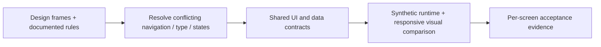

# Design system and UI consistency audit

**Implementation update (2026-10-25):** [Clinical record and navigation batch](07-implementation-progress.md) records the current code, test results and remaining blockers. Audit evidence below is the original snapshot except where explicitly updated. No whole screen is COMPLETE.

[Index](README.md) · [Screen architecture](01-information-architecture.md) · [Interactions](02-interaction-map.md) · [Prioritized gaps](05-implementation-gap-analysis.md)

## Verification boundary

All 52 design frames were rendered and their full nested trees inspected. Their captures are linked from 01 and the coverage matrix. **No running CliniX application screenshot was obtained.** The collaborative preview opened `http://localhost:3000` and returned `chrome-error://chromewebdata/`; a local listener check found no CliniX web/API process on the expected ports. The separate Next process on port 20128 belonged to another application, not CliniX. No application server, cloud gate, migration, or clinical-record request was started for this documentation audit.

Consequently, discrepancies below are **structural/source-derived**, not pixel measurements of the application. Color tokens and CSS values can be compared statically; rendered spacing, contrast, font metrics, clipping, responsive behavior and focus cannot be certified. Several imported FigCraft renderings have apparent font/glyph or fill anomalies, notably nodes 3645, 4149 and 5440. These are preserved as evidence and flagged for comparison with an authoritative original export; they are not automatically judged intentional design or implementation defects.

## Measured design inventory

The 27-page document has 5,615 inspected nodes including pages, 55 top-level frames, 52 screen/state frames, 10 color variables in one collection (`3:2`, `CliniX / Patient Tokens`), one variable mode (`3:0`, `Mode 1`), and **zero exposed named styles, component nodes, instance nodes or component/variant links**. Repeated interface patterns are ordinary frames/groups in the imported document. This is an observation of FigCraft's accessible data, not proof the original Figma document never had a component library or prototype.

All application frames are 393 px wide; heights vary by content. There are no discovered desktop or tablet frames. Auto layout exists on nested rows and stacks; many screen elements use absolute coordinates, with left/top constraints. Responsive breakpoints are not specified by these fixed-width frames.

### Color variables and existing tokens

| Design variable | Variable ID | Design value (rounded sRGB) | Frontend token / result |
| --- | --- | --- | --- |
| Color/Patient/Alabaster | 3:3 | #F7F2E9 | --color-canvas matches |
| Color/Patient/Paper | 3:4 | #FFFDFC | --color-surface matches |
| Color/Patient/Deep Botanical | 3:5 | #12352C | --color-botanical matches |
| Color/Patient/Mineral Sage | 3:6 | #AFB88A | --color-sage matches |
| Color/Ink | 3:7 | #151919 | --color-ink matches |
| Color/Graphite | 3:8 | #3D4640 | --color-graphite matches |
| Color/Evidence Blue | 3:9 | approximately #A5C3FF | --color-evidence matches rounded color |
| Color/Copper | 6:2 | approximately #F5934F | --color-copper matches rounded color |
| Color/Critical Red | 17:50 | #B42318 | --color-critical matches |
| Color/Review Amber | 26:151 | approximately #A65F11 | --color-review matches |

Source: FigCraft `variable.list`, plus [globals.css](../../apps/web/src/app/globals.css). Additional frontend tokens are Hairline `#E6E0D6`, doctor panel `#202622`, doctor muted `#F4F1EA`. Doctor design panels frequently use Graphite `#3D4640`; the shared doctor card uses `#202622`, while dossier sections inline Graphite. SCR-007 also uses a gradient in its frame; the frontend uses flat Ink. These require an intentional surface mapping, not arbitrary per-page colors.

The requested Bronze Night & Parchment palette applies to audit presentation; it does not supersede the actual CliniX design palette. No application styling was changed.

### Typography, geometry and layout

| Property | Measured design evidence | Frontend comparison / uncertainty |
| --- | --- | --- |
| Font families | 3,055 Plus Jakarta Sans text nodes; 256 Inter; 1 Playfair Display, excluding Page 0 reference assets | layout.tsx loads Plus Jakarta Sans and JetBrains Mono. Inter and serif appearances conflict with docs/DESIGN.md; do not silently homogenize original frames. |
| Serif exception | Node 785, SCR-008 question heading: Playfair Display | Check-in uses font-sans; exact visual conflict is source-derived. |
| Type scale | 29 distinct font sizes, 7–40 px. Most common: 9 px (706), 10 px (596), 11 px (444), 8 px (356) | Many implementation captions are 9–11 px too. docs/DESIGN.md requires essential clinical/consent information ≥12 px; reconcile before copying tiny mockup type. |
| Weights | Semi Bold 1,838; Regular 677; Medium 417; Bold 378; Extra Bold 2 | Code mixes medium/semibold/bold per page; no semantic type tokens beyond fonts and clinix-label. |
| Radius | Most frequent: 18 (193), 14 (148), 20 (119), 22 (112), 16 (106) px; pill radii also present | clinix-card 24 px, doctor-card 18 px, field 16 px; many inline 20/22/26/28/32 px values. Not a single consistent card contract. |
| Spacing | Nested auto-layout gaps most often 0/12/4/6/8 px; many absolute-positioned elements; padding examples 16, 20, 14 and 18 px | Shell px-6 matches 24px design gutters, but section padding/hierarchy differ; exact screen-by-screen pixel comparison unavailable. |
| Shadows | Drop and inner shadows exposed; common 0 8px 18px at ~15% black and 0 1px 2px at ~7% white inner | clinix-card uses botanical-tinted 7% shadow; doctor-card black 18%; inline shadow-sm/shadow-md/2xl vary. |
| Grid | Patient dashboard quick links 2 columns; doctor lists stacked; review forms and paired stats use nested rows | Desktop widths vary between shell max 87.5rem, auth 34rem, focused pages 393px and dossier md:max-w-2xl. |
| Icons | Text glyphs and vectors coexist: C/star brand, arrows, navigation symbols, source/lock/checkbox states | WorkspaceShell NavIcon is bespoke SVG; several pages duplicate text C logo and arrows; appointment date uses emoji. There is no shared icon contract. |

Counts describe inspected property occurrences, including imported/hidden layer properties; they are not rendered-pixel frequencies or a recommended token scale. The one serif heading is visible at SCR-008/node 785. Inter occurs in follow-up/frame details as well as reference content; the count above excludes Page 0.

## Reusable patterns and component opportunities

| Pattern | Design screens / references | Existing component | Unimplemented standardization opportunity |
| --- | --- | --- | --- |
| Role shell + navigation | SCR-006/007/024/027/036/042/043; patient dock 580, doctor dock 752 | WorkspaceShell | Single route manifest with role/capability policy; resolve four-vs-five destinations first; staff practice shell is distinct. |
| Auth/onboarding composition | SCR-001–005 | AuthShell + ClinixBrand | Common back/header/form layout; preserve patient-vs-doctor tones and invitation-specific verification state. |
| Patient identity/safety context | SCR-026/028/029/030/033/035/044 | Inline repeated headers | Data-backed context strip with explicit unknown values, author/time and no fictional defaults. |
| Source viewer | SCR-012/014/016/026/029/033 | Vault inline drawer + separate OCR source pane | Authorized source panel with PDF page controls, original/download, provenance and shared keyboard behavior. |
| Medication editor | SCR-033/034/035 | MedicineEditor | Data-backed safety panel, per-field confidence, ambiguity state and authoritative persisted-review confirmation. |
| Confirmation sheet | SCR-023/031/035/040/047/048/050 | Several inline modals/review states | Shared focus/close semantics, exact consequence summary, stale-draft prevention and error recovery. |
| Status/provenance | Across timeline, vault, dossier, queues, intake | StatusBadge + ConfidenceBadge; many inline pills | Separate status from authority; common source/provenance chip with text, no universal DOCTOR-AUTHORED fallback. |
| Records/labs/trends | SCR-013/029 | Vault Sparkline; hardcoded dossier table | Shared observation/source contract and real data; never imply range interpretation beyond source evidence. |
| Filters/segmented controls | SCR-011/015/017/019/024/027/032/036/049 | Inline repeated buttons/selects | Accessible selection state and source/semantic-filter contract; no decorative active button with no handler. |

These are recommendations only. No component refactoring was performed. The package manifest does not contain shadcn or TanStack Query dependencies; current code uses bespoke components and `useApiData`. That differs from the master plan but is not by itself proof of a defect. Shared behavior and verified accessibility matter more than substituting a library.

## Screen-level structural differences

The full screen-by-screen findings remain in [04](04-design-code-traceability.md); key cross-cutting discrepancies are below.

| Affected screens | Confirmed source discrepancy | Evidence |
| --- | --- | --- |
| SCR-001–004 | Auth/signup adds tabbed mode selector and splits designed unified form; onboarding changes fields/flow | Sign-in/up and onboarding page files; frame 163/199/300/350 |
| SCR-006/007 | Clinical content reduced to summaries/demo or nonlinked rows; quick-link hierarchy changed | Dashboard page files; frame 478/594 |
| SCR-008/010 | Question font differs; result scope/basis become text; local saved label; static linked labs and risk copy | Check-in/result page files; nodes 785/867/934/940 |
| SCR-011 | Shell title plus second h1; card-source affordance is noninteractive | timeline/page.tsx; frame 951/node 984 |
| SCR-013/014 | Large upload form precedes shelf; cards→rows; observations table→stacked cards; PDF preview external only | vault/page.tsx; frames 1130/1249 |
| SCR-015/016 | Registry detail omits source links, duration and complete provenance; filter vocabulary differs | medications/page.tsx; frames 1310/1495 |
| SCR-017/022/023 | No mode selection or source-preserving packet; review expiry differs; reschedule/join/directions absent | appointments/book page files; frames 1555/2143/2255 |
| SCR-024/025/026 | No day/week calendar or context state; weekly editor lacks rules and saved-value load | schedule/page.tsx; frames 2317/2453/2548 |
| SCR-027/028/029 | Directory omits safety/next appointment details; compact context missing; full dossier includes hardcoded facts and highlight-only tabs | patients page files; frames 2609/2722/2789 |
| SCR-030/031 | Packet/AI/source and follow-up actions absent; confirmation reduced to static assurances | consultation page; frames 2966/3103 |
| SCR-032–035 | Queue filters/order differ; workbench safety/confidence/preview absent; final review not tied to saved content | drafts and prescription pages; frames 3158/3377/3524/3590 |
| SCR-018–021/036–037/044–052 | Designed screens have no matching UI; standalone endpoints/schemas do not supply those screens | Route inventory in 04; frames linked from 01 |
| SCR-042/043 | Single light membership stub replaces two dark practice-scoped role dashboards | staff/page.tsx; frames 4536/4687 |

## Responsive and accessibility verification backlog

[W3C's Reflow guidance](https://www.w3.org/WAI/WCAG22/Understanding/reflow.html) describes preserving content/function at a width equivalent to 320 CSS pixels, with limited exceptions for content needing two-dimensional layout. Apply that as a verification criterion; no conformance claim is made here.

| Surface | Static evidence / risk | Required verification |
| --- | --- | --- |
| All shells/docks | 320px body minimum; fixed mobile dock with safe-area offset; md sticky dock; pages disagree on nav destinations | 320/360/393/768/1024/1440px; zoom 200% and 400%; portrait/landscape; no dock overlap or unreachable primary action |
| Auth forms | max-width 34rem, 24px outer padding; Clerk runtime UI/config not captured | Actual Clerk fields, error wrapping, password reveal, keyboard, mobile autocomplete and recovery |
| Availability editor | Single flex row contains checkbox, two native time inputs and “to”; no row wrap | Narrow viewport and locale time-input intrinsic widths; no horizontal loss |
| Booking/patient create | Persistent two-column date/sex or date/action groups and multi-column slots | Long labels, native controls, error text and long doctor names at 320px |
| MedicineEditor | Two-column inputs; 28px reorder/remove buttons; visible labels have no id/htmlFor or wrapping label binding | Programmatic names, touch sizing, row reorder focus continuity; keyboard and screen reader |
| Clinical note forms | Labels adjacent to textareas without id/htmlFor; autosave errors not surfaced | Programmatic label, saved/error announcement, retry and slow-network pending completion |
| Modal/drawer family | role=dialog/aria-modal/title exist; no focus trap, Escape handler or restoration in inspected code | Tab confinement, initial focus, Escape/cancel, return focus, scroll/long-content behavior |
| Choice/filter buttons | Several use local styling only; some tablists lack panel/keyboard model | Radio/pressed/tab semantics, selected state and arrow-key behavior |
| Clinical status and font size | Hardcoded safety/consent labels; many small captions; Evidence Blue on Paper needs measured contrast | Real-data unknown states, label+color, font scaling, contrast measurement and assistive announcements |

## Design conflicts to resolve before visual implementation

1. Page 0 and `SCREEN_CATALOG.md` specify patient Home/Timeline/Vault/Visits/Care and five doctor destinations; many rendered frames have four items with Reports/You. Staff frames explicitly defer their primary navigation. Do not invent a settled staff dock.
2. The design has Inter/Playfair and very small labels, while `docs/DESIGN.md` forbids those fonts and sets larger minimum essential text. Record the product decision before turning either source into a conformance gate.
3. SCR-028 and SCR-029 have the same “Patient Clinical Workspace” name but distinct compact versus full layouts/actions; they are not automatically duplicates. SCR-033/034 share a workflow but differ by OCR/direct provenance.
4. Original Figma node IDs in source comments (for example 52:33, 61:215) are not the current numeric FigCraft IDs. No verified import-ID mapping was exposed. Use current IDs and exact names for this audit; do not assume equality.

## Implementation comparison — clinical reviews

The original no-runtime verification boundary above applies to the audit snapshot. Subsequent FigCraft MCP reads/renders and synthetic Chromium captures cover SCR-031 and SCR-035; see [07](07-implementation-progress.md#verification-and-visual-evidence). Their shared native dialog now uses Ink/Graphite/Copper/Evidence surfaces, 24px gutters, 22px review-panel radii, source-derived summary/rule/action hierarchy and mobile full-screen presentation. Medicine labels now bind to their fields.

Both remain visually PARTIAL. Unperformed source/safety/preview/follow-up reviews are not represented by reassuring checkmarks. Author/version/context values are not invented. Keyboard focus, Close/Escape/Return and horizontal fit were tested at 320/393/768/1440px. Full parent-screen, clinical typography, contrast, screen-reader and application-wide responsive acceptance remain open.
