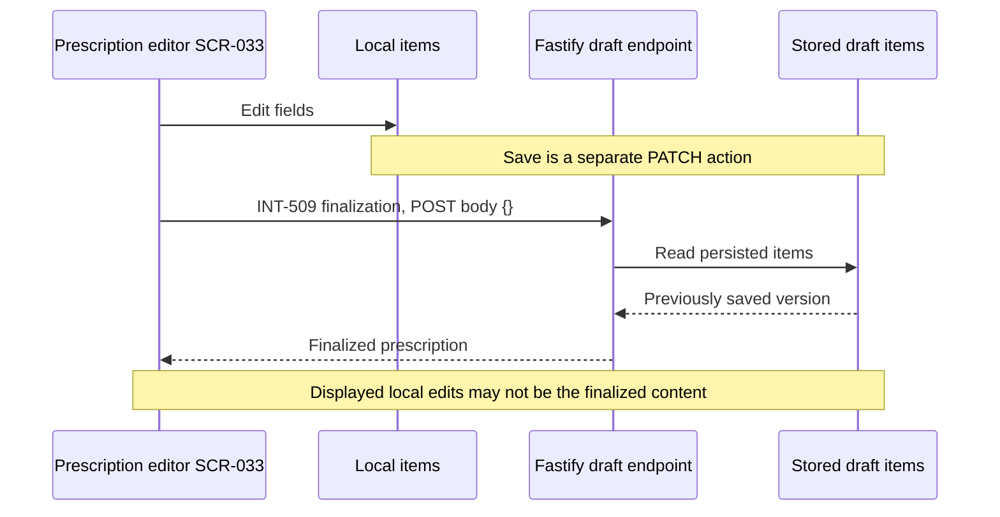

# Design-to-code traceability

**Batch 6 (2026-10-26):** [Phase 3 medication provenance](12-medication-implementation.md) supersedes SCR-015/016 findings. Registry groups/filters, source-aligned detail, exact-version patient prescription view and selected encounter chapter are implemented and tested. Prescribed items remain UNKNOWN_STATUS; exposure/reaction authorship is not invented. Live database acceptance and unresolved You navigation remain open; neither screen is COMPLETE.

**Batch 5 (2026-10-26):** [Phase 4 Health Vault and source lifecycle](11-vault-implementation.md) supersedes SCR-013/014 source findings. Source shelf, upload recovery, refreshed OCR reports, confirmed corrections, actual trends and a paginated original-file drawer are implemented and tested. Live storage/worker/database acceptance, exact observation-page provenance and the unresolved You destination remain open. Neither screen is certified COMPLETE.

**Batch 4 (2026-10-26):** [Phase 3 booking and appointment management](10-appointment-implementation.md) supersedes the original SCR-017/022/023 findings. Visit selection/review, cancellation and approved cancel-and-rebook are implemented and tested; scoped packets, draft storage, clinic directions and video joining remain explicit limits.

**Batch 3 (2026-10-25):** [Phase 5 check-in, safety, result and timeline detail](09-checkin-implementation.md) records current implementation and synthetic verification. SCR-012 now exists; SCR-008/009/010 and AI timeline links are corrected. Packet consent, optional measurements, richer adaptive blocks and live database/worker acceptance remain open.

**Batch 2 (2026-10-25):** [Phase 2 patient-record implementation](08-patient-record-implementation.md) supersedes the original SCR-027/028/029 findings. Supported own-record workflows are implemented/tested; consent, safety-data and follow-up dependencies remain explicit.

**Implementation update (2026-10-25):** [Clinical record and navigation batch](07-implementation-progress.md) records the current code, test results and remaining blockers. Audit evidence below is the original snapshot except where explicitly updated. No whole screen is COMPLETE.

[Index](README.md) · [Architecture](01-information-architecture.md) · [Interaction inventory](02-interaction-map.md) · [Gap backlog](05-implementation-gap-analysis.md)

## Evidence levels and status rules

Audit snapshot: commit `8e82fe7f43f570fa5bc900846678f16a158944f7`, plus the working tree as inspected on 2026-10-25. Pre-existing changes to `apps/web/next-env.d.ts` and untracked `.claude/` were left untouched. Only `docs/architecture/` is authored by this audit.

- COMPLETE: all audited major requirements implemented **and verified**. None qualifies without runtime verification.
- PARTIAL: a corresponding page/state exists but UI, behavior or data is incomplete.
- MISSING: no matching screen/state implementation found; it may still have backend support.
- MISMATCH: existing structure or behavior contradicts the design in a material way.
- BROKEN: deterministic source-level failure is identifiable. Runtime reproduction is separately unverified.
- UNVERIFIED: evidence insufficient for an implementation verdict.

Statuses below are exclusive primary screen classifications. Additional defects do not disappear when a screen has another primary classification. Design frames do not encode URL paths or expose prototype links. **Intended Route is UNKNOWN unless an explicit specification supplies it; Actual Route is a verified source association, not a route invented for a missing state.** A drawer or confirmation can live inside its parent route.

## Every design frame

| Screen ID | Design Frame | Intended Route | Actual Route | Frontend File | Backend Dependency | Implementation Status | Notes |
| --- | --- | --- | --- | --- | --- | --- | --- |
| [SCR-001](01-information-architecture.md#scr-001) | CliniX / Patient / Sign in Page 1 · node 163 | UNKNOWN (design has no URL) | /sign-in/[[...sign-in]] | [apps/web/src/app/sign-in/[[...sign-in]]/page.tsx](../../apps/web/src/app/sign-in/[[...sign-in]]/page.tsx) | Clerk SignIn; GET /me via post-login | PARTIAL | Clerk widget controls depend on provider configuration; added auth tabs; three social buttons explicitly disabled. |
| [SCR-002](01-information-architecture.md#scr-002) | CliniX / Patient / Sign up Page 2 · node 199 | UNKNOWN (design has no URL) | /sign-up/[[...sign-up]] | [apps/web/src/app/sign-up/[[...sign-up]]/page.tsx](../../apps/web/src/app/sign-up/[[...sign-up]]/page.tsx) | Clerk SignUp; role/onboarding later | MISMATCH | Clerk signup then separate role/onboarding routes; design puts name, DOB, mobile, role and passwords together. |
| [SCR-003](01-information-architecture.md#scr-003) | Page2a / ClinixAI / Patient Onboarding · node 300 | UNKNOWN (design has no URL) | /onboarding/patient | [apps/web/src/app/onboarding/patient/page.tsx](../../apps/web/src/app/onboarding/patient/page.tsx) | POST /patients/self | MISMATCH | Identity and privacy-mode form replaces optional blood group, allergies, current medicines and skip. |
| [SCR-004](01-information-architecture.md#scr-004) | Page2b / ClinixAI / Doctor Onboarding · node 350 | UNKNOWN (design has no URL) | /onboarding/doctor | [apps/web/src/app/onboarding/doctor/page.tsx](../../apps/web/src/app/onboarding/doctor/page.tsx) | POST /doctors/self | PARTIAL | Registration form persists PENDING profile; no primary workplace or skip; displayed verification policy is not enforced by doctor guard. |
| [SCR-005](01-information-architecture.md#scr-005) | Page2c / ClinixAI / Clinic Staff Invitation & Onboarding · node 400 | UNKNOWN (design has no URL) | /onboarding/staff | [apps/web/src/app/onboarding/staff/page.tsx](../../apps/web/src/app/onboarding/staff/page.tsx) | None (invitation API absent) | PARTIAL | Invitation preview only; accept disabled; account verification, acceptance terms and decline absent. |
| [SCR-006](01-information-architecture.md#scr-006) | Page 3 / ClinixAI / Patient Dashboard · node 478 | /app/patient | /app/patient | [apps/web/src/app/app/patient/page.tsx](../../apps/web/src/app/app/patient/page.tsx) | GET /patients/self/dashboard | PARTIAL | Care plan is a labeled demo; no Share & consent quick action; Care nav goes to medications; Today lacks medication row. |
| [SCR-007](01-information-architecture.md#scr-007) | Page 4 / ClinixAI / Doctor Dashboard · node 594 | /app/doctor | /app/doctor | [apps/web/src/app/app/doctor/page.tsx](../../apps/web/src/app/app/doctor/page.tsx) | GET /doctor/dashboard; POST confirm/cancel | PARTIAL | Schedule rows lack context links; queue reduced to aggregate link; follow-ups are counts without task access. |
| [SCR-008](01-information-architecture.md#scr-008) | Page 6 / ClinixAI / AI Health Check-in · node 766 | UNKNOWN (design has no URL) | /app/patient/checkin | [apps/web/src/app/app/patient/checkin/page.tsx](../../apps/web/src/app/app/patient/checkin/page.tsx) | POST /patients/self/encounters; interaction/start; responses; ai-analysis | PARTIAL | Restores actual blocks/answers, resumable URL, valid free text, three-step configured server progress and analysis retry. Rich adaptive blocks remain open. |
| [SCR-009](01-information-architecture.md#scr-009) | Page 6a / ClinixAI / Red-flag Safety Interrupt · node 815 | UNKNOWN (design has no URL) | /app/patient/checkin | [apps/web/src/app/app/patient/checkin/page.tsx](../../apps/web/src/app/app/patient/checkin/page.tsx) | Same as SCR-008; tel/maps external | PARTIAL | Persistent blocking safety alert; native read-only answer review; emergency links retained. Synthetic API/browser tested. |
| [SCR-010](01-information-architecture.md#scr-010) | Page 7 / ClinixAI / Check-in Result · node 843 | UNKNOWN (design has no URL) | /app/patient/checkin/result/[sessionId] | [apps/web/src/app/app/patient/checkin/result/[sessionId]/page.tsx](../../apps/web/src/app/app/patient/checkin/result/[sessionId]/page.tsx) | GET /ai-sessions/:id and /evidence; checked worker outcome | PARTIAL | Checked outcome only; evidence/retry dialogs; no fictional labs or local save; scoped JSON result export. Optional measurement and packet/consent services blocked. |
| [SCR-011](01-information-architecture.md#scr-011) | Page 8 / ClinixAI / Health Timeline · node 951 | UNKNOWN (design has no URL) | /app/patient/timeline | [apps/web/src/app/app/patient/timeline/page.tsx](../../apps/web/src/app/app/patient/timeline/page.tsx) | GET /patients/self/timeline | PARTIAL | AI entries now open selected SCR-012; non-AI entry details remain unresolved. |
| [SCR-012](01-information-architecture.md#scr-012) | Page 8a / ClinixAI / Timeline Entry Detail · node 1060 | UNKNOWN (design has no URL) | /app/patient/timeline/checkins/[sessionId] | [apps/web/src/app/app/patient/timeline/checkins/[sessionId]/page.tsx](../../apps/web/src/app/app/patient/timeline/checkins/[sessionId]/page.tsx) | Owner-only AI session + evidence; patient layout | PARTIAL | New owner-only AI timeline detail: saved provenance/answers and exact full-result links. Packet unavailable; full screen remains PARTIAL. |
| [SCR-013](01-information-architecture.md#scr-013) | Page 9 / ClinixAI / Health Vault & Document Hub · node 1130 | UNKNOWN (design has no URL) | /app/patient/vault | [apps/web/src/app/app/patient/vault/page.tsx](../../apps/web/src/app/app/patient/vault/page.tsx) | Document init/PUT/complete/list/get; lab reports/observations/PATCH | PARTIAL | Source shelf/upload/recovery/report correction/trends and native original-file drawer implemented and browser/API tested in batch 5; exact page-level OCR provenance, unknown You navigation and live cloud acceptance remain open. |
| [SCR-014](01-information-architecture.md#scr-014) | Page 9a / ClinixAI / Source Preview Drawer · node 1249 | UNKNOWN (design has no URL) | /app/patient/vault | [apps/web/src/app/app/patient/vault/page.tsx](../../apps/web/src/app/app/patient/vault/page.tsx) | GET document signed view_url | PARTIAL | Source shelf/upload/recovery/report correction/trends and native original-file drawer implemented and browser/API tested in batch 5; exact page-level OCR provenance, unknown You navigation and live cloud acceptance remain open. |
| [SCR-015](01-information-architecture.md#scr-015) | Page 10 / ClinixAI / Medication History · node 1310 | UNKNOWN (design has no URL) | /app/patient/medications | [apps/web/src/app/app/patient/medications/page.tsx](../../apps/web/src/app/app/patient/medications/page.tsx) | GET /patients/self/medications | PARTIAL | Source-aligned registry/detail, explicit discontinued/unknown statuses, exact-version read-only patient prescription and selected encounter source implemented/tested in batch 6. Live database acceptance, unknown You and absent attribution metadata remain open. |
| [SCR-016](01-information-architecture.md#scr-016) | Page 10a / ClinixAI / Medication Detail · node 1495 | UNKNOWN (design has no URL) | /app/patient/medications | [apps/web/src/app/app/patient/medications/page.tsx](../../apps/web/src/app/app/patient/medications/page.tsx) | Same medication GET; patient prescription GET unused | PARTIAL | Source-aligned registry/detail, explicit discontinued/unknown statuses, exact-version read-only patient prescription and selected encounter source implemented/tested in batch 6. Live database acceptance, unknown You and absent attribution metadata remain open. |
| [SCR-017](01-information-architecture.md#scr-017) | Page 11 / ClinixAI / Patient Appointments · node 1555 | UNKNOWN (design has no URL) | /app/patient/appointments | [apps/web/src/app/app/patient/appointments/page.tsx](../../apps/web/src/app/app/patient/appointments/page.tsx) | GET /patients/self/appointments; POST cancel | PARTIAL | Actual counts/history, future/past buckets, manual payment badges, confirmed/requested cancellation with retry, explicit cancel-and-rebook, unavailable directions/video. 393px compared; browser/API tested; PARTIAL. |
| [SCR-018](01-information-architecture.md#scr-018) | Page 12 / ClinixAI / Care Circle & Directory · node 1703 | UNKNOWN (design has no URL) | UNKNOWN | NONE | GET /patients/self/doctors and relationship upsert exist without Care UI | MISSING | Care Circle has backend relationship list/upsert, but no frontend screen; medication route occupies Care nav. |
| [SCR-019](01-information-architecture.md#scr-019) | Page 12a / ClinixAI / Discover Doctors · node 1832 | UNKNOWN (design has no URL) | UNKNOWN | NONE | GET /doctors exists as booking picker only | MISSING | Doctor list is used only in booking select; full discovery/search/filter/profile screen absent. |
| [SCR-020](01-information-architecture.md#scr-020) | Page 12b / ClinixAI / Consent Scope Picker · node 1944 | UNKNOWN (design has no URL) | UNKNOWN | NONE | Consent API absent | MISSING | No recipient/purpose/expiry consent picker or matching registered endpoint. |
| [SCR-021](01-information-architecture.md#scr-021) | Page 13 / ClinixAI / Privacy & Access Ledger · node 2021 | UNKNOWN (design has no URL) | UNKNOWN | NONE | access_events writes exist; ledger read/consent API absent | MISSING | No privacy ledger, scope editor, revoke or patient removal-request UI; audit writes exist separately. |
| [SCR-022](01-information-architecture.md#scr-022) | Page 14 / ClinixAI / Consultation Booking & Packet Builder · node 2143 | UNKNOWN (design has no URL) | /app/patient/book | [apps/web/src/app/app/patient/book/page.tsx](../../apps/web/src/app/app/patient/book/page.tsx) | GET /doctors; GET availability; POST appointment | PARTIAL | Actual doctor verification, online/in-person selection, India dates and keyed slots, reason edit, reviewed submission and safe retry. No fake packet, receipt or draft. 393px compared; PARTIAL. |
| [SCR-023](01-information-architecture.md#scr-023) | Page 14a / ClinixAI / Review Consultation Booking · node 2255 | UNKNOWN (design has no URL) | /app/patient/book | [apps/web/src/app/app/patient/book/page.tsx](../../apps/web/src/app/app/patient/book/page.tsx) | Same POST, packet omitted | PARTIAL | Visit review includes header/Edit/back links, reviewed mode/reason/time, submission errors and real REQUESTED acknowledgement. Scope unavailable; no seven-day consent claim. 393px compared; PARTIAL. |
| [SCR-024](01-information-architecture.md#scr-024) | Page 15 / ClinixAI / Doctor Schedule · node 2317 | UNKNOWN (design has no URL) | /app/doctor/schedule | [apps/web/src/app/app/doctor/schedule/page.tsx](../../apps/web/src/app/app/doctor/schedule/page.tsx) | GET /doctor/appointments; POST confirm/cancel/payment-status | PARTIAL | Day/week calendar, date strip, status filters, payments and context links verified in synthetic-response browser tests only; no live database run ([13](13-schedule-implementation.md)). |
| [SCR-025](01-information-architecture.md#scr-025) | Page 15a / ClinixAI / Doctor Availability · node 2453 | UNKNOWN (design has no URL) | /app/doctor/schedule | [apps/web/src/app/app/doctor/schedule/page.tsx](../../apps/web/src/app/app/doctor/schedule/page.tsx) | GET + PUT /doctors/self/availability | PARTIAL | Loads saved rules; windows, breaks, online hours, blocked dates and overrides verified. Clinic assignment unavailable (no practice/location service). |
| [SCR-026](01-information-architecture.md#scr-026) | Page 15b / ClinixAI / Appointment Consultation Context · node 2548 | UNKNOWN (design has no URL) | /app/doctor/schedule/[appointmentId] | apps/web/src/app/app/doctor/schedule/[appointmentId]/page.tsx | GET /doctor/appointments; GET /doctor/patients/:id/workspace | PARTIAL | Context, START CONSULTATION and record link work; packet Open → controls disabled (no scoped packet service). |
| [SCR-027](01-information-architecture.md#scr-027) | Page 16 / ClinixAI / Patient Directory · node 2609 | UNKNOWN (design has no URL) | /app/doctor/patients | [apps/web/src/app/app/doctor/patients/page.tsx](../../apps/web/src/app/app/doctor/patients/page.tsx) | GET /doctor/patients?q=&filter= | PARTIAL | Working Recent/Upcoming/Unclaimed, ID search, masked metadata and compact context links; follow-up/safety service remains blocked. See 08. |
| [SCR-028](01-information-architecture.md#scr-028) | Page 16a / ClinixAI / Patient Clinical Workspace · node 2722 | UNKNOWN (design has no URL) | /app/doctor/patients/[patientId]/context | [context/page.tsx](../../apps/web/src/app/app/doctor/patients/[patientId]/context/page.tsx) + [DoctorPatientRecord](../../apps/web/src/components/doctor-patient-record.tsx) | Existing own-record workspace GET | PARTIAL | Compact context implemented and browser/visual tested; consent/shared packet fields remain unavailable. See 08. |
| [SCR-029](01-information-architecture.md#scr-029) | Page 17 / ClinixAI / Patient Clinical Workspace · node 2789 | UNKNOWN (design has no URL) | /app/doctor/patients/[patientId] | [apps/web/src/app/app/doctor/patients/[patientId]/page.tsx](../../apps/web/src/app/app/doctor/patients/[patientId]/page.tsx) | Scoped workspace/documents; existing upload, encounter, claim and prescription APIs | PARTIAL | Fixtures removed; own records only; working section/history/source/upload/consultation/composer flows. Consent/AI/safety/follow-ups remain blocked. See 08. |
| [SCR-030](01-information-architecture.md#scr-030) | Page 18 / ClinixAI / Consultation Workspace · node 2966 | UNKNOWN (design has no URL) | /app/doctor/consultation/[appointmentId] | [apps/web/src/app/app/doctor/consultation/[appointmentId]/page.tsx](../../apps/web/src/app/app/doctor/consultation/[appointmentId]/page.tsx) | GET consultation; PUT note; POST complete/payment/note-amend | PARTIAL | Ordered autosave/flush and visible failures; completion checks reviewed_note; editable appended amendments/history. Context/AI/source gaps remain. See 07. |
| [SCR-031](01-information-architecture.md#scr-031) | Page 18a / ClinixAI / Complete Consultation Confirmation · node 3103 | UNKNOWN (design has no URL) | /app/doctor/consultation/[appointmentId] | [apps/web/src/app/app/doctor/consultation/[appointmentId]/page.tsx](../../apps/web/src/app/app/doctor/consultation/[appointmentId]/page.tsx) | POST complete | PARTIAL | Native shared review with patient/visit and exact note fields; Close/Return/Escape/focus browser-tested; source/follow-up review still absent. See 07. |
| [SCR-032](01-information-architecture.md#scr-032) | Page 19 / ClinixAI / Prescription Draft Queue · node 3158 | UNKNOWN (design has no URL) | /app/doctor/drafts | [apps/web/src/app/app/doctor/drafts/page.tsx](../../apps/web/src/app/app/doctor/drafts/page.tsx) | GET/DELETE prescription-drafts | MISMATCH | Status instead of source filters; no reassign/source action; equal-risk sort is newest first, contrary to oldest-first design. |
| [SCR-033](01-information-architecture.md#scr-033) | Page 20 / ClinixAI / Prescription Workspace / OCR Review · node 3377 | UNKNOWN (design has no URL) | /app/doctor/prescription-drafts/[draftId] | [apps/web/src/app/app/doctor/prescription-drafts/[draftId]/page.tsx](../../apps/web/src/app/app/doctor/prescription-drafts/[draftId]/page.tsx) | GET/PATCH draft; GET doctor document; POST finalize | PARTIAL | Review flags persisted per line with confirming doctor/time; finalization blocked until flagged lines are confirmed (UI + server); source failure retry; safety context panel; printable preview. Allergy and interaction data do not exist (stated); not run against live PostgreSQL ([14](14-prescription-gates-implementation.md)). |
| [SCR-034](01-information-architecture.md#scr-034) | Page 20a / ClinixAI / Prescription Workspace / Direct · node 3524 | UNKNOWN (design has no URL) | /app/doctor/prescription-drafts/new | [apps/web/src/app/app/doctor/prescription-drafts/new/page.tsx](../../apps/web/src/app/app/doctor/prescription-drafts/new/page.tsx) | POST encounter prescription-drafts | PARTIAL | Direct entry offers PREVIEW and FINALIZE (opens final review), safety panel on the draft page; route/frequency/timing are free text with suggestions rather than fixed selects. |
| [SCR-035](01-information-architecture.md#scr-035) | Page 20b / ClinixAI / Prescription Finalization Confirmation · node 3590 | UNKNOWN (design has no URL) | /app/doctor/prescription-drafts/[draftId] | [apps/web/src/app/app/doctor/prescription-drafts/[draftId]/page.tsx](../../apps/web/src/app/app/doctor/prescription-drafts/[draftId]/page.tsx) | POST draft finalize | PARTIAL | Final review has source (OCR), safety and preview acknowledgments gating the button; server rejects unconfirmed lines (REVIEW_REQUIRED) and stale content. Checklist is a client acknowledgment, not persisted. 393px capture compared; not pixel-perfect. |
| [SCR-036](01-information-architecture.md#scr-036) | Page 21 / ClinixAI / Follow-up Worklist · node 3645 | UNKNOWN (design has no URL) | UNKNOWN | NONE | No follow-up API; dashboard hardcodes zero counts | MISSING | No follow-up worklist UI or registered follow-up routes; dashboard counts only. |
| [SCR-037](01-information-architecture.md#scr-037) | Page 21a / ClinixAI / Follow-up Task Detail · node 4149 | UNKNOWN (design has no URL) | UNKNOWN | NONE | No follow-up task API | MISSING | No task detail, contact, assignment, scheduling or outcome UI. |
| [SCR-038](01-information-architecture.md#scr-038) | Page 22 / ClinixAI / Add Clinic Patient · node 4293 | UNKNOWN (design has no URL) | /app/doctor/patients/new | [apps/web/src/app/app/doctor/patients/new/page.tsx](../../apps/web/src/app/app/doctor/patients/new/page.tsx) | POST /doctor/patients | PARTIAL | Identity form and review exist; duplicate check happens at create instead of pre-review; no clinic/doctor assignment or SMS switch. |
| [SCR-039](01-information-architecture.md#scr-039) | Page 22a / ClinixAI / Duplicate Resolution · node 4372 | UNKNOWN (design has no URL) | /app/doctor/patients/new | [apps/web/src/app/app/doctor/patients/new/page.tsx](../../apps/web/src/app/app/doctor/patients/new/page.tsx) | POST creation 409; then directory query | PARTIAL | Conflict candidates only after 409; no not-same resolution, per-candidate gate or name+DOB matching. |
| [SCR-040](01-information-architecture.md#scr-040) | Page 22b / ClinixAI / Confirm Clinic Patient · node 4437 | UNKNOWN (design has no URL) | /app/doctor/patients/new | [apps/web/src/app/app/doctor/patients/new/page.tsx](../../apps/web/src/app/app/doctor/patients/new/page.tsx) | POST /doctor/patients | PARTIAL | Basic review/create exists; duplicate-cleared receipt, clinic assignment and invitation summary absent. |
| [SCR-041](01-information-architecture.md#scr-041) | Page 22c / ClinixAI / Patient Created → Workspace · node 4500 | UNKNOWN (design has no URL) | UNKNOWN | NONE | No separate success state; manual invite endpoint exists | MISSING | Creation navigates immediately to dossier; no success/invitation-queued state. |
| [SCR-042](01-information-architecture.md#scr-042) | Page 23 / ClinixAI / Clinic Staff Dashboard / Receptionist · node 4536 | /app/staff | /app/staff | [apps/web/src/app/app/staff/page.tsx](../../apps/web/src/app/app/staff/page.tsx) | No staff data call | PARTIAL | Generic membership stub; no receptionist dashboard/actions/data; nav labels all self-link. |
| [SCR-043](01-information-architecture.md#scr-043) | Page 23a / ClinixAI / Clinic Staff Dashboard / Clinical Assistant · node 4687 | /app/staff | /app/staff | [apps/web/src/app/app/staff/page.tsx](../../apps/web/src/app/app/staff/page.tsx) | No staff data call | PARTIAL | Same stub without assistant role, active practice or intake tasks. |
| [SCR-044](01-information-architecture.md#scr-044) | Page 24 / ClinixAI / Patient Intake Workspace · node 4856 | UNKNOWN (design has no URL) | UNKNOWN | NONE | No staff intake API | MISSING | No intake/vitals/upload/readiness UI or corresponding API. |
| [SCR-045](01-information-architecture.md#scr-045) | Page 24a / ClinixAI / Receptionist Arrival-Only Access · node 4980 | UNKNOWN (design has no URL) | UNKNOWN | NONE | No staff operations API | MISSING | No arrival-only restricted view or operational appointment destination. |
| [SCR-046](01-information-architecture.md#scr-046) | Page 25 / ClinixAI / Practice Team & Memberships · node 5015 | UNKNOWN (design has no URL) | UNKNOWN | NONE | No practice-membership API | MISSING | No practice team UI or invitation/membership lifecycle routes. |
| [SCR-047](01-information-architecture.md#scr-047) | Page 25a / Confirm Role Change · node 5179 | UNKNOWN (design has no URL) | UNKNOWN | NONE | No membership-role API | MISSING | No permission-expansion confirmation. |
| [SCR-048](01-information-architecture.md#scr-048) | Page 25b / End Membership Confirmation · node 5202 | UNKNOWN (design has no URL) | UNKNOWN | NONE | No termination API | MISSING | No termination date/reason/confirmation workflow. |
| [SCR-049](01-information-architecture.md#scr-049) | Page 26 / ClinixAI / Record Removal & Retention Requests · node 5233 | UNKNOWN (design has no URL) | UNKNOWN | NONE | No retention API | MISSING | No removal/retention request center or registered API. |
| [SCR-050](01-information-architecture.md#scr-050) | Page 26a / ClinixAI / Confirm Retention Decision · node 5352 | UNKNOWN (design has no URL) | UNKNOWN | NONE | No decision API | MISSING | No decision confirmation or patient-visible result synchronization. |
| [SCR-051](01-information-architecture.md#scr-051) | Page 26b / ClinixAI / Staff Route Request · node 5396 | UNKNOWN (design has no URL) | UNKNOWN | NONE | No staff request-routing API | MISSING | No staff routing-only request screen or API. |
| [SCR-052](01-information-architecture.md#scr-052) | Page 27 / ClinixAI / Doctor Profile & Consultation Services · node 5440 | UNKNOWN (design has no URL) | UNKNOWN | NONE | GET /doctors/self exists; no profile edit API/UI | MISSING | No professional profile/services editor; GET /doctors/self exists without editor client. |

Measured current design-frame classifications: **COMPLETE: 0**, **PARTIAL: 32**, **MISSING: 17**, **MISMATCH: 3**, **BROKEN: 0**, **UNVERIFIED: 0**.

## Complete frontend route inventory

Routing architecture is detected from files; the [official Next.js project-structure reference](https://nextjs.org/docs/app/getting-started/project-structure) supports the interpretation of `app/page`, `layout`, and optional catch-all segments. Package ranges are Next `^16.3.8`, React `^19.3.0`; no framework migration guidance is inferred from newer documentation. Route existence does not imply meaningful UI or successful rendering.

| Actual route pattern | Exact page file | Screen association | Meaningful rendering | Reachability | Controls/data verification | Placeholders / divergence |
| --- | --- | --- | --- | --- | --- | --- |
| /after-sign-in | apps/web/src/app/after-sign-in/page.tsx | SCR-055 | Redirect/loading state only | Source links/redirects/conditional route transitions exist; see 06 | API/handler wiring in 02; not runtime verified | Post-login resolver: code only |
| /app/doctor/consultation/[appointmentId] | apps/web/src/app/app/doctor/consultation/[appointmentId]/page.tsx | SCR-030, SCR-031 | Substantive UI in source; runtime unverified | Source links/redirects/conditional route transitions exist; see 06 | API/handler wiring in 02; not runtime verified | Note autosave/payment/Rx actions wired; scoped packet, AI encounter panel, video, report and follow-up actions absent; amendment cannot edit fields.; Completion modal exists but designed review checklist/summary missing; complete does not await latest note save. |
| /app/doctor/drafts | apps/web/src/app/app/doctor/drafts/page.tsx | SCR-032 | Substantive UI in source; runtime unverified | Source links/redirects/conditional route transitions exist; see 06 | API/handler wiring in 02; not runtime verified | Status instead of source filters; no reassign/source action; equal-risk sort is newest first, contrary to oldest-first design. |
| /app/doctor | apps/web/src/app/app/doctor/page.tsx | SCR-007 | Substantive UI in source; runtime unverified | Source links/redirects/conditional route transitions exist; see 06 | API/handler wiring in 02; not runtime verified | Schedule rows lack context links; queue reduced to aggregate link; follow-ups are counts without task access. |
| /app/doctor/patients/[patientId] | apps/web/src/app/app/doctor/patients/[patientId]/page.tsx | SCR-029 | Substantive UI in source; runtime unverified | Source links/redirects/conditional route transitions exist; see 06 | API/handler wiring in 02; not runtime verified | Hardcoded Penicillin fallback, conditions, medicines, labs, dates, doctor and CONSENT ACTIVE; tabs change highlight only; several actions inert. |
| /app/doctor/patients/new | apps/web/src/app/app/doctor/patients/new/page.tsx | SCR-038, SCR-039, SCR-040 | Substantive UI in source; runtime unverified | Source links/redirects/conditional route transitions exist; see 06 | API/handler wiring in 02; not runtime verified | Identity form and review exist; duplicate check happens at create instead of pre-review; no clinic/doctor assignment or SMS switch.; Conflict candidates only after 409; no not-same resolution, per-candidate gate or name+DOB matching.; Basic review/create exists; duplicate-cleared receipt, clinic assignment and invitation summary absent. |
| /app/doctor/patients | apps/web/src/app/app/doctor/patients/page.tsx | SCR-027 | Substantive UI in source; runtime unverified | Source links/redirects/conditional route transitions exist; see 06 | API/handler wiring in 02; not runtime verified | Search/unclaimed and dossier links wired; Recent has no handler; upcoming absent; follow-up filter disabled. |
| /app/doctor/prescription-drafts/[draftId] | apps/web/src/app/app/doctor/prescription-drafts/[draftId]/page.tsx | SCR-033, SCR-035 | Substantive UI in source; runtime unverified | Source links/redirects/conditional route transitions exist; see 06 | API/handler wiring in 02; not runtime verified | OCR source + editor exists; safety context, field confidence, preview and ambiguity review missing; finalize does not save edited local items.; Finalization modal exists but no source/safety/preview checklist; counts local items while endpoint finalizes stored items. |
| /app/doctor/prescription-drafts/new | apps/web/src/app/app/doctor/prescription-drafts/new/page.tsx | SCR-034 | Substantive UI in source; runtime unverified | Source links/redirects/conditional route transitions exist; see 06 | API/handler wiring in 02; not runtime verified | Structured editor saves direct draft then routes to review; no safety context, direct preview or finalize on initial form. |
| /app/doctor/prescriptions/[prescriptionId] | apps/web/src/app/app/doctor/prescriptions/[prescriptionId]/page.tsx | SCR-058 | Substantive UI in source; runtime unverified | Source links/redirects/conditional route transitions exist; see 06 | API/handler wiring in 02; not runtime verified | Finalized prescription and amendment: documented/code, no distinct design frame |
| /app/doctor/schedule | apps/web/src/app/app/doctor/schedule/page.tsx | SCR-024, SCR-025 | Substantive UI in source; runtime unverified | Source links/redirects/conditional route transitions exist; see 06 | API/handler wiring in 02; not runtime verified | Status-filtered list replaces day/week calendar; payments wired; context screen skipped in favor of direct consultation.; Weekly editor saves template/duration; never loads saved template; breaks, clinics, blocked dates and overrides absent. |
| /app/patient/appointments | apps/web/src/app/app/patient/appointments/page.tsx | SCR-017 | Implemented and browser-tested at synthetic boundaries | Booking confirmation, existing patient navigation; Back/+Book/rebook | Owned state guards, doctor confirmation round trip, cancellation/retry and widths tested; see 10 | Actual counts/cards and cancel/rebook; video join excluded; clinic directions blocked |
| /app/patient/book | apps/web/src/app/app/patient/book/page.tsx | SCR-022, SCR-023 | Implemented and browser-tested at synthetic boundaries | Visits header, existing result entry, owned rebook URL; Back/Cancel/Edit paths | 25 new API tests, 11 visit browser cases, 393px comparison; see 10 | Both modes and real slots/reason/review; packet/consent/draft storage unavailable |
| /app/patient/checkin | apps/web/src/app/app/patient/checkin/page.tsx | SCR-008, SCR-009 | Substantive UI in source; runtime unverified | Source links/redirects/conditional route transitions exist; see 06 | API/handler wiring in 02; not runtime verified | Back decrements step counter without restoring previous question; only single option/free text supported.; Emergency call/map links exist; review dismisses interrupt in memory; server safety-state behavior requires runtime verification. |
| /app/patient/checkin/result/[sessionId] | apps/web/src/app/app/patient/checkin/result/[sessionId]/page.tsx | SCR-010 | Substantive UI in source; runtime unverified | Source links/redirects/conditional route transitions exist; see 06 | API/handler wiring in 02; not runtime verified | Save is local only; share/download buttons have no handler; scope/basis are text; labs and reassuring copy are hardcoded. |
| /app/patient/medications | apps/web/src/app/app/patient/medications/page.tsx | SCR-015, SCR-016 | Source-aligned grouped registry and full-screen native record/source states | Reports parent, Home/Timeline/Reports/Visits and source exits browser-tested | 11 new browser cases and 13 API/projection cases; [batch 6](12-medication-implementation.md) | No new route; exposure authorship, missing legacy source metadata and live database acceptance remain explicit |
| /app/patient | apps/web/src/app/app/patient/page.tsx | SCR-006 | Substantive UI in source; runtime unverified | Source links/redirects/conditional route transitions exist; see 06 | API/handler wiring in 02; not runtime verified | Care plan is a labeled demo; no Share & consent quick action; Care nav goes to medications; Today lacks medication row. |
| /app/patient/timeline | apps/web/src/app/app/patient/timeline/page.tsx | SCR-011 | Substantive UI in source; runtime unverified | Source links/redirects/conditional route transitions exist; see 06 | API/handler wiring in 02; not runtime verified | Filter API wired; every details/source affordance is a span with no href or handler. |
| /app/patient/timeline/checkins/[sessionId] | apps/web/src/app/app/patient/timeline/checkins/[sessionId]/page.tsx | SCR-012 | New AI-entry detail; synthetic browser tested | Selected AI timeline row; Back/Close and full-result links | Owner/evidence API handlers and browser recovery tested | Scoped packet absent; live database unverified; see 09 |
| /app/patient/vault | apps/web/src/app/app/patient/vault/page.tsx | SCR-013, SCR-014 | Source-aligned shelf/table/queue/trends and actual source drawer | Parent Home, Timeline, Reports, Visits and Medications connections tested | 12 module browser cases + 19 source API cases; [batch 5](11-vault-implementation.md) | No new route; separate background Back/You and exact OCR-page provenance unresolved; cloud acceptance unverified |
| /app/staff | apps/web/src/app/app/staff/page.tsx | SCR-042, SCR-043 | Membership stub only | Source links/redirects/conditional route transitions exist; see 06 | API/handler wiring in 02; not runtime verified | Generic membership stub; no receptionist dashboard/actions/data; nav labels all self-link.; Same stub without assistant role, active practice or intake tasks. |
| /onboarding/claim | apps/web/src/app/onboarding/claim/page.tsx | SCR-057 | Substantive UI in source; runtime unverified | Source links/redirects/conditional route transitions exist; see 06 | API/handler wiring in 02; not runtime verified | Record claim: documented/code, no design frame |
| /onboarding/doctor | apps/web/src/app/onboarding/doctor/page.tsx | SCR-004 | Substantive UI in source; runtime unverified | Source links/redirects/conditional route transitions exist; see 06 | API/handler wiring in 02; not runtime verified | Registration form persists PENDING profile; no primary workplace or skip; displayed verification policy is not enforced by doctor guard. |
| /onboarding/patient | apps/web/src/app/onboarding/patient/page.tsx | SCR-003 | Substantive UI in source; runtime unverified | Source links/redirects/conditional route transitions exist; see 06 | API/handler wiring in 02; not runtime verified | Identity and privacy-mode form replaces optional blood group, allergies, current medicines and skip. |
| /onboarding/role | apps/web/src/app/onboarding/role/page.tsx | SCR-056 | Substantive UI in source; runtime unverified | Source links/redirects/conditional route transitions exist; see 06 | API/handler wiring in 02; not runtime verified | Role selection: code only |
| /onboarding/staff | apps/web/src/app/onboarding/staff/page.tsx | SCR-005 | Substantive UI in source; runtime unverified | Source links/redirects/conditional route transitions exist; see 06 | API/handler wiring in 02; not runtime verified | Invitation preview only; accept disabled; account verification, acceptance terms and decline absent. |
| / | apps/web/src/app/page.tsx | SCR-054 | Redirect/loading state only | Source links/redirects/conditional route transitions exist; see 06 | API/handler wiring in 02; not runtime verified | Root redirect: code only |
| /settings | apps/web/src/app/settings/page.tsx | SCR-053 | Substantive UI in source; runtime unverified | No incoming application link found (direct URL only) | API/handler wiring in 02; not runtime verified | Settings: documented, no design frame |
| /sign-in/[[...sign-in]] | apps/web/src/app/sign-in/[[...sign-in]]/page.tsx | SCR-001 | Substantive UI in source; runtime unverified | Source links/redirects/conditional route transitions exist; see 06 | API/handler wiring in 02; not runtime verified | Clerk widget controls depend on provider configuration; added auth tabs; three social buttons explicitly disabled. |
| /sign-up/[[...sign-up]] | apps/web/src/app/sign-up/[[...sign-up]]/page.tsx | SCR-002 | Substantive UI in source; runtime unverified | Source links/redirects/conditional route transitions exist; see 06 | API/handler wiring in 02; not runtime verified | Clerk signup then separate role/onboarding routes; design puts name, DOB, mobile, role and passwords together. |

The 29 route files include redirects, a staff stub and code-derived surfaces. They are not “29 complete designed screens.” The sole root `layout.tsx` provides fonts/Clerk; `proxy.ts` enforces a session for nonpublic pages. Role/resource checks live primarily in Fastify, not in route layouts. Staff/doctor URLs can present a shell before API authorization; the generic staff page has no membership data request at all.

### Code-derived surfaces without a separate frame

| Screen ID | Actual route | Evidence / verdict |
| --- | --- | --- |
| [SCR-053](01-information-architecture.md#scr-053) | /settings | Settings: documented, no design frame; PARTIAL |
| [SCR-054](01-information-architecture.md#scr-054) | / | Root redirect: code only; UNVERIFIED as design match; source behavior inspected |
| [SCR-055](01-information-architecture.md#scr-055) | /after-sign-in | Post-login resolver: code only; UNVERIFIED as design match; source behavior inspected |
| [SCR-056](01-information-architecture.md#scr-056) | /onboarding/role | Role selection: code only; UNVERIFIED as design match; source behavior inspected |
| [SCR-057](01-information-architecture.md#scr-057) | /onboarding/claim | Record claim: documented/code, no design frame; UNVERIFIED as design match; source behavior inspected |
| [SCR-058](01-information-architecture.md#scr-058) | /app/doctor/prescriptions/[prescriptionId] | Finalized prescription and amendment: documented/code, no distinct design frame; UNVERIFIED as design match; source behavior inspected |

## Backend registry: actual registered endpoints

The API is a Fastify modular monolith. `services/api/src/index.ts` registers domain route functions under `/api/v1`; most handlers call Drizzle inline, rather than a separate controller/service abstraction. Named helpers include `authorizePatientAccess`, `medicationsForPatient`, `computeSlots`, source-storage helpers, `logAccess`, PDF mappers/renderer and queue functions. Do not insert a nonexistent service layer into a trace.

The registry below lists source declarations in registered modules, plus `/me` and `/health`. No live route requests were made. Paths use Fastify's parameter syntax exactly. The existence of an endpoint does not prove a frontend consumer, authorization completeness or correct UI response handling.

| Method | Endpoint | Handler evidence | Verification |
| --- | --- | --- | --- |
| POST | /api/v1/encounters/:id/ai-analysis | [services/api/src/ai/routes.ts:26](../../services/api/src/ai/routes.ts#L26) | Static registered declaration; runtime unverified |
| GET | /api/v1/ai-sessions/:id | [services/api/src/ai/routes.ts:88](../../services/api/src/ai/routes.ts#L88) | Static registered declaration; runtime unverified |
| GET | /api/v1/ai-sessions/:id/evidence | [services/api/src/ai/routes.ts:177](../../services/api/src/ai/routes.ts#L177) | Static registered declaration; runtime unverified |
| GET | /api/v1/doctor/encounters/:id/ai-assistance | [services/api/src/ai/routes.ts:242](../../services/api/src/ai/routes.ts#L242) | Static registered declaration; runtime unverified |
| GET | /api/v1/doctor/patients/:id/ai-assistance | [services/api/src/ai/routes.ts:342](../../services/api/src/ai/routes.ts#L342) | Static registered declaration; runtime unverified |
| POST | /api/v1/patients/self/appointments | [services/api/src/appointments/routes.ts:31](../../services/api/src/appointments/routes.ts#L31) | Static registered declaration; runtime unverified |
| GET | /api/v1/patients/self/appointments | [services/api/src/appointments/routes.ts:132](../../services/api/src/appointments/routes.ts#L132) | Static registered declaration; runtime unverified |
| GET | /api/v1/doctor/appointments | [services/api/src/appointments/routes.ts:171](../../services/api/src/appointments/routes.ts#L171) | Static registered declaration; runtime unverified |
| POST | /api/v1/doctor/appointments/:appointment_id/confirm | [services/api/src/appointments/routes.ts:195](../../services/api/src/appointments/routes.ts#L195) | Static registered declaration; runtime unverified |
| POST | /api/v1/doctor/appointments/:appointment_id/complete | [services/api/src/appointments/routes.ts:222](../../services/api/src/appointments/routes.ts#L222) | Static registered declaration; runtime unverified |
| POST | /api/v1/doctor/appointments/:appointment_id/payment-status | [services/api/src/appointments/routes.ts:267](../../services/api/src/appointments/routes.ts#L267) | Static registered declaration; runtime unverified |
| POST | /api/v1/appointments/:appointment_id/cancel | [services/api/src/appointments/routes.ts:307](../../services/api/src/appointments/routes.ts#L307) | Static registered declaration; runtime unverified |
| GET | /api/v1/doctors/:doctor_id/availability | [services/api/src/availability/routes.ts:11](../../services/api/src/availability/routes.ts#L11) | Static registered declaration; runtime unverified |
| PUT | /api/v1/doctors/self/availability | [services/api/src/availability/routes.ts:73](../../services/api/src/availability/routes.ts#L73) | Static registered declaration; runtime unverified |
| POST | /api/v1/doctor/patients/:patient_id/claim-invites | [services/api/src/claims/routes.ts:20](../../services/api/src/claims/routes.ts#L20) | Static registered declaration; runtime unverified |
| POST | /api/v1/patient-claims | [services/api/src/claims/routes.ts:60](../../services/api/src/claims/routes.ts#L60) | Static registered declaration; runtime unverified |
| POST | /api/v1/doctor/appointments | [services/api/src/consultations/routes.ts:35](../../services/api/src/consultations/routes.ts#L35) | Static registered declaration; runtime unverified |
| POST | /api/v1/doctor/encounters | [services/api/src/consultations/routes.ts:101](../../services/api/src/consultations/routes.ts#L101) | Static registered declaration; runtime unverified |
| GET | /api/v1/doctor/appointments/:appointment_id/consultation | [services/api/src/consultations/routes.ts:168](../../services/api/src/consultations/routes.ts#L168) | Static registered declaration; runtime unverified |
| PUT | /api/v1/doctor/encounters/:encounter_id/note | [services/api/src/consultations/routes.ts:236](../../services/api/src/consultations/routes.ts#L236) | Static registered declaration; runtime unverified |
| POST | /api/v1/doctor/encounters/:encounter_id/note/amend | [services/api/src/consultations/routes.ts:297](../../services/api/src/consultations/routes.ts#L297) | Static registered declaration; runtime unverified |
| GET | /api/v1/doctor/dashboard | [services/api/src/dashboards/routes.ts:29](../../services/api/src/dashboards/routes.ts#L29) | Static registered declaration; runtime unverified |
| GET | /api/v1/patients/self/dashboard | [services/api/src/dashboards/routes.ts:81](../../services/api/src/dashboards/routes.ts#L81) | Static registered declaration; runtime unverified |
| POST | /api/v1/doctor/patients | [services/api/src/doctor-patients/routes.ts:22](../../services/api/src/doctor-patients/routes.ts#L22) | Static registered declaration; runtime unverified |
| GET | /api/v1/doctor/patients | [services/api/src/doctor-patients/routes.ts:79](../../services/api/src/doctor-patients/routes.ts#L79) | Static registered declaration; runtime unverified |
| GET | /api/v1/doctor/patients/:patient_id/workspace | [services/api/src/doctor-patients/routes.ts:164](../../services/api/src/doctor-patients/routes.ts#L164) | Static registered declaration; runtime unverified |
| POST | /api/v1/doctors/self | [services/api/src/doctors/routes.ts:11](../../services/api/src/doctors/routes.ts#L11) | Static registered declaration; runtime unverified |
| GET | /api/v1/doctors/self | [services/api/src/doctors/routes.ts:67](../../services/api/src/doctors/routes.ts#L67) | Static registered declaration; runtime unverified |
| POST | /api/v1/patients/self/documents/upload-init | [services/api/src/documents/routes.ts:202](../../services/api/src/documents/routes.ts#L202) | Static registered declaration; runtime unverified |
| POST | /api/v1/patients/self/documents/:document_id/upload-complete | [services/api/src/documents/routes.ts:208](../../services/api/src/documents/routes.ts#L208) | Static registered declaration; runtime unverified |
| GET | /api/v1/patients/self/documents | [services/api/src/documents/routes.ts:217](../../services/api/src/documents/routes.ts#L217) | Static registered declaration; runtime unverified |
| GET | /api/v1/patients/self/documents/:document_id | [services/api/src/documents/routes.ts:230](../../services/api/src/documents/routes.ts#L230) | Static registered declaration; runtime unverified |
| GET | /api/v1/patients/self/lab-reports | [services/api/src/documents/routes.ts:259](../../services/api/src/documents/routes.ts#L259) | Static registered declaration; runtime unverified |
| GET | /api/v1/patients/self/lab-reports/:report_id | [services/api/src/documents/routes.ts:277](../../services/api/src/documents/routes.ts#L277) | Static registered declaration; runtime unverified |
| GET | /api/v1/patients/self/lab-observations | [services/api/src/documents/routes.ts:291](../../services/api/src/documents/routes.ts#L291) | Static registered declaration; runtime unverified |
| PATCH | /api/v1/patients/self/lab-observations/:id | [services/api/src/documents/routes.ts:331](../../services/api/src/documents/routes.ts#L331) | Static registered declaration; runtime unverified |
| POST | /api/v1/doctor/patients/:patient_id/documents/upload-init | [services/api/src/documents/routes.ts:381](../../services/api/src/documents/routes.ts#L381) | Static registered declaration; runtime unverified |
| POST | /api/v1/doctor/patients/:patient_id/documents/:document_id/upload-complete | [services/api/src/documents/routes.ts:393](../../services/api/src/documents/routes.ts#L393) | Static registered declaration; runtime unverified |
| GET | /api/v1/doctor/documents/:document_id | [services/api/src/documents/routes.ts:405](../../services/api/src/documents/routes.ts#L405) | Static registered declaration; runtime unverified |
| POST | /api/v1/patients/self/encounters | [services/api/src/encounters/routes.ts:9](../../services/api/src/encounters/routes.ts#L9) | Static registered declaration; runtime unverified |
| POST | /api/v1/encounters/:id/interaction/start | [services/api/src/interactions/routes.ts:54](../../services/api/src/interactions/routes.ts#L54) | Static registered declaration; runtime unverified |
| POST | /api/v1/interactions/:id/responses | [services/api/src/interactions/routes.ts:159](../../services/api/src/interactions/routes.ts#L159) | Static registered declaration; runtime unverified |
| GET | /api/v1/interactions/:id | [services/api/src/interactions/routes.ts:296](../../services/api/src/interactions/routes.ts#L296) | Static registered declaration; runtime unverified |
| GET | /api/v1/patients/self/medications | [services/api/src/medications/routes.ts:7](../../services/api/src/medications/routes.ts#L7) | Static registered declaration; runtime unverified |
| POST | /api/v1/patients/self | [services/api/src/patients/routes.ts:16](../../services/api/src/patients/routes.ts#L16) | Static registered declaration; runtime unverified |
| GET | /api/v1/patients/self | [services/api/src/patients/routes.ts:81](../../services/api/src/patients/routes.ts#L81) | Static registered declaration; runtime unverified |
| PATCH | /api/v1/patients/self | [services/api/src/patients/routes.ts:101](../../services/api/src/patients/routes.ts#L101) | Static registered declaration; runtime unverified |
| POST | /api/v1/doctor/encounters/:encounter_id/prescription-drafts | [services/api/src/prescriptions/routes.ts:124](../../services/api/src/prescriptions/routes.ts#L124) | Static registered declaration; runtime unverified |
| GET | /api/v1/doctor/prescription-drafts | [services/api/src/prescriptions/routes.ts:187](../../services/api/src/prescriptions/routes.ts#L187) | Static registered declaration; runtime unverified |
| GET | /api/v1/doctor/prescription-drafts/:draft_id | [services/api/src/prescriptions/routes.ts:229](../../services/api/src/prescriptions/routes.ts#L229) | Static registered declaration; runtime unverified |
| PATCH | /api/v1/doctor/prescription-drafts/:draft_id | [services/api/src/prescriptions/routes.ts:256](../../services/api/src/prescriptions/routes.ts#L256) | Static registered declaration; runtime unverified |
| DELETE | /api/v1/doctor/prescription-drafts/:draft_id | [services/api/src/prescriptions/routes.ts:311](../../services/api/src/prescriptions/routes.ts#L311) | Static registered declaration; runtime unverified |
| POST | /api/v1/doctor/prescription-drafts/:draft_id/finalize | [services/api/src/prescriptions/routes.ts:341](../../services/api/src/prescriptions/routes.ts#L341) | Static registered declaration; runtime unverified |
| GET | /api/v1/doctor/prescriptions/:prescription_id | [services/api/src/prescriptions/routes.ts:474](../../services/api/src/prescriptions/routes.ts#L474) | Static registered declaration; runtime unverified |
| POST | /api/v1/doctor/prescriptions/:prescription_id/amend | [services/api/src/prescriptions/routes.ts:489](../../services/api/src/prescriptions/routes.ts#L489) | Static registered declaration; runtime unverified |
| POST | /api/v1/doctor/prescriptions/:prescription_id/render | [services/api/src/prescriptions/routes.ts:561](../../services/api/src/prescriptions/routes.ts#L561) | Static registered declaration; runtime unverified |
| GET | /api/v1/patients/self/prescriptions/:prescription_id | [services/api/src/prescriptions/routes.ts:608](../../services/api/src/prescriptions/routes.ts#L608) | Static registered declaration; runtime unverified |
| GET | /api/v1/doctors | [services/api/src/relationships/routes.ts:44](../../services/api/src/relationships/routes.ts#L44) | Static registered declaration; runtime unverified |
| GET | /api/v1/patients/self/doctors | [services/api/src/relationships/routes.ts:49](../../services/api/src/relationships/routes.ts#L49) | Static registered declaration; runtime unverified |
| POST | /api/v1/patients/self/doctors/:doctor_id/relationships | [services/api/src/relationships/routes.ts:74](../../services/api/src/relationships/routes.ts#L74) | Static registered declaration; runtime unverified |
| GET | /api/v1/patients/self/timeline | [services/api/src/timeline/routes.ts:44](../../services/api/src/timeline/routes.ts#L44) | Static registered declaration; runtime unverified |
| GET | /api/v1/me | [services/api/src/auth/me.ts:8](../../services/api/src/auth/me.ts#L8) | Static registered declaration; runtime unverified |
| GET | /health | [services/api/src/index.ts:41](../../services/api/src/index.ts#L41) | Static registered declaration; runtime unverified |

Measured declarations: **63 endpoints**, including root health and `/api/v1/me`.

## UI → handler → API → data/service → UI update chains

Every instance is linked through 02's element IDs. Chains are grouped by shared handler to keep repeated cards readable. These are static traces, not executed clinical workflows.

| Screens | UI element / event | Frontend handler/client | Endpoint(s), all /api/v1 | Backend data/service path | Response → UI | Missing / contradictory link |
| --- | --- | --- | --- | --- | --- | --- |
| SCR-003/004 | Onboarding submit | React Hook Form/Zod onSubmit → fetchApi | POST /patients/self or /doctors/self | patients/routes.ts → identity encryption + ensureProfile + Drizzle; doctors/routes.ts → PENDING row | router.replace workspace; validation/error state | Clinical health basics/primary workplace differ; verification evidence absent |
| SCR-006/007 | Dashboard load and incoming request actions | useApiData; DoctorPage.act | GET dashboards; POST confirm/cancel | dashboards/routes.ts DB projections; appointments/routes.ts owner checks | state.refresh; dashboard sections render | Follow-up counts/arrays are hardcoded zero/empty; no worklist integration |
| SCR-008/009/010 | Start, answers, analysis, poll | handleStartCheckin / handleContinue / checkStatus → fetchApi | POST encounter/start/responses/ai-analysis; GET ai-session | interactions routes + safety evaluator → queue ai.analyze → worker evidence bundle, analysts/judge → DB | activeBlock/emergency or router result; polling until succeeded/failed | Back/resume broken; fixed three-question server vs seven display; missing ownership on GET reads; worker safe guidance output not used by result endpoint |
| SCR-010 | View result basis | Static p; no handler | GET /ai-sessions/:id/evidence exists | ai/routes.ts reads evidence bundle | No request/UI update | Frontend-to-API link missing; evidence read also lacks ownership check |
| SCR-010 | Save/share/download packet | setSavedToVault(true); two inert buttons | None | No save/export call | Local label only | False save acknowledgment; share/download missing |
| SCR-011/012 | Filter / open entry | setSelectedFilter → useApiData; source text is span | GET /patients/self/timeline | timeline/routes.ts projects encounters, AI, reports, Rx | refetched filtered entries; no entry-detail transition | No detail consumer; metadata resource IDs exist but never used as links |
| SCR-013/014 | Document upload / source / correction | upload receipt; stable report/source IDs; keyed trends; local PDF.js | Existing init → checked signed PUT → completion; owned source GET; lab PATCH | documents/routes.ts → storage/queue/worker; correction locks owned source and updates field/review status | Shared source/report polling; actual PDF/image; patient-confirmed value and refreshed trend; source/download retry | Synthetic API/browser verified in batch 5; live DB/storage/worker, exact observation-page provenance and native external viewer chrome unverified |
| SCR-013 | Correct observation / trend | confirmObservation; setTrendTest | PATCH lab-observations/:id; GET lab-observations?test_name= | documents/routes.ts validation/ownership → Drizzle; reports/trend response | reports.refresh; Sparkline | Inline review field lacks programmatic label; trend errors not displayed; exact source-row deep links missing |
| SCR-015/016 | Registry / medication detail | stable selected entry + native record/source dialog | Existing medications GET; patient prescription GET; own Timeline GET | medicationsForPatient → explicit exposure fields + exact prescription item/version; patient source read scopes initial Rx query | truthful filters, original version, explicit version inspection, exact encounter and focus return | Implemented/tested in batch 6; live DB and unavailable attribution metadata remain open |
| SCR-017 | Tabs / cancellation | setTab; setCancellingId; cancel | GET appointments; POST /appointments/:id/cancel | appointments/routes.ts owner checks → DB status | state.refresh and close modal | Only REQUESTED exposes cancel; no catch/error recovery for mutation; reschedule absent |
| SCR-018/019 | Care Circle relationship actions | No frontend screen | GET self/doctors; POST relationship upsert; GET doctors exist | relationships/routes.ts | No Care UI consumer | Backend-before-UI gap; verified-only directory filter is absent |
| SCR-022/023 | Review and confirm booking | loadSlots/setPacket/setReviewing/book | GET doctors/availability; POST appointment | availability/routes.ts → computeSlots; appointments/routes.ts → Zod/DB | router.replace appointments | packetId/encounterId query ignored, packet selections/consent not sent, mode hardcoded; reason null conflicts with optional-string schema when empty |
| SCR-024/025/026 | Schedule actions / availability | AppointmentList callbacks; AvailabilityEditor.save | GET doctor appointments; POST confirm/cancel/payment; PUT availability | appointments/routes.ts writes payment_events; availability/routes.ts stores weekly template | refresh appointments or schedule tab | No date/week/context view; editor never loads saved values; no break/clinic/date override model |
| SCR-027/029 | Directory / dossier / invite / new Rx | setQ/setUnclaimed; useApiData; generateInvite/createPrescription | GET directory/workspace/AI assistance; POST claim-invites/encounter | doctor-patients routes → relationship guard + decrypt; ai routes; claims routes; consultation encounter create | navigate dossier or direct draft; display manual claim token | Hardcoded patient facts conceal missing data; consent guard incomplete; no automatic SMS delivery |
| SCR-030/031 | Clinical note / payment / completion/amendment | setSections → 800ms autosave; setPayment/complete/amend | GET consultation; PUT note; POST payment/complete/note-amend | consultations/routes.ts loads or creates encounter on GET; appointments/routes.ts completes; notes append for amendment | savedAt / refresh / modal close | No save flush before complete; errors not surfaced; amendment form provides reason but no editable revised sections |
| SCR-032–035 | Draft review/edit/finalize | rank + status filters; save/finalize → fetchApi | GET/PATCH/DELETE drafts; POST finalize | prescriptions/routes.ts → stored items → transaction/version/hash → logAccess | router final Rx; local items initially loaded once | Newest-first tie-break; source/safety/ambiguity gate absent; finalize skips unsaved local fields; replay path returns before ownership check |
| SCR-038–041/057 | Clinic create, conflict and claim | handleSubmit→review; create catches 409; claim submit | POST doctor/patients; GET directory?q; POST patient-claims | doctor-patients routes phone_hash; claims routes token-hash/expiry/atomic ownership transition | router dossier or patient dashboard | No preflight duplicate gate/name+DOB resolution; global conflict can yield no accessible directory candidate; code-only claim validates code, not designed identity verification |
| SCR-058 | Amend / Print PDF | beginAmend/amend/print → fetchApi/Blob | GET Rx; POST amend/render | prescriptions/routes.ts → versioned records / renderPrescriptionPdf | refresh version; window.open Blob URL | No patient-view UI; no send action; browser popup behavior unverified |
| SCR-036/037/042–052 | Follow-up, staff intake, practice, retention, profile | Absent UI or staff static stub | No corresponding registered workflow endpoint except read-only doctor self | Schema identifiers/stubs are not workflow implementations | No clinical/intake/task state synchronization | Phases 6/7 remain mostly missing, not merely visually incomplete |

### Clinical authorization and data visibility findings

1. Session authentication is present; `requireDoctor` checks only primary role and doctor ID, not verification status. `authorizePatientAccess` permits patient-self or ACTIVE doctor relationship, without consent groups, expiry or active-practice/assignment rules. Workspace endpoint returns `allergies: []`, `consent_active: null`, and cross-doctor patient appointments/encounters under that broad relationship. UI then renders fictional facts and “CONSENT ACTIVE.” This is an authorization/data-contract gap, not just a styling difference.
2. `GET /ai-sessions/:id` and `/evidence` perform no ownership/relationship check beyond global authentication. Doctor AI-assistance endpoints check DOCTOR role but not relationship/consent. `GET /interactions/:id` requires patient role but not session ownership. Cross-account disclosure is a static finding; no real-record exploit was attempted.
3. Prescription finalization checks DOCTOR, but the already-finalized replay path calls `loadPrescriptionByDraft` and returns its view **before checking the requesting doctor owns the draft**. Normal transaction path does check ownership. Both branches need equivalent authorization.
4. `logAccess` exists and is used for selected reads/writes and worker AI processing. There is no patient ledger read UI/API, consent FK/table enforcement is deferred, and not every sensitive route/action calls the logger. Application insert-only usage does not independently prove database append-only privileges; no live DB permission audit was performed.
5. Staff do not have clinical endpoint permissions in current doctor/patient guards; that prevents a working staff workflow, but is not evidence of a completed practice-scoped policy. No staff membership/expiry/assignment checks are implemented in frontend or registered staff APIs.

## Separate gap inventories

### Designed states without any matching UI

| Screen | Frame node | Backend/route caveat |
| --- | --- | --- |
| [SCR-018](01-information-architecture.md#scr-018) | 1703 | Care Circle has backend relationship list/upsert, but no frontend screen; medication route occupies Care nav. |
| [SCR-019](01-information-architecture.md#scr-019) | 1832 | Doctor list is used only in booking select; full discovery/search/filter/profile screen absent. |
| [SCR-020](01-information-architecture.md#scr-020) | 1944 | No recipient/purpose/expiry consent picker or matching registered endpoint. |
| [SCR-021](01-information-architecture.md#scr-021) | 2021 | No privacy ledger, scope editor, revoke or patient removal-request UI; audit writes exist separately. |
| [SCR-026](01-information-architecture.md#scr-026) | 2548 | No appointment-context review surface; Consult jumps straight to consultation route. |
| [SCR-036](01-information-architecture.md#scr-036) | 3645 | No follow-up worklist UI or registered follow-up routes; dashboard counts only. |
| [SCR-037](01-information-architecture.md#scr-037) | 4149 | No task detail, contact, assignment, scheduling or outcome UI. |
| [SCR-041](01-information-architecture.md#scr-041) | 4500 | Creation navigates immediately to dossier; no success/invitation-queued state. |
| [SCR-044](01-information-architecture.md#scr-044) | 4856 | No intake/vitals/upload/readiness UI or corresponding API. |
| [SCR-045](01-information-architecture.md#scr-045) | 4980 | No arrival-only restricted view or operational appointment destination. |
| [SCR-046](01-information-architecture.md#scr-046) | 5015 | No practice team UI or invitation/membership lifecycle routes. |
| [SCR-047](01-information-architecture.md#scr-047) | 5179 | No permission-expansion confirmation. |
| [SCR-048](01-information-architecture.md#scr-048) | 5202 | No termination date/reason/confirmation workflow. |
| [SCR-049](01-information-architecture.md#scr-049) | 5233 | No removal/retention request center or registered API. |
| [SCR-050](01-information-architecture.md#scr-050) | 5352 | No decision confirmation or patient-visible result synchronization. |
| [SCR-051](01-information-architecture.md#scr-051) | 5396 | No staff routing-only request screen or API. |
| [SCR-052](01-information-architecture.md#scr-052) | 5440 | No professional profile/services editor; GET /doctors/self exists without editor client. |

### Implemented surfaces without distinct matching frames

| Screen | Route | Evidence |
| --- | --- | --- |
| [SCR-053](01-information-architecture.md#scr-053) | /settings | Settings: documented, no design frame |
| [SCR-054](01-information-architecture.md#scr-054) | / | Root redirect: code only |
| [SCR-055](01-information-architecture.md#scr-055) | /after-sign-in | Post-login resolver: code only |
| [SCR-056](01-information-architecture.md#scr-056) | /onboarding/role | Role selection: code only |
| [SCR-057](01-information-architecture.md#scr-057) | /onboarding/claim | Record claim: documented/code, no design frame |
| [SCR-058](01-information-architecture.md#scr-058) | /app/doctor/prescriptions/[prescriptionId] | Finalized prescription and amendment: documented/code, no distinct design frame |

### Broken/incorrect navigation and inaccessible states

Care dock links to Medications; Timeline is explicitly disabled from Vault, Medications, Visits and Booking despite an existing Timeline route. Staff Schedule/Patients/Follow-ups all self-link. Directory skips SCR-028; Schedule skips SCR-026. Historical audit: timeline detail SCR-012 was unreachable (now implemented for AI check-ins in batch 3); result scope/basis and dossier source links are static text. Follow-ups, privacy and practice modules are unreachable because their UIs are absent. Settings `/settings` has no incoming application link found; Clerk UserButton alone does not establish a Settings link. Dossier tabs change selection styling without scrolling/filtering content. Check-in back changes only progress counter. The exact per-element IDs/statuses are in 02.

### Orphans, duplicates and unresolved states

`/settings` is an apparent internal-navigation orphan, reachable directly while authenticated. No other route is declared orphan solely for lacking a design frame: root/post-login/role/claim/final-Rx have evidenced source entry paths. Missing screens are implementation orphans, not evidence of abandoned designs. SCR-028 and SCR-029 duplicate a title, not necessarily purpose. SCR-033/034 are intentionally source-specific; one data model can support both without deleting the distinction. Source comment IDs differ from imported numeric IDs and require explicit reconciliation.

Unresolved destinations are not silently removed from graphs: the complete UNKNOWN inventory is in 02 and the per-screen unknown nodes/edges in 06. No missing route path has been invented. Missing backend integrations include doctor-upload client, result evidence client, patient prescription client, Care relationship client, consent/ledger reads and all staff/practice/retention/follow-up workflows.

## Batch 2 traceability update

The missing-frame inventory above now excludes SCR-028. Actual route `/app/doctor/patients/[patientId]/context` inherits the doctor layout and connects directory → compact → full dossier/selected consultation. Source projections reuse the existing workspace, document upload/view and prescription APIs; no duplicate endpoint was added. At batch 2 there were 33 page files, including this new route. [Exact UI→API traces and constraints](08-patient-record-implementation.md).

Historical orphan statements about directory skipping SCR-028, dossier highlight-only tabs and static sources are superseded by this batch. Other orphan/navigation findings retain their original evidence boundaries.

## Batch 3 route and integration delta

- Added `/app/patient/timeline/checkins/[sessionId]` in [the patient timeline detail page](../../apps/web/src/app/app/patient/timeline/checkins/[sessionId]/page.tsx). This is an implementation-selected URL for the documented SCR-011 → SCR-012 transition; FigCraft does not specify URL syntax. Current route-file count: **34**; registered API endpoint count remains **63**.
- Existing check-in, result and timeline routes use owner-checked interaction/session/evidence reads. Responses bind the block to the session and patient, serialize edits/retries, and retain blocking alerts. Worker publishes `patient_outcome` with SUCCEEDED; timeline uses that outcome. Doctor AI assistance returns no cross-record data before scoped consent exists.
- Historical route/API tables retain original audit evidence except current design-frame rows above. See [09](09-checkin-implementation.md) for exact files, migration and verification limits.

## Batch 4 booking/API trace delta

SCR-022/023 remain states of `/app/patient/book`; no new page or API endpoint was added. SCR-017 remains `/app/patient/appointments`. Reschedule is the approved cancel-and-rebook transition: explicit cancel → `/app/patient/book?rebook={ownedCancelledId}` → reviewed new request. Incoming `doctorId` selects only an actual picker entry; missing IDs require explicit selection. Owned `booked` acknowledgement never trusts a URL alone. Current route files: **34**; endpoint declarations: **63**.

Booking POST locks the doctor row for patient booking retries, checks actual published slot/interval capacity, preserves reviewed mode/reason and rejects unsupported packet/consent fields. Cancellation/confirmation/completion coordinate through appointment locks and terminal-state guards. Availability uses IST date boundaries, actual stored end times and future slots. Existing note finalization logic is preserved. See [10](10-appointment-implementation.md) for exact files and synthetic/live limits.
