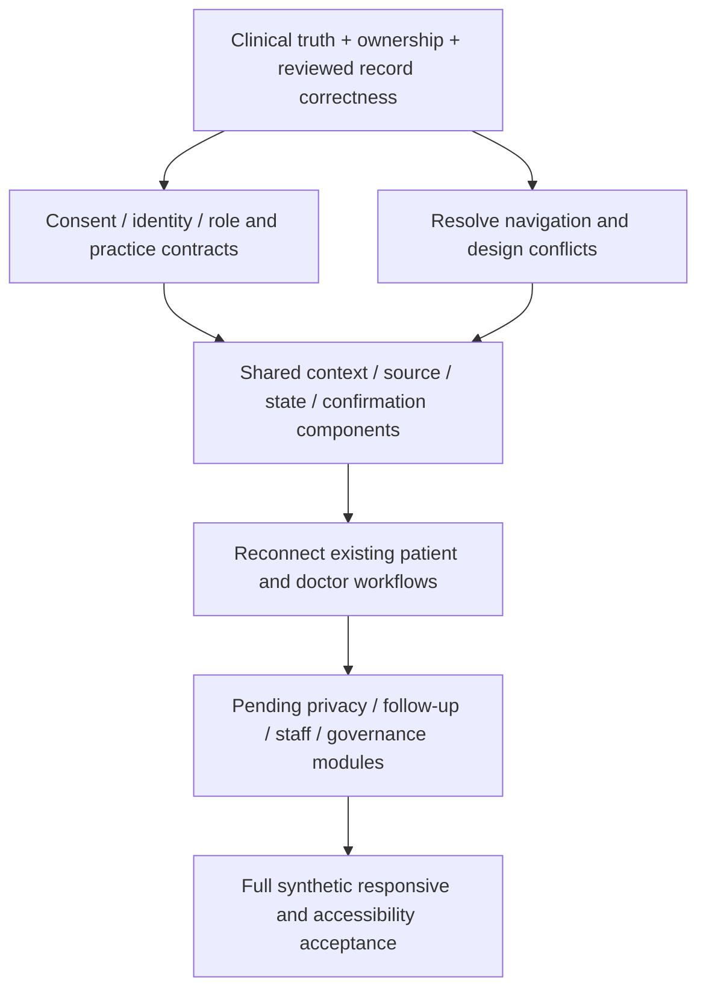

# Implementation gap analysis and ordered backlog

**Batch 6 (2026-10-26):** [Phase 3 medication provenance](12-medication-implementation.md) supersedes SCR-015/016 findings. Registry groups/filters, source-aligned detail, exact-version patient prescription view and selected encounter chapter are implemented and tested. Prescribed items remain UNKNOWN_STATUS; exposure/reaction authorship is not invented. Live database acceptance and unresolved You navigation remain open; neither screen is COMPLETE.

**Batch 5 (2026-10-26):** [Phase 4 Health Vault and source lifecycle](11-vault-implementation.md) supersedes SCR-013/014 source findings. Source shelf, upload recovery, refreshed OCR reports, confirmed corrections, actual trends and a paginated original-file drawer are implemented and tested. Live storage/worker/database acceptance, exact observation-page provenance and the unresolved You destination remain open. Neither screen is certified COMPLETE.

**Batch 4 (2026-10-26):** [Phase 3 booking and appointment management](10-appointment-implementation.md) supersedes the original SCR-017/022/023 findings. Visit selection/review, cancellation and approved cancel-and-rebook are implemented and tested; scoped packets, draft storage, clinic directions and video joining remain explicit limits.

**Batch 3 (2026-10-25):** [Phase 5 check-in, safety, result and timeline detail](09-checkin-implementation.md) records current implementation and synthetic verification. SCR-012 now exists; SCR-008/009/010 and AI timeline links are corrected. Packet consent, optional measurements, richer adaptive blocks and live database/worker acceptance remain open.

**Batch 2 (2026-10-25):** [Phase 2 patient-record implementation](08-patient-record-implementation.md) supersedes the original SCR-027/028/029 findings. Supported own-record workflows are implemented/tested; consent, safety-data and follow-up dependencies remain explicit.

**Implementation update (2026-10-25):** [Clinical record and navigation batch](07-implementation-progress.md) records the current code, test results and remaining blockers. Audit evidence below is the original snapshot except where explicitly updated. No whole screen is COMPLETE.

[Index](README.md) · [Interaction evidence](02-interaction-map.md) · [Design/code mapping](04-design-code-traceability.md)

This backlog started as a read-only audit. **Implementation progress is recorded below and in [07](07-implementation-progress.md); the original evidence remains distinguishable from subsequent verification.** Critical findings concern clinical facts, data isolation or authoritative records. High findings block safe/complete workflows. Medium findings cover missing functionality or consistency. Runtime failures are not claimed where only static evidence exists; verification methods below explicitly use synthetic records.

## Existing development-plan reconciliation

The [master build plan](../../code-agent/c-plans/2026-10-01_clinix-master-build-plan.md) has Phases 0–8. Sections mark Phases 0–5 complete; Phases 6/7/8 remain pending. Phase 1 frontmatter says pending while its section and screen checklist say complete. Phase 2 and Phase 3 detailed plans exist. A Phase 4 detail filename is mentioned but is absent in this checkout; Phase 5 has a gate script but no matching detailed plan found. No separate sprint schedule was found in the inspected project files. This audit associates issues with existing **phases**, not invented sprint numbers or dates.

Archived claims of 36/36, 33/33 and 38/38 API gates are historical plan statements. The scripts exist but were not rerun because they can create remote records and exercise external services. Such API gates cannot establish that a source-label button works, that saved fields equal finalized fields, or that a screen is responsive. Voice capture and a real video-consult provider are explicit master-plan non-goals; their designed controls need an explicit unavailable/deferred product decision, not an invented integration.

## Recommended dependency order

Navigation and shared contracts should be established before isolated visual polishing. Existing clinical correctness and disclosure hazards take priority even over shell polish. Order below is a recommended implementation sequence; dependency notes may require coordinating several adjacent items before closing one.

## Backlog index

| Order / issue | Severity | Title | Screens | Existing phase |
| --- | --- | --- | --- | --- |
| [GAP-001](#gap-001) | Critical | Replace fabricated clinical facts and consent labels | SCR-029 | Phase 2 dossier + Phase 5 update, both marked complete. |
| [GAP-002](#gap-002) | Critical | Enforce ownership on AI/session read endpoints | SCR-008, SCR-010, SCR-029 | Phase 5 implemented surface; privacy hardening is Phase 6 but existing isolation cannot wait. |
| [GAP-003](#gap-003) | Critical | Authorize prescription finalization replay before returning data | SCR-033, SCR-035 | Phase 3 finalization, marked complete. |
| [GAP-004](#gap-004) | Critical | Bind prescription confirmation to saved reviewed items | SCR-033, SCR-035 | Phase 3/4, marked complete. |
| [GAP-005](#gap-005) | Critical | Use actual safety outcome instead of unconditional low-risk UI | SCR-009, SCR-010, SCR-011 | Phase 5 marked Figma-faithful/complete. |
| [GAP-006](#gap-006) | Critical | Replace relationship-only access with scoped consent enforcement | SCR-018, SCR-020, SCR-021, SCR-023, SCR-029, SCR-030 | Phase 6 pending; current Phase 2/3/5 surfaces already claim consent. |
| [GAP-007](#gap-007) | High | Flush and confirm clinical autosave before completion | SCR-030, SCR-031 | Phase 3 marked complete. |
| [GAP-008](#gap-008) | High | Make note amendments actually editable and visible | SCR-030 | Phase 3 scope mismatch. |
| [GAP-009](#gap-009) | High | Preserve blocking emergency state across review and reload | SCR-008, SCR-009 | Phase 5 marked complete. |
| [GAP-010](#gap-010) | High | Enforce doctor verification and honest directory eligibility | SCR-004, SCR-019, SCR-029, SCR-034 | Phase 1 claims completion; professional directory in Phase 6/7. |
| [GAP-011](#gap-011) | High | Centralize and reconcile application navigation | SCR-006, SCR-007, SCR-011, SCR-013, SCR-015, SCR-017, SCR-022, SCR-024, SCR-027, SCR-042, SCR-043, SCR-053 | Phases 1/2 shell complete claims; staff nav explicitly unresolved in design. |
| [GAP-012](#gap-012) | High | Persist selected booking packet and sharing receipt | SCR-010, SCR-020, SCR-022, SCR-023 | Phase 3/5 marked complete; Phase 6 dependency unresolved. |
| [GAP-013](#gap-013) | High | Complete booking mode, validation and draft handling | SCR-022, SCR-023 | Phase 3 marked complete. |
| [GAP-014](#gap-014) | High | Rebuild check-in progression around actual question state | SCR-008 | Phase 5 marked adaptive/Figma-faithful complete. |
| [GAP-015](#gap-015) | High | Implement real result basis, save and export actions | SCR-010 | Phase 5 marked complete. |
| [GAP-016](#gap-016) | Medium | Restore timeline details and source navigation | SCR-011, SCR-012 | Phase 5 marked complete, detail state omitted. |
| [GAP-017](#gap-017) | Medium | Finish Vault visual/data lifecycle and source drawer | SCR-013, SCR-014 | Phase 4 marked complete. |
| [GAP-018](#gap-018) | Medium | Complete medication provenance and source detail | SCR-015, SCR-016 | Phase 3 marked complete. |
| [GAP-019](#gap-019) | Medium | Complete appointment-management actions | SCR-017 | Phase 3 complete claim; video provider explicitly excluded. |
| [GAP-020](#gap-020) | Medium | Complete schedule calendar/context and round-trip availability | SCR-024, SCR-025, SCR-026 | Phase 2 marked complete. |
| [GAP-021](#gap-021) | Medium | Complete directory and distinguish compact context from dossier | SCR-027, SCR-028, SCR-029 | Phase 2 marked complete; Phase 5 dossier update also incomplete. |
| [GAP-022](#gap-022) | Medium | Restore consultation context and review composition | SCR-030, SCR-031 | Phase 3 marked complete. |
| [GAP-023](#gap-023) | Medium | Restore draft queue source filters, priority and recovery | SCR-032 | Phase 3/4 marked complete; voice intentionally hypothetical. |
| [GAP-024](#gap-024) | High | Complete prescription safety/ambiguity/preview gates | SCR-033, SCR-034, SCR-035 | Phase 3/4 marked complete. |
| [GAP-025](#gap-025) | Medium | Restore duplicate-resolution and patient-create states | SCR-038, SCR-039, SCR-040, SCR-041 | Phase 2 marked complete; claim loop Phase 3. |
| [GAP-026](#gap-026) | Medium | Reconcile auth and onboarding with design and multi-workspace spec | SCR-001, SCR-002, SCR-003, SCR-004, SCR-005, SCR-053, SCR-055, SCR-056, SCR-057 | Phase 1 section says complete, frontmatter still pending; multi-workspace delivery mismatch. |
| [GAP-027](#gap-027) | Medium | Finish dashboard actions and data-backed care summaries | SCR-006, SCR-007 | Phase 2 marked complete; follow-ups Phase 7 pending. |
| [GAP-028](#gap-028) | High | Implement Care Circle, verified discovery and scope picker | SCR-018, SCR-019, SCR-020 | Phase 6 pending (Page 12); discovery/scope substates not separately tracked in 30-screen checklist. |
| [GAP-029](#gap-029) | High | Implement privacy ledger and patient permissions/requests | SCR-021 | Phase 6 pending; append-only claims require current verification. |
| [GAP-030](#gap-030) | High | Implement follow-up worklist and role-bounded task detail | SCR-036, SCR-037 | Phase 7 pending. |
| [GAP-031](#gap-031) | High | Implement distinct staff dashboard and intake/arrival boundaries | SCR-005, SCR-042, SCR-043, SCR-044, SCR-045 | Phase 7 pending, Page 2c prematurely checked in Phase 1 list. |
| [GAP-032](#gap-032) | High | Implement practice membership lifecycle with confirmations | SCR-046, SCR-047, SCR-048 | Phase 7 pending. |
| [GAP-033](#gap-033) | High | Implement removal/retention request and staff routing views | SCR-049, SCR-050, SCR-051 | Phase 6 pending; staff routing depends on Phase 7 boundaries. |
| [GAP-034](#gap-034) | Medium | Implement professional profile and consultation-services editor | SCR-052 | Phase 7 pending. |
| [GAP-035](#gap-035) | Medium | Standardize shared components after resolving contracts | SCR-001, SCR-006, SCR-007, SCR-011, SCR-013, SCR-024, SCR-029, SCR-030, SCR-033, SCR-042, SCR-052 | Foundation Phase 0 + all UI phase acceptance. |
| [GAP-036](#gap-036) | High | Verify responsive behavior and accessible interaction semantics | SCR-001, SCR-005, SCR-008, SCR-011, SCR-013, SCR-014, SCR-016, SCR-017, SCR-022, SCR-025, SCR-030, SCR-031, SCR-033, SCR-034, SCR-035, SCR-042, SCR-044, SCR-046, SCR-052 | Phase 8 phone/PWA gate pending; earlier phase visual fidelity not demonstrated. |
| [GAP-037](#gap-037) | Medium | Reopen phase acceptance with measurable screen/state gates | SCR-001, SCR-002, SCR-005, SCR-008, SCR-010, SCR-012, SCR-020, SCR-026, SCR-028, SCR-035, SCR-041, SCR-052 | Existing Phase 0–8 plan; no sprint schedule found, so no sprint assignment fabricated. |

## GAP-001 — Replace fabricated clinical facts and consent labels

| Field | Evidence / requirement |
| --- | --- |
| Severity / suggested order | Critical; sequence 1 |
| Affected screens | [SCR-029](01-information-architecture.md#scr-029) |
| Affected interactions | [INT-414](02-interaction-map.md#int-414), [INT-415](02-interaction-map.md#int-415) |
| Design reference | SCR-029: frame 2789 |
| Relevant source files | [apps/web/src/app/app/doctor/patients/[patientId]/page.tsx](../../apps/web/src/app/app/doctor/patients/[patientId]/page.tsx); [services/api/src/doctor-patients/routes.ts](../../services/api/src/doctor-patients/routes.ts) |
| Expected behavior | Only patient-specific, source-backed facts and actual authorization state appear in clinical dossier. |
| Actual observed/code-derived behavior | Empty allergies become Penicillin; conditions, medicines, lab values, primary doctor, dates and reassuring concern text are static; both consent branches say CONSENT ACTIVE; API returns allergies=[] and consent_active=null. |
| Missing work | Define an honest clinical context DTO, unknown/locked states, source/time provenance and render real patient data; isolate any demo fixtures from live dossiers. |
| Dependencies | None; block clinical fidelity acceptance until resolved. |
| Existing phase / scope mismatch | Phase 2 dossier + Phase 5 update, both marked complete. |
| Verification method | Use two synthetic patients with different/empty allergies and labs; no shared fictional facts, explicit unavailable state and correct consent display. |
| Batch 2 update | Implemented/tested within the patient-record module: fictional clinical values, consent, author/date/active-use claims removed; own-record DTO and explicit unavailable states. No whole-screen COMPLETE claim. See [08](08-patient-record-implementation.md). |

## GAP-002 — Enforce ownership on AI/session read endpoints

| Field | Evidence / requirement |
| --- | --- |
| Severity / suggested order | Critical; sequence 2 |
| Affected screens | [SCR-008](01-information-architecture.md#scr-008), [SCR-010](01-information-architecture.md#scr-010), [SCR-029](01-information-architecture.md#scr-029) |
| Affected interactions | [INT-110](02-interaction-map.md#int-110), [INT-414](02-interaction-map.md#int-414) |
| Design reference | SCR-008: frame 766; SCR-010: frame 843; SCR-029: frame 2789 |
| Relevant source files | [services/api/src/ai/routes.ts](../../services/api/src/ai/routes.ts); [services/api/src/interactions/routes.ts](../../services/api/src/interactions/routes.ts); [services/api/src/auth/guards.ts](../../services/api/src/auth/guards.ts) |
| Expected behavior | Patient/session reads are owner-only; doctor reads require appropriate relationship/consent. |
| Actual observed/code-derived behavior | AI result/evidence reads have no patient/relationship check; doctor assistance only checks role; interaction GET checks PATIENT role but not session ownership. |
| Missing work | Apply resource authorization before returning status, evidence or clinical content; include role, patient and consent scope on every branch; audit sensitive reads. |
| Dependencies | Shared authorization contract. |
| Existing phase / scope mismatch | Phase 5 implemented surface; privacy hardening is Phase 6 but existing isolation cannot wait. |
| Verification method | With synthetic IDs, patient B cannot GET patient A sessions/evidence/interactions; unrelated doctor cannot read assistance; legitimate own paths still work. No real-record probing. |
| Batch 3 update | Owner-only result/evidence/interaction reads and read auditing implemented/tested. Doctor encounter reads require own encounter plus relationship; cross-record AI endpoints fail closed with CONSENT_REQUIRED until Phase 6 scope exists. No live PostgreSQL policy certification. See [09](09-checkin-implementation.md). |

## GAP-003 — Authorize prescription finalization replay before returning data

| Field | Evidence / requirement |
| --- | --- |
| Severity / suggested order | Critical; sequence 3 |
| Affected screens | [SCR-033](01-information-architecture.md#scr-033), [SCR-035](01-information-architecture.md#scr-035) |
| Affected interactions | [INT-477](02-interaction-map.md#int-477), [INT-509](02-interaction-map.md#int-509) |
| Design reference | SCR-033: frame 3377; SCR-035: frame 3590 |
| Relevant source files | [services/api/src/prescriptions/routes.ts](../../services/api/src/prescriptions/routes.ts) |
| Expected behavior | Every finalization/replay response belongs to requesting authorized doctor. |
| Actual observed/code-derived behavior | loadPrescriptionByDraft replay returns existing prescription before draft.doctorId ownership is checked in transaction path. |
| Missing work | Move equivalent authorization into replay/race paths; preserve idempotent behavior without disclosing another doctor’s prescription. |
| Dependencies | Shared authorization contract. |
| Existing phase / scope mismatch | Phase 3 finalization, marked complete. |
| Verification method | Two synthetic doctors: foreign finalized draft replay rejected; owner replay returns same immutable version. |
| Implementation update | Implemented; synthetic Fastify ownership/replay tests pass. No live PostgreSQL security run. See [batch report](07-implementation-progress.md). |

## GAP-004 — Bind prescription confirmation to saved reviewed items

| Field | Evidence / requirement |
| --- | --- |
| Severity / suggested order | Critical; sequence 4 |
| Affected screens | [SCR-033](01-information-architecture.md#scr-033), [SCR-035](01-information-architecture.md#scr-035) |
| Affected interactions | [INT-471](02-interaction-map.md#int-471), [INT-472](02-interaction-map.md#int-472), [INT-475](02-interaction-map.md#int-475), [INT-477](02-interaction-map.md#int-477), [INT-509](02-interaction-map.md#int-509) |
| Design reference | SCR-033: frame 3377; SCR-035: frame 3590 |
| Relevant source files | [apps/web/src/app/app/doctor/prescription-drafts/[draftId]/page.tsx](../../apps/web/src/app/app/doctor/prescription-drafts/[draftId]/page.tsx); [services/api/src/prescriptions/routes.ts](../../services/api/src/prescriptions/routes.ts) |
| Expected behavior | Finalized prescription exactly matches fields reviewed in confirmation. |
| Actual observed/code-derived behavior | Local items can change; finalize sends {}, endpoint reads persisted items; confirmation counts local items without saving them. |
| Missing work | Persist/validate current revision before opening/confirming finalization; prevent stale version/review mismatch; show exact saved content/hash in review. |
| Dependencies | Prescription save/version contract. |
| Existing phase / scope mismatch | Phase 3/4, marked complete. |
| Verification method | Edit a synthetic draft without pressing Save then finalize: final Rx must match the explicit reviewed content or finalization must remain blocked. |
| Implementation update | Save-before-review, saved medicine snapshot and stale-content checks implemented/tested. GAP-024 source/safety/ambiguity/preview gates remain open; no whole-screen completion. See [batch report](07-implementation-progress.md). |

## GAP-005 — Use actual safety outcome instead of unconditional low-risk UI

| Field | Evidence / requirement |
| --- | --- |
| Severity / suggested order | Critical; sequence 5 |
| Affected screens | [SCR-009](01-information-architecture.md#scr-009), [SCR-010](01-information-architecture.md#scr-010), [SCR-011](01-information-architecture.md#scr-011) |
| Affected interactions | [INT-105](02-interaction-map.md#int-105), [INT-107](02-interaction-map.md#int-107), [INT-110](02-interaction-map.md#int-110), [INT-117](02-interaction-map.md#int-117) |
| Design reference | SCR-009: frame 815; SCR-010: frame 843; SCR-011: frame 951 |
| Relevant source files | [apps/web/src/app/app/patient/checkin/result/[sessionId]/page.tsx](../../apps/web/src/app/app/patient/checkin/result/[sessionId]/page.tsx); [services/api/src/ai/routes.ts](../../services/api/src/ai/routes.ts); [services/api/src/timeline/routes.ts](../../services/api/src/timeline/routes.ts); [services/worker/src/handlers/ai-analyze.ts](../../services/worker/src/handlers/ai-analyze.ts); [services/worker/src/pipeline/post-check.ts](../../services/worker/src/pipeline/post-check.ts) |
| Expected behavior | Risk labels, escalation, guidance and timeline summaries reflect the actual analyzed outcome. |
| Actual observed/code-derived behavior | Result always displays LOW RISK/no red flags; timeline AI summary is always low risk; worker discards sanitized outcome and API reconstructs guidance from raw safeConsensus. |
| Missing work | Persist/serve the checked outcome, derive risk/uncertainty/escalation UI from it, remove unconditional reassuring fallback and retain source evidence. |
| Dependencies | AI outcome DTO and safety-state contract. |
| Existing phase / scope mismatch | Phase 5 marked Figma-faithful/complete. |
| Verification method | Synthetic urgent and nonurgent judge outputs produce distinct correct labels; sanitized guidance survives API round trip; no urgent case gets unconditional low-risk text. |
| Batch 3 update | Worker now stores deterministic checked patient_outcome with SUCCEEDED; result/timeline read it instead of raw consensus. Urgent results show a blocking urgent-care screen, review/disagreement states differ, unavailable legacy results fail closed. Synthetic worker/API/browser tests pass. New migration not live-applied. See [09](09-checkin-implementation.md). |

## GAP-006 — Replace relationship-only access with scoped consent enforcement

| Field | Evidence / requirement |
| --- | --- |
| Severity / suggested order | Critical; sequence 6 |
| Affected screens | [SCR-018](01-information-architecture.md#scr-018), [SCR-020](01-information-architecture.md#scr-020), [SCR-021](01-information-architecture.md#scr-021), [SCR-023](01-information-architecture.md#scr-023), [SCR-029](01-information-architecture.md#scr-029), [SCR-030](01-information-architecture.md#scr-030) |
| Affected interactions | [INT-229](02-interaction-map.md#int-229), [INT-276](02-interaction-map.md#int-276), [INT-283](02-interaction-map.md#int-283), [INT-323](02-interaction-map.md#int-323) |
| Design reference | SCR-018: frame 1703; SCR-020: frame 1944; SCR-021: frame 2021; SCR-023: frame 2255; SCR-029: frame 2789; SCR-030: frame 2966 |
| Relevant source files | [services/api/src/auth/guards.ts](../../services/api/src/auth/guards.ts); [services/api/src/doctor-patients/routes.ts](../../services/api/src/doctor-patients/routes.ts); [services/api/src/consultations/routes.ts](../../services/api/src/consultations/routes.ts); [services/api/src/relationships/routes.ts](../../services/api/src/relationships/routes.ts) |
| Expected behavior | Adding doctor or booking never automatically grants unrelated history; scope/expiry/revocation are enforced server-side. |
| Actual observed/code-derived behavior | ACTIVE relationship permits broad patient-resource access; no registered consent API; booking receipt is local preview; dossier queries patient history beyond appointment-specific packet. |
| Missing work | Implement authoritative consent scope/expiry/revocation and minimum-necessary composition; separate relationship from permission; show explicit locked state. |
| Dependencies | Resolve consent model before packet/source/UI completion. |
| Existing phase / scope mismatch | Phase 6 pending; current Phase 2/3/5 surfaces already claim consent. |
| Verification method | Synthetic related doctor with no/expired/revoked/limited grant sees only permitted groups; no broadening from Care relationship alone. |
| Batch 2 update | PARTIAL containment: workspace/medication/source composition limited to this doctor’s own records; patient-shared/other-clinician groups locked. Full scoped grant/expiry/revocation service still unimplemented. See [08](08-patient-record-implementation.md). |

## GAP-007 — Flush and confirm clinical autosave before completion

| Field | Evidence / requirement |
| --- | --- |
| Severity / suggested order | High; sequence 7 |
| Affected screens | [SCR-030](01-information-architecture.md#scr-030), [SCR-031](01-information-architecture.md#scr-031) |
| Affected interactions | [INT-420](02-interaction-map.md#int-420), [INT-421](02-interaction-map.md#int-421), [INT-422](02-interaction-map.md#int-422), [INT-423](02-interaction-map.md#int-423), [INT-438](02-interaction-map.md#int-438) |
| Design reference | SCR-030: frame 2966; SCR-031: frame 3103 |
| Relevant source files | [apps/web/src/app/app/doctor/consultation/[appointmentId]/page.tsx](../../apps/web/src/app/app/doctor/consultation/[appointmentId]/page.tsx); [services/api/src/appointments/routes.ts](../../services/api/src/appointments/routes.ts); [services/api/src/consultations/routes.ts](../../services/api/src/consultations/routes.ts) |
| Expected behavior | Complete the latest persisted note atomically or fail with an actionable pending/error state. |
| Actual observed/code-derived behavior | 800ms note save timer runs separately; complete immediately posts {}; timer errors are uncaught; backend completion can finalize existing or absent note. |
| Missing work | Await latest save, guard stale/versioned note and completion state, surface save failure/retry, prevent empty/partial completion where disallowed. |
| Dependencies | Note revision/finalization contract. |
| Existing phase / scope mismatch | Phase 3 marked complete. |
| Verification method | Under delayed/failed synthetic PUT, immediate completion cannot lose last edits or claim success before save; retry preserves text. |
| Implementation update | Serialized saves, explicit failure/retry, completion flush, reviewed_note comparison and atomic completion implemented/tested. Actual PostgreSQL concurrency remains unverified. See [batch report](07-implementation-progress.md). |

## GAP-008 — Make note amendments actually editable and visible

| Field | Evidence / requirement |
| --- | --- |
| Severity / suggested order | High; sequence 8 |
| Affected screens | [SCR-030](01-information-architecture.md#scr-030) |
| Affected interactions | [INT-420](02-interaction-map.md#int-420), [INT-438](02-interaction-map.md#int-438) |
| Design reference | SCR-030: frame 2966 |
| Relevant source files | [apps/web/src/app/app/doctor/consultation/[appointmentId]/page.tsx](../../apps/web/src/app/app/doctor/consultation/[appointmentId]/page.tsx); [services/api/src/consultations/routes.ts](../../services/api/src/consultations/routes.ts) |
| Expected behavior | Doctor creates a dated corrected note with reason, preserving original and exposing amendment history. |
| Actual observed/code-derived behavior | Amend mode adds reason only while readOnly keeps sections rendered as dl; POST sends previously loaded sections; consultation GET selects only CONSULTATION notes. |
| Missing work | Expose revised editable fields in amendment mode and display appended amendments/history without replacing original. |
| Dependencies | Note revision contract; completion fix. |
| Existing phase / scope mismatch | Phase 3 scope mismatch. |
| Verification method | Finalize synthetic note, amend assessment, reopen consultation: original and new assessment/reason/author/time are visible. |
| Implementation update | Editable amendment sections, immutable original, final-note guard and dated author-ID history implemented; synthetic UI/API/browser tests pass. See [batch report](07-implementation-progress.md). |

## GAP-009 — Preserve blocking emergency state across review and reload

| Field | Evidence / requirement |
| --- | --- |
| Severity / suggested order | High; sequence 9 |
| Affected screens | [SCR-008](01-information-architecture.md#scr-008), [SCR-009](01-information-architecture.md#scr-009) |
| Affected interactions | [INT-092](02-interaction-map.md#int-092), [INT-100](02-interaction-map.md#int-100), [INT-101](02-interaction-map.md#int-101), [INT-107](02-interaction-map.md#int-107) |
| Design reference | SCR-008: frame 766; SCR-009: frame 815 |
| Relevant source files | [apps/web/src/app/app/patient/checkin/page.tsx](../../apps/web/src/app/app/patient/checkin/page.tsx); [services/api/src/interactions/routes.ts](../../services/api/src/interactions/routes.ts) |
| Expected behavior | Review answers cannot resume unsafe normal flow; reload restores correct session/interrupt state. |
| Actual observed/code-derived behavior | Review only sets isEmergency=false; no session persistence/resume; response route does not reject ESCALATED/COMPLETED before inserting/advancing and does not bind block ID to session. |
| Missing work | Define safe read-only review/resume transitions, validate block/session ownership/current state, prevent duplicated/foreign answers and unsafe progression. |
| Dependencies | Safety state machine and ownership fix. |
| Existing phase / scope mismatch | Phase 5 marked complete. |
| Verification method | Synthetic escalation → review/back/reload/duplicate POST remains blocked or safely read-only; foreign block IDs rejected. |
| Batch 3 update | Persistent safety_alert plus owner-checked restore; review is a native read-only dialog. Server refuses escalated response/analysis progression, binds blocks to session, serializes retries and earlier-answer edits. Browser/API tested; live database migration required. See [09](09-checkin-implementation.md). |

## GAP-010 — Enforce doctor verification and honest directory eligibility

| Field | Evidence / requirement |
| --- | --- |
| Severity / suggested order | High; sequence 10 |
| Affected screens | [SCR-004](01-information-architecture.md#scr-004), [SCR-019](01-information-architecture.md#scr-019), [SCR-029](01-information-architecture.md#scr-029), [SCR-034](01-information-architecture.md#scr-034) |
| Affected interactions | [INT-043](02-interaction-map.md#int-043), [INT-254](02-interaction-map.md#int-254), [INT-415](02-interaction-map.md#int-415) |
| Design reference | SCR-004: frame 350; SCR-019: frame 1832; SCR-029: frame 2789; SCR-034: frame 3524 |
| Relevant source files | [services/api/src/auth/guards.ts](../../services/api/src/auth/guards.ts); [services/api/src/doctors/routes.ts](../../services/api/src/doctors/routes.ts); [services/api/src/relationships/routes.ts](../../services/api/src/relationships/routes.ts); [apps/web/src/app/onboarding/doctor/page.tsx](../../apps/web/src/app/onboarding/doctor/page.tsx) |
| Expected behavior | Professional actions/directory visibility obey explicit verification policy. |
| Actual observed/code-derived behavior | Onboarding writes PENDING and routes to Doctor; requireDoctor never checks verification; /doctors list has no verified-only filter. |
| Missing work | Resolve prototype policy, enforce it consistently in API and UI, and render pending/evidence/reverification states. |
| Dependencies | Product verification policy; auth model. |
| Existing phase / scope mismatch | Phase 1 claims completion; professional directory in Phase 6/7. |
| Verification method | Synthetic PENDING/VERIFIED/REJECTED profiles exercise workspace/action/discovery policies; client label never substitutes for server guard. |
| Batch 4 update | Approved API contract §4 explicitly allows a completed PENDING doctor profile into the workspace under the demo policy; verification is advisory. No contrary verification gate was invented. Booking picker now displays actual status rather than a static VERIFIED badge. Future verified-only discovery/governance remains outside this completed-phase batch. See [10](10-appointment-implementation.md). |

## GAP-011 — Centralize and reconcile application navigation

| Field | Evidence / requirement |
| --- | --- |
| Severity / suggested order | High; sequence 11 |
| Affected screens | [SCR-006](01-information-architecture.md#scr-006), [SCR-007](01-information-architecture.md#scr-007), [SCR-011](01-information-architecture.md#scr-011), [SCR-013](01-information-architecture.md#scr-013), [SCR-015](01-information-architecture.md#scr-015), [SCR-017](01-information-architecture.md#scr-017), [SCR-022](01-information-architecture.md#scr-022), [SCR-024](01-information-architecture.md#scr-024), [SCR-027](01-information-architecture.md#scr-027), [SCR-042](01-information-architecture.md#scr-042), [SCR-043](01-information-architecture.md#scr-043), [SCR-053](01-information-architecture.md#scr-053) |
| Affected interactions | [INT-063](02-interaction-map.md#int-063), [INT-065](02-interaction-map.md#int-065), [INT-162](02-interaction-map.md#int-162), [INT-194](02-interaction-map.md#int-194), [INT-342](02-interaction-map.md#int-342) |
| Design reference | SCR-006: frame 478; SCR-007: frame 594; SCR-011: frame 951; SCR-013: frame 1130; SCR-015: frame 1310; SCR-017: frame 1555; SCR-022: frame 2143; SCR-024: frame 2317; SCR-027: frame 2609; SCR-042: frame 4536; SCR-043: frame 4687; SCR-053: documented/code surface, no frame |
| Relevant source files | [apps/web/src/components/workspace-shell.tsx](../../apps/web/src/components/workspace-shell.tsx); [apps/web/src/app/settings/page.tsx](../../apps/web/src/app/settings/page.tsx); [apps/web/src/app/app/staff/page.tsx](../../apps/web/src/app/app/staff/page.tsx) |
| Expected behavior | Existing destinations are consistently reachable with correct label; unresolved design choices stay explicit. |
| Actual observed/code-derived behavior | Care links to medication registry; Timeline is disabled on four pages; follow-ups disabled; staff dock self-links; Settings has no incoming app link; design four/five-item models conflict. |
| Missing work | Decide canonical patient/doctor/staff nav and account entry; shared route/capability manifest; correct links/selection and unavailable affordances. |
| Dependencies | Product decision on Page 0 vs rendered docks; missing-module milestones. |
| Existing phase / scope mismatch | Phases 1/2 shell complete claims; staff nav explicitly unresolved in design. |
| Verification method | Route crawl with synthetic roles plus keyboard/mobile checks: every enabled label reaches intended destination, existing Timeline is reachable, unknown modules are not misleading self-links. |
| Implementation update | PARTIAL: Timeline links from Vault, medications, Visits and booking restored and browser-tested. Care/staff/follow-up/shared manifest decisions remain open. See [batch report](07-implementation-progress.md). |
| Batch 4 update | Within visit/booking screens, existing Home/Timeline/Reports/Visits/medication destinations are preserved, the medication destination is labelled honestly, and navigation sits after content instead of covering forms. The four-item design You/Care discrepancy remains unresolved; no arbitrary You route added. See [10](10-appointment-implementation.md). |

## GAP-012 — Persist selected booking packet and sharing receipt

| Field | Evidence / requirement |
| --- | --- |
| Severity / suggested order | High; sequence 12 |
| Affected screens | [SCR-010](01-information-architecture.md#scr-010), [SCR-020](01-information-architecture.md#scr-020), [SCR-022](01-information-architecture.md#scr-022), [SCR-023](01-information-architecture.md#scr-023) |
| Affected interactions | [INT-116](02-interaction-map.md#int-116), [INT-117](02-interaction-map.md#int-117), [INT-310](02-interaction-map.md#int-310), [INT-311](02-interaction-map.md#int-311), [INT-312](02-interaction-map.md#int-312), [INT-313](02-interaction-map.md#int-313), [INT-315](02-interaction-map.md#int-315), [INT-323](02-interaction-map.md#int-323) |
| Design reference | SCR-010: frame 843; SCR-020: frame 1944; SCR-022: frame 2143; SCR-023: frame 2255 |
| Relevant source files | [apps/web/src/app/app/patient/book/page.tsx](../../apps/web/src/app/app/patient/book/page.tsx); [apps/web/src/app/app/patient/checkin/result/[sessionId]/page.tsx](../../apps/web/src/app/app/patient/checkin/result/[sessionId]/page.tsx); [packages/schemas/src/index.ts](../../packages/schemas/src/index.ts); [services/api/src/appointments/routes.ts](../../services/api/src/appointments/routes.ts) |
| Expected behavior | Selected packet, origin encounter, purpose, recipient and expiry survive review/confirmation and define doctor-visible context. |
| Actual observed/code-derived behavior | Result passes packetId/encounterId but BookPage reads no search params; packet array omitted from POST; schema has encounter_id but no packet/consent; expiry preview says end of encounter instead of 7 days. |
| Missing work | Define packet/consent contract; hydrate incoming context; persist exact records and receipt; validate authoritative doctor access after booking. |
| Dependencies | Consent enforcement and source model. |
| Existing phase / scope mismatch | Phase 3/5 marked complete; Phase 6 dependency unresolved. |
| Verification method | Select only synthetic lab A and not B; book from result, reload, inspect authorized doctor context and receipt: only A plus explicitly selected context travels. |
| Batch 3 update | Still BLOCKED: result now states sharing unavailable and opens a truthful scope explanation; ordinary booking no longer carries ignored packet/encounter query parameters or claims sharing. No packet or consent workflow invented. See [09](09-checkin-implementation.md). |
| Batch 4 update | Still BLOCKED on scoped consent. Fake selectable packet attachments/receipt/expiry removed from booking/review; explicit no-sharing state shown. Existing booking endpoint rejects provided unsupported packet/consent fields rather than silently succeeding. No Phase 6 service invented. See [10](10-appointment-implementation.md). |

## GAP-013 — Complete booking mode, validation and draft handling

| Field | Evidence / requirement |
| --- | --- |
| Severity / suggested order | High; sequence 13 |
| Affected screens | [SCR-022](01-information-architecture.md#scr-022), [SCR-023](01-information-architecture.md#scr-023) |
| Affected interactions | [INT-299](02-interaction-map.md#int-299), [INT-300](02-interaction-map.md#int-300), [INT-317](02-interaction-map.md#int-317), [INT-323](02-interaction-map.md#int-323) |
| Design reference | SCR-022: frame 2143; SCR-023: frame 2255 |
| Relevant source files | [apps/web/src/app/app/patient/book/page.tsx](../../apps/web/src/app/app/patient/book/page.tsx); [packages/schemas/src/index.ts](../../packages/schemas/src/index.ts); [services/api/src/appointments/routes.ts](../../services/api/src/appointments/routes.ts) |
| Expected behavior | Choose supported visit mode; optional reason does not break booking; draft/review/cancel preserves intended state. |
| Actual observed/code-derived behavior | appointment_type is always IN_PERSON; no online selector; reason sends null while schema accepts optional string; no save draft or matching header cancel. |
| Missing work | Support mode and valid optional payloads; define draft/cancel behavior; show availability-load errors. |
| Dependencies | Booking/availability contract. |
| Existing phase / scope mismatch | Phase 3 marked complete. |
| Verification method | Book synthetic appointment with empty and filled reason in each permitted mode; verify request, persisted mode, receipt and error recovery. |
| Batch 4 update | PARTIAL: mode/date/slot/reason/review/back/cancel, empty-reason omission, actual metadata, keyed availability and server slot replay/capacity checks implemented/tested. Persisted draft remains blocked: no approved storage contract/API; Save as draft is explicitly unavailable. Source 2143/2255 compared with 393px runtime captures. See [10](10-appointment-implementation.md). |

## GAP-014 — Rebuild check-in progression around actual question state

| Field | Evidence / requirement |
| --- | --- |
| Severity / suggested order | High; sequence 14 |
| Affected screens | [SCR-008](01-information-architecture.md#scr-008) |
| Affected interactions | [INT-092](02-interaction-map.md#int-092), [INT-094](02-interaction-map.md#int-094), [INT-099](02-interaction-map.md#int-099), [INT-100](02-interaction-map.md#int-100), [INT-101](02-interaction-map.md#int-101) |
| Design reference | SCR-008: frame 766 |
| Relevant source files | [apps/web/src/app/app/patient/checkin/page.tsx](../../apps/web/src/app/app/patient/checkin/page.tsx); [services/api/src/interactions/routes.ts](../../services/api/src/interactions/routes.ts); [packages/schemas/src/index.ts](../../packages/schemas/src/index.ts) |
| Expected behavior | Back restores previous block/answer; progress reflects real total; input respects block type and free-text allowance. |
| Actual observed/code-derived behavior | Back decrements number only; display total 7, server advances fixed 3 single-select questions; generic basis text; multi/numeric/date/scale schema exists but renderer ignores it. |
| Missing work | Version question/answer history, resume endpoint contract, dynamic progress and block renderer; use actual basis metadata. |
| Dependencies | Question/session state model and safety fix. |
| Existing phase / scope mismatch | Phase 5 marked adaptive/Figma-faithful complete. |
| Verification method | Synthetic varying block types and branch counts; back/forward/reload restores correct answers and never duplicates submission. |
| Batch 3 update | PARTIAL: real block/answer Back, resume URL/GET, configured three-step progress, empty-answer validation, server-bound free text, duplicate retry and dependent-answer invalidation implemented/tested. Full adaptive branch generation, multi/numeric/date/scale renderer and draft autosave remain open. See [09](09-checkin-implementation.md). |

## GAP-015 — Implement real result basis, save and export actions

| Field | Evidence / requirement |
| --- | --- |
| Severity / suggested order | High; sequence 15 |
| Affected screens | [SCR-010](01-information-architecture.md#scr-010) |
| Affected interactions | [INT-110](02-interaction-map.md#int-110), [INT-113](02-interaction-map.md#int-113), [INT-114](02-interaction-map.md#int-114), [INT-115](02-interaction-map.md#int-115), [INT-116](02-interaction-map.md#int-116), [INT-118](02-interaction-map.md#int-118), [INT-119](02-interaction-map.md#int-119), [INT-120](02-interaction-map.md#int-120) |
| Design reference | SCR-010: frame 843 |
| Relevant source files | [apps/web/src/app/app/patient/checkin/result/[sessionId]/page.tsx](../../apps/web/src/app/app/patient/checkin/result/[sessionId]/page.tsx); [services/api/src/ai/routes.ts](../../services/api/src/ai/routes.ts) |
| Expected behavior | Result actions open evidence, collect optional missing facts, persist/export only after valid review and report truthful success. |
| Actual observed/code-derived behavior | Basis/scope are p text, optional missing-information section absent, save toggles local boolean, share/download buttons have no handlers, labs hardcoded. |
| Missing work | Wire evidence/scope controls, real persistence or accurate already-saved model, safe export/share contract and data-backed linked records. |
| Dependencies | Safe outcome, consent/source contracts. |
| Existing phase / scope mismatch | Phase 5 marked complete. |
| Verification method | Reload after save; open every source; downloaded/shared synthetic packet matches reviewed scope; failure cannot display saved success. |
| Batch 3 update | PARTIAL: actual evidence/retry/focus-return dialog, data-backed labs, uncertainty/checked disposition, truthful saved-record timeline Link and parsed local JSON result download. Optional measurement mutation/reanalysis, Vault document save, scoped packet sharing/export and consent remain BLOCKED; no fake success. See [09](09-checkin-implementation.md). |

## GAP-016 — Restore timeline details and source navigation

| Field | Evidence / requirement |
| --- | --- |
| Severity / suggested order | Medium; sequence 16 |
| Affected screens | [SCR-011](01-information-architecture.md#scr-011), [SCR-012](01-information-architecture.md#scr-012) |
| Affected interactions | [INT-124](02-interaction-map.md#int-124), [INT-130](02-interaction-map.md#int-130), [INT-131](02-interaction-map.md#int-131), [INT-132](02-interaction-map.md#int-132), [INT-133](02-interaction-map.md#int-133), [INT-134](02-interaction-map.md#int-134), [INT-135](02-interaction-map.md#int-135), [INT-136](02-interaction-map.md#int-136), [INT-146](02-interaction-map.md#int-146), [INT-147](02-interaction-map.md#int-147), [INT-148](02-interaction-map.md#int-148), [INT-149](02-interaction-map.md#int-149) |
| Design reference | SCR-011: frame 951; SCR-012: frame 1060 |
| Relevant source files | [apps/web/src/app/app/patient/timeline/page.tsx](../../apps/web/src/app/app/patient/timeline/page.tsx); [services/api/src/timeline/routes.ts](../../services/api/src/timeline/routes.ts) |
| Expected behavior | Every actionable entry opens its exact provenance/source detail and can return to filtered timeline. |
| Actual observed/code-derived behavior | View details is span; no detail screen/handler; metadata IDs are returned but not consumed; header search missing. |
| Missing work | Implement detail/source state within agreed route strategy; search/filter and preserved back state; no invented source destinations. |
| Dependencies | Shared authorized source viewer and navigation decisions. |
| Existing phase / scope mismatch | Phase 5 marked complete, detail state omitted. |
| Verification method | Open each synthetic record type; confirm correct resource ID/source and back preserves filter/scroll. |
| Batch 3 update | PARTIAL: omitted SCR-012 implemented for AI check-ins with saved provenance/answer snapshot, selected-session full result links and Close/Back. Both AI timeline row templates connect to selected session. Non-AI source/detail routes and scoped packet remain open. See [09](09-checkin-implementation.md). |

## GAP-017 — Finish Vault visual/data lifecycle and source drawer

| Field | Evidence / requirement |
| --- | --- |
| Severity / suggested order | Medium; sequence 17 |
| Affected screens | [SCR-013](01-information-architecture.md#scr-013), [SCR-014](01-information-architecture.md#scr-014) |
| Affected interactions | [INT-151](02-interaction-map.md#int-151), [INT-152](02-interaction-map.md#int-152), [INT-153](02-interaction-map.md#int-153), [INT-156](02-interaction-map.md#int-156), [INT-157](02-interaction-map.md#int-157), [INT-158](02-interaction-map.md#int-158), [INT-176](02-interaction-map.md#int-176), [INT-177](02-interaction-map.md#int-177), [INT-178](02-interaction-map.md#int-178), [INT-179](02-interaction-map.md#int-179), [INT-180](02-interaction-map.md#int-180), [INT-181](02-interaction-map.md#int-181) |
| Design reference | SCR-013: frame 1130; SCR-014: frame 1249 |
| Relevant source files | [apps/web/src/app/app/patient/vault/page.tsx](../../apps/web/src/app/app/patient/vault/page.tsx); [services/api/src/documents/routes.ts](../../services/api/src/documents/routes.ts); [services/worker/src/handlers/document-extract.ts](../../services/worker/src/handlers/document-extract.ts) |
| Expected behavior | Source shelf, processing/review states, observations and trends remain linked and refresh when extraction completes. |
| Current implementation | Batch 5 implements source summary/shelf, checked resumable upload, shared document/report polling, patient value confirmation with source-locked review-state update, keyed actual trends, native PDF/image drawer, pagination, original open/download and report return. |
| Remaining work | Live PostgreSQL/storage/queue/worker acceptance; OCR page-coordinate metadata; full PDF accessibility/complex-font/scanned-document acceptance; separate dimmed header Back and unresolved You destination. No OCR percentage or fixture medical facts invented. |
| Dependencies | PDF.js 6.4.299 loads locally for actual PDF rendering; existing endpoints retained. No new migration or clinical sharing service. |
| Existing phase / scope mismatch | Phase 4 marked complete. |
| Verification | Two-page synthetic source renders/paginates; checked upload/completion recovery; extraction refresh without reload; review/correction updates queue and trend; bytes/filename/parent routes/keyboard/width checks. See [exact evidence and limitations](11-vault-implementation.md). |

## GAP-018 — Complete medication provenance and source detail

| Field | Evidence / requirement |
| --- | --- |
| Severity / suggested order | Medium; sequence 18 |
| Affected screens | [SCR-015](01-information-architecture.md#scr-015), [SCR-016](01-information-architecture.md#scr-016) |
| Affected interactions | [INT-186](02-interaction-map.md#int-186), [INT-187](02-interaction-map.md#int-187), [INT-188](02-interaction-map.md#int-188), [INT-189](02-interaction-map.md#int-189), [INT-190](02-interaction-map.md#int-190), [INT-198](02-interaction-map.md#int-198), [INT-199](02-interaction-map.md#int-199), [INT-200](02-interaction-map.md#int-200) |
| Design reference | SCR-015: frame 1310; SCR-016: frame 1495 |
| Relevant source files | [apps/web/src/app/app/patient/medications/page.tsx](../../apps/web/src/app/app/patient/medications/page.tsx); [services/api/src/medications/derive.ts](../../services/api/src/medications/derive.ts); [services/api/src/prescriptions/routes.ts](../../services/api/src/prescriptions/routes.ts) |
| Expected behavior | Medication detail preserves dose/duration/author/reason/reaction provenance and links original prescription/encounter. |
| Current implementation | Batch 6 implements source-aligned registry/detail, discontinued/unknown filters, stored exposure context/dates, exact item/version provenance, read-only patient prescription and originating owned encounter view. Derived prescribed items correctly retain UNKNOWN_STATUS. |
| Remaining work | Seeded live database acceptance; absent exposure/reaction authorship metadata and legacy original-version links; unresolved You navigation. No exposure write service or current-use inference was added. |
| Dependencies | Existing patient prescription and Timeline APIs reused; shared native dialog has opt-in full-screen patient mode. Explicit DISCONTINUED is preserved only for exposure records; no migration/new endpoint. |
| Existing phase / scope mismatch | Phase 3 marked complete. |
| Verification | Synthetic active/past/discontinued/unknown projection and browser cases; original v1 remains visible when current is v2; missing/foreign sources fail without fallback; selected encounter and module exits work. See [batch 6](12-medication-implementation.md). |

## GAP-019 — Complete appointment-management actions

| Field | Evidence / requirement |
| --- | --- |
| Severity / suggested order | Medium; sequence 19 |
| Affected screens | [SCR-017](01-information-architecture.md#scr-017) |
| Affected interactions | [INT-206](02-interaction-map.md#int-206), [INT-207](02-interaction-map.md#int-207), [INT-208](02-interaction-map.md#int-208), [INT-209](02-interaction-map.md#int-209), [INT-212](02-interaction-map.md#int-212), [INT-215](02-interaction-map.md#int-215) |
| Design reference | SCR-017: frame 1555 |
| Relevant source files | [apps/web/src/app/app/patient/appointments/page.tsx](../../apps/web/src/app/app/patient/appointments/page.tsx); [services/api/src/appointments/routes.ts](../../services/api/src/appointments/routes.ts) |
| Expected behavior | Reschedule/cancel follow clinic policy; online/directions affordances reflect supported integrations. |
| Actual observed/code-derived behavior | Only REQUESTED cancellation; no reschedule/join/maps/address; mutation errors uncaught; backend cancel lacks designed time/status policy gates. |
| Missing work | Implement supported management/policy contract and honest unavailable modes; preserve manual payment states; explicitly defer real video per master-plan non-goal. |
| Dependencies | Booking policy and product decision on design video vs deferred provider. |
| Existing phase / scope mismatch | Phase 3 complete claim; video provider explicitly excluded. |
| Verification method | Synthetic requested/confirmed/past cases test allowed/denied cancellation/reschedule and actionable errors; external actions verified without real appointments. |
| Batch 4 update | PARTIAL: actual counts/date buckets, manual payment states, requested/confirmed cancellation, error/retry, and explicitly confirmed cancel-and-rebook implemented/tested. Existing Phase 3 plan specifies cancel + re-book, not an invented atomic reschedule endpoint. Doctor confirmation/completion cannot revive cancelled visits. Join provider excluded; directions blocked on missing clinic location. See [10](10-appointment-implementation.md). |

## GAP-020 — Complete schedule calendar/context and round-trip availability

| Field | Evidence / requirement |
| --- | --- |
| Severity / suggested order | Medium; sequence 20 |
| Affected screens | [SCR-024](01-information-architecture.md#scr-024), [SCR-025](01-information-architecture.md#scr-025), [SCR-026](01-information-architecture.md#scr-026) |
| Affected interactions | [INT-328](02-interaction-map.md#int-328), [INT-329](02-interaction-map.md#int-329), [INT-335](02-interaction-map.md#int-335), [INT-366](02-interaction-map.md#int-366), [INT-367](02-interaction-map.md#int-367), [INT-368](02-interaction-map.md#int-368), [INT-371](02-interaction-map.md#int-371), [INT-372](02-interaction-map.md#int-372), [INT-373](02-interaction-map.md#int-373), [INT-383](02-interaction-map.md#int-383) |
| Design reference | SCR-024: frame 2317; SCR-025: frame 2453; SCR-026: frame 2548 |
| Relevant source files | [apps/web/src/app/app/doctor/schedule/page.tsx](../../apps/web/src/app/app/doctor/schedule/page.tsx); [services/api/src/availability/routes.ts](../../services/api/src/availability/routes.ts); [services/api/src/availability/slots.ts](../../services/api/src/availability/slots.ts) |
| Expected behavior | Day/week schedule opens context; availability loads existing configuration and preserves breaks/clinic/online/blocked dates/overrides. |
| Actual observed/code-derived behavior | Status list replaces calendar; context skipped; editor starts hardcoded weekdays every mount and saves overwrite; backend only weekly template/duration. |
| Missing work | Define availability DTO and load/edit/save round trip; complete calendar/context plus safe role-restricted variants; handle mutation failures. |
| Dependencies | Shared context and staff/practice decisions. |
| Existing phase / scope mismatch | Phase 2 marked complete. |
| Verification method | Save nondefault synthetic schedule, reload and re-save unchanged; slots respect exceptions; narrow-screen controls remain usable. |

## GAP-021 — Complete directory and distinguish compact context from dossier

| Field | Evidence / requirement |
| --- | --- |
| Severity / suggested order | Medium; sequence 21 |
| Affected screens | [SCR-027](01-information-architecture.md#scr-027), [SCR-028](01-information-architecture.md#scr-028), [SCR-029](01-information-architecture.md#scr-029) |
| Affected interactions | [INT-387](02-interaction-map.md#int-387), [INT-388](02-interaction-map.md#int-388), [INT-389](02-interaction-map.md#int-389), [INT-391](02-interaction-map.md#int-391), [INT-402](02-interaction-map.md#int-402), [INT-403](02-interaction-map.md#int-403), [INT-404](02-interaction-map.md#int-404), [INT-405](02-interaction-map.md#int-405) |
| Design reference | SCR-027: frame 2609; SCR-028: frame 2722; SCR-029: frame 2789 |
| Relevant source files | [apps/web/src/app/app/doctor/patients/page.tsx](../../apps/web/src/app/app/doctor/patients/page.tsx); [apps/web/src/app/app/doctor/patients/[patientId]/page.tsx](../../apps/web/src/app/app/doctor/patients/[patientId]/page.tsx); [services/api/src/doctor-patients/routes.ts](../../services/api/src/doctor-patients/routes.ts) |
| Expected behavior | Search/filter and authorized safety/last/next context match design; compact preview and full dossier retain distinct purpose. |
| Actual observed/code-derived behavior | Recent button inert, upcoming absent, follow-up disabled; cards omit design context; compact frame absent; dossier tabs only highlight and source/actions inert. |
| Missing work | Decide compact presentation, wire tabs/source links and missing filters/context from actual data; avoid conflating titles. |
| Dependencies | Truthful dossier, authorization, navigation and shared source panel. |
| Existing phase / scope mismatch | Phase 2 marked complete; Phase 5 dossier update also incomplete. |
| Verification method | Synthetic directory filters and each workspace action map to exact patient/context; tabs scroll/filter as agreed, no no-op control. |
| Batch 2 update | PARTIAL: missing SCR-028 implemented; working directory Recent/Upcoming/Unclaimed/ID search, context links and dossier section/history/source actions verified. Follow-up and authoritative safety/consent metadata remain blocked. See [08](08-patient-record-implementation.md). |

## GAP-022 — Restore consultation context and review composition

| Field | Evidence / requirement |
| --- | --- |
| Severity / suggested order | Medium; sequence 22 |
| Affected screens | [SCR-030](01-information-architecture.md#scr-030), [SCR-031](01-information-architecture.md#scr-031) |
| Affected interactions | [INT-419](02-interaction-map.md#int-419), [INT-424](02-interaction-map.md#int-424), [INT-425](02-interaction-map.md#int-425), [INT-426](02-interaction-map.md#int-426), [INT-427](02-interaction-map.md#int-427), [INT-428](02-interaction-map.md#int-428), [INT-438](02-interaction-map.md#int-438) |
| Design reference | SCR-030: frame 2966; SCR-031: frame 3103 |
| Relevant source files | [apps/web/src/app/app/doctor/consultation/[appointmentId]/page.tsx](../../apps/web/src/app/app/doctor/consultation/[appointmentId]/page.tsx); [services/api/src/consultations/routes.ts](../../services/api/src/consultations/routes.ts) |
| Expected behavior | Authorized shared packet, safety context, separate AI assistance and consequence summary remain visible around authored notes. |
| Actual observed/code-derived behavior | Only note/current medications/payment and prescription/complete controls are implemented; packet/AI/report/follow-up sections absent; confirmation has reduced assurances. |
| Missing work | Compose data-backed packet/safety/AI panels; wire supported source/upload/follow-up actions and honest final review; keep video explicitly deferred where unsupported. |
| Dependencies | Consent, shared context, note-save completion and follow-up service. |
| Existing phase / scope mismatch | Phase 3 marked complete. |
| Verification method | Synthetic scoped visit shows only shared facts, provenance and exact note status; review checklist cannot assert unperformed safety/source checks. |

## GAP-023 — Restore draft queue source filters, priority and recovery

| Field | Evidence / requirement |
| --- | --- |
| Severity / suggested order | Medium; sequence 23 |
| Affected screens | [SCR-032](01-information-architecture.md#scr-032) |
| Affected interactions | [INT-441](02-interaction-map.md#int-441), [INT-442](02-interaction-map.md#int-442), [INT-443](02-interaction-map.md#int-443), [INT-444](02-interaction-map.md#int-444), [INT-445](02-interaction-map.md#int-445), [INT-446](02-interaction-map.md#int-446), [INT-448](02-interaction-map.md#int-448), [INT-462](02-interaction-map.md#int-462) |
| Design reference | SCR-032: frame 3158 |
| Relevant source files | [apps/web/src/app/app/doctor/drafts/page.tsx](../../apps/web/src/app/app/doctor/drafts/page.tsx); [services/api/src/prescriptions/routes.ts](../../services/api/src/prescriptions/routes.ts) |
| Expected behavior | Source filters and allergy/dosage/oldest-first priority; individually review/reassign/delete and recover failed sources. |
| Actual observed/code-derived behavior | Filters are status-based, equal risk sorted newest-first; no source/reassign/failed review; metrics differ from processing/failed design. |
| Missing work | Define source+processing status model, stable priority/age ordering, scoped reassignment and safe retry/source review; keep no bulk approval. |
| Dependencies | Draft/safety state DTO and source viewer. |
| Existing phase / scope mismatch | Phase 3/4 marked complete; voice intentionally hypothetical. |
| Verification method | Synthetic mixed-risk/age/source/failed drafts sort correctly; source/reassign/recovery permissions and errors tested; voice never implies live capture. |

## GAP-024 — Complete prescription safety/ambiguity/preview gates

| Field | Evidence / requirement |
| --- | --- |
| Severity / suggested order | High; sequence 24 |
| Affected screens | [SCR-033](01-information-architecture.md#scr-033), [SCR-034](01-information-architecture.md#scr-034), [SCR-035](01-information-architecture.md#scr-035) |
| Affected interactions | [INT-470](02-interaction-map.md#int-470), [INT-471](02-interaction-map.md#int-471), [INT-472](02-interaction-map.md#int-472), [INT-474](02-interaction-map.md#int-474), [INT-476](02-interaction-map.md#int-476), [INT-477](02-interaction-map.md#int-477), [INT-502](02-interaction-map.md#int-502), [INT-503](02-interaction-map.md#int-503), [INT-509](02-interaction-map.md#int-509) |
| Design reference | SCR-033: frame 3377; SCR-034: frame 3524; SCR-035: frame 3590 |
| Relevant source files | [apps/web/src/app/app/doctor/prescription-drafts/[draftId]/page.tsx](../../apps/web/src/app/app/doctor/prescription-drafts/[draftId]/page.tsx); [apps/web/src/app/app/doctor/prescription-drafts/new/page.tsx](../../apps/web/src/app/app/doctor/prescription-drafts/new/page.tsx); [apps/web/src/components/medicine-editor.tsx](../../apps/web/src/components/medicine-editor.tsx); [services/api/src/prescriptions/routes.ts](../../services/api/src/prescriptions/routes.ts) |
| Expected behavior | Doctor reviews actual allergies/current drugs, uncertain fields, original source and printable preview before finalizing. |
| Actual observed/code-derived behavior | No workbench safety panel or per-field confidence; source-load failure hides comparison silently; no preview; API finalization checks only nonempty medicine names, not unresolved flags. |
| Missing work | Persist explicit review/ambiguity decisions, enforce required-field/source/version rules server-side, provide truthful safety context and pre-finalization preview; never add unsupported clinical interaction claims. |
| Dependencies | Truthful clinical context, reviewed-item persistence and source viewer. |
| Existing phase / scope mismatch | Phase 3/4 marked complete. |
| Verification method | Synthetic ambiguous OCR remains blocked until resolved; failed source has explicit recovery; preview/finalized content identical and review state attributable. |

## GAP-025 — Restore duplicate-resolution and patient-create states

| Field | Evidence / requirement |
| --- | --- |
| Severity / suggested order | Medium; sequence 25 |
| Affected screens | [SCR-038](01-information-architecture.md#scr-038), [SCR-039](01-information-architecture.md#scr-039), [SCR-040](01-information-architecture.md#scr-040), [SCR-041](01-information-architecture.md#scr-041) |
| Affected interactions | [INT-559](02-interaction-map.md#int-559), [INT-561](02-interaction-map.md#int-561), [INT-562](02-interaction-map.md#int-562), [INT-563](02-interaction-map.md#int-563), [INT-564](02-interaction-map.md#int-564), [INT-573](02-interaction-map.md#int-573), [INT-574](02-interaction-map.md#int-574), [INT-575](02-interaction-map.md#int-575), [INT-576](02-interaction-map.md#int-576), [INT-577](02-interaction-map.md#int-577), [INT-587](02-interaction-map.md#int-587), [INT-596](02-interaction-map.md#int-596) |
| Design reference | SCR-038: frame 4293; SCR-039: frame 4372; SCR-040: frame 4437; SCR-041: frame 4500 |
| Relevant source files | [apps/web/src/app/app/doctor/patients/new/page.tsx](../../apps/web/src/app/app/doctor/patients/new/page.tsx); [services/api/src/doctor-patients/routes.ts](../../services/api/src/doctor-patients/routes.ts); [services/api/src/claims/routes.ts](../../services/api/src/claims/routes.ts) |
| Expected behavior | Required claimed/unclaimed matching is resolved before review/create; clinic/doctor/invite states and success are explicit. |
| Actual observed/code-derived behavior | Review precedes duplicate check; creation checks only phone hash; directory lookup may hide global candidate; no not-same gate, clinic/doctor selector, invite toggle or success frame. |
| Missing work | Design safe duplicate preflight/resolution with minimum necessary exposure, persist relationship/assignment/invite intent, add confirmation/success and real delivery policy. |
| Dependencies | Authorization, practice model and identity/claim policy. |
| Existing phase / scope mismatch | Phase 2 marked complete; claim loop Phase 3. |
| Verification method | Synthetic exact/similar/foreign clinic matches: no duplicate creation, no unauthorized identity disclosure, deliberate resolution and correct claim result. |

## GAP-026 — Reconcile auth and onboarding with design and multi-workspace spec

| Field | Evidence / requirement |
| --- | --- |
| Severity / suggested order | Medium; sequence 26 |
| Affected screens | [SCR-001](01-information-architecture.md#scr-001), [SCR-002](01-information-architecture.md#scr-002), [SCR-003](01-information-architecture.md#scr-003), [SCR-004](01-information-architecture.md#scr-004), [SCR-005](01-information-architecture.md#scr-005), [SCR-053](01-information-architecture.md#scr-053), [SCR-055](01-information-architecture.md#scr-055), [SCR-056](01-information-architecture.md#scr-056), [SCR-057](01-information-architecture.md#scr-057) |
| Affected interactions | [INT-002](02-interaction-map.md#int-002), [INT-005](02-interaction-map.md#int-005), [INT-006](02-interaction-map.md#int-006), [INT-008](02-interaction-map.md#int-008), [INT-013](02-interaction-map.md#int-013), [INT-015](02-interaction-map.md#int-015), [INT-017](02-interaction-map.md#int-017), [INT-028](02-interaction-map.md#int-028), [INT-029](02-interaction-map.md#int-029), [INT-030](02-interaction-map.md#int-030), [INT-042](02-interaction-map.md#int-042), [INT-047](02-interaction-map.md#int-047), [INT-048](02-interaction-map.md#int-048) |
| Design reference | SCR-001: frame 163; SCR-002: frame 199; SCR-003: frame 300; SCR-004: frame 350; SCR-005: frame 400; SCR-053: documented/code surface, no frame; SCR-055: documented/code surface, no frame; SCR-056: documented/code surface, no frame; SCR-057: documented/code surface, no frame |
| Relevant source files | [apps/web/src/app/sign-in/[[...sign-in]]/page.tsx](../../apps/web/src/app/sign-in/[[...sign-in]]/page.tsx); [apps/web/src/app/sign-up/[[...sign-up]]/page.tsx](../../apps/web/src/app/sign-up/[[...sign-up]]/page.tsx); [apps/web/src/app/onboarding/patient/page.tsx](../../apps/web/src/app/onboarding/patient/page.tsx); [apps/web/src/app/onboarding/doctor/page.tsx](../../apps/web/src/app/onboarding/doctor/page.tsx); [apps/web/src/app/onboarding/role/page.tsx](../../apps/web/src/app/onboarding/role/page.tsx); [apps/web/src/app/settings/page.tsx](../../apps/web/src/app/settings/page.tsx); [services/api/src/auth/context.ts](../../services/api/src/auth/context.ts) |
| Expected behavior | Account/onboarding flow, optional basics and entitled workspace/default selection are explicit and consistent. |
| Actual observed/code-derived behavior | Unified signup split across Clerk/role/setup; optional health basics/skip and workplace absent; one primary role; settings mostly disabled; RoleSelect ready branch sends non-doctor staff to patient. |
| Missing work | Resolve field ownership and required vs optional setup; implement entitlement/default/practice model or approved documented scope reduction; verify Clerk configuration and honest unavailable provider/recovery state. |
| Dependencies | Identity/verification and membership policy. |
| Existing phase / scope mismatch | Phase 1 section says complete, frontmatter still pending; multi-workspace delivery mismatch. |
| Verification method | Synthetic new/existing/multiple-entitlement/invited users get correct fields/default/switch; staff never routed to patient by fallback; credential flows verified without real records. |

## GAP-027 — Finish dashboard actions and data-backed care summaries

| Field | Evidence / requirement |
| --- | --- |
| Severity / suggested order | Medium; sequence 27 |
| Affected screens | [SCR-006](01-information-architecture.md#scr-006), [SCR-007](01-information-architecture.md#scr-007) |
| Affected interactions | [INT-058](02-interaction-map.md#int-058), [INT-059](02-interaction-map.md#int-059), [INT-060](02-interaction-map.md#int-060), [INT-063](02-interaction-map.md#int-063), [INT-075](02-interaction-map.md#int-075), [INT-076](02-interaction-map.md#int-076), [INT-077](02-interaction-map.md#int-077), [INT-078](02-interaction-map.md#int-078), [INT-079](02-interaction-map.md#int-079), [INT-080](02-interaction-map.md#int-080), [INT-082](02-interaction-map.md#int-082), [INT-083](02-interaction-map.md#int-083) |
| Design reference | SCR-006: frame 478; SCR-007: frame 594 |
| Relevant source files | [apps/web/src/app/app/patient/page.tsx](../../apps/web/src/app/app/patient/page.tsx); [apps/web/src/app/app/doctor/page.tsx](../../apps/web/src/app/app/doctor/page.tsx); [apps/web/src/lib/ui-demo-data.ts](../../apps/web/src/lib/ui-demo-data.ts); [services/api/src/dashboards/routes.ts](../../services/api/src/dashboards/routes.ts) |
| Expected behavior | Today, quick actions, draft/follow-up cards and appointment context reflect real scoped work. |
| Actual observed/code-derived behavior | Patient care-plan demo, no medication Today row/consent quick action; doctor appointment rows inert; follow-up counts fixed zero and no task cards; source queue shortcuts reduced. |
| Missing work | Restore verified modules/context links and honest empty/unavailable states; data-backed counts and workflows before polishing cards. |
| Dependencies | Navigation, follow-up, medication and scope services. |
| Existing phase / scope mismatch | Phase 2 marked complete; follow-ups Phase 7 pending. |
| Verification method | Synthetic dashboard with appointment, medication, drafts and due task shows accurate counts/actions; no fabricated live clinical facts. |

## GAP-028 — Implement Care Circle, verified discovery and scope picker

| Field | Evidence / requirement |
| --- | --- |
| Severity / suggested order | High; sequence 28 |
| Affected screens | [SCR-018](01-information-architecture.md#scr-018), [SCR-019](01-information-architecture.md#scr-019), [SCR-020](01-information-architecture.md#scr-020) |
| Affected interactions | [INT-228](02-interaction-map.md#int-228), [INT-229](02-interaction-map.md#int-229), [INT-230](02-interaction-map.md#int-230), [INT-231](02-interaction-map.md#int-231), [INT-232](02-interaction-map.md#int-232), [INT-248](02-interaction-map.md#int-248), [INT-255](02-interaction-map.md#int-255), [INT-256](02-interaction-map.md#int-256), [INT-276](02-interaction-map.md#int-276) |
| Design reference | SCR-018: frame 1703; SCR-019: frame 1832; SCR-020: frame 1944 |
| Relevant source files | [services/api/src/relationships/routes.ts](../../services/api/src/relationships/routes.ts); [apps/web/src/app/app/patient/book/page.tsx](../../apps/web/src/app/app/patient/book/page.tsx); [docs/SCREEN_CATALOG.md](../../docs/SCREEN_CATALOG.md) |
| Expected behavior | Find/add/remove doctors and separately review exact consent; booking preserves doctor choice. |
| Actual observed/code-derived behavior | Relationship list/upsert and doctor picker endpoints exist; full Care/discovery/scope UIs absent; messaging/public-profile destinations unknown. |
| Missing work | Complete designed screens on agreed routes/states; define remove/search/profile/message scope; never grant history from adding a doctor. |
| Dependencies | Consent authorization, directory eligibility and navigation decisions. |
| Existing phase / scope mismatch | Phase 6 pending (Page 12); discovery/scope substates not separately tracked in 30-screen checklist. |
| Verification method | Synthetic Care relationship actions preserve independent sharing; verified discovery filters work; unknown messaging/profile behavior resolved before implementation. |

## GAP-029 — Implement privacy ledger and patient permissions/requests

| Field | Evidence / requirement |
| --- | --- |
| Severity / suggested order | High; sequence 29 |
| Affected screens | [SCR-021](01-information-architecture.md#scr-021) |
| Affected interactions | [INT-278](02-interaction-map.md#int-278), [INT-279](02-interaction-map.md#int-279), [INT-280](02-interaction-map.md#int-280), [INT-281](02-interaction-map.md#int-281), [INT-282](02-interaction-map.md#int-282), [INT-283](02-interaction-map.md#int-283), [INT-284](02-interaction-map.md#int-284), [INT-289](02-interaction-map.md#int-289), [INT-290](02-interaction-map.md#int-290), [INT-291](02-interaction-map.md#int-291) |
| Design reference | SCR-021: frame 2021 |
| Relevant source files | [services/api/src/audit/log.ts](../../services/api/src/audit/log.ts); [services/api/src/schema.ts](../../services/api/src/schema.ts); [services/api/src/index.ts](../../services/api/src/index.ts); [docs/API_CONTRACT_SPEC.md](../../docs/API_CONTRACT_SPEC.md) |
| Expected behavior | Patient can inspect attributable accesses, review/update/revoke scope, and track/request removal with plain-language reasons. |
| Actual observed/code-derived behavior | access_events writes exist without ledger read API/UI; no consent APIs; design request source references Page 13 but visible request action is not specified in that frame. |
| Missing work | Implement scoped ledger reads/receipts, permission lifecycle and resolve patient request entry/details; verify append-only storage policy separately. |
| Dependencies | Consent model and retention request contract. |
| Existing phase / scope mismatch | Phase 6 pending; append-only claims require current verification. |
| Verification method | Synthetic access/AI events appear accurately; patient B denied; revoke immediately blocks doctor scope; receipt/request status immutable and explainable. |

## GAP-030 — Implement follow-up worklist and role-bounded task detail

| Field | Evidence / requirement |
| --- | --- |
| Severity / suggested order | High; sequence 30 |
| Affected screens | [SCR-036](01-information-architecture.md#scr-036), [SCR-037](01-information-architecture.md#scr-037) |
| Affected interactions | [INT-515](02-interaction-map.md#int-515), [INT-516](02-interaction-map.md#int-516), [INT-517](02-interaction-map.md#int-517), [INT-518](02-interaction-map.md#int-518), [INT-521](02-interaction-map.md#int-521), [INT-527](02-interaction-map.md#int-527), [INT-535](02-interaction-map.md#int-535), [INT-541](02-interaction-map.md#int-541), [INT-545](02-interaction-map.md#int-545) |
| Design reference | SCR-036: frame 3645; SCR-037: frame 4149 |
| Relevant source files | [services/api/src/dashboards/routes.ts](../../services/api/src/dashboards/routes.ts); [services/api/src/index.ts](../../services/api/src/index.ts); [docs/SCREEN_CATALOG.md](../../docs/SCREEN_CATALOG.md) |
| Expected behavior | Tasks, appointments, contact attempts and clinician outcomes remain separate, attributable states. |
| Actual observed/code-derived behavior | No follow-up frontend route or registered task API; dashboard zeros only; some source buttons claim follow-up but have no handler. |
| Missing work | Build task/assignment/contact/completion contract and designed list/detail; clinical outcome doctor-only; staff operational task access constrained. |
| Dependencies | Practice/role authorization and booking links. |
| Existing phase / scope mismatch | Phase 7 pending. |
| Verification method | Synthetic task-only and appointment-linked flows; completed task never implies attended visit; staff cannot author clinical outcome. |

## GAP-031 — Implement distinct staff dashboard and intake/arrival boundaries

| Field | Evidence / requirement |
| --- | --- |
| Severity / suggested order | High; sequence 31 |
| Affected screens | [SCR-005](01-information-architecture.md#scr-005), [SCR-042](01-information-architecture.md#scr-042), [SCR-043](01-information-architecture.md#scr-043), [SCR-044](01-information-architecture.md#scr-044), [SCR-045](01-information-architecture.md#scr-045) |
| Affected interactions | [INT-048](02-interaction-map.md#int-048), [INT-597](02-interaction-map.md#int-597), [INT-598](02-interaction-map.md#int-598), [INT-600](02-interaction-map.md#int-600), [INT-613](02-interaction-map.md#int-613), [INT-620](02-interaction-map.md#int-620), [INT-634](02-interaction-map.md#int-634), [INT-635](02-interaction-map.md#int-635), [INT-642](02-interaction-map.md#int-642), [INT-644](02-interaction-map.md#int-644), [INT-651](02-interaction-map.md#int-651), [INT-653](02-interaction-map.md#int-653), [INT-654](02-interaction-map.md#int-654), [INT-656](02-interaction-map.md#int-656), [INT-657](02-interaction-map.md#int-657) |
| Design reference | SCR-005: frame 400; SCR-042: frame 4536; SCR-043: frame 4687; SCR-044: frame 4856; SCR-045: frame 4980 |
| Relevant source files | [apps/web/src/app/app/staff/page.tsx](../../apps/web/src/app/app/staff/page.tsx); [apps/web/src/app/onboarding/staff/page.tsx](../../apps/web/src/app/onboarding/staff/page.tsx); [services/api/src/auth/context.ts](../../services/api/src/auth/context.ts); [services/api/src/index.ts](../../services/api/src/index.ts) |
| Expected behavior | Receptionist has operations-only access; assistant gets assigned appointment intake; readiness updates doctor views with provenance. |
| Actual observed/code-derived behavior | Same generic light stub; no active practice, role subtypes, appointment actions, intake/readiness service or API; acceptance disabled. |
| Missing work | Implement membership-backed active practice and role-specific dashboards; encounter-scoped vital/report/confirmation/readiness workflow; receptionist locked view. |
| Dependencies | Membership/assignment model and canonical staff navigation decision. |
| Existing phase / scope mismatch | Phase 7 pending, Page 2c prematurely checked in Phase 1 list. |
| Verification method | Synthetic receptionist/assistant in two practices: no cross-practice or unassigned clinical access; readiness and provenance round-trip to doctor schedule/consultation. |

## GAP-032 — Implement practice membership lifecycle with confirmations

| Field | Evidence / requirement |
| --- | --- |
| Severity / suggested order | High; sequence 32 |
| Affected screens | [SCR-046](01-information-architecture.md#scr-046), [SCR-047](01-information-architecture.md#scr-047), [SCR-048](01-information-architecture.md#scr-048) |
| Affected interactions | [INT-658](02-interaction-map.md#int-658), [INT-662](02-interaction-map.md#int-662), [INT-663](02-interaction-map.md#int-663), [INT-664](02-interaction-map.md#int-664), [INT-665](02-interaction-map.md#int-665), [INT-666](02-interaction-map.md#int-666), [INT-667](02-interaction-map.md#int-667), [INT-668](02-interaction-map.md#int-668), [INT-669](02-interaction-map.md#int-669), [INT-670](02-interaction-map.md#int-670), [INT-673](02-interaction-map.md#int-673), [INT-676](02-interaction-map.md#int-676), [INT-680](02-interaction-map.md#int-680) |
| Design reference | SCR-046: frame 5015; SCR-047: frame 5179; SCR-048: frame 5202 |
| Relevant source files | [services/api/src/auth/context.ts](../../services/api/src/auth/context.ts); [services/api/src/index.ts](../../services/api/src/index.ts); [docs/SCREEN_CATALOG.md](../../docs/SCREEN_CATALOG.md); [docs/DATABASE_SCHEMA_SPEC.md](../../docs/DATABASE_SCHEMA_SPEC.md) |
| Expected behavior | Owner controls invitations, permission expansion, suspension, restoration, assignments and effective termination with preserved history. |
| Actual observed/code-derived behavior | No membership routes/UI; role exists only as primary profile field; no active membership period or assignment policy. |
| Missing work | Build scoped lifecycle APIs and UI with confirmation, effective-date enforcement, open-task reassignment and immutable attribution. |
| Dependencies | Auth/entitlement and practice model; resolve staff nav. |
| Existing phase / scope mismatch | Phase 7 pending. |
| Verification method | Synthetic invite/accept/role expansion/suspend/end periods; ordinary staff cannot manage members; ended membership loses access while history remains. |

## GAP-033 — Implement removal/retention request and staff routing views

| Field | Evidence / requirement |
| --- | --- |
| Severity / suggested order | High; sequence 33 |
| Affected screens | [SCR-049](01-information-architecture.md#scr-049), [SCR-050](01-information-architecture.md#scr-050), [SCR-051](01-information-architecture.md#scr-051) |
| Affected interactions | [INT-686](02-interaction-map.md#int-686), [INT-687](02-interaction-map.md#int-687), [INT-688](02-interaction-map.md#int-688), [INT-689](02-interaction-map.md#int-689), [INT-693](02-interaction-map.md#int-693), [INT-694](02-interaction-map.md#int-694), [INT-695](02-interaction-map.md#int-695), [INT-698](02-interaction-map.md#int-698), [INT-700](02-interaction-map.md#int-700) |
| Design reference | SCR-049: frame 5233; SCR-050: frame 5352; SCR-051: frame 5396 |
| Relevant source files | [services/api/src/index.ts](../../services/api/src/index.ts); [docs/API_CONTRACT_SPEC.md](../../docs/API_CONTRACT_SPEC.md); [docs/SCREEN_CATALOG.md](../../docs/SCREEN_CATALOG.md) |
| Expected behavior | Responsible doctor explicitly decides per record with patient-visible rationale; staff can route only; audit/retention survives visibility change. |
| Actual observed/code-derived behavior | No request center, decision, staff-routing API/UI or patient status synchronization. |
| Missing work | Define request/decision version contract, legal/policy configuration and per-record visibility, owner/doctor authority, routing-only staff variant and patient tracking. |
| Dependencies | Consent/ledger, membership and professional-record retention policy. |
| Existing phase / scope mismatch | Phase 6 pending; staff routing depends on Phase 7 boundaries. |
| Verification method | Synthetic partial/retain cases require reason, preserve decision/audit versions, deny staff decision calls, and update correct patient status. |

## GAP-034 — Implement professional profile and consultation-services editor

| Field | Evidence / requirement |
| --- | --- |
| Severity / suggested order | Medium; sequence 34 |
| Affected screens | [SCR-052](01-information-architecture.md#scr-052) |
| Affected interactions | [INT-702](02-interaction-map.md#int-702), [INT-703](02-interaction-map.md#int-703), [INT-704](02-interaction-map.md#int-704), [INT-705](02-interaction-map.md#int-705), [INT-706](02-interaction-map.md#int-706), [INT-707](02-interaction-map.md#int-707), [INT-708](02-interaction-map.md#int-708), [INT-711](02-interaction-map.md#int-711), [INT-712](02-interaction-map.md#int-712) |
| Design reference | SCR-052: frame 5440 |
| Relevant source files | [services/api/src/doctors/routes.ts](../../services/api/src/doctors/routes.ts); [services/api/src/relationships/routes.ts](../../services/api/src/relationships/routes.ts); [services/api/src/index.ts](../../services/api/src/index.ts); [docs/SCREEN_CATALOG.md](../../docs/SCREEN_CATALOG.md) |
| Expected behavior | Doctor edits public/services data; verified credentials locked pending reverification; directory preview matches published eligibility. |
| Actual observed/code-derived behavior | Read-only self profile API only; no editor, publishing/toggle/fee/policy API or availability shortcut. |
| Missing work | Implement editable vs verified DTO, services/location policy, credential change review, visibility and safe directory preview; resolve undefined public-profile destination. |
| Dependencies | Verification, practice, availability and directory contracts. |
| Existing phase / scope mismatch | Phase 7 pending. |
| Verification method | Synthetic public edit publishes permitted fields only; credentials not directly editable; availability/scope and directory visibility agree. |

## GAP-035 — Standardize shared components after resolving contracts

| Field | Evidence / requirement |
| --- | --- |
| Severity / suggested order | Medium; sequence 35 |
| Affected screens | [SCR-001](01-information-architecture.md#scr-001), [SCR-006](01-information-architecture.md#scr-006), [SCR-007](01-information-architecture.md#scr-007), [SCR-011](01-information-architecture.md#scr-011), [SCR-013](01-information-architecture.md#scr-013), [SCR-024](01-information-architecture.md#scr-024), [SCR-029](01-information-architecture.md#scr-029), [SCR-030](01-information-architecture.md#scr-030), [SCR-033](01-information-architecture.md#scr-033), [SCR-042](01-information-architecture.md#scr-042), [SCR-052](01-information-architecture.md#scr-052) |
| Affected interactions | [INT-051](02-interaction-map.md#int-051), [INT-052](02-interaction-map.md#int-052), [INT-123](02-interaction-map.md#int-123), [INT-176](02-interaction-map.md#int-176), [INT-414](02-interaction-map.md#int-414), [INT-477](02-interaction-map.md#int-477) |
| Design reference | SCR-001: frame 163; SCR-006: frame 478; SCR-007: frame 594; SCR-011: frame 951; SCR-013: frame 1130; SCR-024: frame 2317; SCR-029: frame 2789; SCR-030: frame 2966; SCR-033: frame 3377; SCR-042: frame 4536; SCR-052: frame 5440 |
| Relevant source files | [apps/web/src/components/workspace-shell.tsx](../../apps/web/src/components/workspace-shell.tsx); [apps/web/src/components/auth-shell.tsx](../../apps/web/src/components/auth-shell.tsx); [apps/web/src/components/clinix-brand.tsx](../../apps/web/src/components/clinix-brand.tsx); [apps/web/src/components/status-badge.tsx](../../apps/web/src/components/status-badge.tsx); [apps/web/src/app/globals.css](../../apps/web/src/app/globals.css) |
| Expected behavior | Role shells, headers, sources, data context, buttons, state and confirmation behavior have shared intentional contracts. |
| Actual observed/code-derived behavior | Repeated inline brand/title/card/modal implementations differ; imported design has no exposed native component library; nav/status definitions drift. |
| Missing work | Specify then reuse shared primitives and data-bound clinical components; preserve intentional patient/doctor/staff variants; no adjacent refactoring beyond these gaps. |
| Dependencies | Navigation/type conflicts and clinical/source contracts must be settled first. |
| Existing phase / scope mismatch | Foundation Phase 0 + all UI phase acceptance. |
| Verification method | Component states and representative compositions approved, then every screen checked at design width and responsive widths. |
| Batch 2 update | PARTIAL: optional focused shell and source C mark preserve defaults for prior screens; shared record component and existing native dialog reused. See [08](08-patient-record-implementation.md). |
| Batch 3 update | Focused check-in typography uses source Inter/Playfair, existing dialog reused and shared persistent safety component added. Other modules and global token mismatches unchanged. See [09](09-checkin-implementation.md). |
| Batch 4 update | Optional source-style visit header and flow navigation added without changing other shell defaults; existing brand/native dialog reused. Source Plus Jakarta typography and focused card geometry applied to SCR-017/022/023 only. See [10](10-appointment-implementation.md). |

## GAP-036 — Verify responsive behavior and accessible interaction semantics

| Field | Evidence / requirement |
| --- | --- |
| Severity / suggested order | High; sequence 36 |
| Affected screens | [SCR-001](01-information-architecture.md#scr-001), [SCR-005](01-information-architecture.md#scr-005), [SCR-008](01-information-architecture.md#scr-008), [SCR-011](01-information-architecture.md#scr-011), [SCR-013](01-information-architecture.md#scr-013), [SCR-014](01-information-architecture.md#scr-014), [SCR-016](01-information-architecture.md#scr-016), [SCR-017](01-information-architecture.md#scr-017), [SCR-022](01-information-architecture.md#scr-022), [SCR-025](01-information-architecture.md#scr-025), [SCR-030](01-information-architecture.md#scr-030), [SCR-031](01-information-architecture.md#scr-031), [SCR-033](01-information-architecture.md#scr-033), [SCR-034](01-information-architecture.md#scr-034), [SCR-035](01-information-architecture.md#scr-035), [SCR-042](01-information-architecture.md#scr-042), [SCR-044](01-information-architecture.md#scr-044), [SCR-046](01-information-architecture.md#scr-046), [SCR-052](01-information-architecture.md#scr-052) |
| Affected interactions | [INT-094](02-interaction-map.md#int-094), [INT-125](02-interaction-map.md#int-125), [INT-176](02-interaction-map.md#int-176), [INT-197](02-interaction-map.md#int-197), [INT-438](02-interaction-map.md#int-438), [INT-471](02-interaction-map.md#int-471), [INT-509](02-interaction-map.md#int-509) |
| Design reference | SCR-001: frame 163; SCR-005: frame 400; SCR-008: frame 766; SCR-011: frame 951; SCR-013: frame 1130; SCR-014: frame 1249; SCR-016: frame 1495; SCR-017: frame 1555; SCR-022: frame 2143; SCR-025: frame 2453; SCR-030: frame 2966; SCR-031: frame 3103; SCR-033: frame 3377; SCR-034: frame 3524; SCR-035: frame 3590; SCR-042: frame 4536; SCR-044: frame 4856; SCR-046: frame 5015; SCR-052: frame 5440 |
| Relevant source files | [apps/web/src/components/medicine-editor.tsx](../../apps/web/src/components/medicine-editor.tsx); [apps/web/src/components/workspace-shell.tsx](../../apps/web/src/components/workspace-shell.tsx); [apps/web/src/app/app/doctor/schedule/page.tsx](../../apps/web/src/app/app/doctor/schedule/page.tsx); [apps/web/src/app/app/doctor/consultation/[appointmentId]/page.tsx](../../apps/web/src/app/app/doctor/consultation/[appointmentId]/page.tsx); [apps/web/src/app/globals.css](../../apps/web/src/app/globals.css) |
| Expected behavior | All actions remain usable with narrow viewports, zoom, keyboard and assistive technology; dialogs preserve focus. |
| Actual observed/code-derived behavior | No runtime visual audit; multiple adjacent labels unbound to inputs; 28px medication toolbar targets; no modal focus/Escape handling; availability rows may overflow; shell widths/headings differ. |
| Missing work | Run synthetic width/zoom/keyboard matrix, fix measured issues and shared semantics, capture screenshots per screen/state; reconcile tiny design text against essential information requirements. |
| Dependencies | Shared components, synthetic fixtures and a working authenticated runtime. |
| Existing phase / scope mismatch | Phase 8 phone/PWA gate pending; earlier phase visual fidelity not demonstrated. |
| Verification method | 320/360/393/768/1024/1440px plus 200/400% zoom, keyboard-only, dialog focus return, selected-state/labels and long-content/slow-network cases. |
| Batch 2 update | Patient-record/context/dialog widths and keyboard behavior tested at 320/393/768/1440; full app accessibility remains open. See [08](08-patient-record-implementation.md). |
| Batch 3 update | Check-in/result/detail at 393px captured and compared; 320/768/1440 fit and keyboard dialog return verified with synthetic services. Full zoom/assistive-technology matrix remains open. See [09](09-checkin-implementation.md). |
| Batch 4 update | Visit forms/review/native confirmations fit 320/393/768/1440; keyboard Escape/focus return verified; three 393px captures compared. Full zoom/assistive-technology and whole-app visual acceptance remain unverified. See [10](10-appointment-implementation.md). |

## GAP-037 — Reopen phase acceptance with measurable screen/state gates

| Field | Evidence / requirement |
| --- | --- |
| Severity / suggested order | Medium; sequence 37 |
| Affected screens | [SCR-001](01-information-architecture.md#scr-001), [SCR-002](01-information-architecture.md#scr-002), [SCR-005](01-information-architecture.md#scr-005), [SCR-008](01-information-architecture.md#scr-008), [SCR-010](01-information-architecture.md#scr-010), [SCR-012](01-information-architecture.md#scr-012), [SCR-020](01-information-architecture.md#scr-020), [SCR-026](01-information-architecture.md#scr-026), [SCR-028](01-information-architecture.md#scr-028), [SCR-035](01-information-architecture.md#scr-035), [SCR-041](01-information-architecture.md#scr-041), [SCR-052](01-information-architecture.md#scr-052) |
| Affected interactions | [INT-118](02-interaction-map.md#int-118), [INT-323](02-interaction-map.md#int-323), [INT-509](02-interaction-map.md#int-509) |
| Design reference | SCR-001: frame 163; SCR-002: frame 199; SCR-005: frame 400; SCR-008: frame 766; SCR-010: frame 843; SCR-012: frame 1060; SCR-020: frame 1944; SCR-026: frame 2548; SCR-028: frame 2722; SCR-035: frame 3590; SCR-041: frame 4500; SCR-052: frame 5440 |
| Relevant source files | [code-agent/c-plans/2026-10-01_clinix-master-build-plan.md](../../code-agent/c-plans/2026-10-01_clinix-master-build-plan.md); [code-agent/c-plans/2026-10-01_clinix-phase-2-core-dossiers.md](../../code-agent/c-plans/2026-10-01_clinix-phase-2-core-dossiers.md); [code-agent/c-plans/2026-10-01_clinix-phase-3-clinical-loop.md](../../code-agent/c-plans/2026-10-01_clinix-phase-3-clinical-loop.md); [services/api/gate-phase3.mjs](../../services/api/gate-phase3.mjs); [services/api/gate-phase4.mjs](../../services/api/gate-phase4.mjs); [services/api/gate-phase5.mjs](../../services/api/gate-phase5.mjs) |
| Expected behavior | Phase completion covers designed states, real UI handlers, visual/responsive behavior and authorization, not endpoint gates alone. |
| Actual observed/code-derived behavior | 30-base-screen checklist masks 52 visible frames/states; phase statuses claim fidelity despite missing/no-op UI; Phase 1 frontmatter and prose disagree; referenced Phase 4 detail file absent in repository. |
| Missing work | Update future acceptance criteria from this audit; add design-ID/interaction coverage, synthetic end-to-end UI evidence and explicit deferrals. Do not rewrite historical gate results as if rerun. |
| Dependencies | Resolve backlog and record current runtime evidence. |
| Existing phase / scope mismatch | Existing Phase 0–8 plan; no sprint schedule found, so no sprint assignment fabricated. |
| Verification method | Independent reviewer can reconcile every frame/control/route and trace completion evidence; documented counts match artifacts. |

## Scope and confidence limits

No severity depends on real clinical data or unperformed exploitation. Missing patient/practice authority is inferred from complete registered route and guard inspection; a live database policy audit remains outstanding. “Figma fidelity” is not accepted as a current verification result simply because the historical plan says it. Pixel spacing, rendered contrast and breakpoints require the screenshot matrix in 03. Unknown messaging, public doctor profile, receipt, source-review and staff-booking destinations must be decided from specifications/design before implementation, rather than assigned convenient URLs.

There is pre-existing unused state/import/dead-code noise in the inspected frontend (for example result `router` and dossier activeTab affecting only styling); no unrelated cleanup was performed. Future fixes should touch only lines needed for their issue and remove only orphans they create.

## Batch 5 scope boundary

GAP-017 is implemented and tested at synthetic HTTP/database boundaries; it is not marked fully complete pending live acceptance and the remaining source metadata/navigation ambiguities. GAP-011/035/036 improve only on SCR-013/014. Existing pending consent, prescription, schedule and medication work is not relabelled complete. [Details](11-vault-implementation.md).
