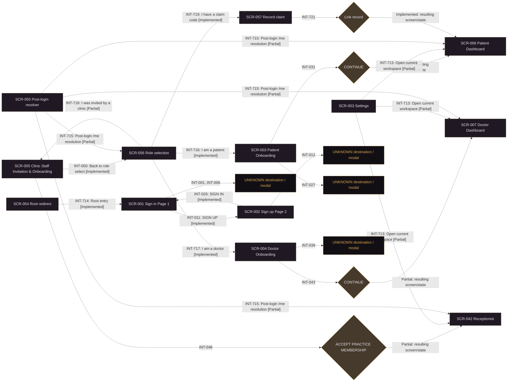
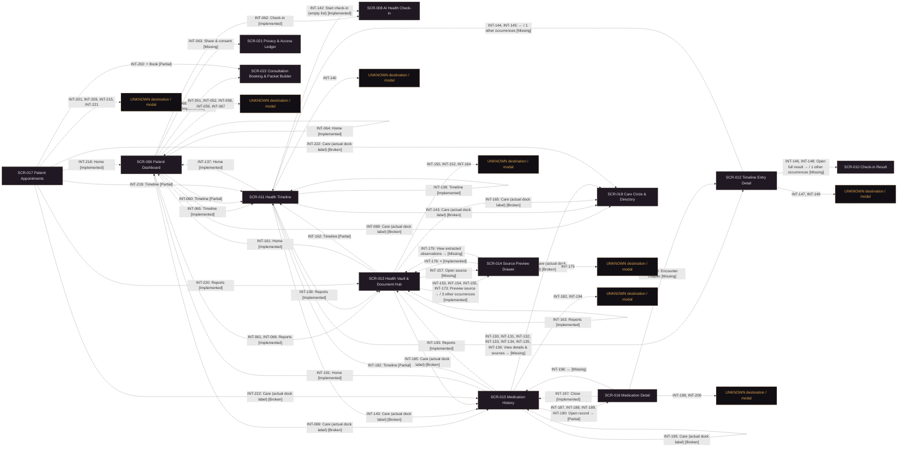
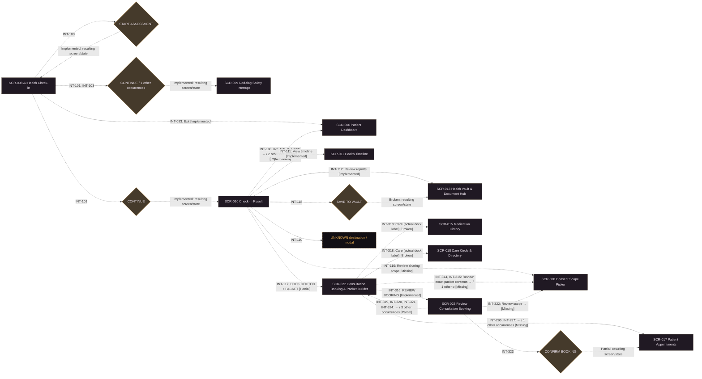
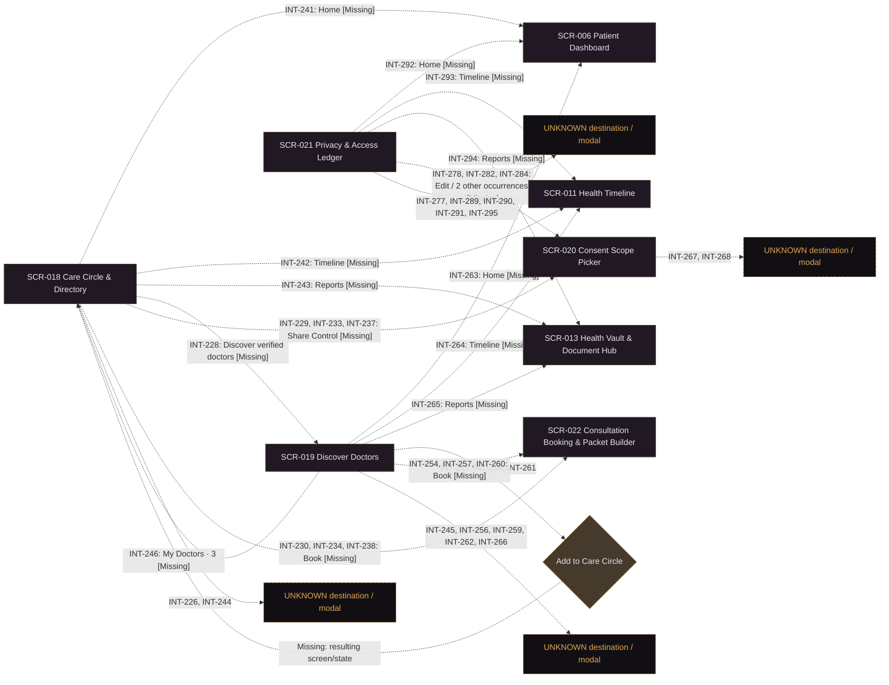
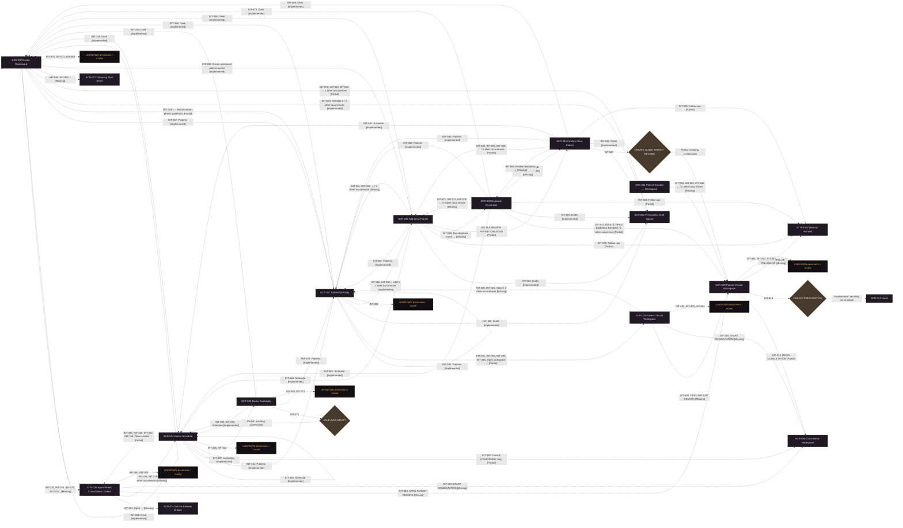
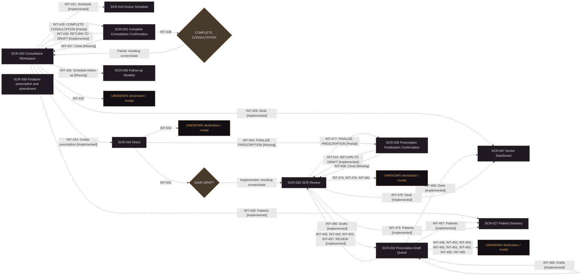
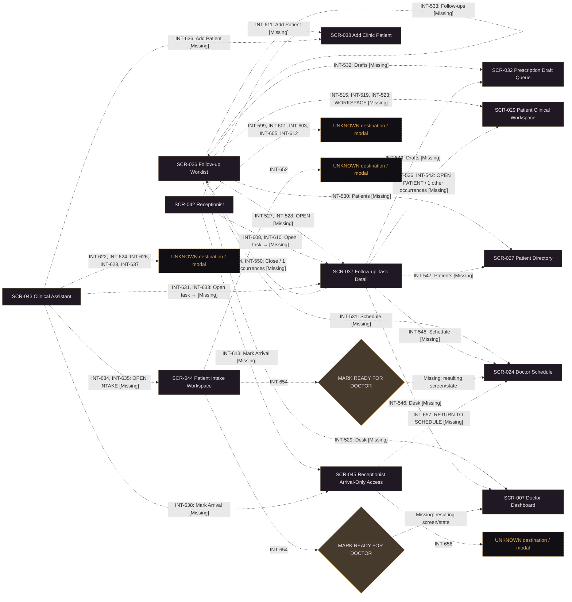
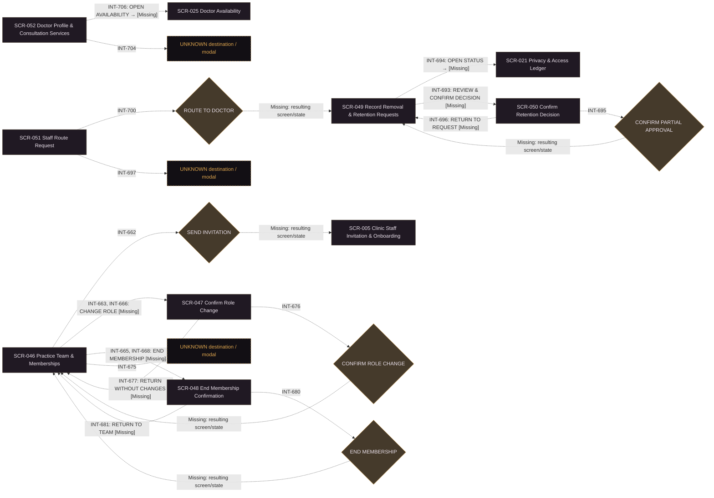

# Master navigation graph

[Index](README.md) · [Screen hierarchy](01-information-architecture.md) · [Complete interaction inventory](02-interaction-map.md) · [Source/API traces](04-design-code-traceability.md)

## Reading the graphs

The master containment hierarchy is in 01. The module graphs below are the **complete screen-destination projection of the interaction inventory**, including inferred navigation and conditional results. Every discovered frame is declared in a module even if it has no proven incoming edge. Dashed edges mean design/document-derived expectation or unresolved route, not a prototype wire. No explicit prototype interaction was exposed by FigCraft. A diamond is a non-navigation submission/state effect that may lead to another screen, rather than an automatic browser navigation. Unknown targets are explicit per source screen. Repeated controls sharing a logical destination are grouped by their interaction IDs; the individual node/element references remain in 02.

The separate **actual code-route graph** follows the module diagrams. It must not be confused with the design projection. Status labels on edges describe current static implementation, not runtime verification. A partial implementation can lead somewhere else; 02 records that contradiction rather than silently replacing the intended target.

The basic master hierarchy is in 01; the following module projections use the Bronze Night & Parchment diagram styling. These colors describe audit evidence, not a change to CliniX's UI palette.

## Shared entry and onboarding

Non-screen results and unresolved actions (individual behavior is in 02):

| Source | Non-navigation / external / unresolved interaction references |
| --- | --- |
| [SCR-001](01-information-architecture.md#scr-001) | [INT-001](02-interaction-map.md#int-001), [INT-002](02-interaction-map.md#int-002), [INT-003](02-interaction-map.md#int-003), [INT-004](02-interaction-map.md#int-004), [INT-005](02-interaction-map.md#int-005), [INT-006](02-interaction-map.md#int-006), [INT-007](02-interaction-map.md#int-007), [INT-008](02-interaction-map.md#int-008), [INT-009](02-interaction-map.md#int-009), [INT-010](02-interaction-map.md#int-010) |
| [SCR-002](01-information-architecture.md#scr-002) | [INT-012](02-interaction-map.md#int-012), [INT-013](02-interaction-map.md#int-013), [INT-014](02-interaction-map.md#int-014), [INT-015](02-interaction-map.md#int-015), [INT-016](02-interaction-map.md#int-016), [INT-017](02-interaction-map.md#int-017), [INT-018](02-interaction-map.md#int-018), [INT-019](02-interaction-map.md#int-019), [INT-020](02-interaction-map.md#int-020), [INT-021](02-interaction-map.md#int-021), [INT-022](02-interaction-map.md#int-022), [INT-023](02-interaction-map.md#int-023), [INT-024](02-interaction-map.md#int-024), [INT-025](02-interaction-map.md#int-025) |
| [SCR-003](01-information-architecture.md#scr-003) | [INT-027](02-interaction-map.md#int-027), [INT-028](02-interaction-map.md#int-028), [INT-029](02-interaction-map.md#int-029), [INT-030](02-interaction-map.md#int-030), [INT-032](02-interaction-map.md#int-032), [INT-033](02-interaction-map.md#int-033), [INT-034](02-interaction-map.md#int-034), [INT-035](02-interaction-map.md#int-035), [INT-036](02-interaction-map.md#int-036), [INT-037](02-interaction-map.md#int-037), [INT-038](02-interaction-map.md#int-038) |
| [SCR-004](01-information-architecture.md#scr-004) | [INT-039](02-interaction-map.md#int-039), [INT-040](02-interaction-map.md#int-040), [INT-041](02-interaction-map.md#int-041), [INT-042](02-interaction-map.md#int-042), [INT-044](02-interaction-map.md#int-044), [INT-045](02-interaction-map.md#int-045), [INT-046](02-interaction-map.md#int-046) |
| [SCR-005](01-information-architecture.md#scr-005) | [INT-047](02-interaction-map.md#int-047), [INT-049](02-interaction-map.md#int-049) |
| [SCR-057](01-information-architecture.md#scr-057) | [INT-720](02-interaction-map.md#int-720) |

## Patient record and visit navigation

Non-screen results and unresolved actions (individual behavior is in 02):

| Source | Non-navigation / external / unresolved interaction references |
| --- | --- |
| [SCR-006](01-information-architecture.md#scr-006) | [INT-051](02-interaction-map.md#int-051), [INT-052](02-interaction-map.md#int-052), [INT-053](02-interaction-map.md#int-053), [INT-054](02-interaction-map.md#int-054), [INT-055](02-interaction-map.md#int-055), [INT-056](02-interaction-map.md#int-056), [INT-057](02-interaction-map.md#int-057), [INT-058](02-interaction-map.md#int-058), [INT-059](02-interaction-map.md#int-059), [INT-067](02-interaction-map.md#int-067) |
| [SCR-011](01-information-architecture.md#scr-011) | [INT-123](02-interaction-map.md#int-123), [INT-124](02-interaction-map.md#int-124), [INT-125](02-interaction-map.md#int-125), [INT-126](02-interaction-map.md#int-126), [INT-127](02-interaction-map.md#int-127), [INT-128](02-interaction-map.md#int-128), [INT-129](02-interaction-map.md#int-129), [INT-140](02-interaction-map.md#int-140), [INT-141](02-interaction-map.md#int-141) |
| [SCR-012](01-information-architecture.md#scr-012) | [INT-147](02-interaction-map.md#int-147), [INT-149](02-interaction-map.md#int-149) |
| [SCR-013](01-information-architecture.md#scr-013) | [INT-150](02-interaction-map.md#int-150), [INT-151](02-interaction-map.md#int-151), [INT-152](02-interaction-map.md#int-152), [INT-156](02-interaction-map.md#int-156), [INT-158](02-interaction-map.md#int-158), [INT-159](02-interaction-map.md#int-159), [INT-160](02-interaction-map.md#int-160), [INT-164](02-interaction-map.md#int-164), [INT-166](02-interaction-map.md#int-166), [INT-167](02-interaction-map.md#int-167), [INT-168](02-interaction-map.md#int-168), [INT-169](02-interaction-map.md#int-169), [INT-170](02-interaction-map.md#int-170), [INT-171](02-interaction-map.md#int-171), [INT-172](02-interaction-map.md#int-172), [INT-174](02-interaction-map.md#int-174) |
| [SCR-014](01-information-architecture.md#scr-014) | [INT-175](02-interaction-map.md#int-175), [INT-177](02-interaction-map.md#int-177), [INT-178](02-interaction-map.md#int-178), [INT-180](02-interaction-map.md#int-180), [INT-181](02-interaction-map.md#int-181) |
| [SCR-015](01-information-architecture.md#scr-015) | [INT-182](02-interaction-map.md#int-182), [INT-183](02-interaction-map.md#int-183), [INT-184](02-interaction-map.md#int-184), [INT-185](02-interaction-map.md#int-185), [INT-186](02-interaction-map.md#int-186), [INT-194](02-interaction-map.md#int-194) |
| [SCR-016](01-information-architecture.md#scr-016) | [INT-198](02-interaction-map.md#int-198), [INT-200](02-interaction-map.md#int-200) |
| [SCR-017](01-information-architecture.md#scr-017) | [INT-201](02-interaction-map.md#int-201), [INT-203](02-interaction-map.md#int-203), [INT-204](02-interaction-map.md#int-204), [INT-205](02-interaction-map.md#int-205), [INT-206](02-interaction-map.md#int-206), [INT-207](02-interaction-map.md#int-207), [INT-208](02-interaction-map.md#int-208), [INT-209](02-interaction-map.md#int-209), [INT-210](02-interaction-map.md#int-210), [INT-211](02-interaction-map.md#int-211), [INT-212](02-interaction-map.md#int-212), [INT-213](02-interaction-map.md#int-213), [INT-214](02-interaction-map.md#int-214), [INT-215](02-interaction-map.md#int-215), [INT-216](02-interaction-map.md#int-216), [INT-217](02-interaction-map.md#int-217), [INT-221](02-interaction-map.md#int-221), [INT-223](02-interaction-map.md#int-223), [INT-224](02-interaction-map.md#int-224), [INT-225](02-interaction-map.md#int-225) |

## Check-in, safety, packet and booking

Non-screen results and unresolved actions (individual behavior is in 02):

| Source | Non-navigation / external / unresolved interaction references |
| --- | --- |
| [SCR-008](01-information-architecture.md#scr-008) | [INT-092](02-interaction-map.md#int-092), [INT-094](02-interaction-map.md#int-094), [INT-095](02-interaction-map.md#int-095), [INT-096](02-interaction-map.md#int-096), [INT-097](02-interaction-map.md#int-097), [INT-098](02-interaction-map.md#int-098), [INT-099](02-interaction-map.md#int-099), [INT-100](02-interaction-map.md#int-100), [INT-102](02-interaction-map.md#int-102), [INT-104](02-interaction-map.md#int-104) |
| [SCR-009](01-information-architecture.md#scr-009) | [INT-105](02-interaction-map.md#int-105), [INT-106](02-interaction-map.md#int-106), [INT-107](02-interaction-map.md#int-107) |
| [SCR-010](01-information-architecture.md#scr-010) | [INT-110](02-interaction-map.md#int-110), [INT-113](02-interaction-map.md#int-113), [INT-114](02-interaction-map.md#int-114), [INT-115](02-interaction-map.md#int-115), [INT-119](02-interaction-map.md#int-119), [INT-120](02-interaction-map.md#int-120), [INT-121](02-interaction-map.md#int-121) |
| [SCR-022](01-information-architecture.md#scr-022) | [INT-298](02-interaction-map.md#int-298), [INT-299](02-interaction-map.md#int-299), [INT-300](02-interaction-map.md#int-300), [INT-301](02-interaction-map.md#int-301), [INT-302](02-interaction-map.md#int-302), [INT-303](02-interaction-map.md#int-303), [INT-304](02-interaction-map.md#int-304), [INT-305](02-interaction-map.md#int-305), [INT-306](02-interaction-map.md#int-306), [INT-307](02-interaction-map.md#int-307), [INT-308](02-interaction-map.md#int-308), [INT-309](02-interaction-map.md#int-309), [INT-310](02-interaction-map.md#int-310), [INT-311](02-interaction-map.md#int-311), [INT-312](02-interaction-map.md#int-312), [INT-313](02-interaction-map.md#int-313), [INT-317](02-interaction-map.md#int-317) |

## Care Circle and privacy

Non-screen results and unresolved actions (individual behavior is in 02):

| Source | Non-navigation / external / unresolved interaction references |
| --- | --- |
| [SCR-018](01-information-architecture.md#scr-018) | [INT-226](02-interaction-map.md#int-226), [INT-227](02-interaction-map.md#int-227), [INT-231](02-interaction-map.md#int-231), [INT-232](02-interaction-map.md#int-232), [INT-235](02-interaction-map.md#int-235), [INT-236](02-interaction-map.md#int-236), [INT-239](02-interaction-map.md#int-239), [INT-240](02-interaction-map.md#int-240), [INT-244](02-interaction-map.md#int-244) |
| [SCR-019](01-information-architecture.md#scr-019) | [INT-245](02-interaction-map.md#int-245), [INT-247](02-interaction-map.md#int-247), [INT-248](02-interaction-map.md#int-248), [INT-249](02-interaction-map.md#int-249), [INT-250](02-interaction-map.md#int-250), [INT-251](02-interaction-map.md#int-251), [INT-252](02-interaction-map.md#int-252), [INT-253](02-interaction-map.md#int-253), [INT-256](02-interaction-map.md#int-256), [INT-259](02-interaction-map.md#int-259), [INT-262](02-interaction-map.md#int-262), [INT-266](02-interaction-map.md#int-266) |
| [SCR-020](01-information-architecture.md#scr-020) | [INT-267](02-interaction-map.md#int-267), [INT-268](02-interaction-map.md#int-268), [INT-269](02-interaction-map.md#int-269), [INT-270](02-interaction-map.md#int-270), [INT-271](02-interaction-map.md#int-271), [INT-272](02-interaction-map.md#int-272), [INT-273](02-interaction-map.md#int-273), [INT-274](02-interaction-map.md#int-274), [INT-275](02-interaction-map.md#int-275), [INT-276](02-interaction-map.md#int-276) |
| [SCR-021](01-information-architecture.md#scr-021) | [INT-277](02-interaction-map.md#int-277), [INT-279](02-interaction-map.md#int-279), [INT-280](02-interaction-map.md#int-280), [INT-281](02-interaction-map.md#int-281), [INT-283](02-interaction-map.md#int-283), [INT-285](02-interaction-map.md#int-285), [INT-286](02-interaction-map.md#int-286), [INT-287](02-interaction-map.md#int-287), [INT-288](02-interaction-map.md#int-288), [INT-289](02-interaction-map.md#int-289), [INT-290](02-interaction-map.md#int-290), [INT-291](02-interaction-map.md#int-291), [INT-295](02-interaction-map.md#int-295) |

## Doctor schedule, directory and patient creation

Non-screen results and unresolved actions (individual behavior is in 02):

| Source | Non-navigation / external / unresolved interaction references |
| --- | --- |
| [SCR-007](01-information-architecture.md#scr-007) | [INT-070](02-interaction-map.md#int-070), [INT-071](02-interaction-map.md#int-071), [INT-072](02-interaction-map.md#int-072), [INT-074](02-interaction-map.md#int-074), [INT-089](02-interaction-map.md#int-089), [INT-090](02-interaction-map.md#int-090), [INT-091](02-interaction-map.md#int-091) |
| [SCR-024](01-information-architecture.md#scr-024) | [INT-325](02-interaction-map.md#int-325), [INT-326](02-interaction-map.md#int-326), [INT-328](02-interaction-map.md#int-328), [INT-329](02-interaction-map.md#int-329), [INT-330](02-interaction-map.md#int-330), [INT-331](02-interaction-map.md#int-331), [INT-332](02-interaction-map.md#int-332), [INT-333](02-interaction-map.md#int-333), [INT-334](02-interaction-map.md#int-334), [INT-342](02-interaction-map.md#int-342), [INT-343](02-interaction-map.md#int-343), [INT-344](02-interaction-map.md#int-344), [INT-345](02-interaction-map.md#int-345), [INT-346](02-interaction-map.md#int-346), [INT-347](02-interaction-map.md#int-347), [INT-348](02-interaction-map.md#int-348), [INT-349](02-interaction-map.md#int-349), [INT-350](02-interaction-map.md#int-350), [INT-351](02-interaction-map.md#int-351) |
| [SCR-025](01-information-architecture.md#scr-025) | [INT-353](02-interaction-map.md#int-353), [INT-355](02-interaction-map.md#int-355), [INT-356](02-interaction-map.md#int-356), [INT-357](02-interaction-map.md#int-357), [INT-358](02-interaction-map.md#int-358), [INT-359](02-interaction-map.md#int-359), [INT-360](02-interaction-map.md#int-360), [INT-361](02-interaction-map.md#int-361), [INT-362](02-interaction-map.md#int-362), [INT-363](02-interaction-map.md#int-363), [INT-364](02-interaction-map.md#int-364), [INT-365](02-interaction-map.md#int-365), [INT-366](02-interaction-map.md#int-366), [INT-367](02-interaction-map.md#int-367), [INT-368](02-interaction-map.md#int-368), [INT-369](02-interaction-map.md#int-369), [INT-370](02-interaction-map.md#int-370), [INT-371](02-interaction-map.md#int-371), [INT-372](02-interaction-map.md#int-372), [INT-377](02-interaction-map.md#int-377) |
| [SCR-026](01-information-architecture.md#scr-026) | [INT-380](02-interaction-map.md#int-380), [INT-382](02-interaction-map.md#int-382) |
| [SCR-027](01-information-architecture.md#scr-027) | [INT-385](02-interaction-map.md#int-385), [INT-387](02-interaction-map.md#int-387), [INT-388](02-interaction-map.md#int-388), [INT-389](02-interaction-map.md#int-389), [INT-390](02-interaction-map.md#int-390), [INT-399](02-interaction-map.md#int-399) |
| [SCR-028](01-information-architecture.md#scr-028) | [INT-402](02-interaction-map.md#int-402), [INT-403](02-interaction-map.md#int-403), [INT-404](02-interaction-map.md#int-404) |
| [SCR-029](01-information-architecture.md#scr-029) | [INT-407](02-interaction-map.md#int-407), [INT-408](02-interaction-map.md#int-408), [INT-409](02-interaction-map.md#int-409), [INT-410](02-interaction-map.md#int-410), [INT-411](02-interaction-map.md#int-411), [INT-412](02-interaction-map.md#int-412), [INT-413](02-interaction-map.md#int-413), [INT-416](02-interaction-map.md#int-416), [INT-418](02-interaction-map.md#int-418) |
| [SCR-038](01-information-architecture.md#scr-038) | [INT-553](02-interaction-map.md#int-553), [INT-554](02-interaction-map.md#int-554), [INT-555](02-interaction-map.md#int-555), [INT-556](02-interaction-map.md#int-556), [INT-557](02-interaction-map.md#int-557), [INT-558](02-interaction-map.md#int-558), [INT-560](02-interaction-map.md#int-560), [INT-561](02-interaction-map.md#int-561), [INT-562](02-interaction-map.md#int-562), [INT-563](02-interaction-map.md#int-563), [INT-565](02-interaction-map.md#int-565) |
| [SCR-039](01-information-architecture.md#scr-039) | [INT-574](02-interaction-map.md#int-574), [INT-576](02-interaction-map.md#int-576) |

## Consultation and prescriptions

Non-screen results and unresolved actions (individual behavior is in 02):

| Source | Non-navigation / external / unresolved interaction references |
| --- | --- |
| [SCR-030](01-information-architecture.md#scr-030) | [INT-419](02-interaction-map.md#int-419), [INT-420](02-interaction-map.md#int-420), [INT-421](02-interaction-map.md#int-421), [INT-422](02-interaction-map.md#int-422), [INT-423](02-interaction-map.md#int-423), [INT-425](02-interaction-map.md#int-425), [INT-427](02-interaction-map.md#int-427), [INT-432](02-interaction-map.md#int-432), [INT-433](02-interaction-map.md#int-433), [INT-434](02-interaction-map.md#int-434), [INT-435](02-interaction-map.md#int-435), [INT-436](02-interaction-map.md#int-436) |
| [SCR-032](01-information-architecture.md#scr-032) | [INT-440](02-interaction-map.md#int-440), [INT-441](02-interaction-map.md#int-441), [INT-442](02-interaction-map.md#int-442), [INT-443](02-interaction-map.md#int-443), [INT-444](02-interaction-map.md#int-444), [INT-446](02-interaction-map.md#int-446), [INT-447](02-interaction-map.md#int-447), [INT-448](02-interaction-map.md#int-448), [INT-450](02-interaction-map.md#int-450), [INT-451](02-interaction-map.md#int-451), [INT-452](02-interaction-map.md#int-452), [INT-454](02-interaction-map.md#int-454), [INT-455](02-interaction-map.md#int-455), [INT-456](02-interaction-map.md#int-456), [INT-458](02-interaction-map.md#int-458), [INT-459](02-interaction-map.md#int-459), [INT-460](02-interaction-map.md#int-460), [INT-461](02-interaction-map.md#int-461), [INT-462](02-interaction-map.md#int-462), [INT-463](02-interaction-map.md#int-463), [INT-464](02-interaction-map.md#int-464), [INT-465](02-interaction-map.md#int-465), [INT-469](02-interaction-map.md#int-469) |
| [SCR-033](01-information-architecture.md#scr-033) | [INT-470](02-interaction-map.md#int-470), [INT-471](02-interaction-map.md#int-471), [INT-472](02-interaction-map.md#int-472), [INT-473](02-interaction-map.md#int-473), [INT-474](02-interaction-map.md#int-474), [INT-475](02-interaction-map.md#int-475), [INT-476](02-interaction-map.md#int-476), [INT-481](02-interaction-map.md#int-481), [INT-482](02-interaction-map.md#int-482), [INT-483](02-interaction-map.md#int-483), [INT-484](02-interaction-map.md#int-484), [INT-485](02-interaction-map.md#int-485), [INT-486](02-interaction-map.md#int-486), [INT-487](02-interaction-map.md#int-487), [INT-488](02-interaction-map.md#int-488), [INT-489](02-interaction-map.md#int-489), [INT-490](02-interaction-map.md#int-490), [INT-491](02-interaction-map.md#int-491), [INT-492](02-interaction-map.md#int-492) |
| [SCR-034](01-information-architecture.md#scr-034) | [INT-493](02-interaction-map.md#int-493), [INT-494](02-interaction-map.md#int-494), [INT-495](02-interaction-map.md#int-495), [INT-496](02-interaction-map.md#int-496), [INT-497](02-interaction-map.md#int-497), [INT-498](02-interaction-map.md#int-498), [INT-499](02-interaction-map.md#int-499), [INT-500](02-interaction-map.md#int-500), [INT-502](02-interaction-map.md#int-502), [INT-504](02-interaction-map.md#int-504), [INT-505](02-interaction-map.md#int-505), [INT-506](02-interaction-map.md#int-506), [INT-507](02-interaction-map.md#int-507) |
| [SCR-035](01-information-architecture.md#scr-035) | [INT-509](02-interaction-map.md#int-509) |
| [SCR-058](01-information-architecture.md#scr-058) | [INT-722](02-interaction-map.md#int-722), [INT-723](02-interaction-map.md#int-723), [INT-724](02-interaction-map.md#int-724), [INT-725](02-interaction-map.md#int-725), [INT-726](02-interaction-map.md#int-726), [INT-727](02-interaction-map.md#int-727), [INT-728](02-interaction-map.md#int-728), [INT-729](02-interaction-map.md#int-729), [INT-730](02-interaction-map.md#int-730), [INT-731](02-interaction-map.md#int-731), [INT-732](02-interaction-map.md#int-732), [INT-733](02-interaction-map.md#int-733), [INT-734](02-interaction-map.md#int-734), [INT-735](02-interaction-map.md#int-735), [INT-736](02-interaction-map.md#int-736), [INT-737](02-interaction-map.md#int-737), [INT-738](02-interaction-map.md#int-738) |

## Follow-ups and staff operations

Non-screen results and unresolved actions (individual behavior is in 02):

| Source | Non-navigation / external / unresolved interaction references |
| --- | --- |
| [SCR-036](01-information-architecture.md#scr-036) | [INT-511](02-interaction-map.md#int-511), [INT-512](02-interaction-map.md#int-512), [INT-513](02-interaction-map.md#int-513), [INT-514](02-interaction-map.md#int-514), [INT-516](02-interaction-map.md#int-516), [INT-517](02-interaction-map.md#int-517), [INT-518](02-interaction-map.md#int-518), [INT-520](02-interaction-map.md#int-520), [INT-521](02-interaction-map.md#int-521), [INT-522](02-interaction-map.md#int-522), [INT-524](02-interaction-map.md#int-524), [INT-525](02-interaction-map.md#int-525), [INT-526](02-interaction-map.md#int-526) |
| [SCR-037](01-information-architecture.md#scr-037) | [INT-535](02-interaction-map.md#int-535), [INT-537](02-interaction-map.md#int-537), [INT-538](02-interaction-map.md#int-538), [INT-539](02-interaction-map.md#int-539), [INT-540](02-interaction-map.md#int-540), [INT-541](02-interaction-map.md#int-541), [INT-543](02-interaction-map.md#int-543), [INT-544](02-interaction-map.md#int-544), [INT-545](02-interaction-map.md#int-545) |
| [SCR-042](01-information-architecture.md#scr-042) | [INT-597](02-interaction-map.md#int-597), [INT-598](02-interaction-map.md#int-598), [INT-599](02-interaction-map.md#int-599), [INT-600](02-interaction-map.md#int-600), [INT-601](02-interaction-map.md#int-601), [INT-602](02-interaction-map.md#int-602), [INT-603](02-interaction-map.md#int-603), [INT-604](02-interaction-map.md#int-604), [INT-605](02-interaction-map.md#int-605), [INT-606](02-interaction-map.md#int-606), [INT-607](02-interaction-map.md#int-607), [INT-609](02-interaction-map.md#int-609), [INT-612](02-interaction-map.md#int-612), [INT-614](02-interaction-map.md#int-614), [INT-615](02-interaction-map.md#int-615), [INT-616](02-interaction-map.md#int-616), [INT-617](02-interaction-map.md#int-617), [INT-618](02-interaction-map.md#int-618), [INT-619](02-interaction-map.md#int-619) |
| [SCR-043](01-information-architecture.md#scr-043) | [INT-620](02-interaction-map.md#int-620), [INT-621](02-interaction-map.md#int-621), [INT-622](02-interaction-map.md#int-622), [INT-623](02-interaction-map.md#int-623), [INT-624](02-interaction-map.md#int-624), [INT-625](02-interaction-map.md#int-625), [INT-626](02-interaction-map.md#int-626), [INT-627](02-interaction-map.md#int-627), [INT-628](02-interaction-map.md#int-628), [INT-629](02-interaction-map.md#int-629), [INT-630](02-interaction-map.md#int-630), [INT-632](02-interaction-map.md#int-632), [INT-637](02-interaction-map.md#int-637), [INT-639](02-interaction-map.md#int-639), [INT-640](02-interaction-map.md#int-640) |
| [SCR-044](01-information-architecture.md#scr-044) | [INT-641](02-interaction-map.md#int-641), [INT-642](02-interaction-map.md#int-642), [INT-643](02-interaction-map.md#int-643), [INT-644](02-interaction-map.md#int-644), [INT-645](02-interaction-map.md#int-645), [INT-646](02-interaction-map.md#int-646), [INT-647](02-interaction-map.md#int-647), [INT-648](02-interaction-map.md#int-648), [INT-649](02-interaction-map.md#int-649), [INT-650](02-interaction-map.md#int-650), [INT-651](02-interaction-map.md#int-651), [INT-652](02-interaction-map.md#int-652), [INT-653](02-interaction-map.md#int-653) |
| [SCR-045](01-information-architecture.md#scr-045) | [INT-655](02-interaction-map.md#int-655), [INT-656](02-interaction-map.md#int-656) |

## Practice, retention and professional profile

Non-screen results and unresolved actions (individual behavior is in 02):

| Source | Non-navigation / external / unresolved interaction references |
| --- | --- |
| [SCR-046](01-information-architecture.md#scr-046) | [INT-658](02-interaction-map.md#int-658), [INT-659](02-interaction-map.md#int-659), [INT-660](02-interaction-map.md#int-660), [INT-661](02-interaction-map.md#int-661), [INT-664](02-interaction-map.md#int-664), [INT-667](02-interaction-map.md#int-667), [INT-669](02-interaction-map.md#int-669), [INT-670](02-interaction-map.md#int-670), [INT-671](02-interaction-map.md#int-671), [INT-672](02-interaction-map.md#int-672), [INT-673](02-interaction-map.md#int-673), [INT-674](02-interaction-map.md#int-674), [INT-675](02-interaction-map.md#int-675) |
| [SCR-048](01-information-architecture.md#scr-048) | [INT-678](02-interaction-map.md#int-678), [INT-679](02-interaction-map.md#int-679) |
| [SCR-049](01-information-architecture.md#scr-049) | [INT-682](02-interaction-map.md#int-682), [INT-683](02-interaction-map.md#int-683), [INT-684](02-interaction-map.md#int-684), [INT-685](02-interaction-map.md#int-685), [INT-686](02-interaction-map.md#int-686), [INT-687](02-interaction-map.md#int-687), [INT-688](02-interaction-map.md#int-688), [INT-689](02-interaction-map.md#int-689), [INT-690](02-interaction-map.md#int-690), [INT-691](02-interaction-map.md#int-691), [INT-692](02-interaction-map.md#int-692) |
| [SCR-051](01-information-architecture.md#scr-051) | [INT-697](02-interaction-map.md#int-697), [INT-698](02-interaction-map.md#int-698), [INT-699](02-interaction-map.md#int-699) |
| [SCR-052](01-information-architecture.md#scr-052) | [INT-701](02-interaction-map.md#int-701), [INT-702](02-interaction-map.md#int-702), [INT-703](02-interaction-map.md#int-703), [INT-704](02-interaction-map.md#int-704), [INT-705](02-interaction-map.md#int-705), [INT-707](02-interaction-map.md#int-707), [INT-708](02-interaction-map.md#int-708), [INT-709](02-interaction-map.md#int-709), [INT-710](02-interaction-map.md#int-710), [INT-711](02-interaction-map.md#int-711), [INT-712](02-interaction-map.md#int-712) |

## Actual source-code route graph

Solid edges below are observed links/redirects/router calls. Route nodes use the stable screen that owns the route; nested drawer/review/safety states share their parent route and are shown in the design module projections. Edges list actual controls, not guessed destinations for missing designs. For source references see the FE manifest in 02 and route table in 04. Repeated docks are grouped, while their screen-specific records are retained in 02.

```mermaid
flowchart TD
  R1["SCR-001 /sign-in/[[...sign-in]]"]:::screen
  R2["SCR-002 /sign-up/[[...sign-up]]"]:::screen
  R3["SCR-003 /onboarding/patient"]:::screen
  R4["SCR-004 /onboarding/doctor"]:::screen
  R5["SCR-005 /onboarding/staff"]:::screen
  R6["SCR-006 /app/patient"]:::screen
  R7["SCR-007 /app/doctor"]:::screen
  R8["SCR-008 /app/patient/checkin"]:::screen
  R10["SCR-010 /app/patient/checkin/result/[sessionId]"]:::screen
  R11["SCR-011 /app/patient/timeline"]:::screen
  R13["SCR-013 /app/patient/vault"]:::screen
  R15["SCR-015 /app/patient/medications"]:::screen
  R17["SCR-017 /app/patient/appointments"]:::screen
  R22["SCR-022 /app/patient/book"]:::screen
  R24["SCR-024 /app/doctor/schedule"]:::screen
  R27["SCR-027 /app/doctor/patients"]:::screen
  R29["SCR-029 /app/doctor/patients/[patientId]"]:::screen
  R30["SCR-030 /app/doctor/consultation/[appointmentId]"]:::screen
  R32["SCR-032 /app/doctor/drafts"]:::screen
  R33["SCR-033 /app/doctor/prescription-drafts/[draftId]"]:::screen
  R34["SCR-034 /app/doctor/prescription-drafts/new"]:::screen
  R38["SCR-038 /app/doctor/patients/new"]:::screen
  R42["SCR-042 /app/staff"]:::screen
  R53["SCR-053 /settings"]:::screen
  R54["SCR-054 /"]:::screen
  R55["SCR-055 /after-sign-in"]:::screen
  R56["SCR-056 /onboarding/role"]:::screen
  R57["SCR-057 /onboarding/claim"]:::screen
  R58["SCR-058 /app/doctor/prescriptions/[prescriptionId]"]:::screen
  R54 -->|"signed out"| R1
  R54 -->|"signed in"| R55
  R1 -->|"Sign up"| R2
  R1 -->|"Clerk sign-in success"| R55
  R2 -->|"Sign in"| R1
  R2 -->|"Clerk signup success"| R56
  R55 -->|"onboarding required"| R56
  R55 -->|"PATIENT / fallback"| R6
  R55 -->|"DOCTOR"| R7
  R55 -->|"CLINIC_STAFF"| R42
  R56 -->|"I am a patient"| R3
  R56 -->|"I am a doctor"| R4
  R56 -->|"clinic invitation preview"| R5
  R56 -->|"I have a claim code"| R57
  R56 -->|"already DOCTOR"| R7
  R56 -->|"already ready, non-doctor fallback"| R6
  R3 -->|"setup success"| R6
  R4 -->|"verification submit success, even PENDING"| R7
  R5 -->|"Back to role select"| R56
  R57 -->|"claim success"| R6
  R53 -->|"patient current workspace"| R6
  R53 -->|"doctor current workspace"| R7
  R53 -->|"staff current workspace"| R42
  R6 -->|"Timeline dock"| R11
  R6 -->|"Reports / Vault"| R13
  R6 -->|"Visits"| R17
  R6 -->|"Care / Medications"| R15
  R6 -->|"Check-in"| R8
  R6 -->|"Book a doctor"| R22
  R7 -->|"Schedule"| R24
  R7 -->|"Patient search / Patients"| R27
  R7 -->|"Create unclaimed patient"| R38
  R7 -->|"Drafts"| R32
  R8 -->|"Exit / initial back"| R6
  R8 -->|"analysis started"| R10
  R10 -->|"Back / Done / failure return"| R6
  R10 -->|"View timeline"| R11
  R10 -->|"Review reports"| R13
  R10 -->|"Book + packet query"| R22
  R11 -->|"Home"| R6
  R11 -->|"Vault"| R13
  R11 -->|"Visits"| R17
  R11 -->|"Care"| R15
  R11 -->|"empty-state check-in"| R8
  R13 -->|"Home"| R6
  R13 -->|"Visits"| R17
  R13 -->|"Care"| R15
  R15 -->|"Home"| R6
  R15 -->|"Vault"| R13
  R15 -->|"Visits"| R17
  R17 -->|"Home"| R6
  R17 -->|"Vault"| R13
  R17 -->|"Care"| R15
  R17 -->|"Book new appointment"| R22
  R22 -->|"Home"| R6
  R22 -->|"Vault"| R13
  R22 -->|"Care"| R15
  R22 -->|"Visits / confirm success"| R17
  R24 -->|"Home"| R7
  R24 -->|"Patients"| R27
  R24 -->|"Drafts"| R32
  R24 -->|"Consult CONFIRMED appointment"| R30
  R27 -->|"Desk"| R7
  R27 -->|"Schedule"| R24
  R27 -->|"Drafts"| R32
  R27 -->|"Add / create"| R38
  R27 -->|"Patient card"| R29
  R38 -->|"Desk"| R7
  R38 -->|"Schedule"| R24
  R38 -->|"Patients"| R27
  R38 -->|"Drafts"| R32
  R38 -->|"Create success / duplicate record"| R29
  R29 -->|"Home"| R7
  R29 -->|"Schedule"| R24
  R29 -->|"Patients"| R27
  R29 -->|"Drafts"| R32
  R29 -->|"Begin: first requested/confirmed appointment"| R30
  R29 -->|"Create prescription after POST encounter"| R34
  R30 -->|"Desk"| R7
  R30 -->|"Schedule"| R24
  R30 -->|"Patients"| R27
  R30 -->|"Drafts"| R32
  R30 -->|"Create prescription"| R34
  R32 -->|"Desk"| R7
  R32 -->|"Schedule"| R24
  R32 -->|"Patients"| R27
  R32 -->|"Review draft"| R33
  R33 -->|"Desk"| R7
  R33 -->|"Schedule"| R24
  R33 -->|"Patients"| R27
  R33 -->|"Drafts"| R32
  R33 -->|"Finalize success"| R58
  R34 -->|"Desk"| R7
  R34 -->|"Schedule"| R24
  R34 -->|"Patients"| R27
  R34 -->|"Drafts"| R32
  R34 -->|"Save draft success"| R33
  R58 -->|"Desk"| R7
  R58 -->|"Schedule"| R24
  R58 -->|"Patients"| R27
  R58 -->|"Drafts"| R32
  R42 -->|"Home / Schedule / Patients / Follow-ups: self-links"| R42
  classDef screen fill:#201923,color:#EAE1EB,stroke:#453A2B
  classDef action fill:#453A2B,color:#EAE1EB,stroke:#DFA64F
  classDef unknown fill:#120F14,color:#DFA64F,stroke:#DFA64F,stroke-dasharray:4 4
```

### States and actions that do not create routes

| Screen / state | Current code transition | Important distinction |
| --- | --- | --- |
| SCR-008 → SCR-009 | `isEmergency` / `safetyAlert` state | Safety interrupt shares check-in route; review merely hides it locally |
| SCR-013 → SCR-014 | `drawer = DocumentView` | Source overlay, no source-preview URL |
| SCR-015 → SCR-016 | `selectedMed` | Local medication sheet, no detail route |
| SCR-017 cancellation | `cancellingId`, then cancel POST | Confirmation and API mutation, not a new page |
| SCR-022 → SCR-023 | `reviewing` | Local booking review; packet not persisted |
| SCR-024 → SCR-025 | `tab=availability` | Availability editor in schedule route |
| SCR-030 → SCR-031 | `confirmComplete` | Confirmation modal before complete POST |
| SCR-033 → SCR-035 | `confirming` | Modal before finalization POST; unsaved fields omitted |
| SCR-038 → SCR-040 / SCR-039 | `review`, then candidates on 409 | Duplicate check after Create; designed preflight order not implemented |
| SCR-058 amendment | `amending`, items/reason; POST amend | Revision state within finalized prescription route |

Upload, observation confirmation, note autosave, manual payment changes, draft deletion, source downloads and external emergency links are non-navigation interactions. Their complete request/response/state chains are recorded in 02 and 04, including failure paths. No Follow-up, Consent, Privacy, Intake, Practice or Retention URL is fabricated to fill a graph.

## Unresolved destination register

**84 navigation/modal/external-link rows have UNKNOWN destinations.** Across all interaction types, **199 rows** have UNKNOWN results/destinations. These are occurrence counts, not counts of unique missing screens. Some static-preview or input-edit affordances do not require a new destination at all; they remain unresolved until product behavior is clarified.

| Interaction | Source | Affordance | Evidence/status |
| --- | --- | --- | --- |
| [INT-001](02-interaction-map.md#int-001) | [SCR-001](01-information-architecture.md#scr-001) | ← | Missing; Return to prior entry; no back control in AuthShell. |
| [INT-006](02-interaction-map.md#int-006) | [SCR-001](01-information-architecture.md#scr-001) | FORGOT PASSWORD? | Missing; Begin password recovery; configured Clerk flow unverified. |
| [INT-012](02-interaction-map.md#int-012) | [SCR-002](01-information-architecture.md#scr-002) | Back | Missing; Return to preceding caller; exact route UNKNOWN. |
| [INT-027](02-interaction-map.md#int-027) | [SCR-003](01-information-architecture.md#scr-003) | ← | Missing; Return to previous onboarding context. |
| [INT-039](02-interaction-map.md#int-039) | [SCR-004](01-information-architecture.md#scr-004) | ← | Missing; Return to previous onboarding context. |
| [INT-051](02-interaction-map.md#int-051) | [SCR-006](01-information-architecture.md#scr-006) | • | Missing; Open notifications/alerts; header bell is aria-hidden decorative span. |
| [INT-052](02-interaction-map.md#int-052) | [SCR-006](01-information-architecture.md#scr-006) | A | Partial; Open profile/account options; design reference Page 0 names Settings. |
| [INT-058](02-interaction-map.md#int-058) | [SCR-006](01-information-architecture.md#scr-006) | View today → | Missing; Inspect today's care items; exact destination UNKNOWN. |
| [INT-059](02-interaction-map.md#int-059) | [SCR-006](01-information-architecture.md#scr-006) | → | Missing; Open care plan details; no designed detail frame or code route. |
| [INT-067](02-interaction-map.md#int-067) | [SCR-006](01-information-architecture.md#scr-006) | You | Missing; Open personal/account area; exact destination is UNKNOWN. |
| [INT-070](02-interaction-map.md#int-070) | [SCR-007](01-information-architecture.md#scr-007) | ! | Missing; Open notifications/alerts; header bell is aria-hidden decorative span. |
| [INT-071](02-interaction-map.md#int-071) | [SCR-007](01-information-architecture.md#scr-007) | RM | Partial; Open profile/account options; design reference Page 0 names Settings. |
| [INT-089](02-interaction-map.md#int-089) | [SCR-007](01-information-architecture.md#scr-007) | You | Missing; Open personal/account area; exact destination is UNKNOWN. |
| [INT-110](02-interaction-map.md#int-110) | [SCR-010](01-information-architecture.md#scr-010) | View result basis | Missing; View outcome evidence/basis. |
| [INT-140](02-interaction-map.md#int-140) | [SCR-011](01-information-architecture.md#scr-011) | You | Missing; Open personal/account area; exact destination is UNKNOWN. |
| [INT-147](02-interaction-map.md#int-147) | [SCR-012](01-information-architecture.md#scr-012) | Check-in answers | Missing; Review saved check-in answers; read-only review destination UNKNOWN. |
| [INT-149](02-interaction-map.md#int-149) | [SCR-012](01-information-architecture.md#scr-012) | Consultation packet | Missing; Open scoped consultation packet; exact review destination UNKNOWN. |
| [INT-150](02-interaction-map.md#int-150) | [SCR-013](01-information-architecture.md#scr-013) | ← | Missing; Return from Vault; back control absent. |
| [INT-152](02-interaction-map.md#int-152) | [SCR-013](01-information-architecture.md#scr-013) | View all 7 | Missing; View complete document shelf; no separate all-documents action. |
| [INT-164](02-interaction-map.md#int-164) | [SCR-013](01-information-architecture.md#scr-013) | You | Missing; Open personal/account area; exact destination is UNKNOWN. |
| [INT-175](02-interaction-map.md#int-175) | [SCR-014](01-information-architecture.md#scr-014) | ← | Missing; Return from Vault/source preview; no matching back button. |
| [INT-182](02-interaction-map.md#int-182) | [SCR-015](01-information-architecture.md#scr-015) | ← | Missing; Return from medication registry; no back control. |
| [INT-194](02-interaction-map.md#int-194) | [SCR-015](01-information-architecture.md#scr-015) | You | Missing; Open personal/account area; exact destination is UNKNOWN. |
| [INT-198](02-interaction-map.md#int-198) | [SCR-016](01-information-architecture.md#scr-016) | Original prescription | Missing; Open original prescription for this medication; API exists but no patient prescription UI consumer. |
| [INT-200](02-interaction-map.md#int-200) | [SCR-016](01-information-architecture.md#scr-016) | OPEN ORIGINAL PRESCRIPTION | Missing; Open original prescription for this medication; API exists but no patient prescription UI consumer. |
| [INT-201](02-interaction-map.md#int-201) | [SCR-017](01-information-architecture.md#scr-017) | ← | Missing; Return from appointments; header back absent. |
| [INT-209](02-interaction-map.md#int-209) | [SCR-017](01-information-architecture.md#scr-017) | Open directions → | Missing; Open clinic directions. |
| [INT-215](02-interaction-map.md#int-215) | [SCR-017](01-information-architecture.md#scr-017) | Open directions → | Missing; Open clinic directions. |
| [INT-221](02-interaction-map.md#int-221) | [SCR-017](01-information-architecture.md#scr-017) | You | Missing; Open personal/account area; exact destination is UNKNOWN. |
| [INT-226](02-interaction-map.md#int-226) | [SCR-018](01-information-architecture.md#scr-018) | ← | Missing; Return to preceding caller; exact route UNKNOWN. |
| [INT-244](02-interaction-map.md#int-244) | [SCR-018](01-information-architecture.md#scr-018) | You | Missing; Open personal/account area; exact destination is UNKNOWN. |
| [INT-245](02-interaction-map.md#int-245) | [SCR-019](01-information-architecture.md#scr-019) | ← | Missing; Return to preceding caller; exact route UNKNOWN. |
| [INT-256](02-interaction-map.md#int-256) | [SCR-019](01-information-architecture.md#scr-019) | View profile → | Missing; View patient's public doctor profile; SCR-052 is an editor, not proof of this destination. |
| [INT-259](02-interaction-map.md#int-259) | [SCR-019](01-information-architecture.md#scr-019) | View profile → | Missing; View patient's public doctor profile; SCR-052 is an editor, not proof of this destination. |
| [INT-262](02-interaction-map.md#int-262) | [SCR-019](01-information-architecture.md#scr-019) | View profile → | Missing; View patient's public doctor profile; SCR-052 is an editor, not proof of this destination. |
| [INT-266](02-interaction-map.md#int-266) | [SCR-019](01-information-architecture.md#scr-019) | You | Missing; Open personal/account area; exact destination is UNKNOWN. |
| [INT-267](02-interaction-map.md#int-267) | [SCR-020](01-information-architecture.md#scr-020) | ← | Missing; Return to caller without sharing; caller may be Care or booking. |
| [INT-268](02-interaction-map.md#int-268) | [SCR-020](01-information-architecture.md#scr-020) | Close | Missing; Return to caller without sharing; caller may be Care or booking. |
| [INT-277](02-interaction-map.md#int-277) | [SCR-021](01-information-architecture.md#scr-021) | ← | Missing; Return to caller; exact route UNKNOWN. |
| [INT-289](02-interaction-map.md#int-289) | [SCR-021](01-information-architecture.md#scr-021) | View access receipt → | Missing; Inspect immutable access receipt; detail view destination UNKNOWN. |
| [INT-290](02-interaction-map.md#int-290) | [SCR-021](01-information-architecture.md#scr-021) | View inference audit → | Missing; Inspect AI inference audit/evidence; destination UNKNOWN. |
| [INT-291](02-interaction-map.md#int-291) | [SCR-021](01-information-architecture.md#scr-021) | View access receipt → | Missing; Inspect immutable access receipt; detail view destination UNKNOWN. |
| [INT-295](02-interaction-map.md#int-295) | [SCR-021](01-information-architecture.md#scr-021) | You | Missing; Open personal/account area; exact destination is UNKNOWN. |
| [INT-325](02-interaction-map.md#int-325) | [SCR-024](01-information-architecture.md#scr-024) | RM | Partial; Open profile/account options; design reference Page 0 names Settings. |
| [INT-342](02-interaction-map.md#int-342) | [SCR-024](01-information-architecture.md#scr-024) | You | Missing; Open personal/account area; exact destination is UNKNOWN. |
| [INT-353](02-interaction-map.md#int-353) | [SCR-025](01-information-architecture.md#scr-025) | RM | Partial; Open profile/account options; design reference Page 0 names Settings. |
| [INT-377](02-interaction-map.md#int-377) | [SCR-025](01-information-architecture.md#scr-025) | You | Missing; Open personal/account area; exact destination is UNKNOWN. |
| [INT-380](02-interaction-map.md#int-380) | [SCR-026](01-information-architecture.md#scr-026) | Open → | Missing; Open selected check-in result in authorized clinician context; exact destination UNKNOWN. |
| [INT-382](02-interaction-map.md#int-382) | [SCR-026](01-information-architecture.md#scr-026) | Open → | Missing; Open authorized active medications; clinician destination UNKNOWN. |
| [INT-399](02-interaction-map.md#int-399) | [SCR-027](01-information-architecture.md#scr-027) | You | Missing; Open personal/account area; exact destination is UNKNOWN. |
| [INT-402](02-interaction-map.md#int-402) | [SCR-028](01-information-architecture.md#scr-028) | Review consent scope → | Missing; Review authorized consultation consent; doctor review destination UNKNOWN. |
| [INT-403](02-interaction-map.md#int-403) | [SCR-028](01-information-architecture.md#scr-028) | Open full timeline → | Missing; Open patient's full clinical timeline; clinician destination UNKNOWN. |
| [INT-404](02-interaction-map.md#int-404) | [SCR-028](01-information-architecture.md#scr-028) | Open medication history → | Missing; Open patient's medication history in clinician context; destination UNKNOWN. |
| [INT-411](02-interaction-map.md#int-411) | [SCR-029](01-information-architecture.md#scr-029) | Open full timeline → | Missing; Open full clinician timeline. |
| [INT-412](02-interaction-map.md#int-412) | [SCR-029](01-information-architecture.md#scr-029) | Open report & source → | Missing; Open report and original source. |
| [INT-413](02-interaction-map.md#int-413) | [SCR-029](01-information-architecture.md#scr-029) | Open medication & prescription history → | Missing; Open medication/prescription history for this patient. |
| [INT-432](02-interaction-map.md#int-432) | [SCR-030](01-information-architecture.md#scr-030) | You | Missing; Open personal/account area; exact destination is UNKNOWN. |
| [INT-448](02-interaction-map.md#int-448) | [SCR-032](01-information-architecture.md#scr-032) | Open source image → | Missing; Open exact queue source image/audio/draft; queue source links absent. |
| [INT-452](02-interaction-map.md#int-452) | [SCR-032](01-information-architecture.md#scr-032) | Open source image → | Missing; Open exact queue source image/audio/draft; queue source links absent. |
| [INT-456](02-interaction-map.md#int-456) | [SCR-032](01-information-architecture.md#scr-032) | Open consultation audio → | Missing; Open exact queue source image/audio/draft; queue source links absent. |
| [INT-460](02-interaction-map.md#int-460) | [SCR-032](01-information-architecture.md#scr-032) | Open consultation draft → | Missing; Open exact queue source image/audio/draft; queue source links absent. |
| [INT-461](02-interaction-map.md#int-461) | [SCR-032](01-information-architecture.md#scr-032) | Open source image → | Missing; Open exact queue source image/audio/draft; queue source links absent. |
| [INT-462](02-interaction-map.md#int-462) | [SCR-032](01-information-architecture.md#scr-032) | REVIEW SOURCE | Missing; Review failed source and recover extraction; no source/retry queue control. |
| [INT-465](02-interaction-map.md#int-465) | [SCR-032](01-information-architecture.md#scr-032) | Open failed source image → | Missing; Open exact queue source image/audio/draft; queue source links absent. |
| [INT-469](02-interaction-map.md#int-469) | [SCR-032](01-information-architecture.md#scr-032) | You | Missing; Open personal/account area; exact destination is UNKNOWN. |
| [INT-474](02-interaction-map.md#int-474) | [SCR-033](01-information-architecture.md#scr-033) | Open full printable preview → | Missing; Open printable preview before finalization; only finalized PDF exists. |
| [INT-476](02-interaction-map.md#int-476) | [SCR-033](01-information-architecture.md#scr-033) | PREVIEW | Missing; Open printable preview before finalization; only finalized PDF exists. |
| [INT-481](02-interaction-map.md#int-481) | [SCR-033](01-information-architecture.md#scr-033) | You | Missing; Open personal/account area; exact destination is UNKNOWN. |
| [INT-502](02-interaction-map.md#int-502) | [SCR-034](01-information-architecture.md#scr-034) | PREVIEW | Missing; Open printable preview before finalization; only finalized PDF exists. |
| [INT-599](02-interaction-map.md#int-599) | [SCR-042](01-information-architecture.md#scr-042) | Open → | Missing; Open operational appointment; no unrestricted clinical workspace access. |
| [INT-601](02-interaction-map.md#int-601) | [SCR-042](01-information-architecture.md#scr-042) | Open → | Missing; Open operational appointment; no unrestricted clinical workspace access. |
| [INT-603](02-interaction-map.md#int-603) | [SCR-042](01-information-architecture.md#scr-042) | Receipt → | Missing; Open operational payment receipt; receipt UI destination UNKNOWN. |
| [INT-605](02-interaction-map.md#int-605) | [SCR-042](01-information-architecture.md#scr-042) | OPEN | Missing; Review outstanding claim invitations; staff destination UNKNOWN. |
| [INT-612](02-interaction-map.md#int-612) | [SCR-042](01-information-architecture.md#scr-042) | Book Appointment | Missing; Book an appointment for active practice; staff booking destination UNKNOWN. |
| [INT-622](02-interaction-map.md#int-622) | [SCR-043](01-information-architecture.md#scr-043) | Open → | Missing; Open operational appointment; no unrestricted clinical workspace access. |
| [INT-624](02-interaction-map.md#int-624) | [SCR-043](01-information-architecture.md#scr-043) | Open → | Missing; Open operational appointment; no unrestricted clinical workspace access. |
| [INT-626](02-interaction-map.md#int-626) | [SCR-043](01-information-architecture.md#scr-043) | Receipt → | Missing; Open operational payment receipt; receipt UI destination UNKNOWN. |
| [INT-628](02-interaction-map.md#int-628) | [SCR-043](01-information-architecture.md#scr-043) | OPEN | Missing; Review outstanding claim invitations; staff destination UNKNOWN. |
| [INT-637](02-interaction-map.md#int-637) | [SCR-043](01-information-architecture.md#scr-043) | Book Appointment | Missing; Book an appointment for active practice; staff booking destination UNKNOWN. |
| [INT-652](02-interaction-map.md#int-652) | [SCR-044](01-information-architecture.md#scr-044) | → | Missing; Open exact encounter upload source; authorized preview destination UNKNOWN. |
| [INT-656](02-interaction-map.md#int-656) | [SCR-045](01-information-architecture.md#scr-045) | Open operational appointment → | Missing; Open operational appointment without clinical intake access; exact destination UNKNOWN. |
| [INT-675](02-interaction-map.md#int-675) | [SCR-046](01-information-architecture.md#scr-046) | PRACTICE SETTINGS | Missing; Open practice settings; specific screen/route UNKNOWN. |
| [INT-697](02-interaction-map.md#int-697) | [SCR-051](01-information-architecture.md#scr-051) | VIEW REQUEST DETAILS → | Missing; View routing-safe request details; full decision controls unavailable. |
| [INT-704](02-interaction-map.md#int-704) | [SCR-052](01-information-architecture.md#scr-052) | VIEW PRACTICE PROFILE | Missing; View practice profile; public/practice-profile screen is not separately present. |
