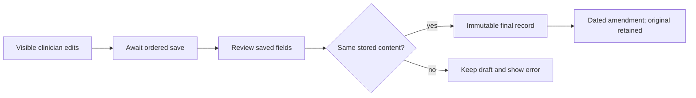

# Implementation progress — clinical record review and Timeline navigation

**Historical batch 1:** subsequent patient-record work is recorded in [batch 2](08-patient-record-implementation.md).

[Audit index](README.md) · [Gap backlog](05-implementation-gap-analysis.md) · [Interaction inventory](02-interaction-map.md)

Implementation date: **2026-10-25**. This is the first implementation batch, not whole-application acceptance. No screen is promoted to COMPLETE. No missing route is filled with a placeholder. The 19 missing design screens/states in the audit still require work.

## Scope and source reconciliation

The existing Phase 3 plan explicitly includes consultation notes, prescription review/finalization, immutable records and amendments. GAP-003/004/007/008 therefore repair previously delivered scope. GAP-011 is addressed only for existing Timeline destinations. No sprint calendar was found; phase assignments are retained.

The repository is Next.js **16.3.8 with TypeScript/TSX**, not a JavaScript-only frontend, and already uses Supabase authentication rather than the audit's historical Clerk references. Existing routing, styling, API hooks, Fastify, Drizzle and schemas are retained. Auth migration was not rewritten.

FigCraft was initially absent from the host tool catalog. After the user enabled it, its configured `figcraft-cli mcp --attach 7979` stdio transport successfully exposed `inspect_document`, `get_node` and `screenshot`. The active document was **ClinixAI v2**, clean, with stable imported IDs. Frames **2966, 3103, 3377, 3524 and 3590** were read; confirmation frames were rendered again. Reference frame **3** explicitly states the five-item patient navigation and Timeline → Page 8 destination. No design mutation occurred.

## Consolidated backlog categories

The existing 37 gap IDs remain the implementation backlog; these are categories, not newly invented scope.

| Category | Established gaps | Current batch |
| --- | --- | --- |
| Missing screens | GAP-016/028/029/030/031/032/033/034 | No new page; missing modules remain pending |
| Partial screens | GAP-013/014/019/020/021/022/023/025/026/027 | Clinical note/review subset repaired |
| Incorrect appearance | GAP-017/021/022/024/026/027/035 | Two confirmation compositions improved; partial comparison only |
| Shared UI components | GAP-011/022/024/035 | Shared review dialog; medicine field labels |
| Navigation | GAP-011/016/018/021 | Four existing Timeline links enabled |
| Forms and dialogs | GAP-004/007/008/013/014/024/025/026 | Save-before-review, failure/retry, dismissal and focus |
| Backend interactions | GAP-002/003/004/005/006/007/008/012 | Owner-scoped replay, reviewed content checks, atomic note completion, amendment history |
| Missing states | GAP-007/008/009/015/017/024 | Pending/unsaved/error/retry/success for affected record writes |
| Responsive discrepancies | GAP-035/036 | Dialog focus and horizontal fit checked at 320/393/768/1440px |
| Cross-screen consistency | GAP-001/005/010/011/035/036/037 | Timeline destinations and shared review behavior only |

## Delivered behavior and IDs

| Gap | Screens / interactions | Implemented behavior | Acceptance boundary |
| --- | --- | --- | --- |
| GAP-003 | SCR-033/035; INT-477/509 | Replay lookup includes authenticated doctor ID, including the race fallback | Synthetic Fastify tests pass; no live database security run |
| GAP-004 | SCR-033/035; INT-471/472/475/477/509 | Every visible row is validated and saved before review; saved snapshot displayed and submitted; API compares ordered medicine fields under draft lock; changed content/replay returns DRAFT_CHANGED | Implemented and tested; source/safety/ambiguity/print-preview review remains GAP-024 |
| GAP-007 | SCR-030/031; INT-420–423/438/739 | Serialized autosaves, accurate unsaved/saving/saved states, visible failure/retry, latest-save flush before completion; reviewed_note comparison; note/encounter/appointment finalized within one transaction | UI and handler tests pass; actual PostgreSQL concurrency/rollback remains unverified |
| GAP-008 | SCR-030; INT-433–436 | Finalized sections become editable in amendment mode; reason and revised fields appended; original retained; dated author-ID history survives reload; API rejects amendments before finalization | Synthetic UI/API/browser tests pass; no live clinical record modified |
| GAP-011 (partial) | SCR-013/015/017/022 → SCR-011; INT-162/192/219 plus code-only booking dock | Timeline links reach /app/patient/timeline rather than being disabled Home links | Browser-tested from all four sources; Care/staff/follow-up navigation remains unresolved |
| Dialog subset | SCR-031/035; INT-437/439/508/510 | Close, Escape, Return to draft, keyboard containment, focus restoration, pending-action protection | Browser-tested; no whole-screen accessibility certification |

The additive `reviewed_items` and `reviewed_note` request fields are optional for compatibility with existing clients. This UI always sends them. Older clients omitting them do not gain stale-review detection. No new endpoint, migration, dependency, auth bypass or replacement state-management system was introduced.

## Affected source and tests

| Exact path | Responsibility / screen IDs |
| --- | --- |
| [apps/web/src/app/app/doctor/prescription-drafts/[draftId]/page.tsx](../../apps/web/src/app/app/doctor/prescription-drafts/[draftId]/page.tsx) | SCR-033/035 saved review and finalization |
| [apps/web/src/app/app/doctor/consultation/[appointmentId]/page.tsx](../../apps/web/src/app/app/doctor/consultation/[appointmentId]/page.tsx) | SCR-030/031 note persistence, completion and amendments |
| [apps/web/src/components/clinical-review-dialog.tsx](../../apps/web/src/components/clinical-review-dialog.tsx) | Shared native modal with focus containment and restoration |
| [apps/web/src/components/medicine-editor.tsx](../../apps/web/src/components/medicine-editor.tsx) | Programmatic labels for clinical fields; shared SCR-033/034/058 consumer |
| [apps/web/src/app/app/patient/vault/page.tsx](../../apps/web/src/app/app/patient/vault/page.tsx) | SCR-013 Timeline destination |
| [apps/web/src/app/app/patient/medications/page.tsx](../../apps/web/src/app/app/patient/medications/page.tsx) | SCR-015 Timeline destination |
| [apps/web/src/app/app/patient/appointments/page.tsx](../../apps/web/src/app/app/patient/appointments/page.tsx) | SCR-017 Timeline destination |
| [apps/web/src/app/app/patient/book/page.tsx](../../apps/web/src/app/app/patient/book/page.tsx) | SCR-022 Timeline destination |
| [packages/schemas/src/index.ts](../../packages/schemas/src/index.ts) | Additive reviewed snapshots and optional amendment-history DTO |
| [services/api/src/prescriptions/routes.ts](../../services/api/src/prescriptions/routes.ts) | Doctor-scoped replay, transactional draft replacement, ordered reviewed-item comparison |
| [services/api/src/appointments/routes.ts](../../services/api/src/appointments/routes.ts) | Locked reviewed-note comparison and atomic completion |
| [services/api/src/consultations/routes.ts](../../services/api/src/consultations/routes.ts) | Serialized note writes and append-only finalized-note amendments/history |
| [services/api/src/clinical-persistence.test.ts](../../services/api/src/clinical-persistence.test.ts) | 13 synthetic Fastify handler regressions |
| [apps/web/src/components/clinical-workflows.test.tsx](../../apps/web/src/components/clinical-workflows.test.tsx) | 7 rendered UI regressions, including an in-flight old autosave |
| [apps/web/e2e/clinical-workflows.spec.ts](../../apps/web/e2e/clinical-workflows.spec.ts) | 7 browser tests: navigation, failure/retry, immutable record, amendment, focus and widths |

## Verification and visual evidence

- `npm run test`: **27 web tests and 52 API tests pass**. API handlers run through Fastify injection with synthetic database boundaries. These do not prove PostgreSQL lock/rollback behavior.
- `npm run test:browser --workspace @clinix/web -- --workers=1`: **19 tests pass**, including all existing authentication lifecycle tests and 7 new workflow tests. The real Supabase browser SDK, app route guards, pages and native dialogs run against controlled synthetic HTTP responses. This is not a live Fastify/PostgreSQL end-to-end test.
- `npm run typecheck`: web/API/worker pass. The actual frontend does have configured TypeScript checks.
- `npm run build`: production Next.js build passes.
- `npm run lint`: no errors; three pre-existing warnings remain in dossier (unused StatusBadge), check-in result (unused router), and Vault polling (missing effect dependency). These unrelated lines were not cleaned up.
- `git diff --check`: passes.
- No cloud gate, migration, destructive operation, real patient request or real account creation was executed.

The initial browser run caught focus escaping the dialog and missing focus restoration. Both were corrected and the browser suite rerun successfully. A test-only unsupported Testing Library option initially failed the production type check; it was removed and the build rerun successfully.

| Screen / dimensions | Source | Implementation | Comparison result |
| --- | --- | --- | --- |
| SCR-035 / 393 × 1260 | [FigCraft frame 3590](evidence/design-3590.png) | [Synthetic runtime capture](evidence/implementation-scr-035-393.png) | Palette, mobile full-screen review, patient summary, saved medicines, amendment rule and action hierarchy compared. Partial, not pixel-perfect. |
| SCR-031 / 393 × 1180 | [FigCraft frame 3103](evidence/design-3103.png) | [Synthetic runtime capture](evidence/implementation-scr-031-393.png) | Palette, summary, exact note content, finalization rule and actions compared. Partial, not pixel-perfect. |

Remaining visual differences are explicit: no simulated phone status bar, no fabricated author/encounter facts, no automatic checkmarks for unperformed source/safety/printable-preview/follow-up reviews, and no claim that a complete access-ledger workflow exists. Real edited content replaces design fixture text. Parent consultation/workbench screens are not fully aligned by this batch. Browser layout checks cover dialog horizontal fit and keyboard behavior, not the entire responsive application.

## Remaining work and next order

1. **GAP-001/002/005:** truthful dossier data, AI/session ownership, and checked safety outcomes. These critical gaps were not fixed by this clinical-record batch.
2. **GAP-006/009/010:** scoped consent, persistent safety interrupts, verification/eligibility policy. Existing broad relationship access remains a dependency for clinical context/source modules.
3. **GAP-024/022:** real ambiguity decisions, source comparison, safety context, printable preview and consultation review composition. OCR flags are not certified as resolved by saving structured fields; these gates still need an explicit persisted review contract.
4. **GAP-011/013/016/017/018/020/021/023/025:** remaining navigation, booking, Timeline detail, source/medication consumers, schedule, directory, queue and identity flows. The audit's stable IDs and unknown destinations remain intact.
5. **GAP-028–034:** Care/discovery/consent/privacy, follow-ups, staff intake, practice, retention and professional profile, in their approved Phase 6/7 order. Design existence alone does not advance future-phase work into Phase 3.
6. **GAP-035–037:** full design/responsive/accessibility/regression acceptance, including a disposable seeded PostgreSQL integration environment. No complete database-backed application journey is certified here.

The missing-page list and dependencies remain in [04](04-design-code-traceability.md) and [05](05-implementation-gap-analysis.md); no arbitrary destination was supplied for unresolved affordances.

Research used the required Exa search and Firecrawl fetch, which both succeeded in this implementation session. The [official Next.js Link reference](https://nextjs.org/docs/app/api-reference/components/link) supports the existing Link navigation convention; the installed Next.js directive guide was also read. The [Drizzle transaction documentation](https://orm.drizzle.team/docs/transactions) supports the transaction boundary pattern; installed Drizzle 0.45.3 conventions already present in this repository were retained. These sources support technical conventions, not claims about clinical correctness or design acceptance.
