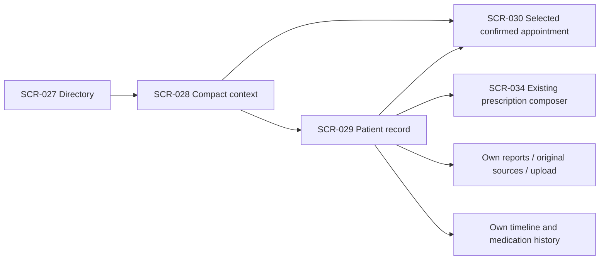

# Phase 2 patient-record module — implementation batch 2

[Audit index](README.md) · [Information architecture](01-information-architecture.md) · [Interaction map](02-interaction-map.md) · [Previous batch](07-implementation-progress.md)

Date: **2026-10-25**. Selected module: patient directory → compact clinical context → longitudinal dossier. GAP-001 is the highest-priority outstanding issue and belongs to the completed Phase 2 dossier and Phase 5 presentation work. The [Phase 2 plan](../../code-agent/c-plans/2026-10-01_clinix-phase-2-core-dossiers.md) names Pages 16/17 and their GET contracts. GAP-021 supplies the omitted compact view. No sprint numbers were invented and no future follow-up or consent service was fabricated.

## Design and routing established before implementation

The connected **ClinixAI v2** document was inspected through the configured FigCraft MCP stdio transport. `inspect_document`, full-depth `get_node` and `screenshot` were used on frames **2609, 2722 and 2789** before source changes. The document remained unmodified. No original Figma URL or prototype connection was assumed.

| Screen | Source frame | Actual route / presentation | Current acceptance |
| --- | --- | --- | --- |
| SCR-027 | 2609 — Patient Directory | `/app/doctor/patients` | Corrected and browser-tested; PARTIAL because follow-up filtering and authoritative safety metadata are unavailable |
| SCR-028 | 2722 — compact Patient Clinical Workspace | `/app/doctor/patients/[patientId]/context` | Missing screen implemented; browser-tested, visually compared; PARTIAL because shared packet/check-in/consent dependencies remain locked |
| SCR-029 | 2789 — longitudinal Patient Clinical Workspace | `/app/doctor/patients/[patientId]` | Fictional clinical values removed; supported interactions implemented and tested; PARTIAL because consent/AI/follow-up/allergy/condition services and full clinical acceptance remain unavailable |

The nested `/context` URL is an explicit implementation decision, not a URL encoded in FigCraft. It represents the distinct compact state documented by INT-391–406. The full dossier route is preserved. Both routes inherit the existing doctor role guard. Component state is keyed by patient ID so previews, files and claim codes cannot carry into another patient's record.

## Behavior and interaction verification

| IDs | Source → element → result | Status / evidence |
| --- | --- | --- |
| INT-385/387/388/390 | Directory search and Recent/Upcoming/Unclaimed → filtered own-relationship list; ID search also supported | Implemented; API and browser tests |
| INT-386/395 | Add/create record → existing `/app/doctor/patients/new` | Existing destination retained; href checked |
| INT-391–394 | Selected patient card → compact context for that patient | Implemented; browser-tested |
| INT-400/401 | Context Close/Back → directory | Implemented; source-matched exits |
| INT-402 | Review consent scope → actual available access boundary | PARTIAL: own-record boundary shown; no immutable grant/scope/expiry receipt exists |
| INT-403/411 | Open full timeline → in-record modal with all composed own events and supplied provenance | Implemented; browser-tested; no arbitrary clinician timeline route |
| INT-404/413 | Open medication history → own history modal; current use is not inferred from a prescription | Implemented; browser-tested |
| INT-405/414 | Start/Begin consultation → explicit confirmed appointment; selector if multiple; absent appointment → disabled action plus Schedule exit | Implemented; browser-tested; REQUESTED visits are not silently selected |
| INT-406 | Open patient record → preserved full dossier route | Implemented; browser-tested |
| INT-407–410 | Overview/Timeline/Reports/Meds → corresponding section anchor with selected-location feedback | Implemented; browser-tested |
| INT-412 | Report/source → exact authorized original image/PDF; error clears the prior preview | Implemented; API and browser tests |
| INT-415 | Create prescription → existing encounter POST → existing composer with both patient/encounter parameters | Implemented; browser-tested |
| INT-416 | Upload record → document-type/file form → existing init → signed PUT → existing complete → source list and quiet extraction polling | Implemented; failed PUT never calls complete; failed complete retries without repeating successful PUT |
| INT-418 | Unclaimed record → actual claim-invite endpoint → one-time code and real expiry | Implemented; browser-tested; no delivery/identity-verification claim |
| INT-389/417 | Follow-up filter / Schedule follow-up | BLOCKED; controls disabled, service unavailable in completed-phase scope |
| INT-399 | Designed You dock item | Remains unresolved as a dock destination; existing header account menu retained on directory/dossier; context exits back to directory |
| INT-740–751 | New code-only recovery, upload, source and history controls | Individually inventoried in 02; source-derived result, no new screen IDs |

The native dialog from batch 1 is reused for timeline, history, access, upload and source states, including Escape, keyboard containment, Close, busy protection and focus return. The compact frame keeps its designed Close/Back and avoids adding the full dossier's dock.

## Clinical truth and access boundary

The previous page displayed Penicillin, migraine, Vitamin D deficiency, medicines, lab values/trends, a primary doctor, dates and CONSENT ACTIVE regardless of data. These fixtures have been removed from live UI. There is no allergy/conditions service in the current schema: those facts are explicitly unconfirmed/unavailable. Unclaimed records are not called verified. AI confidence, low-risk outcomes, successful consent or ledger receipts are not manufactured.

The existing workspace GET now composes only:

- encounters whose `patient_id` and `related_doctor_id` match this patient and clinician;
- appointments with the same patient and doctor;
- undeleted documents uploaded by this doctor for this patient;
- reports attached to those authorized documents;
- prescriptions finalized by this doctor for this patient;
- medication exposures linked to this patient's own-doctor encounters, plus this doctor's finalized prescriptions as `UNKNOWN_STATUS`.

Metadata may be read under the existing active-relationship guard; this does not authorize patient-shared or other-clinician clinical history. Those groups and AI context remain visibly unavailable until scoped consent exists. This is a conservative repair of broad queries, not a new consent implementation. Other AI/session endpoints still require GAP-002 work; the dossier no longer calls their unsafe convenience endpoint.

Timeline authority is not universally DOCTOR-AUTHORED: actual encounter initiation and source-document metadata are retained; appointments whose author is unknown do not acquire clinician authorship. Last-activity metadata uses stored update/create timestamps, not a future appointment time.

Doctor original-source GET and upload-complete now reject other doctors' or patient uploads; source sharing without verified scope returns `CONSENT_REQUIRED`. Upload-init rejects a foreign patient/clinician encounter before creating a document. Existing patient-self document paths remain intact. Consultation medication composition uses the same own-doctor scope when reached from the record. Full consent enforcement across all other modules remains GAP-006.

## Exact affected paths

| Path | Change |
| --- | --- |
| [apps/web/src/app/app/doctor/patients/page.tsx](../../apps/web/src/app/app/doctor/patients/page.tsx) | SCR-027 layout, working filters, compact links, masked phone, upcoming metadata, error recovery |
| [apps/web/src/app/app/doctor/patients/[patientId]/context/page.tsx](../../apps/web/src/app/app/doctor/patients/[patientId]/context/page.tsx) | New guarded SCR-028 entry |
| [apps/web/src/app/app/doctor/patients/[patientId]/page.tsx](../../apps/web/src/app/app/doctor/patients/[patientId]/page.tsx) | Preserved SCR-029 route; removes fixture page and delegates to shared record component |
| [apps/web/src/components/doctor-patient-record.tsx](../../apps/web/src/components/doctor-patient-record.tsx) | Shared truthful context/dossier, histories, sources, uploads, claim and consultation/composer connections |
| [apps/web/src/components/workspace-shell.tsx](../../apps/web/src/components/workspace-shell.tsx) | Optional focused width, heading/nav suppression and header slot; existing callers keep defaults |
| [apps/web/src/components/clinix-brand.tsx](../../apps/web/src/components/clinix-brand.tsx) | Optional source-frame C text mark for focused clinical screens; default mark retained elsewhere |
| [packages/schemas/src/index.ts](../../packages/schemas/src/index.ts) | Additive own-record scope, source/history/provenance/update metadata and next directory appointment |
| [services/api/src/doctor-patients/routes.ts](../../services/api/src/doctor-patients/routes.ts) | Scoped composition, real sources/history, ID search and Upcoming filter |
| [services/api/src/documents/routes.ts](../../services/api/src/documents/routes.ts) | Reuses report projection; source/upload ownership and encounter checks |
| [services/api/src/medications/derive.ts](../../services/api/src/medications/derive.ts) | Optional doctor scope; existing unscoped patient consumers preserved |
| [services/api/src/consultations/routes.ts](../../services/api/src/consultations/routes.ts) | One-line own-doctor medication scope on incoming consultation |
| [services/api/src/doctor-patients/routes.test.ts](../../services/api/src/doctor-patients/routes.test.ts) | Five synthetic handler/SQL-boundary tests |
| [services/api/src/documents/doctor-access.test.ts](../../services/api/src/documents/doctor-access.test.ts) | Six source/upload authorization regressions |
| [services/api/src/clinical-persistence.test.ts](../../services/api/src/clinical-persistence.test.ts) | Existing consultation regression now asserts own-doctor medication scope |
| [apps/web/e2e/patient-records.spec.ts](../../apps/web/e2e/patient-records.spec.ts) | Nine real-browser controlled-service module journeys |

No new API endpoint, dependency, migration, auth provider, state library or backend architecture was introduced. Schemas are additive. One Next.js route was added; current route-file count is 33. Existing batch-1 record-saving/finalization logic was not rewritten. This batch preserves the prior implementation baseline, commit `014bbe3`.

## Verification

- `npm run test`: **27 web tests and 63 API tests pass**.
- Full browser regression run: **28 tests pass**, comprising 19 previous tests and 9 module tests. A focused final module rerun also passes.
- `npm run typecheck`: web/API/worker pass.
- `npm run build`: production build passes and includes the new guarded context route.
- `npm run lint`: no errors; two existing warnings remain in patient check-in result and Vault polling. The previous unused dossier StatusBadge import was removed with the replaced fixture page.
- `git diff --check`: passes.

API tests use actual Fastify handlers with synthetic database/storage boundaries and inspect the generated scope parameters. Browser tests use actual pages, route guards, the browser auth SDK, native dialogs and signed-upload request flow against synthetic HTTP responses. They verify navigation, filters, explicit unknown facts, two different patients, forbidden/retry states, original-source denial/retry, failed PUT, completion retry, extraction refresh, prescription/consultation connections, claim codes, keyboard return and horizontal fit at 320/393/768/1440px. **These do not certify live PostgreSQL, Supabase Storage or extraction-worker integration.** No real clinical record, cloud gate or destructive operation was used.

The initial browser failure was a test locator matching the Next.js route announcer as well as the application's alert. The locator was narrowed and the full suite rerun. A synthetic Map fixture initially failed strict type checking; its generic types were corrected. Those failures are resolved.

## Visual comparison

| Frame | Design evidence | Runtime evidence | Result |
| --- | --- | --- | --- |
| SCR-027 / 2609 | [Design](evidence/design-2609.png) | [393px directory](evidence/implementation-scr-027-393.png) | Focused mobile layout, original section/card pattern, source palette, filters and controls compared |
| SCR-028 / 2722 | [Design](evidence/design-2722.png) | [393px compact context](evidence/implementation-scr-028-393.png) | C header, Close/Back, summary/safety/context/records/medication/access panels and action hierarchy compared |
| SCR-029 / 2789 | [Design](evidence/design-2789.png) | [393px dossier](evidence/implementation-scr-029-393.png) | Identity, section navigation, overview, reports, medications/prescriptions, scope boundary and clinical actions compared |

Captures contain synthetic variable data and explicit unknown/blocked states, so lengths differ from populated design fixtures. No simulated phone status bar, fictional trend, verified-patient label, blanket authorship or completed-consent claim is copied. Development chrome may be visible. Essential clinical text stays readable instead of copying all tiny imported labels. No desktop frame exists; desktop checks establish layout usability, not a desktop design match. Visual acceptance remains partial, not pixel-perfect.

## Remaining module blockers and next order

1. **GAP-006/021:** authoritative scoped consent and immutable receipt, primary-doctor and safety/conditions contracts. Review access explains the current boundary; it cannot present a nonexistent grant.
2. **GAP-002/005:** ownership and checked safety outcomes on the remaining AI/session APIs; these are still the highest-priority independent gaps. Patient-shared AI/check-in content remains locked in this module.
3. **GAP-030:** follow-up service/worklist before enabling INT-389/417. No future-phase service is invented to make a button appear complete.
4. Live seeded PostgreSQL/storage/worker acceptance, source freshness and complete clinical/provenance contracts, screen-reader/contrast and full application regression acceptance. No screen is promoted to COMPLETE.

Mandatory public research used Exa search and Firecrawl fetch for the [official Next.js Link reference](https://nextjs.org/docs/app/api-reference/components/link); the installed Next.js 16.3.8 guide was read before implementation. It supports Link/hash navigation conventions only; private FigCraft and repository evidence establish the clinical workflow.

Historical batch 2 evidence above is preserved. The next completed-phase changes and current verification are recorded in [batch 3](09-checkin-implementation.md).
