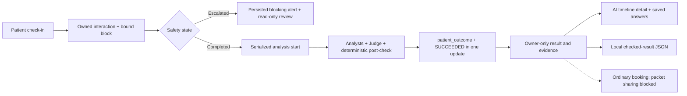

# Batch 3 — Phase 5 check-in, safety, result and AI timeline detail

Date: 2026-10-25. Status: **implemented and tested at synthetic boundaries; visually compared; module remains PARTIAL**. Batches [1](07-implementation-progress.md) and [2](08-patient-record-implementation.md) are preserved. No deployment, live migration, real-account creation, patient-data request or clinical-model call was performed.

## Selection, scope and source reconciliation

The master plan marks [Phase 5 complete](../../code-agent/c-plans/2026-10-01_clinix-master-build-plan.md#phase-5--ai-check-in-screens-6-7-8--17-update--test-milestone-b). No separate Phase 5 detail plan or sprint calendar exists in this checkout, so this batch makes no sprint-number claim. GAP-002 is the highest remaining completed-phase isolation gap; GAP-005 and GAP-009 are critical safety defects in the same workflow. GAP-014/015/016 supply its question/result/detail dependencies.

Before implementation, the connected, imported **ClinixAI v2** document was read through the configured FigCraft MCP transport (`figcraft-cli mcp --attach 7979`): full nested `get_node` trees and rendered `screenshot` captures for frames **766, 815, 843, 951 and 1060**. No design mutation was made. The host's general Figma connector is not required to resolve these imported numeric IDs. Original frame captures remain in `evidence/design-{id}.png`.

The source shows a low-risk *example*, not permission to label every clinical outcome low risk. Approved safety requirements take precedence for urgent/review/unavailable cases. Source typography is Inter with Playfair Display for the question heading; it is now scoped to these screens. The design's seven-step example conflicts with the existing service's three configured single-select questions. The UI now reports the actual service total; adaptive generation and additional block types remain open rather than inventing four clinical questions. Missing packet/consent and optional-measurement contracts are shown as unavailable; the implementation does not claim a saved/shared packet.

## Screens, routes and states

| Screen | Actual route / parent | Implemented and tested | Visual evidence | Remaining / status |
| --- | --- | --- | --- | --- |
| SCR-008 · 766 | `/app/patient/checkin?interactionId=…`; existing patient layout | Saved block/answer Back, return to saved concern, owner-checked restore, actual progress, nonblank free text, answer retry and analysis retry without response replay | [393px capture](evidence/implementation-scr-008-393.png) compared with frame 766 | PARTIAL: three configured questions; no adaptive multi/numeric/date/scale renderer or unsubmitted-draft autosave |
| SCR-009 · 815 | Same check-in route; also used for checked urgent results | Persisted blocking alert, read-only answer review, native dialog Escape/focus return, reload restoration, call/map destinations | [393px capture](evidence/implementation-scr-009-393.png) compared with frame 815 | PARTIAL: curated demo-scale safety rules and live database acceptance not clinically certified |
| SCR-010 · 843 | `/app/patient/checkin/result/[sessionId]`; patient layout | Checked disposition/uncertainty, actual evidence/labs, evidence retry, pending/error/failed/legacy recovery, truthful saved-record link, local result JSON download, ordinary booking exit | [393px capture](evidence/implementation-scr-010-393.png) compared with frame 843 | PARTIAL: optional measurements, Vault document save, scoped packet/consent/share/package unavailable |
| SCR-011 · 951 | `/app/patient/timeline`; patient layout | AI entries link using their selected `ai_session_id`; API summary uses checked outcome | Frame inspected; transitions tested | PARTIAL: non-AI details/source links and broader timeline visual gaps unchanged; no new full-screen visual certification |
| SCR-012 · 1060 | **New** `/app/patient/timeline/checkins/[sessionId]`; patient layout | Saved provenance/time, answer snapshot dialog, full-result/source-result links, Close/Back, entry/evidence retry and empty states | [393px capture](evidence/implementation-scr-012-393.png) compared with frame 1060 | PARTIAL: consultation packet unavailable; arbitrary non-AI entry detail not invented |

The new detail URL is an implementation choice for the established SCR-011 → SCR-012 relationship; FigCraft supplies no URL or exposed prototype wire. Both incoming and outgoing links retain the selected session. Result → booking now opens the existing booking module **without** ignored packet/encounter parameters; nearby text states that booking grants no result/record access. Result → timeline → selected detail → full result, and result → reports, are browser-tested. No full screen is marked COMPLETE.

## Interactions and navigation

- **INT-092/100:** real previous block and saved answer restored. First question returns to its saved concern; resuming the same session does not silently rewrite that concern.
- **INT-094:** basis reflects saved concern/answer count and identifies the configured sequence. Clinical adaptive-basis metadata remains unavailable, so this stays Partial.
- **INT-095–099/104:** accessible pressed selection and free text; `allow_free_text` respected; empty “Something else,” foreign options/blocks and empty responses rejected.
- **INT-101/103, INT-752:** owned interaction/session, URL-based reload recovery, transactional creation/answer progression, dependent-answer invalidation on actual earlier edits, and idempotent same-answer retry. Completed answers survive failed analysis dispatch; retry starts analysis without re-posting the last answer.
- **INT-105/106/107/757:** emergency links retain correct dialer/maps targets; review cannot resume the interrupted flow. Call/maps attributes were checked; no phone call or external geolocation was invoked. Urgent AI results load actual frozen inputs when available; they do not present doctor questions as triggering patient answers or invent trigger attribution.
- **INT-110/755/756:** result-basis dialog reads frozen concern, patient answers, historical encounters, labs and prior-Rx source references. Retry, Close/Escape and exact focus return verified.
- **INT-108/109/111/112/122:** Home/Done, Timeline, reports and error exits retained. **INT-117** supports ordinary booking only and remains Partial for scoped packet booking.
- **INT-118:** replaces local “saved” toggle with a link to the already persisted AI record in the timeline; no Vault document success is claimed. Remains Partial for the designed Vault action.
- **INT-120:** browser-generated JSON contains this checked outcome and frozen evidence only. Downloaded bytes are parsed in the test. This is a working local result export, **not** a scoped package or consent grant; the package interaction stays Partial. **INT-119** remains disabled/blocked with visible sharing limitations.
- **INT-121/753/754:** polling cancels on exit, stops at terminal/error states, and caps at 60 requests spaced two seconds apart with manual status retry. Pending → success, denied, failed and missing checked outcome are browser-tested. The elapsed two-minute timeout branch is source-verified, not browser-exercised; INT-754 remains Partial.
- **INT-130/134/144–148/758–760:** selected AI timeline details, Back/Close, full result and saved-answer dialog implemented. Detail read/evidence errors and retry verified. **INT-149** remains blocked because there is no scoped packet source.
- **INT-113/114/115:** optional measurements/vision updates are still missing. No unpersisted clinical edits or fake confirmations are offered. Real checked-output questions are displayed in the missing-information section.

New recovery controls are inventoried as INT-752–760; established IDs are retained. Current interaction inventory: **760** rows (738 original + 22 implementation controls). Current primary screen classifications: **0 COMPLETE, 30 PARTIAL, 17 MISSING, 5 MISMATCH, 0 BROKEN, 0 UNVERIFIED**. “Implemented” interaction status describes wiring; individual verification boundaries remain in 02 and this report.

## Backend integration and isolation

1. **Result/evidence GET:** patient-role and session/patient ownership predicates run before returning status/content or querying evidence. Missing and foreign resources return 404. Legitimate reads write the existing access ledger. There is no raw-judge fallback for legacy successful sessions without checked outcomes.
2. **Interaction GET/POST:** session/encounter ownership precedes block/answer access. Submission locks its session and encounter, binds the block to the session, validates options/free text, and never advances ESCALATED sessions. Same-answer retries return their saved successor; changed earlier answers invalidate only dependent blocks/responses in that session. Edits are rejected once an AI session exists. GET returns safe session fields, actual history, concern, configured total and saved alert, with read auditing.
3. **Analysis POST:** own encounter and completed interaction required. Encounter lock serializes repeat starts and rechecks completion; existing nonfailed sessions are reused. Failed dispatch marks the session FAILED and returns an actionable 503 instead of leaving a falsely queued RUNNING session. DB/queue distributed exactly-once delivery and crash recovery are not certified here.
4. **Worker:** job/session encounter consistency checked; successful queue replay does not overwrite a completed outcome. Post-check output is retained, post-judge safety evaluation logged, then checked outcome is stored in the same update as SUCCEEDED. Urgent output has no self-care fallback; doctor review/disagreement/unsupported-claim states are distinguished. The existing limited medication-name filter remains a demo-scale guard, not comprehensive clinical validation. Empty checked consensus requires doctor review, and that same disposition is reflected in the safety audit. Fabricated numeric similarity confidence, historical fallback matches and “resolved with prior regimen” outcomes were removed; no resolution is asserted without evidence. Frozen answers now carry actual option labels rather than opaque option IDs.
5. **Timeline:** AI summary uses the stored checked outcome; legacy records show unavailable. No unconditional low-risk text.
6. **Doctor assistance:** own-encounter/relationship predicates guard the encounter endpoint and relationship guards patient lookup. Both return CONSENT_REQUIRED without reading cross-record AI content until scoped consent exists. This deliberately withdraws unsafe fabricated assistance; full doctor AI remains blocked under GAP-006/012.

### Migration prerequisite

Generated **[0008_freezing_slyde.sql](../../services/api/drizzle/0008_freezing_slyde.sql)** adds nullable JSONB `ai_sessions.patient_outcome` and `interaction_sessions.safety_alert`; matching schema snapshot/journal included. It does not alter existing data or invent a backfill. `drizzle-kit check` passed. **Not applied to a live database.** Deploying API/worker changes requires applying this migration to a safe development database first. Legacy successful AI records without checked outcomes deliberately show unavailable; they are not reconstructed from raw judgments.

## Exact affected implementation files

| File | Change |
| --- | --- |
| [apps/web/src/app/app/patient/checkin/page.tsx](../../apps/web/src/app/app/patient/checkin/page.tsx) | Question history/resume, honest progress/basis, free-text validation, retry, source appearance |
| [apps/web/src/app/app/patient/checkin/result/[sessionId]/page.tsx](../../apps/web/src/app/app/patient/checkin/result/[sessionId]/page.tsx) | Checked outcome, bounded polling, urgent state, evidence/scope review, JSON export and truthful actions |
| [apps/web/src/app/app/patient/timeline/page.tsx](../../apps/web/src/app/app/patient/timeline/page.tsx) | AI-entry links to selected detail; other entry types unchanged |
| [apps/web/src/app/app/patient/timeline/checkins/[sessionId]/page.tsx](../../apps/web/src/app/app/patient/timeline/checkins/[sessionId]/page.tsx) | New SCR-012 AI-entry detail |
| [apps/web/src/components/checkin-safety.tsx](../../apps/web/src/components/checkin-safety.tsx) | Shared blocking safety screen and native answer review |
| [apps/web/src/components/checkin-typography.ts](../../apps/web/src/components/checkin-typography.ts) | Source Inter/Playfair fonts scoped to this workflow |
| [packages/schemas/src/index.ts](../../packages/schemas/src/index.ts) | Additive checked disposition/safety and session timestamps; trimmed concern validation |
| [services/api/src/ai/routes.ts](../../services/api/src/ai/routes.ts) | Owned session/evidence reads, safe analysis start/retry, fail-closed doctor assistance |
| [services/api/src/interactions/routes.ts](../../services/api/src/interactions/routes.ts) | Owned history, answer validation/locks/retries and persistent safety state |
| [services/api/src/schema.ts](../../services/api/src/schema.ts) | Nullable checked outcome/alert columns |
| [services/api/src/timeline/routes.ts](../../services/api/src/timeline/routes.ts) | Actual checked AI summary |
| [services/worker/src/handlers/ai-analyze.ts](../../services/worker/src/handlers/ai-analyze.ts) | Publish checked outcome, log post-judge safety, replay/job consistency |
| [services/worker/src/pipeline/post-check.ts](../../services/worker/src/pipeline/post-check.ts) | Honest safety/review disposition and evidence-only history |
| [services/worker/src/pipeline/evidence-bundle.ts](../../services/worker/src/pipeline/evidence-bundle.ts) | Preserve actual selected option labels |
| [services/api/drizzle/0008_freezing_slyde.sql](../../services/api/drizzle/0008_freezing_slyde.sql), [snapshot](../../services/api/drizzle/meta/0008_snapshot.json), [journal](../../services/api/drizzle/meta/_journal.json) | Generated forward-only migration metadata |
| [services/api/src/ai/checkin.test.ts](../../services/api/src/ai/checkin.test.ts) | 28 handler/SQL/safety-outcome tests |
| [services/api/src/ai/worker-outcome.test.ts](../../services/api/src/ai/worker-outcome.test.ts) | 5 publication/failure/replay/job consistency tests |
| [apps/web/e2e/checkin-workflows.spec.ts](../../apps/web/e2e/checkin-workflows.spec.ts) | 10 browser workflows/error/recovery/width tests; four captures |

Architecture files 01–06 and README updated; batch 2 report gains a historical-next-report link. Existing shared dialog, routing, state system, auth SDK, storage and Fastify infrastructure are reused. Earlier uncommitted patient-record work is preserved.

## Verification and evidence limits

| Check | Observed result |
| --- | --- |
| `npm run test --workspace @clinix/web` | **27 passed** |
| `npm run test --workspace @clinix/api` | **96 passed** across 10 files, including 33 new checks |
| `npm run test:browser --workspace @clinix/web -- --workers=1` | **38 passed**; includes previous auth, clinical-review and patient-record regressions plus 10 module cases |
| `npm run typecheck` | Web, API and worker pass |
| `npm run lint` | Pass, no errors; one pre-existing Vault effect dependency warning |
| `npm run build` | Production Next.js build passes; new dynamic timeline detail listed |
| `npm exec --workspace @clinix/api -- drizzle-kit check` | Migration metadata consistent |
| `git diff --check` | Pass |
| FigCraft/runtime comparison | Four 393px screens compared; five exact source frames inspected |
| Width/keyboard | 320/393/768/1440 result/detail fit; native dialog focus return/Escape; check-in and safety captured at 393 |

API tests execute real Fastify handlers and real SQL builders with controlled authentication/database/queue/audit boundaries. Worker tests execute orchestration/post-check with controlled evidence/model/database boundaries. Browser tests execute actual Next pages, Supabase SDK/auth guards, native dialogs and a parsed downloaded file against controlled synthetic HTTP responses. Native T3 preview was also opened and inspected; authenticated workflow acceptance comes from the repository Playwright harness. No real patient data, live credentials, emergency call or model-generated clinical judgment was used.

Initial browser attempts exposed decorative symbols in accessible names and premature test reloads; names and test synchronization were corrected before the passing run. Lint initially caught state setters declared below their consuming helper; declarations were corrected. These are not outstanding failures.

Visual comparison corrected screen widths, source typography, question callout/radio composition and safety/result/detail sections. Screens remain content-driven and scroll instead of clipping the source frames. Differences include actual three-question progress, dynamic concerns/evidence/unknown states, mandatory medication warning, explicit unavailable sharing/measurements, local result export labels and development-tool chrome in captures. No pixel-perfect, live end-to-end clinical, zoom/assistive-technology or full-application visual certification is claimed. The manual timeout branch and whole safety-rule corpus are not comprehensively exercised by browser tests.

Research used official [Fastify testing documentation](https://fastify.dev/docs/latest/Guides/Testing/) (Exa search plus Firecrawl fetch), matching installed Fastify 5.12.x and the handler injection strategy. Installed Next.js 16.3.8 `use-client` documentation was read before UI edits.

## Remaining work and next order

1. Apply migration 0008 to an isolated seeded development database, then verify real PostgreSQL locking/rollback, queue/worker publication, read audits and both patient identities. Re-run relevant cloud acceptance only with synthetic data; no historical gate was rerun or relabeled here.
2. Resolve GAP-006 scoped consent and GAP-010 professional verification policies, then implement GAP-012 exact packet scope/recipient/expiry, booking persistence and authorized doctor consumption. This is the prerequisite for the disabled sharing/packet actions, not permission to invent them.
3. Complete GAP-014's adaptive block/basis/autosave contract and GAP-015 optional measurements/reanalysis plus Vault document save and scoped package export. Only existing three-question service behavior is implemented here.
4. Complete GAP-016's non-AI timeline details/sources, then the completed-phase Vault/medication/source lifecycle (GAP-017/018), appointment management and schedule context (GAP-019/020).
5. Continue completed-phase draft/prescription source/safety/ambiguity gates (GAP-023/024) before pending Phase 6/7 modules. Reconcile all remaining visual/accessibility states through measured screenshots and role-safe journeys.

The module and application remain incomplete; the report separates functioning implemented paths from blocked design controls and unverified live integrations.

Historical batch 3 evidence above is preserved. The next completed-phase visit workflow and current checks are in [batch 4](10-appointment-implementation.md).
