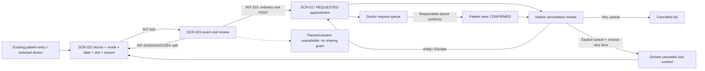
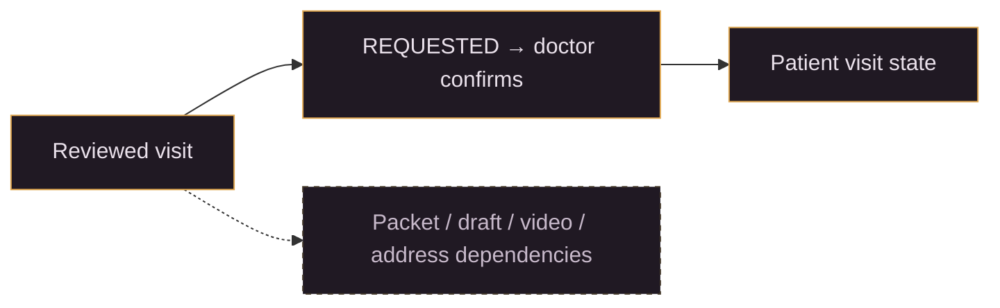

# Batch 4 — Phase 3 booking and appointment management

Date: **2026-10-26**. Scope: **GAP-013 and GAP-019**, plus their GAP-010/011/012/035/036 dependencies. Screens **SCR-017, SCR-022 and SCR-023** are implemented/tested at synthetic boundaries and visually compared; **all remain PARTIAL**. No new route was required. Earlier batches and pre-existing `.gitignore`/`tools/` work are preserved.

## Scope and source reconciliation

The [Phase 3 detail plan](../../code-agent/c-plans/2026-10-01_clinix-phase-3-clinical-loop.md) marks booking and appointments complete and explicitly defers **rescheduling to cancel + re-book**, **video join as a non-goal**, and **consent to Phase 6**. No sprint calendar was discovered, so this report uses the established phase rather than inventing a sprint number. Earlier clinical persistence/session safety repairs were not redone.

GAP-006/012 depend on the pending consent service. GAP-010's current authorization policy is resolved by [API contract §4](../API_CONTRACT_SPEC.md): a completed PENDING doctor profile can open the workspace under the demo policy; verification is not an authorization gate. This batch preserves that approved behavior and shows actual verification metadata. It does not impose an invented VERIFIED-only gate. Future discovery/governance requirements remain open. GAP-013 is the next well-defined incomplete completed-phase workflow after those dependencies and the preceding batches.

Before code changes, FigCraft's imported **ClinixAI v2** document was reopened from the existing local file and inspected through its configured MCP stdio transport, `figcraft-cli mcp --attach 7979`. Full nested `get_node` trees and rendered `screenshot` captures were read for:

| Screen | Frame | Source structure |
| --- | --- | --- |
| SCR-017 · Patient appointments | **1555** | Header Back/+ Book, counted tabs, manual-payment note, online/in-person cards, status/payment separation, reschedule/cancel, directions/join, legend, dock |
| SCR-022 · Booking | **2143** | Header Back/Cancel, selected doctor, visit mode, date/slot, reason, scoped packet, sharing receipt, review/draft actions |
| SCR-023 · Booking review | **2255** | Header Back/Edit, visit summary, attached-record scope, receipt, confirmation and edit exits |
| Navigation reference | **3** | Established Home/Timeline/Reports/Visits destinations; profile → Settings; booking → Appointments |

Source fonts are **Plus Jakarta Sans** and the existing botanical/sage/canvas palette. Existing typography, brand and native dialog are reused. No design mutation or temporary design asset URL was introduced. Missing doctor address, video provider, draft storage and record-consent contracts cannot be inferred from sample fixture text. Static sample doctor names, VERIFIED claims, clinic addresses, selected lab/medicine groups and expiry receipts were not copied into live UI.

## Screens and navigation

| Screen | Actual route / layout | Implemented and tested | Visual comparison | Remaining |
| --- | --- | --- | --- | --- |
| SCR-017 | `/app/patient/appointments`; existing patient `RequireWorkspace` layout | Header Back/+ Book, real counts and date/status buckets, manual payment and consultation states, requested/confirmed cancel, error/retry, native review/Keep/Escape, explicit cancel-and-rebook | [393px runtime](evidence/implementation-scr-017-393.png) vs [1555](evidence/design-1555.png) | PARTIAL: clinic address/directions and video provider absent; You/Care dock contract unresolved |
| SCR-022 | `/app/patient/book`; same layout | Actual doctor picker/status, both modes, real date buttons and date input, keyed returned slots, reason editor, required selection before review, Back/Cancel, availability/data retry | [393px runtime](evidence/implementation-scr-022-393.png) vs [2143](evidence/design-2143.png) | PARTIAL: packet/consent and provisional-draft persistence absent |
| SCR-023 | Review state within `/app/patient/book` | Exact selected doctor/mode/time/reason, Back/Edit/Edit details/Back to edit, scope-limit review, confirm/error/reselect, returned appointment acknowledgement | [393px runtime](evidence/implementation-scr-023-393.png) vs [2255](evidence/design-2255.png) | PARTIAL: no exact attached packet, consent receipt or expiry service |

There is **no new page or endpoint**: current totals remain **34 page files and 63 registered endpoint declarations**. Existing check-in/result → ordinary booking and visits → Timeline/report/medication exits remain available. The booked URL carries only a returned appointment ID; success/status is shown only if that ID is present in the patient's own fetched list.

### Verified workflow

Rescheduling is deliberately **not an atomic slot move**. The confirmation explains that it cancels the old visit first and reserves nothing until the replacement is reviewed and submitted. A failed cancellation keeps the original selection/review open. After cancellation succeeds, `/app/patient/book?rebook={id}` restores doctor, mode and reason **only from an owned CANCELLED appointment** returned by the existing own-list API. A foreign, absent or active ID is not used as rebooking authority.

For a compact styled reading of the same boundary:

## Interaction coverage

- **INT-201/202, INT-296/297:** header parent/booking exits restored; navigation does not create a visit. Browser tests exercise Back, + Book and Cancel.
- **INT-203–205:** real Upcoming/Past/Cancelled counts, including overdue active appointments under Past. No fabricated count or future visit implied by a past date.
- **INT-207/210/213/216:** reviewed cancel-and-rebook flow, selected record/mode/reason restoration and newly confirmed request tested. No new reschedule endpoint or silent cancellation.
- **INT-208/211/214/217/223–225:** both REQUESTED and CONFIRMED cancellation; Keep/Escape/focus return; failure displayed in the still-open dialog; retry and Cancelled-list refresh. Closed/completed/no-show records cannot be cancelled by the API.
- **INT-298–309:** actual doctor selection and verification display; ONLINE/IN_PERSON mode; date strip/native date input; selected returned slot; reason modal. Doctor/date/mode changes invalidate the selected slot. The keyed slot component prevents a late response from populating another doctor's view. Empty optional reason is omitted rather than sent as invalid `null`.
- **INT-316/319/320/321/324:** review and every edit/back exit preserve provisional selected visit state. No appointment is created by these controls. Confirmation is guarded against double activation and uses the reviewed mode/time/trimmed reason.
- **INT-323:** ordinary visit request and doctor confirmation are verified. Remains **Partial** for the attached packet/consent portion of the original design.
- **INT-310–313/314/315/322:** packet rows are disabled/unchecked; exact-content/review-scope controls open a truthful unavailable-scope explanation, while scope editing remains unavailable. No false attachments, active-medication assertion, recipient-access grant, seven-day expiry or sharing receipt.
- **INT-317:** Save as draft is explicitly disabled with a visible storage limitation; leaving discards provisional input. No local-only persistence is misrepresented as a saved booking draft.
- **INT-206/212:** online appointments can be requested, but video join is disabled and clearly unavailable under the approved provider non-goal. No fictitious join link or ten-minute gate.
- **INT-209/215:** directions remain blocked because the API has no clinic-address data. No invented clinic/map destination.
- **INT-218–220/222/318:** existing Home/Timeline/Reports/Visits/medication destinations preserved; the medication route is labelled **Medications** instead of impersonating the missing Care Circle. The design's unresolved You/Care navigation remains open; no arbitrary You destination was assigned.
- **INT-761–772:** new recovery/input/confirmation/rebooking/acknowledgement controls recorded in 02 with exact triggers and results.

Current inventory: **772 unique interactions** (738 original + 34 implementation controls). Current exclusive screen classifications: **0 COMPLETE, 32 PARTIAL, 17 MISSING, 3 MISMATCH, 0 BROKEN, 0 UNVERIFIED**. Screens 022/023 move from MISMATCH to PARTIAL, not COMPLETE. No previously missing full screen was added.

## API integration and backend behavior

| Flow | Existing chain and verified behavior |
| --- | --- |
| Doctor selection | Picker → `GET /doctors` → existing profile/doctor join → actual additive `verification_status`; no static VERIFIED badge and no authorization-policy change |
| Date/slot | Keyed component → `GET /doctors/:id/availability?from=…&to=…&type=…` → actual weekly template minus booked ranges → future slots only; date-only ranges use **India midnight**, not UTC midnight; persisted booking end times respected |
| Confirm visit | Event/busy guard → existing API client → `POST /patients/self/appointments` → doctor-row transaction lock → own encounter check if supplied → matching owned retry → future/published slot and interval-overlap check → REQUESTED/UNPAID row → returned ID → own visit list |
| Retry booking | Matching patient/doctor/start and reviewed mode/reason/encounter replays the existing active request; a different existing booking returns `BOOKING_EXISTS`; no duplicate created by matching patient retries |
| Unsupported sharing | Supplied packet/consent fields return `CONSENT_UNAVAILABLE` rather than silently being ignored; UI sends no grant/packet fields |
| Cancel | Native review → `POST /appointments/:id/cancel` → appointment row lock → owner/responsible-doctor check → active state or owned idempotent replay → cancelled timestamp/status → list refresh or rebooking entry |
| Doctor approval | Existing request queue → existing confirm endpoint → same appointment lock/state check → CONFIRMED; cannot resurrect CANCELLED/COMPLETED/NO_SHOW |
| Clinical completion | Existing doctor/note review logic retained; now locks/rechecks appointment before encounter/note finalization, so cancelled or unconfirmed visits cannot finalize records |

Availability rejects invalid/reversed ranges and ranges over one year before calculating slots. Booking rejects invalid/past times, off-grid/unpublished slots, interval overlap including legacy null-end rows, foreign encounter IDs and unknown doctors. Payment fields are unchanged by cancellation; no refund is performed. Cancellation enforces active/terminal state without inventing a clinic deadline that the current contract does not define.

**Verification limits:** database results, audit/auth boundaries and HTTP services are controlled synthetic fixtures. Doctor-row locking serializes patient booking requests using this handler; a PostgreSQL exclusion constraint and concurrent non-patient scheduling writers were not added or certified. Live locking/rollback/race acceptance remains open. No new migration was required. Prior migration **0008 remains unapplied by this session**; this batch does not relabel its status.

## Exact affected files

| File | Change |
| --- | --- |
| [apps/web/src/app/app/patient/book/page.tsx](../../apps/web/src/app/app/patient/book/page.tsx) | Source-aligned selection/review, real metadata, owned rebooking context, slot invalidation/retry, honest unavailable states |
| [apps/web/src/app/app/patient/appointments/page.tsx](../../apps/web/src/app/app/patient/appointments/page.tsx) | Source-aligned cards/tabs, confirmed cancellation, explicit cancel-and-rebook, errors/acknowledgement |
| [apps/web/src/components/patient-visit-header.tsx](../../apps/web/src/components/patient-visit-header.tsx) | Shared source header and established visit-module destinations |
| [apps/web/src/components/workspace-shell.tsx](../../apps/web/src/components/workspace-shell.tsx) | Optional custom header and flow navigation; existing caller defaults unchanged |
| [packages/schemas/src/index.ts](../../packages/schemas/src/index.ts) | Additive optional actual doctor verification status in picker view |
| [services/api/src/relationships/routes.ts](../../services/api/src/relationships/routes.ts) | Existing doctor list projects actual verification metadata |
| [services/api/src/availability/routes.ts](../../services/api/src/availability/routes.ts) | India day boundaries, range validation, actual booked end times and future-only slots |
| [services/api/src/appointments/routes.ts](../../services/api/src/appointments/routes.ts) | Published-slot/replay/overlap checks, unsupported sharing rejection, cancellation/confirmation/completion state locks |
| [services/api/src/appointments/booking.test.ts](../../services/api/src/appointments/booking.test.ts) | **25** synthetic handler/SQL/time/state tests |
| [services/api/src/clinical-persistence.test.ts](../../services/api/src/clinical-persistence.test.ts) | Existing completion fixtures/assertions account for the additional appointment lock; reviewed-note checks preserved |
| [apps/web/e2e/booking-workflows.spec.ts](../../apps/web/e2e/booking-workflows.spec.ts) | **11** actual browser workflow/error/width checks and three visual captures |

All seven original architecture documents are updated, and batch 3 gains a historical-next-report link. Existing state management, authentication, router, Fastify layout, storage and styling systems are retained. The former `slotMinutes` helper was removed only because the new transaction reads the actual availability record; no unrelated cleanup was performed.

## Verification

| Check | Observed result |
| --- | --- |
| `npm run test` | **27 web + 121 API tests pass**; API suite includes the 25 new boundary checks |
| `npm run test:browser --workspace @clinix/web -- --workers=1` | **49 pass**, including 11 module cases and all preceding auth/check-in/record/clinical regressions |
| `npm run typecheck` | Web, API, worker pass |
| `npm run lint` | No errors; one pre-existing Vault effect-dependency warning |
| `npm run build` | Production build passes, including query-driven suspense boundaries |
| `git diff --check` | Pass |
| FigCraft comparison | Three exact source frames compared against 393px captures |
| Responsive/keyboard | 320/393/768/1440 forms/review/dialog fit; native Escape/Keep/focus return verified |

Verified journeys: visit selection → local reason edit → all review/edit controls → reviewed POST → owned REQUESTED acknowledgement; empty-reason submission and rapid double activation; stale slot/mode/date/doctor changes; availability/doctor/list/confirmation errors and retry; selected REQUESTED/CONFIRMED cancellation; explicit cancel-and-rebook → new request; patient request → independent doctor test browser → confirmation → patient sees CONFIRMED; unowned rebook/forged acknowledgement rejection; existing Timeline/report/medication destinations and previous modules' regressions.

Browser tests run the actual Next application, Supabase SDK/auth guards, router and native dialogs with controlled non-sensitive HTTP services. API tests execute real Fastify handlers and SQL construction with controlled database/auth boundaries. No real patient data, destructive operation, real-account signup, payment, email/SMS, model call, external video connection or geolocation request was used. No historical cloud gate was rerun.

Native T3 preview was opened for the requested browser check; snapshot failed twice with the same raw error: `Preview automation snapshot timed out after 15000ms.` It was closed after use. Authenticated acceptance uses the repository Playwright harness. This report does not claim a successful native snapshot or live end-to-end database verification.

Initial type/lint checks caught a missing verification-view enum name, an insufficiently narrowed transaction result, a render-time clock read and an unescaped apostrophe. These were corrected; they are not remaining failures.

### Visual differences and unresolved dependencies

Measured corrections include 393px screen/345px content geometry, source typography/brand weight, botanical mode/date/slot states, sage-ring doctor/packet trays, reason and review sections, actual card hierarchy, payment/status separation and non-occluding navigation. Runtime content remains dynamic and scrollable. The five working navigation destinations are retained below the content so existing Timeline exits survive; this differs from the four-item source dock and absent booking dock. Larger control targets, actual date input, unknown metadata and honest unavailable-service notices also differ from static source examples. Development-tool chrome may appear in captures. **No pixel-perfect claim**, full zoom/assistive-technology audit, real-phone acceptance or whole-module COMPLETE claim is made.

Remaining controls are concrete blockers, not success placeholders: scoped consent/recipient/expiry/packet service (GAP-006/012), draft storage contract (GAP-013/INT-317), clinic location/directions (GAP-019/INT-209/215), excluded video provider (INT-206/212), and unresolved You/Care dock destination (GAP-011). No fake grant, local-only saved draft, fabricated clinic or inert enabled button was introduced for these items.

Research: OmniRoute Exa search was attempted twice and its Firecrawl fetch once; each returned `Error: fetch failed`. No alternative search provider was substituted. The official [Next.js useSearchParams reference](https://nextjs.org/docs/app/api-reference/functions/use-search-params) was retrieved directly, and installed **Next.js 16.3.8** Link/useSearchParams documentation was read to verify query handling and production suspense behavior. No claim is made that the Exa workflow succeeded.

## Recommended next order

1. Verify this batch against an isolated, migrated, seeded development PostgreSQL database: concurrent patient requests, cancellation versus confirmation/completion, rollback, replay and availability boundaries; then address capacity coordination with non-patient scheduling writers.
2. Continue independent completed-phase Vault/source/medication lifecycle work (GAP-017/018), schedule/context (GAP-020) and draft/prescription provenance/safety gates (GAP-023/024), inspecting their own designs first.
3. Resolve the exact draft/optional-input/adaptive contracts before implementing persistence/clinical branching; do not mark their disabled controls complete.
4. Implement pending scoped consent/packet services only under their approved Phase 6 requirements, then reconnect actual selected records, receipt, expiry and doctor consumption. Preserve explicit unknowns until those services and tests exist.

Subsequent independent completed-phase work: [batch 5 — Phase 4 Vault/source lifecycle](11-vault-implementation.md). Earlier batch verification counts above remain historical.
