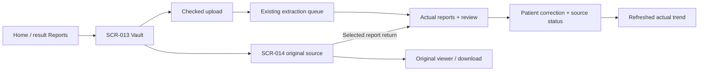
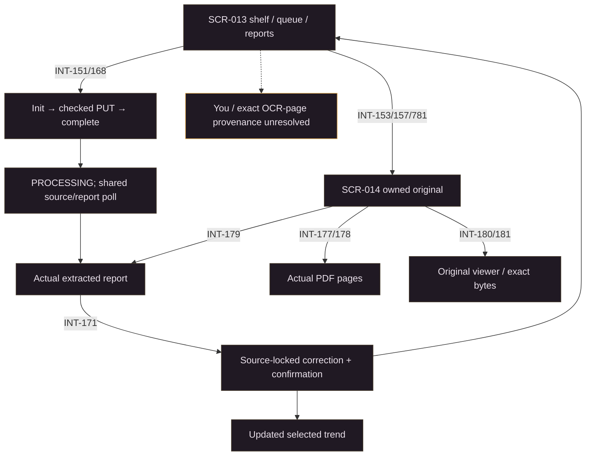

# Batch 5 — Phase 4 Health Vault and source lifecycle

Date: **2026-10-26**. Target: **GAP-017**, SCR-013/014; local improvements to GAP-011/035/036. The [master plan](../../code-agent/c-plans/2026-10-01_clinix-master-build-plan.md) marks Phase 4 Documents/OCR complete on 2026-10-08 and explicitly requires the Vault shelf, upload states, observations, trends, source preview and low-confidence confirmation. The separately referenced Phase 4 detail file is not present. No sprint calendar or invented sprint number is used.

## Reconciliation before edits

The existing seven architecture documents, Phase 4 master-plan section, document API contract, patient guard/layout, shared shell/header, Fastify document/lab routes, storage adapter and worker extraction handler were inspected. FigCraft's imported **ClinixAI v2** was read through its existing local MCP attach service, including full nested trees and fresh renders for **1130 (SCR-013, 393×1860)** and **1249 (SCR-014, 393×980)**. No Figma key or guessed frame was substituted.

The source requires the order: header/upload → Vault status → recent sources → processing queue → selected report observations → longitudinal trend → integrity note. Source drawer contains original-file preview, real pages, extraction/report link, original open and download. Actual record names, counts, values, states and source contents remain dynamic. The designs contain sample data, not permission to manufacture clinical records.

The protected route remains `/app/patient/vault` under [patient layout](../../apps/web/src/app/app/patient/layout.tsx); SCR-014 is a local native modal, not a new route. Parent/incoming paths include patient Home, Timeline navigation and check-in result Reports; outgoing paths retain Home, Timeline, Visits and medication history. Source access is patient-owned through existing API guards. No sharing/consent or doctor prescription-finalization workflow was added.

## Screens and design alignment

| Screen | Implemented and tested | Current status / remaining differences |
| --- | --- | --- |
| SCR-013 / frame 1130 | 393px focused layout and source hierarchy; actual status counts; recent 1+2 source shelf; complete shelf dialog; separate processing/review queue; report selection by stable ID; compact test/result/reference table; actual measurement controls and trend; source-linked review/upload | PARTIAL. Actual filename lengths, record cardinality and visible correction forms affect geometry. Source percentage is absent from API, so processing is indeterminate. Five established module links retain accurate labels; the design's unresolved You destination is not invented. |
| SCR-014 / frame 1249 | Light right-aligned 350px drawer below header; original PDF rendered locally from actual signed bytes; actual page count, pagination and screen-reader text; image preview; metadata/errors/retries; source-linked report return; original viewer and exact-byte download; focus containment/return | PARTIAL. Source content is dynamic and the drawer scrolls when actual content exceeds its viewport. Source-page coordinates for individual OCR observations are not persisted. The separate dimmed header Back is inert behind the native modal; Close/Escape provide verified return. Full scanned/complex-font/password-protected PDF and screen-reader acceptance remains open. |

No missing screen or route was needed. No source screen is marked COMPLETE or pixel-perfect.

Source comparison artifacts:

- [SCR-013 runtime capture](evidence/implementation-scr-013-393.png) versus [design 1130](evidence/design-1130.png).
- [SCR-014 runtime capture](evidence/implementation-scr-014-393.png) versus [design 1249](evidence/design-1249.png).

Both implementation captures are 393px wide. Runtime captures use only synthetic source text and values, and may contain the development toolbar. The OS status bar is not recreated inside the web UI. The preview displays source pixels, not an HTML reconstruction of the sample lab report. No design screenshot or placeholder source is used as an implementation asset.

## Interactions and navigation

| IDs | Source → trigger → result |
| --- | --- |
| INT-150/161/162/163 | Header/dock → existing Home/Timeline/Reports route; existing module exits exercised |
| INT-151/166/167/168 | Upload → labelled type/file → validate → existing init → checked signed PUT → existing completion → source/report refresh → processing/review/complete or retained failure |
| INT-152/781 | View all → complete owned shelf → selected original source; no arbitrary all-documents route |
| INT-153/154/155/173 | Recent/source card → freshly authorized selected document → SCR-014 |
| INT-156 | Queue REVIEW → corresponding lab observations; non-lab review falls back to original source and remains Partial |
| INT-157/169 | Selected report ID → its actual source document ID; no array-index drift |
| INT-170/171 | Labelled correction → validated numeric/text payload → confirmation → report/queue/trend refresh; edits survive failed saves |
| INT-158/159/160/172 | Actual measurement → keyed trend request → chart/error/retry; a delayed previous measurement cannot replace the active one; differing recorded units are not plotted together |
| INT-174/176/773 | Close/Escape/backdrop → modal dismissed → invoking focus; busy upload prevents dismissal; Tab/Shift+Tab contained |
| INT-177/178 | Previous/next → PDF.js actual page count and rendered original page; bounded controls, prior render cancellation |
| INT-179 | View extracted observations → close drawer → selected source report → focused observations section |
| INT-180/181 | Fresh signed original → new browser viewer or checked exact-byte download with original filename; no silent storage success |
| INT-774/775/776 | Source/PDF/image error → explicit retry; page count unavailable until the actual PDF parses |
| INT-777/778 | Vault/trend error → reload actual data, preserving selected source/measurement boundaries |
| INT-779/780 | Failed extraction or unfinished upload → existing owned completion endpoint → validate existing bytes → queue or explicit error; no duplicate upload-init |

INT-164 (You) remains Missing; its exact destination is not established. INT-165 now truthfully labels the medication destination instead of calling it Care; intended Care Circle remains missing (Partial). INT-175 preserves the separate-header ambiguity above. No unrelated destinations or future-sprint controls were invented.

Basic workflow:

Source/review graph with the report palette:

Mermaid source was structurally checked; these graph blocks are not claimed as separately rendered screenshots.

## Existing backend chains and changes

| Flow | Chain and behavior |
| --- | --- |
| Upload | Type/file → existing client → upload-init → private signed PUT → **response.ok checked** → upload-complete → stored-object validation/hash → existing extraction queue. A successful PUT receipt remains in component memory, so completion retry reuses that document and bytes. No PHI is added to persistent browser storage. |
| Extraction | Existing worker routes supported source types; client refreshes documents **and reports together** while PROCESSING. Newly extracted observations and the active measurement refresh without page reload. UPLOADED means unfinished upload, not invented OCR progress; FAILED exposes recovery. |
| Source | Selected ID → existing patient GET source → ownership/deletion check → fresh signed URL → local PDF.js/image renderer. No third-party viewer or clinical-data proxy introduced. |
| Correction | Existing PATCH → requirePatient → validate → owned observation/report → transaction locks its non-deleted owned document → reload field → save exactly one value representation → recompute range flag for comparable units → confirmation timestamp/profile → recompute remaining low-confidence review across this source → document status → existing audit event. |
| Trend | Existing owned measurement query → actual dated numeric points; keyed panel guards selection. UI refuses joint plotting when recorded source units differ. No clinical “improving” interpretation or fixture reference band is generated. |

Patient confirmation clears `needs_review` while preserving the **original OCR confidence**. Numeric/text corrections clear the previous representation and obsolete flag. Editing without confirmation clears the prior patient confirmation. A corrected unit is not compared against the old reference bounds. Source review status changes only for lab sources already COMPLETE/NEEDS_REVIEW, not failed/processing/non-lab sources. Own shelf now filters deleted documents. Sequential completion replay for PROCESSING/NEEDS_REVIEW/COMPLETE does not requeue an extraction.

The existing worker and extraction schemas do not record observation-page coordinates, extraction percentage or library-independent page count. Only real PDF pagination is derived locally. No fake progress, clinic, source-page provenance, encryption guarantee, blanket consent or patient-confirmed clinical interpretation is emitted.

**Limits:** database/storage/queue responses are controlled fixtures in these checks. PostgreSQL transaction rollback/concurrency and concurrent upload-complete versus queue delivery are not certified. The existing OCR worker's end-to-end extraction, retries, source-page attribution and large/malformed/scanned/complex-font PDFs need live seeded acceptance. No migration was required or applied; prior migration 0008 remains unapplied by this session. Existing async extraction atomicity is not relabelled fixed by this UI batch.

## Exact affected files

| Path | Change |
| --- | --- |
| [apps/web/src/app/app/patient/vault/page.tsx](../../apps/web/src/app/app/patient/vault/page.tsx) | Source hierarchy, owned shelf, in-memory upload recovery, shared source/report polling, stable report selection, correction forms, actual trends and modal flows |
| [apps/web/src/components/vault-dialog.tsx](../../apps/web/src/components/vault-dialog.tsx) | Source-styled native modal with busy/Escape/backdrop controls, explicit keyboard containment and focus return |
| [apps/web/src/components/vault-source-preview.tsx](../../apps/web/src/components/vault-source-preview.tsx) | Fresh authorized source, actual PDF/image preview, page count/navigation/text, retries, original open/download and observation return |
| [services/api/src/documents/routes.ts](../../services/api/src/documents/routes.ts) | Correct confirmation/review semantics, source-locked correction/flag/source status updates, removed-source filtering and sequential completion replay protection; prior doctor-access changes preserved |
| [services/api/src/documents/vault.test.ts](../../services/api/src/documents/vault.test.ts) | 19 synthetic Fastify/SQL/transaction/storage/queue boundary checks |
| [apps/web/e2e/vault-workflows.spec.ts](../../apps/web/e2e/vault-workflows.spec.ts) | 12 browser workflow/error/role/width cases and two runtime captures |
| [apps/web/package.json](../../apps/web/package.json), [package-lock.json](../../package-lock.json) | PDF.js `pdfjs-dist` 6.4.299 for actual local page rendering; dependency matches current Node 24.21.0 |
| [apps/web/next.config.ts](../../apps/web/next.config.ts), [apps/web/playwright.config.ts](../../apps/web/playwright.config.ts) | Optional isolated verification build directory; browser harness uses `.next-browser-tests` alongside the pre-existing developer server |
| [apps/web/eslint.config.mjs](../../apps/web/eslint.config.mjs), [.gitignore](../../.gitignore) | Exclude only new generated verification outputs; existing user ignore changes preserved |

All seven original architecture documents are updated with stable screen/interaction IDs; batch 4 receives only a next-report link. No new API endpoint, page route, data schema/migration, state-management replacement, auth provider, queue or styling system was introduced.

## Verification

| Check | Result |
| --- | --- |
| `npm run test` | **27 web + 140 API tests pass**, including the 19 source/lifecycle cases |
| `npm run test --workspace @clinix/api -- src/documents/vault.test.ts` | 19 source/lifecycle tests pass |
| `npm run test:browser --workspace @clinix/web -- --workers=1` | **61 pass**, including 12 Vault cases and all 49 previous module/auth regressions |
| `npm run typecheck` | Web/API/worker pass |
| `npm run lint` | Pass with no warnings; the previous Vault effect dependency warning is removed by the corrected refresh dependency |
| `CLINIX_TEST_DIST_DIR=.next-verification npm run build` | Production build passes; default developer output preserved |
| `git diff --check` and documentation inventory | Pass; 781 unique interaction IDs/14 columns; primary 52-screen table remains 32 PARTIAL, 17 MISSING, 3 MISMATCH |
| Source comparison | Two 393px runtime captures inspected against actual FigCraft 1130/1249; no pixel-perfect claim |
| Responsive/accessibility | 320/393/768/1440 overflow bounds; native dialog Tab/Shift+Tab, Escape/Close/focus return; labelled corrections and actual PDF source text |

Browser verification includes failed PUT never reaching completion; stored-byte completion retry; processing → newly extracted report/trend without reload; validation and retained correction after API failure; corrected source status/trend; complete shelf selection; actual two-page canvas/text/pagination; original navigation request/popup and downloaded filename/exact bytes; API/source/PDF/image/download/trend failures and retry; delayed previous responses; mixed-unit chart suppression; empty states; existing module exits; and doctor-role denial before patient-source reads. Prior module regression suites remain included.

An initial browser run found broad alert selectors also matching Next's route announcer and a real dialog focus escape. Selectors were scoped to the asserted error, the focus trap was fixed, and checks rerun. A later destination assertion was narrowed to its exact existing heading because Timeline already has duplicate h1 elements; that unrelated page structure was not changed. An initial PDF.js parameter no longer present in version 6 was removed based on its installed typings; final type checks pass.

The shared T3 browser opened the existing developer server and confirmed signed-out Vault → sign-in with a successful snapshot. It was not used to sign into real accounts. Protected workflows use the repository's Playwright harness, real Next/SDK/guards and controlled HTTP fixture boundaries. All opened source popup/shared-preview tabs are closed. The pre-existing developer server and imported FigCraft document remain open.

No real patient data, account creation, email/SMS, payment mutation, model call, cloud gate, database migration or destructive operation was used. Uploaded/downloaded PDF bytes are generated synthetic fixtures.

The expanded popup check encountered `about:blank` for native PDF navigation in this headless harness. It now verifies the actual signed navigation request and popup; browser-native viewer chrome remains unverified. PDF content/page rendering is verified inside the application. See [Playwright Page API](https://playwright.dev/docs/api/class-page).

Research: required OmniRoute **Exa search** and **Firecrawl fetch** each returned HTTP 404; no other search provider was substituted. Read official [Next fetching documentation](https://nextjs.org/docs/app/getting-started/fetching-data), installed Next 16.3.8 fetching/distDir docs, [PDF.js examples](https://mozilla.github.io/pdf.js/examples/) and [API](https://mozilla.github.io/pdf.js/api/draft/module-pdfjsLib.html), and [Supabase signed uploads](https://supabase.com/docs/reference/javascript/storage-from-createsigneduploadurl). The Supabase changelog was fetched directly after native fetch rejected its markdown content type; its listed TLS change does not change the existing storage API contract. PDF.js installed typings were used for the exact renderer API. Dependency audit returned existing workspace advisories; none named `pdfjs-dist`. Unrelated dependency upgrades are outside this batch.

## Remaining work and recommended next order

1. **GAP-018, completed Phase 3:** medication provenance, actual original-prescription consumer and SCR-015/016 source detail. Inspect frames 1310/1495 and existing patient prescription endpoints before editing.
2. **GAP-020, completed Phase 3:** doctor schedule/availability and missing SCR-026 appointment context; inspect 2317/2453/2548 and preserve approved role/consent limits.
3. Finish remaining prescription source/preview/safety review gaps within their approved phase scope.
4. Run seeded live PostgreSQL/storage/queue/worker acceptance for this and prior batches, including concurrent requests/retries, document variants and clinical state isolation.
5. Keep pending Phase 6 consent/privacy/packet and future workflows separate until their approved service contracts are implemented. Resolve unknown You and separate source-header Back behavior with authoritative interaction evidence.

Subsequent independent completed-phase work: [batch 6 — Phase 3 medication provenance](12-medication-implementation.md). Earlier verification counts above remain historical.
