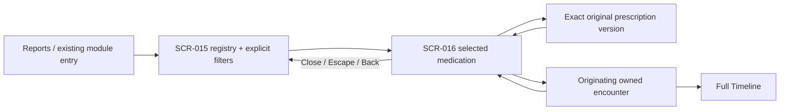
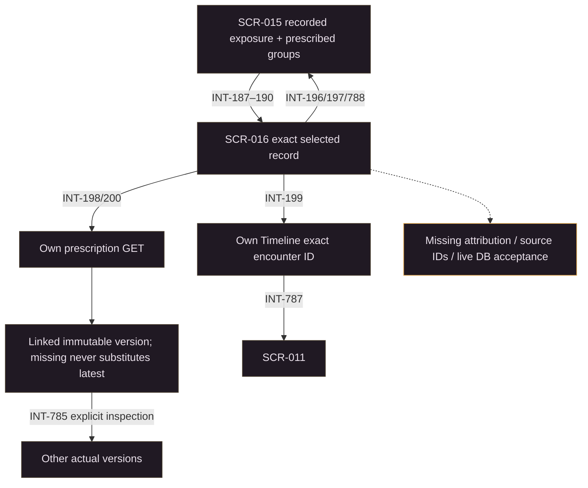

# Batch 6 — Phase 3 medication provenance and source detail

Date: **2026-10-26**. Scope: **GAP-018**, SCR-015/016, with local navigation/accessibility improvements under GAP-011/035/036. The [approved Phase 3 plan](../../code-agent/c-plans/2026-10-01_clinix-phase-3-clinical-loop.md) marks the clinical loop complete and explicitly requires medication history from recorded exposure plus finalized prescription items. Its safety decision is preserved: a derived prescription remains **UNKNOWN_STATUS**, never automatically CURRENT.

The previous Vault, booking, check-in, clinical persistence and patient-record batches were not redone. No future-sprint write service, medication restart/change workflow, patient prescription finalization, consent service, route, endpoint or migration was introduced.

## Source inspection and intended flow

All seven existing architecture documents were used, focusing on GAP-018, INT-182–200, SCR-015/016, traceability and the navigation graph. Relevant source inspection included the patient layout/guards, medication projection, actual medication-record and immutable prescription schemas, patient prescription GET, own Timeline projection, existing brand/shell/native dialogs, and Phase 3 specifications.

The attached FigCraft MCP session timed out. A separate **read-only headless FigCraft MCP** session opened the exact same original local `ClinixAI v2.figcraft` file, with file reads confined to its directory. Full nested node trees and fresh source renders were inspected **before code changes**:

| Screen | Exact frame | Dimensions | Role / route / layout |
| --- | --- | --- | --- |
| SCR-015 | **1310** · Page 10 / ClinixAI / Medication History | 393×2238 | Patient; existing `/app/patient/medications`; protected patient layout; parent Reports (SCR-013) |
| SCR-016 | **1495** · Page 10a / ClinixAI / Medication Detail | 393×1280 | Selected medication; native local detail state on the existing route |

The original GUI/document was left open and unchanged. No original Figma key or guessed frame was substituted. The imported document exposes no prototype connection proving a separate patient-prescription page URL, so prescription and encounter sources use connected local read-only states. This meets the source-result behavior without assigning an arbitrary route.

Incoming paths retain the established medication dock from Vault, visits, booking and Timeline. SCR-015 Back returns to Reports. Selected-record actions open SCR-016. Original-prescription actions use the existing own patient prescription endpoint; Encounter chapter selects the exact originating own Timeline entry. Back returns to medication detail, then the unchanged registry/filter; Close/Escape dismisses all local detail and restores invoking focus. Full Timeline uses the established `/app/patient/timeline` route.

## Screens and visual implementation

| Screen | Implemented / tested | Current status and remaining limits |
| --- | --- | --- |
| SCR-015 | Focused source layout; header/back; medication summary; All/Active/Completed/Discontinued plus truthful Status unknown filter; active/past/unknown groups; three-column dose/frequency/route/duration/prescriber/reason cards; recorded reactions; exact selected-entry actions; loading/error/retry/empty states; established dock exits | PARTIAL. Dynamic names/counts/known fields differ from source fixtures. Source design's two-active example is not invented. Registry count says medication records because recorded exposures are not all prescriptions. Unknown-use group is required by the approved API semantics. You is unresolved; existing five-item dock is retained with accurate Medications label. |
| SCR-016 | Full-screen light native record layout; known dose/duration/date/reason/reaction/response/stopping fields; honest provenance; original prescription and encounter source actions; back/close/Escape/focus; read-only actual version inspection; missing/error/retry states | PARTIAL. Exposure/reaction author fields are absent from the current schema. Some legacy exposures lack an exact prescription item/version. These gaps are explicit. Additional actual dates or long names extend content beyond 1280px and the record scrolls. Live PostgreSQL acceptance remains open. |

No missing full design screen or new page route was necessary. The previously disconnected **patient prescription consumer** and **selected encounter source state** now exist within SCR-016. No whole screen is certified COMPLETE or pixel-perfect.

The empty sage region in frame 1310 was inspected explicitly: node **1324** is an empty decorative 345×112 shape, separate from the summary card. The implementation preserves that shape; it is not labelled as fake loading/content. Registry background follows #F4F1EA from 1310; record detail uses the existing patient canvas. Typography uses existing Plus Jakarta Sans, source-sized headings, shared brand and patient cards. Source imagery is not fabricated or copied into the implementation as a screenshot.

Visual captures compared at the source width:

- [SCR-015 runtime](evidence/implementation-scr-015-393.png) versus [frame 1310](evidence/design-1310.png).
- [SCR-016 runtime](evidence/implementation-scr-016-393.png) versus [frame 1495](evidence/design-1495.png).

The status-bar chrome is not duplicated in the web application. Runtime captures use safe synthetic names/values and can contain the development toolbar. Geometry changes caused by real unknown-use status, extra recorded dates and unavailable attribution are documented rather than filled with sample clinical claims.

## Every targeted interaction

| IDs | Source → element → result |
| --- | --- |
| INT-182 | Registry Back → existing Reports parent |
| INT-183/184/185/186/782 | All / Active / Completed / Discontinued / Status unknown → actual explicit status filter; honest empty states |
| INT-187/188/189/190 | Selected record button → exact medication detail, preserving reason/response/reaction/stopped context |
| INT-191/192/193 | Existing Home/Timeline/Reports links remain connected |
| INT-195 | Misleading Care label corrected to Medications for the actual destination; intended Care Circle remains a separate missing module (Partial) |
| INT-196 | Back → source to selected record, or record to unchanged registry/filter |
| INT-197/788 | Close / Escape / backdrop → registry and invoking focus; Tab/Shift+Tab contained |
| INT-198/200 | Both original-prescription controls → existing own GET → pinned immutable version, author/items and explicit unavailable/unpinned metadata |
| INT-199 | Encounter chapter → own Timeline GET → exact `metadata.encounter_id` match; no unrelated-entry fallback |
| INT-783/784/786 | Registry / prescription / encounter error → corresponding selected-resource retry |
| INT-785 | Explicit version selector → actual recorded version; initial original binding retained on reopening |
| INT-787 | Encounter detail → full existing Timeline |

INT-194 **You** remains Missing because its exact destination is not established. There is no invented follow-up, medication editing, status-change or patient-finalization action. Missing source IDs disable only the corresponding source controls with an explicit unavailable state. An inaccessible linked source shows a real error and return/retry, rather than opening an unrelated record.

INT-199 now supplies the selected encounter detail result locally using the current Timeline projection. It does **not** certify the complete mixed-source SCR-012 design or provide doctor consultation notes absent from that projection.

Basic workflow:

Styled source graph:

Graph fences and IDs were structurally checked; these Mermaid blocks are not claimed as separately rendered screenshots.

## Backend and data truth

| Chain | Implemented behavior |
| --- | --- |
| Registry | Existing GET medications → `requirePatient` → `medicationsForPatient` → explicit exposure records plus current immutable prescription items → view model → grouped/filterable cards |
| Recorded exposure | Preserve actual status/start/end/reason/response/reaction/stopping fields. Creation time is `recorded_at`, never falsely `prescribed_date`. No actor attribution is invented. |
| Prescribed item | Exact item ID + immutable version number + strength/duration/timing/instructions + version finalizer name/date. Status stays UNKNOWN_STATUS even if prescription record is ACTIVE or dates are in the past. |
| Linked exposure source | Only an exact `prescription_item_id` **and** matching prescription ID can supply original authored fields/version. Historical items remain on their own version; medicine name matching is not used. Missing/foreign linked item enrichment stays unknown. |
| Clinician scope | Existing optional doctor scope still limits both exposure encounters and prescription queries; new historical enrichment also applies patient/doctor predicates. Prior patient-record isolation is preserved. |
| Patient prescription | Source action → existing GET → initial prescription lookup now includes patient ownership **before** loading versions/items → actual immutable versions/finalizer names → existing VIEW audit event → selected read-only UI |
| Encounter | Source action → existing owned Timeline GET → exact encounter/type match → only selected title/date/chapter/provenance/summary/status. No encounter or note write occurs. |

Additive optional view metadata preserves existing consumers. `DISCONTINUED` is recognized only when explicitly stored in an exposure; CURRENT/PAST retain their existing UI mapping, unknown statuses normalize to UNKNOWN_STATUS. Dates do not decide current use. Prescription ACTIVE is not medication CURRENT. Exposure and prescribed rows remain distinguishable even with the same medicine name; they are not silently deduplicated into an asserted exposure history.

Reaction copy no longer claims “no adverse reaction reported” when the field is absent. Stored reaction/response/reason-stopped text is shown, but the UI does not call it patient-asserted without an actual attribution field. Reasons are never inferred from a general encounter concern. Missing legacy `source_kind` is labelled medication record/source unknown rather than exposure. If original version metadata is absent, current prescription content is explicitly labelled current with the gap disclosed. If an explicitly linked version is missing, no current version is substituted; actual other versions can be deliberately inspected.

No API contract needs an extra endpoint, no database migration is required, and there is no new cloud/queue/storage dependency. This remains a read-only source workflow apart from the existing authorized VIEW audit write.

## Exact affected paths

| File | Change |
| --- | --- |
| [apps/web/src/app/app/patient/medications/page.tsx](../../apps/web/src/app/app/patient/medications/page.tsx) | Source-aligned registry/detail, accurate metadata/status, all filters, modal/source/back/close/error/empty states and existing module links |
| [apps/web/src/components/medication-sources.tsx](../../apps/web/src/components/medication-sources.tsx) | Patient prescription consumer with exact-version default and explicit inspection; selected own encounter reader and full Timeline exit |
| [apps/web/src/components/vault-dialog.tsx](../../apps/web/src/components/vault-dialog.tsx) | Opt-in full-screen patient-record appearance; original Vault appearance and shared containment/dismissal defaults preserved |
| [packages/schemas/src/index.ts](../../packages/schemas/src/index.ts) | Additive optional medication provenance fields and explicit DISCONTINUED status; previous batches' changes retained |
| [services/api/src/medications/derive.ts](../../services/api/src/medications/derive.ts) | Exact authored item/version metadata, patient/doctor-scoped historical enrichment, true exposure dates/context/status; no current-use inference |
| [services/api/src/prescriptions/routes.ts](../../services/api/src/prescriptions/routes.ts) | Optional patient scope on the first prescription read; existing doctor flows unchanged |
| [services/api/src/medications/provenance.test.ts](../../services/api/src/medications/provenance.test.ts) | 13 projection/SQL/Fastify scope/source cases |
| [apps/web/e2e/medication-workflows.spec.ts](../../apps/web/e2e/medication-workflows.spec.ts) | 11 complete module workflow/error/role/responsive cases and two captures |
| [apps/web/e2e/vault-workflows.spec.ts](../../apps/web/e2e/vault-workflows.spec.ts) | Existing navigation assertion follows the corrected source heading Medication history |

All seven original architecture documents are updated with stable IDs; only a next-report link is appended to batch 5. No new dependency, route, endpoint, schema migration, state management, styling infrastructure or authentication provider is added. Existing unrelated/uncommitted work is preserved.

## Verification and its boundaries

| Check | Observed result |
| --- | --- |
| `npm run test --workspace @clinix/api -- src/medications/provenance.test.ts` | **13 pass** |
| `npm run test` | **27 web + 153 API tests pass** |
| `npm run typecheck` | Web/API/worker pass |
| `npm run lint` | Pass with no warnings |
| `CLINIX_TEST_DIST_DIR=.next-verification npm run build` | Production build passes; existing development server remains running |
| Targeted browser suite | **11 pass** |
| `npm run test:browser --workspace @clinix/web -- --workers=1` | **72 pass**: 11 module cases plus all 61 preceding regressions |
| `git diff --check` / documentation inventory | Pass; 788 unique interaction IDs, 14 columns; unchanged 52 primary design classifications |
| Visual comparison | Both source frames and corresponding 393px captures inspected; dynamic/provenance differences documented |
| Responsive / accessibility | 320/393/768/1440; no page overflow, record bounds, Tab/Shift+Tab containment, Close/Back/Escape and invoking focus |

API tests verify explicit active/past/discontinued/unknown values, no date-based inference, exact old item/version enrichment, no name-based matching, preserved separate source rows, doctor scope, initial patient ownership predicate and existing patient VIEW audit. One initial SQL mock assertion expected a nested doctor predicate in the outer query's mock parameters; it was corrected to verify the separately captured encounter predicate and both patient/doctor-scoped prescription queries. Real handler behavior was not weakened to satisfy the mock.

Browser tests run actual Next, auth SDK, role guards, routing and native dialog behavior against controlled synthetic HTTP. They verify filter/detail/source/return flows; original v1 while current is v2; deliberate version inspection and reopening to v1; missing IDs/unpinned version/missing linked version; exact own encounter with unrelated entries excluded; registry/source/encounter retry; late closed-source isolation; empty/no-match filters; original Reports parent and other module exits; doctor-role denial; and widths/focus. All previous auth, booking, check-in, consultation, prescription, patient-record and Vault tests remain in the regression run.

The shared T3 browser opened the pre-existing developer server and confirmed a signed-out medication request redirects to sign-in. It was not used to enter real accounts or inspect patient data. Its opened tab was closed. Authenticated workflow verification used the repository Playwright harness. No external account, patient record, payment/email/SMS/model/storage/queue operation or destructive test was performed.

**Unverified:** live PostgreSQL query execution/joins, production RLS/permissions and audit persistence. API database/auth/audit boundaries are controlled in tests. No migration or cloud gate was run; prior 0008 remains unapplied by this session. Recorded exposure/reaction authorship cannot be recovered from absent schema fields. Full mixed-source Timeline detail and doctor notes not returned by the own Timeline API are not claimed implemented here.

Research: OmniRoute's required Exa search and Firecrawl fetch each returned HTTP 404, and no alternate search provider was substituted. Retrieved [official Next useParams documentation](https://nextjs.org/docs/app/api-reference/functions/use-params) directly and read installed Next 16.3.8 guidance before implementing; the existing Next Link/API/state patterns are retained. Private project requirements and actual FigCraft/API/schema evidence govern the medication semantics; no public clinical recommendation or inferred treatment decision was introduced.

## Remaining work and next order

1. **GAP-020 / completed Phase 3:** doctor schedule/availability and omitted appointment consultation context SCR-026; inspect exact frames 2317/2453/2548, approved scheduling rules and existing endpoints.
2. Finish remaining source/preview/safety-review gaps in the approved prescription workflows.
3. Run safe seeded PostgreSQL acceptance for medication projections, exact historical version joins, patient/doctor isolation and audit persistence, alongside prior batches' storage/worker checks.
4. Resolve missing legacy original-item links and attribution metadata through approved requirements; do not manufacture authorship or active use. Keep unknown You navigation explicit until its destination is established.
5. Leave pending Phase 6 consent/privacy and later modules separate until their service contracts are implemented.
