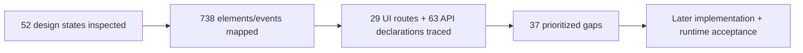

# CliniX AI — design, interaction and implementation audit

## Latest batch — Prescription safety, ambiguity and preview gates

SCR-033/034/035 now persist per-line review decisions, block finalization until flagged extracted lines are confirmed (client and server), show truthful safety context, recover from source-load failures and provide a printable non-final preview. [Details and verification](14-prescription-gates-implementation.md).

## Previous batch — Doctor schedule, availability and appointment context

SCR-024/025/026 now provide a day/week calendar, saved multi-rule availability (windows, breaks, online hours, blocked dates, overrides) and an appointment context screen. Clinic assignment and the scoped consultation packet stay unavailable and are labelled so. [Details and verification](13-schedule-implementation.md).

## Previous batch — Phase 3 medication provenance

SCR-015/016 now provide grouped medication history, explicit discontinued/unknown filters, full-screen record detail, exact-version patient prescription sources and selected encounter chapters with a full Timeline exit. Exposure/reaction authorship is not invented; prescribed items stay UNKNOWN_STATUS. [Exact files, IDs, verification and remaining limits](12-medication-implementation.md).

Both screens remain PARTIAL pending live database acceptance and unresolved source/navigation metadata. **27 web, 153 API and 72 browser tests pass**; build, type checks and lint pass. Two 393px screens compared; 320/393/768/1440 fit and keyboard checks passed. No route, endpoint or migration was added.

## Previous batch — Phase 4 Health Vault and original sources

SCR-013/014 now support the designed source shelf, checked upload/retry, synchronized OCR reports, patient-confirmed corrections, actual measurement trends and an accessible original-file drawer with real PDF pagination, image preview, original open/download and report return. [Exact files, IDs, screenshots, checks and remaining limits](11-vault-implementation.md).

**27 web, 140 API and 61 browser tests pass**; production build, type checks and lint pass. Two 393px screens visually compared and 320/393/768/1440 keyboard/layout checks passed. No missing route was necessary. Both screens remain PARTIAL: live PostgreSQL/storage/worker acceptance, exact OCR-page provenance and unresolved You/background-header behavior are not certified complete.

## Previous batch — Phase 3 booking and appointment management

SCR-017/022/023 now support actual doctor/mode/date/slot/reason selection, complete visit review, cancellation recovery and the approved cancel-and-rebook flow. Patient requests connect to doctor confirmation and back to the patient's updated visit. Fake packet/receipt/verification claims removed; unsupported sharing fails closed. [Exact files, IDs, screenshots, checks and blockers](10-appointment-implementation.md).

Validation: **27 web tests, 121 API tests and 49 browser tests** pass; production build/type checks and remaining limits are recorded in 10. Three 393px screens compared; 320/768/1440 layout/dialog checks passed. Packet consent, draft storage, clinic directions, live database integration and video joining remain open/excluded. No missing route was needed; no screen is COMPLETE.

## Previous batch — Phase 5 check-in and timeline detail

SCR-012 AI timeline detail is now implemented. SCR-008/009/010 restore saved question state, persistent safety interrupts, checked outcomes, actual evidence, JSON result download and connected AI timeline navigation. Session reads are owner-only; cross-record doctor AI fails closed until scoped consent exists. [Exact files, IDs, screenshots, checks and blockers](09-checkin-implementation.md).

Validation: **27 web tests, 96 API tests and 38 browser tests** pass; typecheck/build and migration consistency checks pass; lint has one existing Vault warning. No whole screen is COMPLETE. New migration `0008_freezing_slyde` is generated, not live-applied. Packet sharing, optional measurements, richer adaptive blocks and live worker/database acceptance remain open. Missing design states decrease to **17**.

## Previous batch — Phase 2 patient records

SCR-028 compact context is now implemented; SCR-027/029 are corrected and connected to consultation, prescriptions, own sources and uploads. Live fixture medical facts and blanket consent/author/current-medication claims were removed. Source composition is restricted to the clinician’s own records until scoped sharing exists. [Files, IDs, captures, tests and blockers](08-patient-record-implementation.md).

Validation: **27 web tests, 63 API tests, 28 browser tests** pass; typecheck/build pass; lint has two unrelated existing warnings. Source frames were inspected and three 393px runtime screens compared. No screen is COMPLETE: consent/AI/safety-data/follow-up services and live database/storage/worker acceptance remain explicit gaps. Missing design states decrease from 19 to **18**.

## Implementation progress — 2026-10-25

The first code batch repairs prescription reviewed-content persistence and replay ownership (GAP-003/004), consultation saves/completion/amendments (GAP-007/008), and four disabled Timeline links (part of GAP-011). **No missing full screen was added and no screen is certified COMPLETE.** [Exact files, interaction IDs, verification and remaining work](07-implementation-progress.md).

Validation: 27 web tests, 52 API tests and 19 browser tests passed; build/type checks passed. Lint has three unrelated existing warnings. Two confirmation frames were compared with FigCraft at their 393px design widths; visual alignment remains partial. API/database boundaries are synthetic; PostgreSQL integration is unverified.

The measured screen inventory below remains the original audit baseline. Interaction counts reflect the explicitly updated rows in 02; all other baseline findings retain their original evidence boundary.

**The completed-phase checklist overstates UI coverage.** The connected design has 52 distinct screen/state frames; 17 currently have no matching UI, and no screen qualifies as fully implemented and runtime-verified in this audit. Existing code also contains material clinical-data and authorization contradictions that should precede visual polishing.

Audit date: **2026-10-25**. Repository snapshot: `8e82fe7f43f570fa5bc900846678f16a158944f7` plus inspected working tree. Source of visual intent: connected FigCraft document **ClinixAI v2**. During the original audit, application source was not modified; no clinical records or cloud mutations were executed. Only documentation and design evidence were created under this directory.

## Measured audit coverage

| Measure | Count |
| --- | --- |
| Design pages discovered/inspected | 27 |
| Top-level frames discovered/inspected | 55 |
| Application screen/state frames | 52 |
| Reference frames (Page 0: 3, 39, 40) | 3 |
| Design nodes traversed, including pages | 5615 |
| Screen frames fully inspected (tree + render + controls) | 52 |
| Screen frames partially inspected | 0 |
| Screen frames not inspected | 0 |
| Design frame captures preserved | 52 |
| Distinct frontend route files | 34 current; 29 at audit |
| Registered backend endpoint declarations | 63 |
| Interactions/elements/events inventoried | 788 (738 audit + 50 implementation controls) |
| Design-affordance occurrences | 641 |
| Code-only controls/events | 147 |
| Code/document-derived screen IDs, outside design count | 6 |
| Explicit prototype connections exposed | 0 |
| Original audit: navigation/modal/external rows with UNKNOWN destination | 84 |
| Original audit: all-type rows with UNKNOWN destination/result | 199 |
| Prioritized backlog issues | 37 |
| Screens runtime-verified complete | 0 |

“Fully inspected” means the available frame tree, rendering and relevant controls were examined and classified; it does not mean every intended destination is known or every behavior works. Dynamic record rows are inventoried by template because no live dataset was loaded. Ambiguous/disabled/static-preview affordances are explicitly identified in 02. Counts are not extrapolated from representative samples.

| Primary design-screen implementation classification | Count |
| --- | --- |
| COMPLETE | 0 |
| PARTIAL | 32 |
| MISSING | 17 |
| MISMATCH | 3 |
| BROKEN | 0 |
| UNVERIFIED | 0 |

These exclusive statuses total 52 design frames. A PARTIAL/MISMATCH screen can also contain broken individual interactions. “Implemented screen count” is therefore **0 COMPLETE**, not the count of route files or the number of source handlers. Source-associated design states now exist for 35 frames; the other 17 have no matching UI.

| Interaction status (source inspection) | Count |
| --- | --- |
| Implemented | 340 |
| Partial | 95 |
| Missing | 323 |
| Broken | 6 |
| Unverified | 24 |

## Documents

Current implementation evidence: [batch 1](07-implementation-progress.md), [batch 2](08-patient-record-implementation.md), [batch 3](09-checkin-implementation.md), [batch 4](10-appointment-implementation.md), [batch 5](11-vault-implementation.md), [batch 6](12-medication-implementation.md), [batch 7](13-schedule-implementation.md), [batch 8](14-prescription-gates-implementation.md).

1. [Information architecture](01-information-architecture.md) — every design frame, exact names/IDs, roles, containment, shells, code-derived screens and state/accessibility requirements.
2. [Complete interaction map](02-interaction-map.md) — 788 current individually identified controls/events, expected/actual behavior, destinations, confidence and source manifest.
3. [Design-system and consistency audit](03-design-system-audit.md) — measured colors/type/geometry, shared patterns, structural differences and responsive/keyboard verification matrix.
4. [Design-to-code traceability](04-design-code-traceability.md) — all 52 frames, 29 audit-baseline frontend routes (34 current route files), all 63 API declarations, shared UI→API chains and missing/orphan inventories.
5. [Implementation gap analysis](05-implementation-gap-analysis.md) — 37 ordered issues with design/control/source evidence, dependencies, severity, existing phase and synthetic verification method.
6. [Master navigation graph](06-master-navigation-graph.md) — module design projections, actual code-route graph, non-navigation states and explicit unresolved destinations.

## Highest-priority findings and next sequence

- **Clinical truth:** dossier fixture facts and unconditional check-in/timeline low-risk copy are repaired in batches 2/3; live backend/worker acceptance remains unverified. See GAP-001/GAP-005.
- **Data isolation:** session ownership and prescription replay checks are repaired; doctor cross-record AI now fails closed. Full scoped consent remains GAP-006.
- **Authoritative records:** reviewed draft/note persistence and amendments repaired in batch 1; cloud database acceptance remains open. See GAP-004/GAP-007/GAP-008.
- **Disconnected UI:** AI timeline detail and checked-result download now work; non-AI entry detail, optional measurements and scoped packet booking/sharing remain open. See GAP-012/GAP-015/GAP-016.
- **Missing modules:** Care/discovery/consent/privacy, follow-ups, intake, practice memberships, retention and professional profile are absent or stubs. Backend relationship/doctor-upload/evidence/patient-Rx endpoints do not supply their missing consumers.
- **Navigation/layout:** Care points to medications, existing Timeline is disabled on several pages, staff navigation self-links, and the Settings route lacks an incoming app link. Rendered four-item docks conflict with documented five-item architecture; staff navigation is explicitly unresolved in design. Visual fidelity/responsiveness cannot be certified without the app.

Recommended sequence: clinical truth/authorization/reviewed-state correctness → resolve navigation and identity/consent/practice contracts → shared context/source/confirmation components → reconnect existing workflows → pending Phase 6/7 modules → full synthetic responsive and accessibility verification. The existing plan has phases, not a discovered sprint calendar; no sprint assignments were invented.

## Audit coverage matrix / completed-frame checklist

Each checked row has full tree traversal, rendered appearance review and control inventory. The figure is a **FigCraft rendering of design**, not an implementation screenshot. Stable IDs are audit identifiers; numeric nodes are from the current imported document, not assumed original Figma IDs.

| Done | Screen ID | Exact design page | Exact design frame / node | Controls/events | Implementation | Evidence |
| --- | --- | --- | --- | --- | --- | --- |
| [x] | [SCR-001](01-information-architecture.md#scr-001) | `Page 1 ` | CliniX / Patient / Sign in Page 1 · `163` | 11 | PARTIAL | [Design capture](evidence/design-163.png) · [Controls](02-interaction-map.md#scr-001) |
| [x] | [SCR-002](01-information-architecture.md#scr-002) | `Page 2` | CliniX / Patient / Sign up Page 2 · `199` | 15 | MISMATCH | [Design capture](evidence/design-199.png) · [Controls](02-interaction-map.md#scr-002) |
| [x] | [SCR-003](01-information-architecture.md#scr-003) | `Page 2` | Page2a / ClinixAI / Patient Onboarding · `300` | 12 | MISMATCH | [Design capture](evidence/design-300.png) · [Controls](02-interaction-map.md#scr-003) |
| [x] | [SCR-004](01-information-architecture.md#scr-004) | `Page 2` | Page2b / ClinixAI / Doctor Onboarding · `350` | 8 | PARTIAL | [Design capture](evidence/design-350.png) · [Controls](02-interaction-map.md#scr-004) |
| [x] | [SCR-005](01-information-architecture.md#scr-005) | `Page 2` | Page2c / ClinixAI / Clinic Staff Invitation & Onboarding · `400` | 4 | PARTIAL | [Design capture](evidence/design-400.png) · [Controls](02-interaction-map.md#scr-005) |
| [x] | [SCR-006](01-information-architecture.md#scr-006) | `Page 3 [Patient]` | Page 3 / ClinixAI / Patient Dashboard · `478` | 19 | PARTIAL | [Design capture](evidence/design-478.png) · [Controls](02-interaction-map.md#scr-006) |
| [x] | [SCR-007](01-information-architecture.md#scr-007) | `Page 4 [Doctor]` | Page 4 / ClinixAI / Doctor Dashboard · `594` | 22 | PARTIAL | [Design capture](evidence/design-594.png) · [Controls](02-interaction-map.md#scr-007) |
| [x] | [SCR-008](01-information-architecture.md#scr-008) | `Page 6 [Patient]` | Page 6 / ClinixAI / AI Health Check-in · `766` | 14 | PARTIAL | [Design capture](evidence/design-766.png) · [Controls](02-interaction-map.md#scr-008) |
| [x] | [SCR-009](01-information-architecture.md#scr-009) | `Page 6 [Patient]` | Page 6a / ClinixAI / Red-flag Safety Interrupt · `815` | 4 | PARTIAL | [Design capture](evidence/design-815.png) · [Controls](02-interaction-map.md#scr-009) |
| [x] | [SCR-010](01-information-architecture.md#scr-010) | `Page 7 [Patient]` | Page 7 / ClinixAI / Check-in Result · `843` | 19 | PARTIAL | [Design capture](evidence/design-843.png) · [Controls](02-interaction-map.md#scr-010) |
| [x] | [SCR-011](01-information-architecture.md#scr-011) | `Page 8 [Patient]` | Page 8 / ClinixAI / Health Timeline · `951` | 21 | PARTIAL | [Design capture](evidence/design-951.png) · [Controls](02-interaction-map.md#scr-011) |
| [x] | [SCR-012](01-information-architecture.md#scr-012) | `Page 8 [Patient]` | Page 8a / ClinixAI / Timeline Entry Detail · `1060` | 9 | PARTIAL | [Design capture](evidence/design-1060.png) · [Controls](02-interaction-map.md#scr-012) |
| [x] | [SCR-013](01-information-architecture.md#scr-013) | `Page 9 [Patient]` | Page 9 / ClinixAI / Health Vault & Document Hub · `1130` | 25 | PARTIAL | [Design capture](evidence/design-1130.png) · [Controls](02-interaction-map.md#scr-013) |
| [x] | [SCR-014](01-information-architecture.md#scr-014) | `Page 9 [Patient]` | Page 9a / ClinixAI / Source Preview Drawer · `1249` | 7 | PARTIAL | [Design capture](evidence/design-1249.png) · [Controls](02-interaction-map.md#scr-014) |
| [x] | [SCR-015](01-information-architecture.md#scr-015) | `Page 10 [Patient]` | Page 10 / ClinixAI / Medication History · `1310` | 14 | PARTIAL | [Design capture](evidence/design-1310.png) · [Controls](02-interaction-map.md#scr-015) |
| [x] | [SCR-016](01-information-architecture.md#scr-016) | `Page 10 [Patient]` | Page 10a / ClinixAI / Medication Detail · `1495` | 5 | PARTIAL | [Design capture](evidence/design-1495.png) · [Controls](02-interaction-map.md#scr-016) |
| [x] | [SCR-017](01-information-architecture.md#scr-017) | `Page 11 [Patient]` | Page 11 / ClinixAI / Patient Appointments · `1555` | 29 | PARTIAL | [Design capture](evidence/design-1555.png) · [Controls](02-interaction-map.md#scr-017) |
| [x] | [SCR-018](01-information-architecture.md#scr-018) | `Page 12 [Patient]` | Page 12 / ClinixAI / Care Circle & Directory · `1703` | 19 | MISSING | [Design capture](evidence/design-1703.png) · [Controls](02-interaction-map.md#scr-018) |
| [x] | [SCR-019](01-information-architecture.md#scr-019) | `Page 12 [Patient]` | Page 12a / ClinixAI / Discover Doctors · `1832` | 22 | MISSING | [Design capture](evidence/design-1832.png) · [Controls](02-interaction-map.md#scr-019) |
| [x] | [SCR-020](01-information-architecture.md#scr-020) | `Page 12 [Patient]` | Page 12b / ClinixAI / Consent Scope Picker · `1944` | 10 | MISSING | [Design capture](evidence/design-1944.png) · [Controls](02-interaction-map.md#scr-020) |
| [x] | [SCR-021](01-information-architecture.md#scr-021) | `Page 13 [Patient]` | Page 13 / ClinixAI / Privacy & Access Ledger · `2021` | 19 | MISSING | [Design capture](evidence/design-2021.png) · [Controls](02-interaction-map.md#scr-021) |
| [x] | [SCR-022](01-information-architecture.md#scr-022) | `Page 14 [Patient]` | Page 14 / ClinixAI / Consultation Booking & Packet Builder · `2143` | 30 | PARTIAL | [Design capture](evidence/design-2143.png) · [Controls](02-interaction-map.md#scr-022) |
| [x] | [SCR-023](01-information-architecture.md#scr-023) | `Page 14 [Patient]` | Page 14a / ClinixAI / Review Consultation Booking · `2255` | 7 | PARTIAL | [Design capture](evidence/design-2255.png) · [Controls](02-interaction-map.md#scr-023) |
| [x] | [SCR-024](01-information-architecture.md#scr-024) | `Page 15 [Doctor]` | Page 15 / ClinixAI / Doctor Schedule · `2317` | 28 | PARTIAL | [Design capture](evidence/design-2317.png) · [Controls](02-interaction-map.md#scr-024) |
| [x] | [SCR-025](01-information-architecture.md#scr-025) | `Page 15 [Doctor]` | Page 15a / ClinixAI / Doctor Availability · `2453` | 25 | PARTIAL | [Design capture](evidence/design-2453.png) · [Controls](02-interaction-map.md#scr-025) |
| [x] | [SCR-026](01-information-architecture.md#scr-026) | `Page 15 [Doctor]` | Page 15b / ClinixAI / Appointment Consultation Context · `2548` | 7 | MISSING | [Design capture](evidence/design-2548.png) · [Controls](02-interaction-map.md#scr-026) |
| [x] | [SCR-027](01-information-architecture.md#scr-027) | `Page 16 [Doctor]` | Page 16 / ClinixAI / Patient Directory · `2609` | 15 | PARTIAL | [Design capture](evidence/design-2609.png) · [Controls](02-interaction-map.md#scr-027) |
| [x] | [SCR-028](01-information-architecture.md#scr-028) | `Page 16 [Doctor]` | Page 16a / ClinixAI / Patient Clinical Workspace · `2722` | 7 | PARTIAL | [Design capture](evidence/design-2722.png) · [Controls](02-interaction-map.md#scr-028) |
| [x] | [SCR-029](01-information-architecture.md#scr-029) | `Page 17 [Doctor]` | Page 17 / ClinixAI / Patient Clinical Workspace · `2789` | 12 | PARTIAL | [Design capture](evidence/design-2789.png) · [Controls](02-interaction-map.md#scr-029) |
| [x] | [SCR-030](01-information-architecture.md#scr-030) | `Page 18 [Doctor]` | Page 18 / ClinixAI / Consultation Workspace · `2966` | 18 | PARTIAL | [Design capture](evidence/design-2966.png) · [Controls](02-interaction-map.md#scr-030) |
| [x] | [SCR-031](01-information-architecture.md#scr-031) | `Page 18 [Doctor]` | Page 18a / ClinixAI / Complete Consultation Confirmation · `3103` | 3 | PARTIAL | [Design capture](evidence/design-3103.png) · [Controls](02-interaction-map.md#scr-031) |
| [x] | [SCR-032](01-information-architecture.md#scr-032) | `Page 19 [Doctor]` | Page 19 / ClinixAI / Prescription Draft Queue · `3158` | 30 | MISMATCH | [Design capture](evidence/design-3158.png) · [Controls](02-interaction-map.md#scr-032) |
| [x] | [SCR-033](01-information-architecture.md#scr-033) | `Page 20 [Doctor]` | Page 20 / ClinixAI / Prescription Workspace / OCR Review · `3377` | 23 | PARTIAL | [Design capture](evidence/design-3377.png) · [Controls](02-interaction-map.md#scr-033) |
| [x] | [SCR-034](01-information-architecture.md#scr-034) | `Page 20 [Doctor]` | Page 20a / ClinixAI / Prescription Workspace / Direct · `3524` | 15 | PARTIAL | [Design capture](evidence/design-3524.png) · [Controls](02-interaction-map.md#scr-034) |
| [x] | [SCR-035](01-information-architecture.md#scr-035) | `Page 20 [Doctor]` | Page 20b / ClinixAI / Prescription Finalization Confirmation · `3590` | 3 | PARTIAL | [Design capture](evidence/design-3590.png) · [Controls](02-interaction-map.md#scr-035) |
| [x] | [SCR-036](01-information-architecture.md#scr-036) | `Page 21 [Doctor]` | Page 21 / ClinixAI / Follow-up Worklist · `3645` | 23 | MISSING | [Design capture](evidence/design-3645.png) · [Controls](02-interaction-map.md#scr-036) |
| [x] | [SCR-037](01-information-architecture.md#scr-037) | `Page 21 [Doctor]` | Page 21a / ClinixAI / Follow-up Task Detail · `4149` | 17 | MISSING | [Design capture](evidence/design-4149.png) · [Controls](02-interaction-map.md#scr-037) |
| [x] | [SCR-038](01-information-architecture.md#scr-038) | `Page 22 [Doctor]` | Page 22 / ClinixAI / Add Clinic Patient · `4293` | 20 | PARTIAL | [Design capture](evidence/design-4293.png) · [Controls](02-interaction-map.md#scr-038) |
| [x] | [SCR-039](01-information-architecture.md#scr-039) | `Page 22 [Doctor]` | Page 22a / ClinixAI / Duplicate Resolution · `4372` | 13 | PARTIAL | [Design capture](evidence/design-4372.png) · [Controls](02-interaction-map.md#scr-039) |
| [x] | [SCR-040](01-information-architecture.md#scr-040) | `Page 22 [Doctor]` | Page 22b / ClinixAI / Confirm Clinic Patient · `4437` | 10 | PARTIAL | [Design capture](evidence/design-4437.png) · [Controls](02-interaction-map.md#scr-040) |
| [x] | [SCR-041](01-information-architecture.md#scr-041) | `Page 22 [Doctor]` | Page 22c / ClinixAI / Patient Created → Workspace · `4500` | 3 | MISSING | [Design capture](evidence/design-4500.png) · [Controls](02-interaction-map.md#scr-041) |
| [x] | [SCR-042](01-information-architecture.md#scr-042) | `Page 23 [Clinic_Staff]` | Page 23 / ClinixAI / Clinic Staff Dashboard / Receptionist · `4536` | 23 | PARTIAL | [Design capture](evidence/design-4536.png) · [Controls](02-interaction-map.md#scr-042) |
| [x] | [SCR-043](01-information-architecture.md#scr-043) | `Page 23 [Clinic_Staff]` | Page 23a / ClinixAI / Clinic Staff Dashboard / Clinical Assistant · `4687` | 21 | PARTIAL | [Design capture](evidence/design-4687.png) · [Controls](02-interaction-map.md#scr-043) |
| [x] | [SCR-044](01-information-architecture.md#scr-044) | `Page 24 [Clinic_Staff]` | Page 24 / ClinixAI / Patient Intake Workspace · `4856` | 14 | MISSING | [Design capture](evidence/design-4856.png) · [Controls](02-interaction-map.md#scr-044) |
| [x] | [SCR-045](01-information-architecture.md#scr-045) | `Page 24 [Clinic_Staff]` | Page 24a / ClinixAI / Receptionist Arrival-Only Access · `4980` | 3 | MISSING | [Design capture](evidence/design-4980.png) · [Controls](02-interaction-map.md#scr-045) |
| [x] | [SCR-046](01-information-architecture.md#scr-046) | `Page 25 [Doctor]` | Page 25 / ClinixAI / Practice Team & Memberships · `5015` | 18 | MISSING | [Design capture](evidence/design-5015.png) · [Controls](02-interaction-map.md#scr-046) |
| [x] | [SCR-047](01-information-architecture.md#scr-047) | `Page 25 [Doctor]` | Page 25a / Confirm Role Change · `5179` | 2 | MISSING | [Design capture](evidence/design-5179.png) · [Controls](02-interaction-map.md#scr-047) |
| [x] | [SCR-048](01-information-architecture.md#scr-048) | `Page 25 [Doctor]` | Page 25b / End Membership Confirmation · `5202` | 4 | MISSING | [Design capture](evidence/design-5202.png) · [Controls](02-interaction-map.md#scr-048) |
| [x] | [SCR-049](01-information-architecture.md#scr-049) | `Page 26 [Doctor]` | Page 26 / ClinixAI / Record Removal & Retention Requests · `5233` | 13 | MISSING | [Design capture](evidence/design-5233.png) · [Controls](02-interaction-map.md#scr-049) |
| [x] | [SCR-050](01-information-architecture.md#scr-050) | `Page 26 [Doctor]` | Page 26a / ClinixAI / Confirm Retention Decision · `5352` | 2 | MISSING | [Design capture](evidence/design-5352.png) · [Controls](02-interaction-map.md#scr-050) |
| [x] | [SCR-051](01-information-architecture.md#scr-051) | `Page 26 [Doctor]` | Page 26b / ClinixAI / Staff Route Request · `5396` | 4 | MISSING | [Design capture](evidence/design-5396.png) · [Controls](02-interaction-map.md#scr-051) |
| [x] | [SCR-052](01-information-architecture.md#scr-052) | `Page 27 [Doctor]` | Page 27 / ClinixAI / Doctor Profile & Consultation Services · `5440` | 12 | MISSING | [Design capture](evidence/design-5440.png) · [Controls](02-interaction-map.md#scr-052) |

## Design-page coverage

| Exact page name | Page ID | Top-level frames | Treatment |
| --- | --- | --- | --- |
| `Page 0 Home` | 2 | 3, 39, 40 | Reference assets inspected; excluded from screen count |
| `Page 1 ` | 162 | 163 | Every frame indexed, rendered and control-reviewed |
| `Page 2` | 198 | 199, 300, 350, 400 | Every frame indexed, rendered and control-reviewed |
| `Page 3 [Patient]` | 477 | 478 | Every frame indexed, rendered and control-reviewed |
| `Page 4 [Doctor]` | 593 | 594 | Every frame indexed, rendered and control-reviewed |
| `Page 6 [Patient]` | 765 | 766, 815 | Every frame indexed, rendered and control-reviewed |
| `Page 7 [Patient]` | 842 | 843 | Every frame indexed, rendered and control-reviewed |
| `Page 8 [Patient]` | 950 | 951, 1060 | Every frame indexed, rendered and control-reviewed |
| `Page 9 [Patient]` | 1129 | 1130, 1249 | Every frame indexed, rendered and control-reviewed |
| `Page 10 [Patient]` | 1309 | 1310, 1495 | Every frame indexed, rendered and control-reviewed |
| `Page 11 [Patient]` | 1554 | 1555 | Every frame indexed, rendered and control-reviewed |
| `Page 12 [Patient]` | 1702 | 1703, 1832, 1944 | Every frame indexed, rendered and control-reviewed |
| `Page 13 [Patient]` | 2020 | 2021 | Every frame indexed, rendered and control-reviewed |
| `Page 14 [Patient]` | 2142 | 2143, 2255 | Every frame indexed, rendered and control-reviewed |
| `Page 15 [Doctor]` | 2316 | 2317, 2453, 2548 | Every frame indexed, rendered and control-reviewed |
| `Page 16 [Doctor]` | 2608 | 2609, 2722 | Every frame indexed, rendered and control-reviewed |
| `Page 17 [Doctor]` | 2788 | 2789 | Every frame indexed, rendered and control-reviewed |
| `Page 18 [Doctor]` | 2965 | 2966, 3103 | Every frame indexed, rendered and control-reviewed |
| `Page 19 [Doctor]` | 3157 | 3158 | Every frame indexed, rendered and control-reviewed |
| `Page 20 [Doctor]` | 3376 | 3377, 3524, 3590 | Every frame indexed, rendered and control-reviewed |
| `Page 21 [Doctor]` | 3644 | 3645, 4149 | Every frame indexed, rendered and control-reviewed |
| `Page 22 [Doctor]` | 4292 | 4293, 4372, 4437, 4500 | Every frame indexed, rendered and control-reviewed |
| `Page 23 [Clinic_Staff]` | 4535 | 4536, 4687 | Every frame indexed, rendered and control-reviewed |
| `Page 24 [Clinic_Staff]` | 4855 | 4856, 4980 | Every frame indexed, rendered and control-reviewed |
| `Page 25 [Doctor]` | 5014 | 5015, 5179, 5202 | Every frame indexed, rendered and control-reviewed |
| `Page 26 [Doctor]` | 5232 | 5233, 5352, 5396 | Every frame indexed, rendered and control-reviewed |
| `Page 27 [Doctor]` | 5439 | 5440 | Every frame indexed, rendered and control-reviewed |

## Limitations and reproducibility

- Discovery used actual `mcp__figcraft__inspect_document(allPages=true, depth=30)`, `get_node`, `inspect_ui`, `list_commands`, read-only `variable.list`, and `screenshot`. No layer branch was depth-truncated. Renderings were saved under `evidence/`; exact frame/page IDs allow reinspection. FigCraft command discovery exposes prototype-edit commands, but inspected document/nodes exposed no interactions/flows. Import loss or MCP serialization limits cannot be ruled out. No prototype destination is manufactured.
- No matching desktop design frames, native component/instance metadata or named styles were exposed. Settings has no design frame; five other code/document-derived IDs are deliberately outside the 52-frame denominator. Page 0 explicitly supplies workflow prose but conflicts with some rendered docks. Imported render anomalies require checking an authoritative original export before copying them.
- Collaborative preview opened the expected localhost app but returned `chrome-error://chromewebdata/`. No CliniX web/API listener was running at the expected ports. **Application visual comparison, breakpoint behavior, keyboard/screen-reader behavior and authenticated end-to-end flows remain unverified.** No claim of pixel-level accuracy, COMPLETE screen, successful API response or exploit reproduction is made.
- Required Exa search via OmniRoute failed twice with `Error: fetch failed`; Firecrawl fetch failed with the same message. No other search provider was used. Native fetch successfully read the [W3C Reflow guidance](https://www.w3.org/WAI/WCAG22/Understanding/reflow.html) and [official Next.js structure reference](https://nextjs.org/docs/app/getting-started/project-structure). These support narrow verification criteria/conventions; design and code findings rely on private primary evidence. The Exa-search requirement could not be completed successfully and is disclosed rather than claimed.
- Existing API gate scripts and historical phase claims were inspected, not executed. Builds/typechecks were not run because application code was unchanged and those checks would not validate this audit's visual findings; no dependencies were installed into the application. Documentation references/counts and Mermaid syntax are validated separately.
- Pre-existing `apps/web/next-env.d.ts` and `.claude/` changes were left intact. Design content remained clean with no undo history; screenshot inspection may change the viewed page only. No source/config refactoring, design edits, commits, migrations or destructive operations occurred.

## Documentation validation performed

All 7 requested Markdown files were checked for valid relative file links, stable screen/interaction anchors, balanced code fences and consistent table columns. The audit contains 58 unique screen anchors (52 design + 6 code/document-derived), 738 unique interaction anchors, and 52 linked design captures. All 14 Mermaid diagrams passed `mermaid.parse` using Mermaid 12.2.0 in a temporary validation directory, with zero syntax errors. No application package/config/source was changed for validation. Parsing validates syntax; full rendered graph layout and application runtime behavior remain separate verification tasks.

Batch 2 resolves the original missing compact-context finding. Original route/discovery and unknown-destination counts remain audit-snapshot metrics unless explicitly updated; current route/interaction/status changes and verification boundaries are in [08](08-patient-record-implementation.md).
