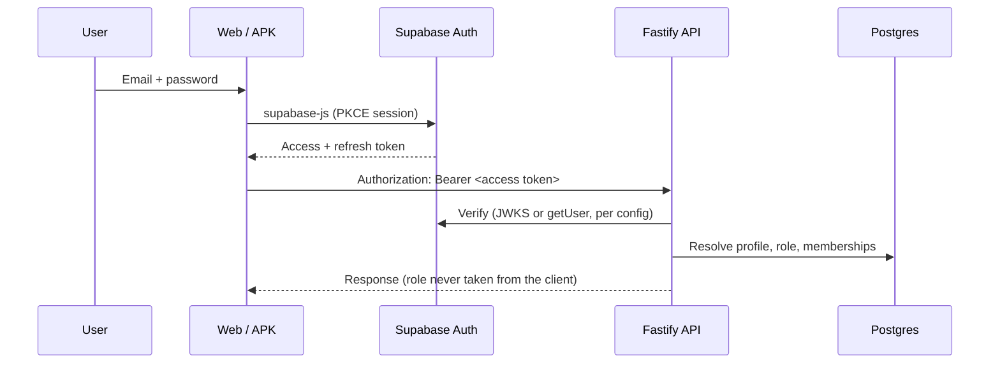

# Authentication and authorization

Supabase Auth establishes who someone is. Fastify decides what they may do. Read this before touching sign-in, `/me`, roles or onboarding.

Last verified: 2026-11-18. How this was migrated from Clerk (2026-10-25) is in [../history.md](../history.md).

## Flow

## Rules

- **The client never supplies its own role.** `/me` (`services/api/src/auth/me.ts`) resolves the profile, primary role and practice memberships from Postgres.
- **Verification mode is explicit.** `SUPABASE_JWT_VERIFICATION_MODE` is `asymmetric` (`jose` + JWKS, with exact issuer, audience and algorithm allowlist) or `auth_server` (Supabase `getUser`). Nothing falls back from one to the other.
- **Error codes:**
  - Missing configuration or a verifier outage → `503 AUTH_UNAVAILABLE`.
  - A bad or expired token → `401 UNAUTHORIZED`.
  - A valid session with no profile → `403 ONBOARDING_REQUIRED`.
  - A role conflict → `409`.
- **New accounts are keyed by the verified Supabase UUID** (`profiles.supabase_user_id`), never by email. Pre-migration profiles keep `legacy_auth_subject` and are not auto-linked.
- **Onboarding is transactional and idempotent.** The profile and its domain row are created together. A claim (a patient taking over a doctor-created record) links in the same transaction and rolls back if it races.
- **Doctors** get workspace access while their verification is `PENDING`. This is the agreed demo policy, and verification is advisory. Staff roles can't be picked publicly. They come only from an invitation that creates a practice membership.
- **Resource checks** use guards (`services/api/src/auth/guards.ts`), membership scope (`services/api/src/practices/scope.ts`) and consent (`services/api/src/privacy/consent.ts`). Sensitive reads write `access_events`.
- **Browser roles have no table privileges** (migration `0007`). Only the API's server role touches tables.

## Callback and sessions

- `/auth/callback` is a fixed static route. It exchanges the PKCE code itself; URL detection is off. Recovery goes to `/reset-password` and everything else to `/after-sign-in`.
- Confirm and recovery links only work in the browser that started the flow, because that browser holds the verifier. Any other browser gets a restart/resend path.
- On Android, callbacks return through verified App Links on the web host ([mobile.md](mobile.md)).
- A change of account aborts in-flight API calls and discards stale hook state (`apps/web/src/lib/auth.tsx`).

## Code

| Concern | Path |
|---|---|
| Browser client, session | `apps/web/src/lib/supabase.ts`, `apps/web/src/lib/auth.tsx` |
| Route guards (UI) | `apps/web/src/components/route-guards.tsx` |
| Token verification | `services/api/src/auth/supabase.ts`, `bearer.ts` |
| Request context, roles, memberships | `services/api/src/auth/context.ts` |
| Live auth gate | `services/api/gate-supabase-auth.mjs` (`npm run test:auth:live --workspace @clinix/api`) |

Variable names: local in [../operations/local-dev.md](../operations/local-dev.md), production in [../operations/environment.md](../operations/environment.md).
