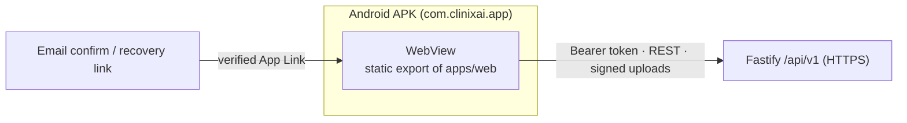

# Android app and PWA

The Android app is a Capacitor shell around a static export of `apps/web`. The PWA is the same web app plus a service worker. Read this before adding a route, a server-only Next feature, or anything that touches native behaviour.

Last verified: 2026-11-18. Build and release steps are in [`apps/mobile/README.md`](../../apps/mobile/README.md) and [../operations/deployment.md](../operations/deployment.md).

## How it is built

- `npm run build:android` runs `build:mobile` in `apps/web`, which sets `CLINIX_MOBILE_EXPORT=1`. That switches `next.config.ts` to `output: "export"` (it's `standalone` otherwise). The `out/` folder is then synced into Capacitor (`apps/mobile/capacitor.config.ts`, `webDir` from `CLINIX_MOBILE_WEB_DIR`).
- The shell appends the user-agent marker `CliniXApp`. `apps/web/src/lib/native.ts` uses it to detect native mode, and it also handles the hardware back button, `appUrlOpen` callbacks and PDF sharing.

## Constraints a static export imposes (do not break)

1. **No request-time Next features** in `apps/web`: no Server Actions, Proxy/middleware auth, `cookies()`/`headers()`, ISR, or route handlers. These are banned anyway by the two-service rule.
2. **No `[id]` dynamic segments for private records.** A static export can't enumerate IDs, so records use query routes: `/…/by-id?patientId=…`, `?draftId=…` and so on. The page components live in `apps/web/src/components/route-pages/`. New record screens must follow this pattern.
3. **`NEXT_PUBLIC_*` values are baked in at build time.** A different API target means a different build. Never put a secret in a `NEXT_PUBLIC_*` variable; the APK carries no service-role or router keys.
4. **CORS:** the WebView origin is `https://localhost`, so it must be in the API's `CORS_ORIGINS`, and Storage must accept signed `PUT`s from it.
5. **Auth callbacks** come back through verified HTTPS App Links on the web host. The web build writes `/.well-known/assetlinks.json` (`apps/web/scripts/write-assetlinks.mjs`) from `ANDROID_APP_LINK_SHA256_CERT_FINGERPRINT`.
6. **Offline:** the bundled UI opens and shows a connection notice. No clinical data is cached on the device.

## PWA

- Serwist runs in configurator mode: `serwist build` after `next build` writes `apps/web/public/sw.js` (source `apps/web/src/app/sw.ts`, config `apps/web/serwist.config.js`).
- It caches the **app shell only** (static assets, fonts, images, `/~offline`). API, Supabase, `/auth/*` and document navigations are `NetworkOnly`. Development runs without a service worker.
- Production PWA tests: `npx playwright test -c apps/web/playwright.pwa.config.ts`. The iPhone profile there is a Chromium emulation, not WebKit.

## Untested

These need a real device: iOS install, physical-phone install and upgrade, hardware back and keyboard resizing, and interrupted file-picker restore. See [../status.md](../status.md).
