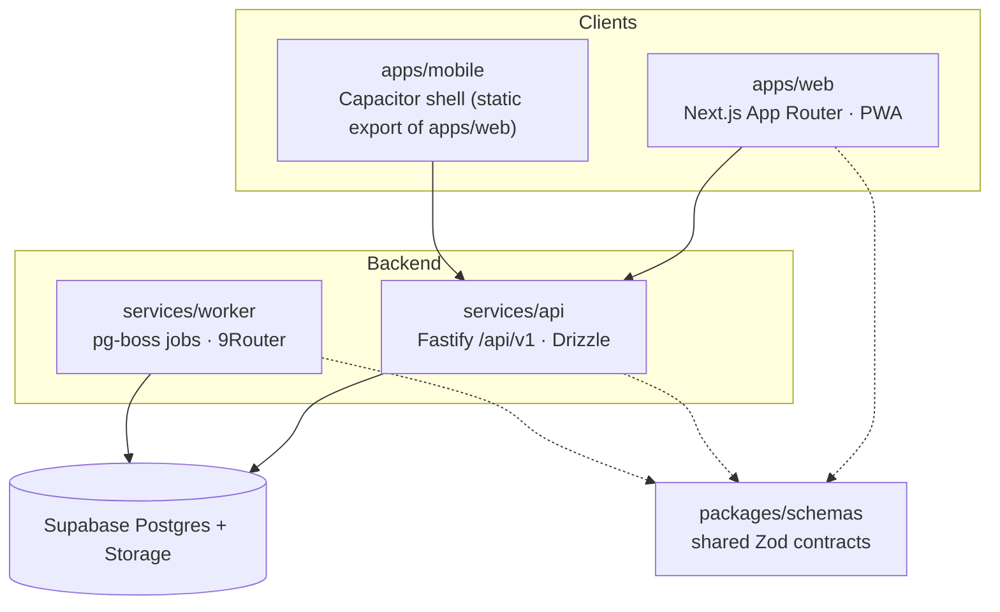

# Codebase map

Where everything lives and what each part owns. Start here before searching the tree.

Last verified: 2026-11-18 against the working tree on `master` (`7f06d66`). Update it when you add or move a top-level folder, an API domain module or a workspace.

## 1. Shape of the system

**One request, end to end:**
1. A page in `apps/web/src/app/**` calls `useApiData`/`fetchApi` (`apps/web/src/lib/api.ts`) with the Supabase access token.
2. Fastify verifies the token (`services/api/src/auth/`), builds the request context (role, memberships), and the domain route checks ownership or consent.
3. The route reads and writes Postgres through Drizzle (`services/api/src/schema.ts`) and writes `access_events` for sensitive reads.
4. Slow work is enqueued with pg-boss (`services/api/src/queue.ts`). The worker picks it up and writes draft results back for a human to review.

## 2. Top level

| Path | What it is | Notes |
|---|---|---|
| `apps/web` | Next.js frontend: patient, doctor and staff workspaces, plus the PWA | **No backend route handlers here** ([CLAUDE.md](../CLAUDE.md)) |
| `apps/mobile` | Capacitor Android project wrapping the static export | [architecture/mobile.md](architecture/mobile.md) |
| `services/api` | Fastify API, Drizzle schema and migrations, seed, live gates | Deployed to Vercel `bom1` |
| `services/worker` | pg-boss consumer for OCR and the AI analysis pipeline | Deployed on Dokploy |
| `packages/schemas` | Shared Zod schemas and types (`src/index.ts`), used by all three services | Single file, organised by phase |
| `packages/config` | Shared `tsconfig.base.json` | — |
| `infra/` | Deploy config: Dokploy compose, backup image, Storage bucket SQL | [infra/README.md](../infra/README.md) |
| `scripts/` | `run.mjs` (local launcher behind `run.sh`), `deploy/` (SHA promotion, registry login), `backup/` (Supabase snapshot) | Called by CI and Dokploy |
| `tools/` | `generate_copyright_pdf.py`, a one-off source deposit generator | Output is gitignored |
| `.github/workflows/` | CI images, production promotion, Android release | [operations/testing.md](operations/testing.md#ci) |
| `docs/` | This documentation | [README.md](README.md) |
| `code-agent/c-plans/` | Temporary plans for in-flight agent work | Distilled into [history.md](history.md) when done |
| `.sensitive_docs/` | Credential routing guide (`README.md` tracked; `credentials.md` **never read, printed or committed**) | — |
| `.impeccable/` | Design-lint tool config | — |

## 3. `apps/web/src`

| Path | Owns |
|---|---|
| `app/` | Routes (App Router). Role areas `app/app/patient`, `app/app/doctor`, `app/app/staff`; account routes at the top level. Full route ↔ screen ↔ design table: [product/screen-map.md](product/screen-map.md) |
| `app/globals.css` | Clear v2 design tokens (Tailwind v4 `@theme`) |
| `app/sw.ts`, `app/~offline/` | Service worker source and offline page |
| `components/route-pages/` | Page bodies for `by-id?…` record routes (static-export safe) |
| `components/workspace-shell.tsx`, `staff-shell.tsx`, `native-shell.tsx`, `auth-shell.tsx`, `role-dock.tsx` | Layout shells and the pinned glass dock |
| `components/route-guards.tsx` | Client-side role and onboarding redirects (UX only; the API enforces access) |
| `components/doctor-patient-record.tsx` | Doctor dossier (full and compact) |
| `components/clinical-review-dialog.tsx`, `prescription-safety-panel.tsx`, `medicine-editor.tsx`, `confidence-badge.tsx` | Prescription and OCR review UI |
| `components/checkin-safety.tsx` | Red-flag safety interrupt |
| `components/vault-dialog.tsx`, `vault-source-preview.tsx`, `medication-sources.tsx` | Vault and source drawers |
| `components/followups.tsx`, `doctor-availability.tsx`, `notification-bell.tsx`, `install-app.tsx` | Feature components |
| `components/ui-icon.tsx`, `status-badge.tsx`, `skeleton.tsx`, `clinix-brand.tsx` | Primitives |
| `lib/api.ts` | `fetchApi`, `fetchApiBlob`, `useApiData`; API base from `NEXT_PUBLIC_API_BASE_URL` |
| `lib/auth.tsx`, `lib/supabase.ts` | Supabase session provider and `/me` |
| `lib/native.ts` | Capacitor detection, back button, App Link callbacks, PDF share |
| `lib/workspace-nav.ts`, `lib/workspace-routing.ts`, `lib/route-params.ts` | Dock items, role routing, query-param helpers |
| `lib/privacy.ts`, `lib/staff.ts`, `lib/doctor-schedule.ts`, `lib/notifications.ts` | Domain helpers |
| `lib/ui-demo-data.ts` | Visual placeholders only; never shown as clinical fact |
| `../e2e/`, `../e2e-live/` | Playwright specs (mocked; live smoke) |

## 4. `services/api/src`

`index.ts` registers every domain under `/api/v1`. Each folder has a `routes.ts`, and tests sit beside the source.

| Domain | Responsibility |
|---|---|
| `auth/` | Token verification (`supabase.ts`, `bearer.ts`), request context and memberships (`context.ts`), guards, `/me` |
| `patients/`, `doctor-patients/`, `relationships/`, `claims/` | Patient records, doctor-created (unclaimed) patients, care relationships, claim invitations |
| `doctors/` | Directory and verification (`routes.ts`), professional profile and services (`profile-routes.ts`) |
| `availability/`, `appointments/`, `dashboards/` | Slots, booking (overbooking guard), role dashboards |
| `encounters/`, `consultations/` | Encounters, consultation notes, autosave, amendments |
| `prescriptions/` | Drafts → review gate → **finalize** (`/doctor/prescription-drafts/:draft_id/finalize`, idempotent, immutable versions), PDF (`pdf.ts`) |
| `medications/` | Medication history projection (`UNKNOWN_STATUS` for prescription-derived) |
| `documents/` | Signed upload-init/complete, Vault, lab observations |
| `interactions/`, `ai/`, `safety/` | Adaptive check-in sessions, AI result/evidence reads, deterministic red-flag rules (`safety/rule_sets/emergency.json`) |
| `timeline/` | Patient timeline composition |
| `privacy/` | Consent scopes (`consent.ts`), access ledger (`ledger.ts`), removal requests |
| `practices/`, `staff/`, `followups/`, `notifications/` | Practices and memberships (`scope.ts`), staff dashboard, intake and booking, follow-ups, notifications |
| `audit/` | `access_events` writer |
| `seed/` | Synthetic personas (`npm run seed`) |
| `schema.ts`, `db.ts`, `migrate.ts`, `queue.ts`, `storage.ts`, `crypto.ts`, `cors.ts`, `http.ts` | Drizzle schema, pool, migrator, pg-boss sender, Storage client, identity encryption, CORS, error envelope |

Other paths:
- `services/api/drizzle/`: forward-only SQL migrations `0000…0013` plus `meta/`
- `services/api/fixtures/`: synthetic lab PDF and prescription images
- `services/api/gate-*.mjs`: live API gates. `demo-checkin.mjs` runs the scripted check-ins

## 5. `services/worker/src`

| Path | Responsibility |
|---|---|
| `index.ts` | Queues `document.extract`, `ai.analyze`, `ops.probe`, plus the heartbeat file |
| `handlers/document-extract.ts` | Storage object → OCR vision call → lab observations, or a `NEEDS_REVIEW` prescription draft |
| `handlers/ai-analyze.ts` | Evidence bundle → Analyst 1 ∥ Analyst 2 → Judge → deterministic post-check → stored outcome |
| `pipeline/evidence-bundle.ts` | Minimum-necessary context with **no direct identifiers** |
| `pipeline/prompts.ts`, `pipeline/post-check.ts` | Prompts and the safety post-check |
| `gateway.ts` | 9Router `ModelGateway` (OpenAI SDK), replay record/replay |
| `ocr-image.ts` | Bounds camera photos before OCR |
| `preflight.ts`, `deployment-probe.ts` | Live gateway check and the deploy `verify` probe |
| `../ai/replays/` | Recorded synthetic model responses for `DEMO_REPLAY` |

## 6. Where to make common changes

| Task | Touch | Also update |
|---|---|---|
| New API endpoint | `services/api/src/<domain>/routes.ts` (+ test), shared types in `packages/schemas` | [architecture/api-contract.md](architecture/api-contract.md) if it changes the contract |
| Schema change | `services/api/src/schema.ts` → `npm run db:generate` → new migration | Never edit an applied migration; [architecture/database.md](architecture/database.md) |
| New screen | `apps/web/src/app/...`; a record screen uses `by-id?…` + `components/route-pages/` | [product/screen-map.md](product/screen-map.md), [status.md](status.md) |
| Visual change | Tokens in `app/globals.css`, shells in `components/` | [design/DESIGN.md](design/DESIGN.md) |
| AI or OCR behaviour | `services/worker/src/pipeline/`, `handlers/` | Keep output draft-first; re-record replays |
| Safety rule | `services/api/src/safety/rule_sets/` | — |
| Deploy config | `apps/web/vercel.json`, `services/api/vercel.json`, `infra/dokploy/` | [operations/deployment.md](operations/deployment.md) |
| A decision with lasting effect | — | [history.md](history.md) |
