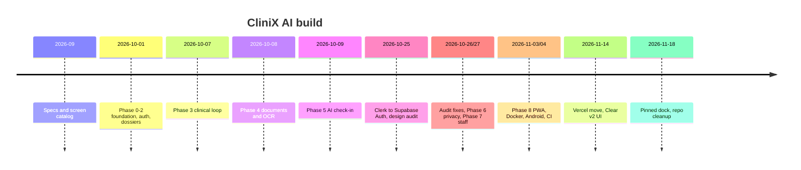

# Project history and decisions

What was decided, why, when and where it lives in the code. This file replaces the old phase plans (`code-agent/c-plans/`) and the per-batch audit logs (`docs/architecture/01–17`). Read it before reopening a settled decision.

Last verified: 2026-11-18 against `git log` on `master` (`7f06d66`).

## How to read an entry

`Date — Decision.` **Why:** the reason. **Where:** code paths. **Commit:** where it landed.

Dates are IST. "Gate" means a live script in `services/api/gate-*.mjs` that drives the real API with synthetic accounts.

## Timeline

## Foundations (still in force)

- **2026-10-01 — Two services: Next.js `apps/web` and Fastify `services/api` at `/api/v1`. No backend work goes in Next route handlers.** **Why:** keeps the API reusable by the Android shell and keeps authorization in one place. **Where:** `services/api/src/index.ts` registers every domain module. Enforced as the first rule in `CLAUDE.md`.
- **2026-10-01 — Supabase Cloud (Mumbai, `ap-south-1`) is the only database. It is never run locally.** Authorization lives in Fastify. RLS is defence-in-depth only. **Why:** a single shared project for dev and demo, with pgvector and Storage included. **Where:** `services/api/src/db.ts`, migrations in `services/api/drizzle/`.
- **2026-10-01 — Use the session pooler (port 5432), never the transaction pooler.** **Why:** pg-boss needs session mode. The pool allows about 15 connections across every client, so keep pools small (`DB_POOL_MAX`, `QUEUE_POOL_MAX`).
- **2026-10-01 — Jobs run on pg-boss in the same Postgres, with no Redis.** **Where:** `services/api/src/queue.ts` (send), `services/worker/src/index.ts` (consume).
- **2026-10-01 — AI goes through a `ModelGateway` to 9Router.** Analyst 1 and Analyst 2 run independently, a Judge reviews them, then a deterministic post-check runs. OCR is a vision route. All output is a draft. **Where:** `services/worker/src/gateway.ts`, `services/worker/src/pipeline/`.
- **2026-10-01 — Safety rails:** OCR, voice and AI output is draft-first. `access_events` is append-only. AI payloads carry no direct identifiers. Seed data is synthetic only. Finalized prescriptions are immutable and a change creates a new version. Repeated in `CLAUDE.md`.
- **2026-10-01 — Voice dictation (prescription Mode C) is a hypothetical stub:** the schema and UI shape exist, but there is no live microphone.
- **Non-goals:** a payment gateway (payment status is set by hand), ABDM/ABHA, a video-consult provider, real clinical validation and handwriting-OCR claims.

## Build phases

| Phase | Date | Delivered | Gate |
|---|---|---|---|
| 0 | 2026-10-01 | npm-workspaces monorepo, tokens, Supabase + pgvector, Fastify + Drizzle, Next shell | health + migrate |
| 1 | 2026-10-01 | Auth + role onboarding (originally Clerk), workspace switch | `/me` role per token |
| 2 | 2026-10-01 | Patient/doctor dossiers, schedule, directory, booking with overbooking guard (`409 SLOT_TAKEN`) | API run green |
| 3 | 2026-10-07 | Encounters, consultation notes, direct digital prescriptions, immutable finalize, claim invites (Test Milestone A) | `gate-phase3.mjs` 36/36 |
| 4 | 2026-10-08 | Private bucket `clinix-documents`, signed uploads, worker OCR → lab observations / Rx drafts (Milestone C) | `gate-phase4.mjs` 33/33 |
| 5 | 2026-10-09 | Adaptive check-in, dual-analyst + judge, `emergency.json` safety interrupt, timeline (Milestone B) | `gate-phase5.mjs` 38/38 |
| 6 | 2026-10-26 | Scoped consent, access ledger, removal requests | `gate-phase6.mjs` 20/20 (run 2026-11-02) |
| 7 | 2026-10-27 | Practices, memberships, invitations, staff dashboard/intake, follow-ups, doctor profile | `gate-phase7.mjs` 62/62 |
| 8 | 2026-11-03 | PWA (Serwist), synthetic seed, Docker/Dokploy, demo replay | `gate-phase8.mjs` 42/42 |

A passed gate means the API flow works. It does **not** mean the screens match the designs. See [status.md](status.md).

`gate-phase4.mjs` has one known failure: its finalize leg predates the review gate and gets `409`. The OCR, lab and trend legs pass.

## Decisions after Phase 5

- **2026-10-25 — Auth moved from Clerk to Supabase Auth.** **Why:** Clerk's server-side provider blocked a static export, which the Android APK needs, and Supabase was already the database. **Where:** `apps/web/src/lib/auth.tsx`, `apps/web/src/lib/supabase.ts`, `services/api/src/auth/`. Migrations `0006` (`profiles.clerk_user_id` → `legacy_auth_subject`, plus `supabase_user_id`) and `0007` (revoke browser table privileges). Old profiles are not auto-linked. **Commit:** `fd60052`. Design: [architecture/auth.md](architecture/auth.md).
- **2026-10-25 — A read-only audit of the 52 design frames against the code found 0 complete screens and 37 ordered gaps (GAP-001…037).** The critical ones were fabricated dossier facts, missing ownership checks on AI reads, prescription replay authorization, and an unconditional "low risk" UI. Gap batches 1–10 (2026-10-25 to 2026-10-27) fixed these. **Where:** outcomes are in [status.md](status.md).
- **2026-10-26 — The prescription review gate.** Each extracted line needs a recorded doctor decision before finalize, and the server returns `REVIEW_REQUIRED` otherwise. **Where:** `services/api/src/prescriptions/routes.ts` (`/doctor/prescription-drafts/:draft_id/finalize`), migration `0010`, test `review-gate.test.ts`.
- **2026-10-26 — A medication derived from a prescription stays `UNKNOWN_STATUS` and never auto-promotes to CURRENT.** **Why:** a historical prescription is not proof of active use.
- **2026-10-27 — Staff access is a membership (an ACTIVE `practice_members` row), resolved server-side.** `primary_role` is never changed. Arrived/Waiting/Ready live in `appointment_intakes`, not in the appointment status. **Where:** `services/api/src/auth/context.ts`, `services/api/src/practices/`, `services/api/src/staff/`.
- **2026-10-27 — `access_events` is append-only at the database level.** **Where:** migration `0012_access_events_append_only.sql`.
- **2026-11-03 — Serwist in configurator mode, caching the app shell only.** **Why:** the Turbopack setup needs a Next route handler, which the two-service rule forbids, and no API response or PHI may be cached on a device. **Where:** `apps/web/serwist.config.js`, `apps/web/src/app/sw.ts`.
- **2026-11-03 — Opt-in AI replay (`DEMO_REPLAY=record|replay`).** **Why:** a rehearsal must not depend on a live model. Replayed runs are labelled `replay:<route>`. **Where:** `services/worker/ai/replays/`.
- **2026-11-03 — The patient "You" dock item opens `/settings`.** The design left the destination undefined.
- **2026-11-03/04 — Android: a Capacitor shell bundling a static export of the web app.** Dynamic records use `/by-id?id=…` query routes because a static export can't enumerate IDs. Auth callbacks return through verified App Links. **Where:** `apps/mobile/`, `apps/web/src/lib/native.ts`. **Commits:** `6ae1448`, `a660b58`. Constraints: [architecture/mobile.md](architecture/mobile.md).
- **2026-11-04 — CI publishes private GHCR images per SHA.** Production is promoted by explicit SHA through a workflow, and signed APKs go out as private prereleases. **Where:** `.github/workflows/`, `scripts/deploy/`. **Commit:** `1c51750`.
- **2026-11-04 — Every AI role uses one model, `ag/gemini-3.8-flash-high`, at low reasoning.** The per-role variables still exist, so roles can diverge again later.
- **2026-11-14 — The web app and API moved to Vercel `bom1`. Dokploy keeps only `migrate`, `worker`, `verify` and `backup`.** **Why:** cross-continent DB round trips dominated latency. `bom1` sits next to Supabase Mumbai. On Vercel the API's pg-boss is send-only. **Where:** `apps/web/vercel.json`, `services/api/vercel.json`, `infra/dokploy/docker-compose.yml`. **Commits:** `0b58209`, `4a38920`. See [operations/deployment.md](operations/deployment.md).
- **2026-11-14 — Clear v2 became the default UI across all 56 designed screens.** It brings Inter, a cool mist canvas, white reading surfaces, a restrained jade accent and glass navigation. **Why:** the old warm palette looked dated. This was a presentation-only migration: handlers, routes and API contracts were unchanged. **Where:** tokens in `apps/web/src/app/globals.css`, shells in `apps/web/src/components/`. **Commits:** `7f06bb6`, `c0d8098`. Design source: [design/DESIGN.md](design/DESIGN.md) and FigCraft pages 7593–7596 in `design/ClinixAI-v2.figcraft`.
- **2026-11-18 — The workspace dock is pinned (`position: fixed`) on every screen and breakpoint.** `main` reserves bottom padding for it. **Why:** the `flowNavigation` and `md:sticky` variants left the dock mid-screen or below the fold. **Where:** `apps/web/src/components/workspace-shell.tsx`, regression test `apps/web/e2e/dock.spec.ts`. **Commit:** `31abd3c`.
- **2026-11-18 — Repository cleanup.** `docs/` became the committed single source of truth. Old plans, audit logs and screenshots were distilled into this file and [status.md](status.md), then deleted. E2E screenshots now go to `apps/web/test-results/screens/`. Spec corrections made while moving: hosting (Dokploy → Vercel + Dokploy worker), UI libraries (no shadcn or TanStack Query in the code) and repo layout (no `packages/ui`, no top-level `ai/`). These are listed at the top of [architecture/overview.md](architecture/overview.md).

## Rules for adding entries

- Add an entry when a decision changes architecture, a safety rail, a data contract, hosting, or a cross-screen UI rule.
- Keep each entry to 1–3 lines and link to the code, not to a plan file.
- Finished plans in `code-agent/c-plans/` are distilled here, then deleted.
