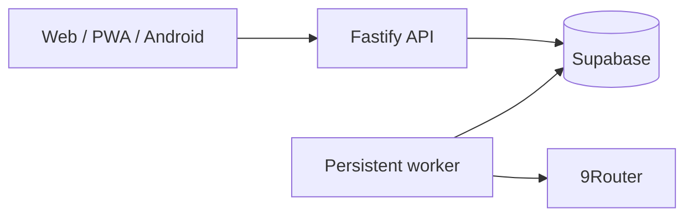

# Deployment and releases

Deploy your own instance for synthetic-data evaluation. No shared demo, prebuilt images or automated deployment workflow is required.

Last verified: 2026-11-20 against the workspace scripts, Dockerfiles and Vercel configuration.

## Deployment order

1. Provision a dedicated Supabase project. Enable `vector`, apply [the private Storage bucket SQL](../../infra/supabase/bucket.sql), and configure Auth redirects. See [environment configuration](environment.md).
2. From the repository root, run `npm ci`, then `npm run db:migrate` with the target `DATABASE_URL` in `services/api/.env` or the migration process environment. Back up an existing deployment before applying changes. Do not run the demo seed in production.
3. If enabling OCR or AI, start the worker before sending jobs. Give it its own environment from [the template](../../services/worker/.env.example), backed by the same Supabase project as the API. Run `npm run preflight:gateway --workspace @clinix/worker` to check configured routes with synthetic input. The worker runs continuously; do not deploy it as a request-scoped function. It initializes and consumes pg-boss queues; the Vercel API only produces jobs. Without the worker, queued jobs will not complete.
4. Deploy web and API with HTTPS. Configure API CORS, the frontend build variables and the Supabase sign-in and recovery redirects before the web build. Verify API `/health` reports `ok: true` and `db: "up"`, then test sign-in and, if enabled, process an OCR or AI job with synthetic data.

## Hosting options

- **Vercel:** Create separate projects rooted at `apps/web` and `services/api`; use the checked-in `vercel.json` files and include workspace files outside each root in the build. Set `master` as the production branch, and place both projects near your Supabase region. The checked-in configs select `bom1`; change that setting if it does not suit your database location.
- **Persistent host:** The workspace start commands are `npm run start --workspace @clinix/api` and `npm run start --workspace @clinix/worker`. For containers, the repo has Dockerfiles at `apps/web/Dockerfile`, `services/api/Dockerfile` and `services/worker/Dockerfile`; build them from the repository root, supplying the web build arguments from [environment configuration](environment.md). Keep the worker private.

## Android builds

Use the [manual Android build instructions](../../apps/mobile/README.md) with your own HTTPS endpoints. For distributed APKs, preserve the signing key, increase the version code for each update, and verify installation and auth links on a physical device. Never embed tokens or signing secrets in an APK.

## Operations

Monitor API and web availability, Auth callback delivery, worker heartbeat, queue failures and gateway errors. Send operational counts and identifiers only; exclude patient data, prompts and secrets. Test backup restoration before relying on backups. Roll back to a previously tested deployment if needed; reverting app code does not reverse database migrations. Use a compatible schema and replace a bad APK with a higher-version build signed by the same key.
