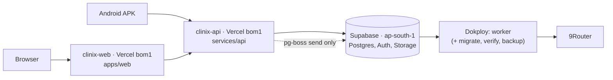

# Deployment and releases

Where each piece runs, how a commit reaches production, and how to roll back. Merged from the former `infra/vercel/README.md` and `infra/dokploy/DEPLOYMENT.md`.

Last verified: 2026-11-18. The exact settings and resource IDs are in [environment.md](environment.md).



## Vercel: web and API

| Project | Root | Domain | Config |
|---|---|---|---|
| `clinix-web` | `apps/web` | `example.invalid` | `apps/web/vercel.json`: region `bom1`. The build writes `assetlinks.json`, then runs `next build && serwist build` |
| `clinix-api` | `services/api` | `example.invalid` | `services/api/vercel.json`: region `bom1`. Zero-config Fastify, entry `src/index.ts`, build helper `scripts/vercel-build.mjs` |

- Both projects are Git-connected to `master`, so **a push deploys both**.
- **Keep `regions: ["bom1"]`.** The default `iad1` (US East) puts every database query on the far side of the planet. You can prove the region from the `x-vercel-id` response header.
- Web variables are build-time (`NEXT_PUBLIC_*`, `ANDROID_APP_LINK_SHA256_CERT_FINGERPRINT`), so changing one needs a redeploy.
- API secrets: `DATABASE_URL`, `IDENTITY_ENCRYPTION_KEY`, `SUPABASE_SERVICE_ROLE_KEY` and optionally `GITHUB_RELEASE_READ_TOKEN`.
- API config: `NODE_ENV=production`, `SUPABASE_URL`, `SUPABASE_PUBLISHABLE_KEY`, `SUPABASE_JWT_*`, `CORS_ORIGINS` (`https://example.invalid,https://localhost`; the APK WebView origin is `https://localhost`), `ANDROID_RELEASE_REPOSITORY`, `DB_POOL_MAX=3`, `QUEUE_POOL_MAX=1`.
- **Serverless behaviour:** when `VERCEL` is set, the API's pg-boss is send-only. Supervise, schedule and migrate are off, and it starts lazily on the first enqueue; the worker owns queue maintenance. `listen()` is not awaited at top level. `/health` reports `revision` from `VERCEL_GIT_COMMIT_SHA`.
- The session pooler's ~15 connections are shared by every Vercel instance and the worker. `idle_timeout` in `services/api/src/db.ts` releases idle ones.

## Dokploy: background stack

`infra/dokploy/docker-compose.yml` runs only what Vercel Functions can't host. No domains are routed to it.

| Service | Role |
|---|---|
| `migrate` | One-shot. Applies Drizzle migrations and exits 0; the worker waits for it |
| `worker` | pg-boss consumer: `document.extract` (OCR) and `ai.analyze` (analysts + judge + post-check) |
| `verify` | One-shot. Checks model routes, enqueues a synthetic `ops.probe`, and the worker must answer with the same image SHA. It creates no patient records |
| `backup` | Daily database + Storage snapshot to an offsite S3 target (`infra/dokploy/backup.Dockerfile`, `scripts/backup/supabase.mjs`). **The schedule stays disabled until a destination and a restore drill exist** |

Images are private GHCR packages built in CI. There are no source builds and no public ports on the VPS. New resources belong only to the Dokploy project `CliniX`. **Never touch the separate `Routing` project** (9Router/OmniRoute).

## Promotion (backend stack)

1. Open a PR to `master`. `Build and publish images` runs typecheck, unit, browser, both UI builds and image validation. PRs can't deploy.
2. Merge. CI publishes the four private images (`clinix-web`, `clinix-api`, `clinix-worker`, `clinix-backup`) under the full SHA.
3. Run **Promote production SHA** (`deploy-production.yml`) with that full SHA. It checks ancestry and CI success, writes literal SHA image references into the compose definition (`scripts/deploy/promote.mjs`) and deploys.
4. Promotion checks API revision and DB health, migration exit, and the `verify` exit. On any failure the job fails and the summary records the previous SHA.

## Android releases

Run **Android APK release** (`android-release.yml`) with the same tested SHA. By default it creates a draft private prerelease. `publish=true` publishes a private prerelease candidate. Promote it to stable only after physical-phone acceptance.

- Releases stay in the private repository, and the APK carries no GitHub token.
- Version codes must keep increasing.
- **Never replace the signing key** after distributing an APK. Keep an encrypted copy outside GitHub and the VPS.

Build details: [`apps/mobile/README.md`](../../apps/mobile/README.md).

## Rollback

- **Backend stack:** run *Promote production SHA* with an earlier successful SHA.
- **Web/API:** use Vercel's instant rollback to an earlier deployment.
- **Database migrations are never reversed automatically.** Schema changes must stay compatible with the previous APK/API release. If a migration fails, fix it before starting new containers.
- **A bad APK** is replaced by a corrected one with the **same signing key and a higher version code**. Withdraw only the bad candidate.

## Monitoring

Still to be configured before patient launch:

- uptime checks for the API (HTTPS/DB), the web app and the auth callback
- worker heartbeat (`HEARTBEAT_FILE`), queue failures and stalls, router failures and certificate expiry
- an external alert destination

Use operational identifiers and counts only. Never send patient data, prompts or credentials to monitoring.

## Local production run

```bash
docker compose --env-file <env file> -f infra/dokploy/docker-compose.yml up
```

This runs the background stack from the published images. Production web builds require HTTPS for the API, Supabase and the auth redirect, so sign-in over plain `http://localhost` fails by design.
