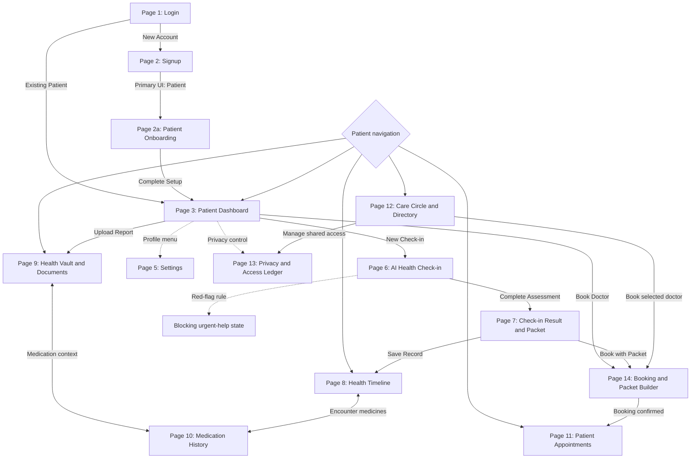
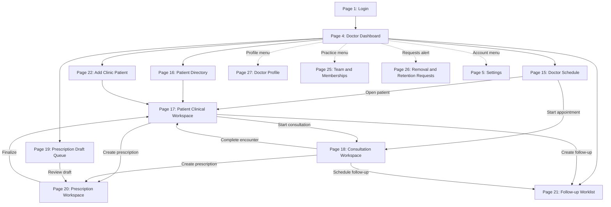
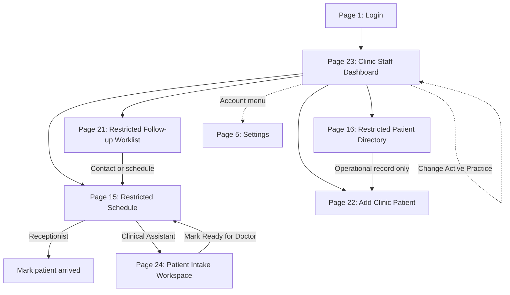
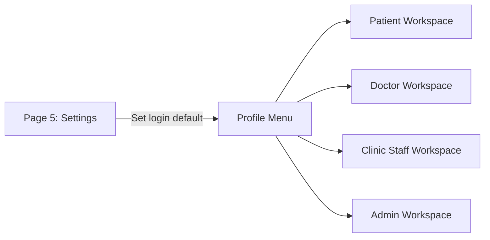
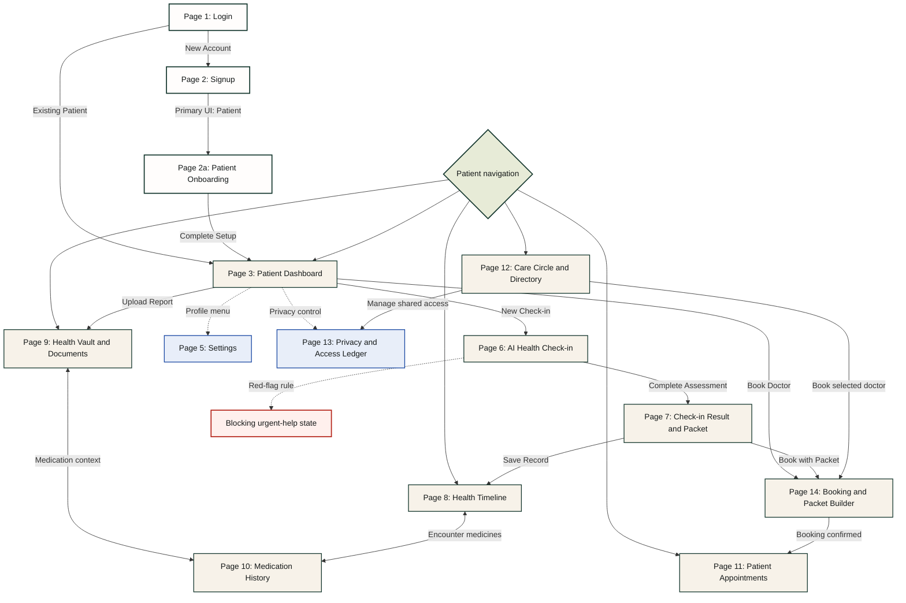
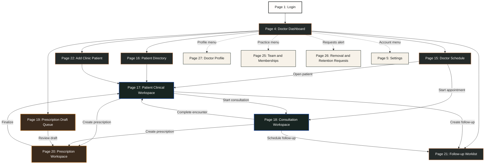
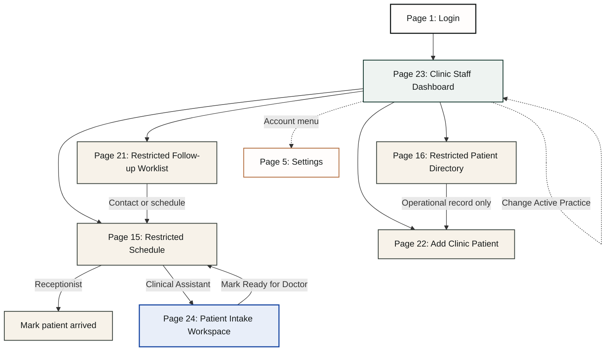
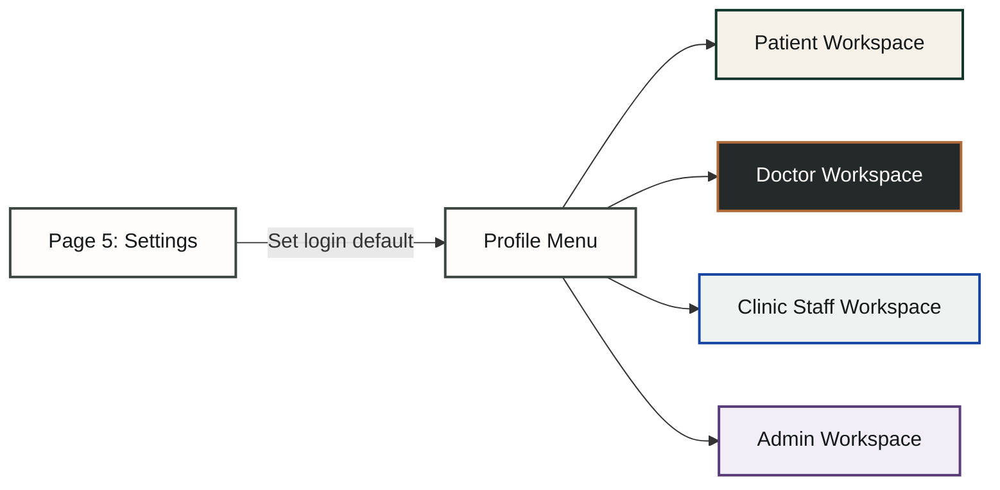

# CliniX Screen Catalog

> This is the product-intent catalog of 30 numbered screens. The 56 implemented screen states, with their routes, design frames and files, are in [screen-map.md](screen-map.md).

> Confirmed screen inventory and navigation model from the patient, doctor, and clinic staff design sessions.
>
> Admin workspace screens are intentionally deferred until the Patient and Doctor workflows are established.

## 1. Catalog rules

- The current catalog contains **30 distinct screens**.
- Pages `2a`, `2b`, and `2c` are separate onboarding screens and count individually.
- A permission-restricted rendering of an existing screen does not count as another screen. For example, doctors and clinic staff use Page 15 with different capabilities.
- Drawers, dialogs, confirmation prompts, menus, source previews, and emergency interruption states are interaction states rather than separately numbered screens.
- A person has one CliniX Account and may hold Patient, Doctor, Clinic Staff, or Admin workspace entitlements simultaneously.
- Settings determines the workspace opened after login. The profile menu permits immediate switching among current workspace entitlements.
- Clinic Staff access comes from an invitation and a time-bounded Practice Membership. It cannot be self-granted during public signup.

## 2. Screen index

### Shared and onboarding

| Page | Screen | Expected user |
| --- | --- | --- |
| 1 | Login | Public |
| 2 | Signup | Public |
| 2a | Patient Onboarding | Patient |
| 2b | Doctor Onboarding and Verification | Doctor applicant |
| 2c | Clinic Staff Invitation and Onboarding | Invited clinic staff |
| 5 | Settings | All authenticated users |

### Patient workspace

| Page | Screen | Expected user |
| --- | --- | --- |
| 3 | Patient Dashboard | Patient |
| 6 | AI Health Check-in | Patient |
| 7 | Check-in Result and Consultation Packet | Patient |
| 8 | Health Timeline | Patient |
| 9 | Health Vault and Document Hub | Patient |
| 10 | Medication History | Patient |
| 11 | Patient Appointments | Patient |
| 12 | Care Circle and Doctor Directory | Patient |
| 13 | Privacy and Access Ledger | Patient |
| 14 | Appointment Booking and Packet Builder | Patient |

### Doctor workspace

| Page | Screen | Expected user |
| --- | --- | --- |
| 4 | Doctor Dashboard | Doctor |
| 15 | Doctor Schedule | Doctor and permitted clinic staff |
| 16 | Patient Directory | Doctor and permitted clinic staff |
| 17 | Patient Clinical Workspace | Doctor |
| 18 | Consultation Workspace | Doctor |
| 19 | Prescription Draft Queue | Doctor |
| 20 | Prescription Workspace | Doctor |
| 21 | Follow-up Worklist | Doctor and permitted clinic staff |
| 22 | Add Clinic Patient | Doctor and permitted clinic staff |
| 25 | Practice Team and Memberships | Practice Owner or authorized doctor |
| 26 | Record Removal and Retention Requests | Responsible doctor or Practice Owner |
| 27 | Doctor Profile and Consultation Services | Doctor |

### Clinic staff workspace

| Page | Screen | Expected user |
| --- | --- | --- |
| 23 | Clinic Staff Dashboard | Receptionist or Clinical Assistant/Nurse |
| 24 | Patient Intake Workspace | Clinical Assistant/Nurse and doctor |

## 3. Shared navigation model

### 3.1 Authentication and landing

1. Page 1 authenticates the person.
2. New users continue to Page 2.
3. Patient-first users continue to Page 2a.
4. Doctor-first users continue to Page 2b.
5. Clinic Staff users enter through a Practice invitation and Page 2c, not through public role selection.
6. After authentication and required onboarding, the account opens its configured default workspace.

### 3.2 Workspace switcher

The profile menu shows only workspaces the account may currently enter:

- Patient
- Doctor
- Clinic Staff
- Admin, when internally authorized

Switching workspace does not sign the person out. Clinic Staff selection also restores or requests an Active Practice. A person without Doctor entitlement may start Doctor onboarding, but cannot enter the Doctor workspace until the product's verification policy permits it.

### 3.3 Settings boundary

Page 5 contains personal account preferences. Professional profile management belongs to Page 27, Practice membership administration belongs to Page 25, and patient consent belongs to Page 13.

## 4. Patient navigation

### 4.1 Persistent navigation

The Patient workspace uses five persistent destinations. On mobile they appear as a bottom navigation bar. On wider screens they appear as a floating navigation island or quiet chapter rail.

| Navigation item | Destination |
| --- | --- |
| Home | Page 3 - Patient Dashboard |
| Timeline | Page 8 - Health Timeline |
| Vault | Page 9 - Health Vault and Document Hub |
| Visits | Page 11 - Patient Appointments |
| Care | Page 12 - Care Circle and Doctor Directory |

Page 5 is available through the profile menu. Page 13 is available through a privacy or access control in the account header and through sharing-related actions.

### 4.2 Contextual patient screens

- Page 6 opens from New Check-in actions.
- Page 7 follows completion of Page 6.
- Page 10 opens from medication references in Pages 8, 9, or encounter details.
- Page 14 opens from booking actions on Pages 3, 7, 11, or 12.
- A deterministic red-flag response interrupts Page 6 as a blocking state rather than a separate numbered screen.

## 5. Doctor navigation

The Doctor workspace uses a compact left clinical rail on desktop and a five-item bottom navigation bar on mobile.

| Navigation item | Destination |
| --- | --- |
| Home | Page 4 - Doctor Dashboard |
| Schedule | Page 15 - Doctor Schedule |
| Patients | Page 16 - Patient Directory |
| Drafts | Page 19 - Prescription Draft Queue |
| Follow-ups | Page 21 - Follow-up Worklist |

Pages 17, 18, and 20 are contextual clinical workspaces. Pages 25, 26, and 27 are reached through Practice, request, profile, or dashboard actions rather than the primary navigation rail.

## 6. Clinic staff navigation

The Clinic Staff workspace has its own dashboard and navigation shell.

| Navigation item | Destination |
| --- | --- |
| Home | Page 23 - Clinic Staff Dashboard |
| Schedule | Restricted Page 15 |
| Patients | Restricted Page 16 |
| Follow-ups | Restricted Page 21 |

Page 5 is available through the profile menu. Page 22 opens from Add Patient actions. Page 24 opens only for an appointment or assigned intake task. Clinic Staff never enter Pages 17 through 20.

## 7. Detailed screen specifications

### Page 1 - Login

**Expected user:** Public, returning user

**Purpose:** Authenticate one CliniX Account and continue to its configured default workspace.

**Content:**

- Email or mobile identifier.
- OTP or password authentication, according to the configured auth method.
- Forgot password or account recovery action.
- Link to Page 2 Signup.
- Concise privacy-first product positioning.
- Validation and authentication error states.
- Successful routing to Patient, Doctor, Clinic Staff, or Admin based on the account's default workspace entitlement.

### Page 2 - Signup

**Expected user:** Public, new user

**Purpose:** Create the base CliniX Account and choose the initial Patient or Doctor onboarding route.

**Content:**

- Email.
- Full name.
- Mobile number.
- Date of birth.
- Server-enforced 18+ eligibility check.
- Adult and non-emergency scope acknowledgment.
- Initial Primary UI selector: Patient or Doctor.
- Link back to Page 1.
- Clinic Staff is not publicly selectable. Staff access is invitation-only through Page 2c.

### Page 2a - Patient Onboarding

**Expected user:** Newly registered Patient

**Purpose:** Establish the initial Patient workspace, privacy model, and record-linking state.

**Content:**

- Mobile-based lookup for doctor-created unclaimed patient records.
- Candidate record summary without exposing unrelated health information.
- Link or dismiss action for eligible unclaimed records.
- Personal Health Vault choice for persistent longitudinal storage.
- Private Consultation Mode choice for temporary processing and package export without mandatory long-term Vault storage.
- Clear comparison of the two privacy modes.
- Optional baseline allergies and chronic conditions.
- Skip controls for optional health fields.
- Completion action leading to Page 3.

### Page 2b - Doctor Onboarding and Verification

**Expected user:** Doctor applicant

**Purpose:** Establish a professional profile and submit the evidence required for Doctor workspace access.

**Content:**

- Qualification.
- Speciality.
- Medical registration number.
- Registration authority or medical council.
- Verification evidence upload.
- Initial Practice or clinic information.
- Clinic address and contact information.
- Supported consultation modes: online and in-person.
- Initial consultation fee and manual payment information.
- Verification status: Pending, Verified, Rejected, or Suspended.
- Clear explanation that Patient workspace access remains independent.

### Page 2c - Clinic Staff Invitation and Onboarding

**Expected user:** Person invited by a Practice

**Purpose:** Accept a specific Practice Membership without allowing self-granted staff access.

**Content:**

- Practice name and identity.
- Inviting Practice Owner or authorized doctor.
- Offered role: Receptionist or Clinical Assistant/Nurse.
- Human-readable permitted and prohibited actions.
- Email and mobile verification for new accounts.
- Existing-account recognition without replacing existing Patient or Doctor entitlements.
- Invitation expiry and invalid/revoked states.
- Accept or decline action.
- Default-workspace choice for a newly invited account.
- Completion action leading to Page 23.

### Page 3 - Patient Dashboard

**Expected user:** Patient

**Purpose:** Provide an immediate view of what matters today and fast access to common patient actions.

**Content:**

- Today block with next appointment, follow-up reminders, and active or incomplete check-ins.
- Care-plan or health-priority ribbon when relevant.
- Quick actions: New Check-in, Upload Report, and Book Doctor.
- Active medication summary with a link to Page 10.
- Recent timeline entries with a link to Page 8.
- Recent lab or trend teaser with a link to Page 9.
- Appointment card linking to Page 11 or Page 14.
- Privacy and account access controls in the header.
- No generic chatbot feed.

### Page 4 - Doctor Dashboard

**Expected user:** Doctor

**Purpose:** Act as the doctor's operational command center without displaying complete patient records.

**Content:**

- Today's Schedule combining normal appointments and attention states.
- Appointment states such as Requested, Confirmed, Arrived, Waiting, Delayed, In Progress, Incomplete, and Completed.
- Incoming request confirmation or decline actions.
- Prescription Draft Queue summary with review counts and ambiguity warnings.
- Follow-ups Due summary with due-today and overdue counts.
- Patient Search opening Page 16 or a specific Page 17 record.
- Quick actions for Add Patient and Start Consultation.
- Links to full Schedule, Drafts, and Follow-ups screens.
- No separate Attention Queue.

### Page 5 - Settings

**Expected user:** Any authenticated account

**Purpose:** Manage personal account behavior rather than professional or clinical records.

**Content:**

- Personal profile information.
- Authentication methods and active sessions.
- Notification channels and preferences.
- Accessibility and language preferences.
- Switch Workspace control.
- Default workspace after login.
- Active Practice selection for users with multiple staff memberships.
- Patient privacy mode when a Patient profile exists.
- Data export and account deletion request entry points.
- Membership summaries without owner-level membership controls.
- Links to Page 13, Page 25, or Page 27 when the account has the relevant entitlement.

### Page 6 - AI Health Check-in

**Expected user:** Patient

**Purpose:** Collect a structured current concern without presenting a generic chatbot interface.

**Content:**

- Initial symptom or concern input.
- Adaptive single-select, multi-select, numeric, date, and free-text questions.
- Usually three useful structured options where appropriate.
- Persistent Something else free-text path.
- Back and Continue controls.
- Visible progress.
- Draft autosave and resume behavior.
- Relevant-history retrieval notices without exposing internal reasoning.
- Deterministic red-flag safety monitoring.
- Blocking urgent-help interruption when critical rules trigger.
- No diagnosis or autonomous prescription claim.

### Page 7 - Check-in Result and Consultation Packet

**Expected user:** Patient

**Purpose:** Present the completed check-in outcome and support safe next steps.

**Content:**

- Current concern summary.
- Low-risk self-care or preventive guidance within product scope.
- Uncertainty and escalation labels.
- Similar historical episodes classified as strongly similar, partially similar, or insufficiently similar.
- Historical treatment context with an explicit statement that prior medicine is not authorization for reuse.
- Relevant laboratory values or reports.
- Missing information or questions to discuss with a doctor.
- Save to Vault action when persistent storage is enabled.
- Download or export package action.
- Book Doctor with Packet action opening Page 14.

### Page 8 - Health Timeline

**Expected user:** Patient

**Purpose:** Show the longitudinal health record as an understandable chronological story.

**Content:**

- Vertical evidence spine or chronological chapter layout.
- Encounter grouping rather than an undifferentiated activity feed.
- Filters for Doctor Visits, AI Check-ins, Laboratory Reports, Prescriptions, Follow-ups, and All.
- Provenance labels: Patient-asserted, Doctor-authored, Source-document-derived, and AI-derived.
- Expandable encounter details.
- Links to source reports and prescriptions.
- Direct links to medication details on Page 10.
- Visual separation between factual records and AI assistance.

### Page 9 - Health Vault and Document Hub

**Expected user:** Patient

**Purpose:** Organize source documents and verified structured information derived from them.

**Content:**

- Document shelf for laboratory reports, prescriptions, scans, images, and discharge documents.
- Upload action for PDF, image, or scan.
- Upload, parsing, OCR, review, failure, and completion states.
- Extracted laboratory observation table.
- Value, unit, reference range, collection date, source page, and confidence.
- Longitudinal trend charts for selected tests.
- Source-document preview drawer.
- Correction or confirmation path for medically important extracted values.
- Original source retained for verification.

### Page 10 - Medication History

**Expected user:** Patient

**Purpose:** Show medicine use with its original encounter and prescribing context.

**Content:**

- Active, Completed, and Discontinued filters.
- Medicine name, dose, route, frequency, timing, duration, and status.
- Prescribing doctor and prescribed date.
- Associated problem, encounter, and prescription.
- Response, adverse reaction, and reason stopped when available.
- Link to original prescription or source document.
- Safety language that historical use is not authorization to restart treatment.

### Page 11 - Patient Appointments

**Expected user:** Patient

**Purpose:** Manage the patient's scheduled care and consultation history.

**Content:**

- Upcoming, Past, and Cancelled sections.
- Doctor name and speciality.
- Appointment date and time.
- Online or in-person mode.
- Video join control for eligible online appointments.
- Clinic address and map action for in-person visits.
- Reason for consultation.
- Appointment and consultation status.
- Manual payment status: Unpaid, Payment Requested, Paid, Waived, or Adjusted/Refunded when supported.
- Reschedule and cancel actions subject to policy.
- Book Appointment action opening Page 14.

### Page 12 - Care Circle and Doctor Directory

**Expected user:** Patient

**Purpose:** Manage ongoing doctor relationships and discover verified doctors.

**Content:**

- My Doctors list with relationship types such as Primary Physician and Specialist.
- Preferred or regular doctor indicator.
- Book, view profile, manage sharing, or remove relationship actions.
- Discover view for verified doctors.
- Search and filters by speciality, Practice, location, consultation mode, and accepting-patient status.
- Doctor profile cards based on Page 27 information.
- Entry to Page 14 for booking.
- Entry to Page 13 for consent-scoped sharing.

### Page 13 - Privacy and Access Ledger

**Expected user:** Patient

**Purpose:** Give the patient direct control and visibility over access to their Vault.

**Content:**

- Sharing recipient, purpose, and expiry.
- Granular scope selection for current complaint, allergies, current medicines, selected history, reports, and encounters.
- Review-before-confirming consent summary.
- Active, expired, and revoked authorizations.
- Revocation action where appropriate.
- Read-only access ledger showing actor, resource, purpose, time, and action.
- Doctor, staff, AI-processing, sharing, export, and administrative access events.
- Entry to initiate removal requests for doctor-owned professional records.
- Status tracking for requests handled on Page 26.

### Page 14 - Appointment Booking and Packet Builder

**Expected user:** Patient

**Purpose:** Book a consultation while sharing only the minimum necessary health context.

**Content:**

- Selected doctor and Practice.
- Online or in-person mode.
- Clinic location when applicable.
- Date and available slot selection.
- Reason for visit or chief concern.
- Optional attachment of a recent check-in result.
- Selectable reports, laboratory trends, medication list, and relevant encounter history.
- Scope, recipient, purpose, and expiry summary.
- Manual payment instructions and policy notice.
- Final booking review and confirmation.
- Success route to Page 11.

### Page 15 - Doctor Schedule

**Expected user:** Doctor, Receptionist, or Clinical Assistant/Nurse with different permissions

**Purpose:** Manage appointment demand, the working calendar, and doctor availability.

**Content:**

- Day and week calendar views.
- Appointment list with patient, reason, doctor, time, mode, payment, and consultation status.
- Requested, Confirmed, Arrived, Waiting, Delayed, In Progress, Completed, Cancelled, and No-show filters where supported.
- Confirm or decline incoming appointment requests.
- Arrival and waiting-state controls for permitted staff.
- Start Consultation action for doctors.
- Start Intake action for assigned Clinical Assistants.
- Manual payment-status update for permitted users.
- Doctor-only availability tab with working hours, consultation duration, breaks, blocked dates, clinics, online availability, and one-off changes.
- Patient and appointment links to Pages 17, 18, or 24 according to role.

### Page 16 - Patient Directory

**Expected user:** Doctor or permitted clinic staff

**Purpose:** Find patients within the current care or Practice scope.

**Content:**

- Search by patient name, mobile number, or internal patient ID.
- Filters for recent patients, upcoming appointments, follow-ups, and unclaimed records.
- Doctor view with last encounter, next action, relationship status, and limited safety indicators.
- Staff view limited to identity and operational information required for assigned work.
- Add Patient action opening Page 22.
- Doctor selection opens Page 17.
- Staff selection opens only permitted operational actions and never Page 17.

### Page 17 - Patient Clinical Workspace

**Expected user:** Authorized doctor

**Purpose:** Provide a persistent longitudinal dossier without turning the dossier into a live consultation form.

**Content:**

- Fixed patient header with identity, age, documented allergies, current conditions, and consent status.
- Overview of current concern, current medicines, appointments, and recent activity.
- Longitudinal timeline.
- Reports, laboratory values, trends, and original sources.
- Medication and finalized prescription history.
- Separate Patient Record and AI Assistance regions.
- AI relevance, missing-information, and uncertainty summaries without raw chain-of-thought.
- Consent-locked sections shown as unavailable rather than silently omitted.
- Start Consultation, Create Prescription, Upload Record, and Schedule Follow-up actions.

### Page 18 - Consultation Workspace

**Expected user:** Authorized doctor

**Purpose:** Conduct one specific appointment or encounter and produce doctor-authored records.

**Content:**

- Appointment header with patient, mode, time, reason, and payment status.
- Patient-shared consultation packet.
- Clinical Assistant intake from Page 24 when available.
- Separate AI Assistance panel showing relevance, missing information, disagreement, and uncertainty.
- Structured clinical note sections for complaint, observations, assessment, and plan.
- Draft autosave.
- Create Prescription action opening Page 20.
- Request or upload report action.
- Schedule Follow-up action opening or updating Page 21.
- Manual payment-status action.
- Video join control for online consultations without allowing video to dominate the clinical workspace.
- Explicit Complete Consultation confirmation.
- Completed doctor-authored notes use amendments rather than silent edits.

### Page 19 - Prescription Draft Queue

**Expected user:** Doctor

**Purpose:** Triage and review prescription drafts without allowing automatic finalization.

**Content:**

- Filters for OCR, voice, manually saved, processing, and failed drafts.
- Patient and encounter association.
- Source type and creation time.
- Medicines detected.
- Extraction confidence and ambiguity count.
- Allergy, dosage, or interaction warnings.
- Priority ordering for safety ambiguity and draft age.
- Review action opening Page 20.
- Reassign action for incorrect patient or encounter association.
- Delete action with confirmation.
- Source image, audio, transcript, or consultation link.
- No bulk approval.

### Page 20 - Prescription Workspace

**Expected user:** Doctor

**Purpose:** Provide one consistent workspace for direct prescription composition and extracted-draft review.

**Content:**

- Patient and encounter context.
- Direct mode with blank structured medicine fields.
- OCR or voice review mode with source image or transcript beside extracted fields.
- Medicine, dose, route, frequency, timing, duration, and instructions.
- Add, edit, reorder, and remove medicine rows.
- Known allergies and current medicines.
- Ambiguity and possible interaction flags.
- Save Draft action.
- Printable prescription preview.
- Explicit finalization confirmation.
- Doctor, timestamp, version, and source provenance.
- Print and Send to Patient actions after finalization.
- Amendment or new-version workflow for later changes.

### Page 21 - Follow-up Worklist

**Expected user:** Doctor, Receptionist, or Clinical Assistant/Nurse with different permissions

**Purpose:** Keep follow-up obligations visible before and after an appointment is booked.

**Content:**

- Due Today, Upcoming, Overdue, Completed, and Cancelled sections.
- Patient, source encounter, original doctor instruction, due date, priority, assigned person, and contact state.
- Filters by Practice, doctor, consultation mode, follow-up type, and assignee.
- Doctor action to enter a clinical outcome.
- Staff actions for contact status, scheduling, and assignment according to role.
- Book Follow-up Appointment action linking to Page 15.
- Open Patient action linking doctors to Page 17.
- Clear distinction between a follow-up obligation and a booked follow-up appointment.

### Page 22 - Add Clinic Patient

**Expected user:** Doctor or permitted clinic staff

**Purpose:** Create a clinic-managed unclaimed patient record safely.

**Content:**

- Full name.
- Mobile number.
- Date of birth.
- Sex at registration.
- Duplicate check against claimed and unclaimed patients.
- Candidate-match resolution rather than silent duplication.
- Practice and responsible-doctor relationship.
- Explanation that this does not create a patient-owned CliniX Account.
- Optional claim invitation by mobile.
- Confirmation summary before creation.
- Success route to Page 17 for doctors or restricted Page 16 for staff.
- No medical-history entry on this identity-creation screen.

### Page 23 - Clinic Staff Dashboard

**Expected user:** Receptionist or Clinical Assistant/Nurse

**Purpose:** Provide a separate operational workspace scoped to the current Practice Membership.

**Content:**

- Active Practice selector for users with multiple memberships.
- Visible Practice role badge.
- Assigned-doctor filter for Clinical Assistants.
- Today's schedule with Requested, Confirmed, Arrived, Waiting, Delayed, and Completed states.
- Operational alerts for unpaid appointments, pending claim invitations, and patients requiring contact.
- Assigned follow-up contact tasks.
- Clinical Assistant intake tasks awaiting completion.
- Quick actions: Add Patient, Book Appointment, Mark Arrival, Update Payment, and Contact Patient.
- No diagnoses, unrestricted clinical history, AI analysis, prescription drafts, or prescribing controls.

### Page 24 - Patient Intake Workspace

**Expected user:** Clinical Assistant/Nurse or doctor; Receptionist may only mark arrival outside the clinical fields

**Purpose:** Prepare one appointment for doctor review without granting unrestricted clinical access.

**Content:**

- Patient identity, appointment, assigned doctor, visit reason, and consent status.
- Arrived, Intake Started, and Ready for Doctor states.
- Temperature, pulse, blood pressure, oxygen saturation, weight, and optional height.
- Confirmation of patient-reported medicines and allergies without clinical reconciliation authority.
- Non-diagnostic intake note recording what the patient reports.
- Encounter-scoped document or photo upload.
- Clinical Assistant Entered provenance on every entry.
- Out-of-range values phrased as Needs Doctor Review rather than a diagnosis.
- Mark Ready for Doctor action updating Pages 4, 15, and 18.
- No AI analysis, assessment, diagnosis, treatment plan, prescription, or consultation-completion controls.

### Page 25 - Practice Team and Memberships

**Expected user:** Practice Owner or authorized doctor

**Purpose:** Manage the complete Practice Membership lifecycle and doctor assignments.

**Content:**

- Practice identity and current owner.
- Active, Invited, Suspended, and Former members.
- Doctor, Receptionist, and Clinical Assistant/Nurse role badges.
- Invite by email or mobile.
- Pending invitation resend and revoke actions.
- Assign Clinical Assistants to one or more doctors.
- Change Practice role with explicit confirmation.
- Suspend access immediately.
- End membership with effective date and reason.
- Membership and Staff-Doctor Assignment history.
- Safeguards preventing ordinary staff from changing roles or managing other members.

### Page 26 - Record Removal and Retention Requests

**Expected user:** Responsible doctor or Practice Owner; clinic staff may route but not decide

**Purpose:** Resolve patient requests concerning doctor-owned professional records separately from Vault consent revocation.

**Content:**

- Requesting patient and responsible doctor.
- Affected record, encounter, or relationship.
- Patient-provided reason when supplied.
- Request date, age, and status.
- Approve Removal, Partially Approve, or Retain actions.
- Required rationale for partial approval or retention.
- Applicable professional or legal retention note.
- Decision maker and timestamp.
- Audit history preserved even when allowed record content is removed.
- Patient-visible outcome synchronized to Page 13.
- Staff routing action without decision authority.

### Page 27 - Doctor Profile and Consultation Services

**Expected user:** Doctor

**Purpose:** Manage the doctor's verified professional identity and patient-facing service configuration.

**Content:**

- Public name, photograph, biography, speciality, qualifications, languages, and professional experience.
- Registration number, authority, verification status, and verification evidence.
- Locked verified fields with re-verification required for material changes.
- Practice affiliations and clinic locations.
- Online and in-person consultation modes.
- Visit duration, fee, and manual payment instructions.
- Advance-payment preference and cancellation policy.
- Accepting-new-patients state.
- Directory visibility.
- Preview of the Page 12 directory profile.
- Link to Page 15 for availability rather than duplicating calendar controls.

## 8. Role and access boundaries

| Capability | Patient | Doctor | Receptionist | Clinical Assistant/Nurse |
| --- | --- | --- | --- | --- |
| Manage own Patient Vault | Yes | If the account has Patient entitlement | If the account has Patient entitlement | If the account has Patient entitlement |
| View full authorized clinical dossier | No doctor view | Yes | No | No |
| Manage appointments | Own appointments | Yes | Yes, within Practice | Assigned or permitted appointments |
| View patient contact identity | Own identity | Authorized care context | Operational need within Practice | Assigned operational context |
| Record basic observations | Own patient-submitted data | Yes | No | Appointment-scoped |
| Write diagnosis or assessment | No | Yes | No | No |
| Author or finalize prescription | No | Yes | No | No |
| Update manual payment status | Own status is read-only | Yes | Yes | If permitted by Practice role |
| Manage follow-up contact | Own follow-ups | Yes | Yes | Assigned tasks |
| Manage Practice memberships | No | Owner or authorized doctor only | No | No |

## 9. Page transition matrix

| Source | Action | Destination |
| --- | --- | --- |
| Page 1 | Create account | Page 2 |
| Page 2 | Select Patient | Page 2a |
| Page 2 | Select Doctor | Page 2b |
| Practice invitation | Accept staff invitation | Page 2c |
| Page 2a | Finish onboarding | Page 3 |
| Page 2b | Verification permits access | Page 4 |
| Page 2c | Accept membership | Page 23 |
| Page 3 | New Check-in | Page 6 |
| Page 3 | Upload Report | Page 9 |
| Page 3 | Book Doctor | Page 14 |
| Page 6 | Complete assessment | Page 7 |
| Page 7 | Save record | Page 8 |
| Page 7 | Book with packet | Page 14 |
| Page 8 or 9 | View medicine context | Page 10 |
| Page 11 or 12 | Book appointment | Page 14 |
| Page 12 | Manage sharing | Page 13 |
| Page 14 | Confirm booking | Page 11 |
| Page 4 | Open full schedule | Page 15 |
| Page 4 | Search patient | Page 16 or Page 17 |
| Page 4 | Review prescription drafts | Page 19 |
| Page 4 | View follow-ups | Page 21 |
| Page 15 | Open patient | Page 17 for doctors or restricted Page 16 for staff |
| Page 15 | Start consultation | Page 18 |
| Page 15 | Start intake | Page 24 |
| Page 16 | Select patient as doctor | Page 17 |
| Page 16 | Add patient | Page 22 |
| Page 17 | Start consultation | Page 18 |
| Page 17 or 18 | Create prescription | Page 20 |
| Page 17 or 18 | Create follow-up | Page 21 |
| Page 19 | Review draft | Page 20 |
| Page 20 | Finalize prescription | Page 17 or Page 18 context |
| Page 23 | Open schedule | Restricted Page 15 |
| Page 23 | Open patients | Restricted Page 16 |
| Page 23 | Open follow-ups | Restricted Page 21 |
| Page 23 | Begin assigned intake | Page 24 |
| Page 24 | Mark Ready for Doctor | Page 15 and doctor Page 18 state update |

## 10. Mermaid diagrams - theme-neutral versions

### 10.1 Patient flow

### 10.2 Doctor flow

### 10.3 Clinic staff flow

### 10.4 Shared workspace switching

## 11. Mermaid diagrams - styled versions

The styled variants preserve readable text labels so meaning is not communicated by color alone.

### 11.1 Styled patient flow

### 11.2 Styled doctor flow

### 11.3 Styled clinic staff flow

### 11.4 Styled workspace switching

## 12. Deferred Admin workspace

The Admin workspace appears in the entitlement and switching model but does not yet have numbered screens. Its responsibilities and screen inventory will be decided only after this Patient, Doctor, and Clinic Staff catalog is accepted.
