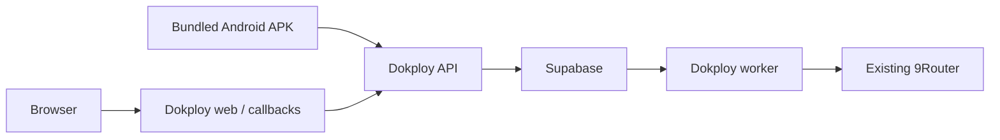

# CliniX deployment and private Android releases

The APK bundles its interface and calls `https://clinix-api.thecontractor.me/api/v1`. Supabase remains the database, authentication and document provider. The existing `https://9router.thecontractor.me/v1` gateway remains independent.

## Setup

Follow [ENVIRONMENT.md](ENVIRONMENT.md) for exact DNS, Dokploy and GitHub settings. New resources belong only to project `CliniX`. Never delete or prune existing Routing resources.

The raw Compose application uses private CI-built images. There are no production source builds and no public worker/migration ports. `migrate` must exit successfully before API and worker start. A one-shot `verify` service checks configured model routes, then enqueues a synthetic `ops.probe` job. The real worker must complete it with the same image revision and a structured 9Router response. No patient records are created by this probe.

## GitHub delivery

1. Push `deploy/clinix-android-production` and open a PR to `master`.
2. PR verification uses synthetic public settings, runs typecheck/unit/browser tests, both UI builds and container build validation. It cannot deploy production.
3. Merge once checks pass. `Build and publish images` publishes all four private GHCR images under the same full SHA. It does not deploy.
4. Run `Promote production SHA`, input the full successfully built master SHA. The workflow checks ancestry and CI success, renders literal SHA image references, updates only the configured CliniX Compose definition and requests deployment.
5. Promotion checks API revision/DB, public web health, Docker API/web/worker health, migration exit and synthetic verification exit. Any failure fails the job and records the previous SHA in the summary.
6. Run `Android APK release`, selecting the same tested source SHA. Default: create a draft private prerelease and candidate artifact. `publish=true` publishes a PRIVATE prerelease candidate. Promote it to a stable release only after phone acceptance.

Source and releases stay private in `AdvaitR7/ClinixAI`. Do not create a second repository or change repository/package visibility. The APK contains no GitHub token. Private downloads require GitHub login with repository access.

## First release checklist

- [ ] DNS resolves both CliniX hosts to `194.163.133.221`; HTTPS certificates are trusted.
- [ ] Original Supabase identity key and project configuration preserved.
- [ ] Router key and exact model routes verified without patient content.
- [ ] Private GHCR pulls work on Dokploy.
- [ ] Supabase email confirmation and recovery callbacks configured.
- [ ] Signing-key fingerprint matches web `/.well-known/assetlinks.json` and the APK certificate.
- [ ] Backend promotion passes migration, health, and queued synthetic AI checks.
- [ ] APK signature, application ID, version and bundled assets verified.
- [ ] Physical phone: clean install, upgrade, sign-in/refresh/restart/logout/account switch, email confirmation/recovery, appointments, check-in, document extraction, analysis, prescription/PDF sharing.
- [ ] Offline startup, dropped connections, invalid router credentials, missing model and interrupted worker recover safely.
- [ ] Actual phone → API → queued job → worker → router → persisted result verified.
- [ ] Offsite database AND document backups scheduled, monitored and restored successfully.
- [ ] Publish the private release and verify APK/checksum access while signed into GitHub.

## Rollback

Each promotion summary records current and previous SHA. For an application rollback, run `Promote production SHA` with a previously successful master SHA. Do not reverse database migrations automatically. Schema changes must remain compatible with the preceding APK/API release. If migration failed, inspect and fix it before starting new API/worker containers.

A bad installed APK is replaced with a corrected APK using the SAME signing key and a HIGHER version code. Withdraw only the bad candidate/release when appropriate; do not delete unrelated releases or services.

## Monitoring and backups

See ENVIRONMENT.md for the external destination inputs, daily 02:00 UTC schedule, retention and restoration gate. A daily backup schedule and operations container are prepared; the schedule remains disabled until destination credentials and a successful restore drill exist. Docker health checks and CI gates exist; an offsite backup provider and external alert recipient must be configured before patient launch. Never treat documentation as proof that a backup schedule ran or a restore succeeded.

## Operational commands

`npm run typecheck`, `npm test`, `npm run test:browser`, `npm run build`, and `npm run build:web --workspace @clinix/mobile` validate local code.

`npm run preflight:gateway --workspace @clinix/worker` verifies the live gateway from a configured server environment. The `verify` Compose service additionally proves persistent queue processing on the expected worker SHA.

Production images are built in CI. Local Android builds require JDK 21 and the Android SDK; local container builds require Docker. Missing tooling must be reported, not counted as a successful build.
